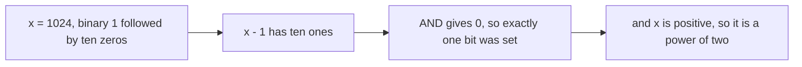
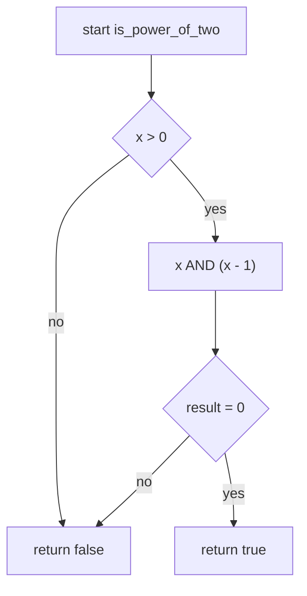
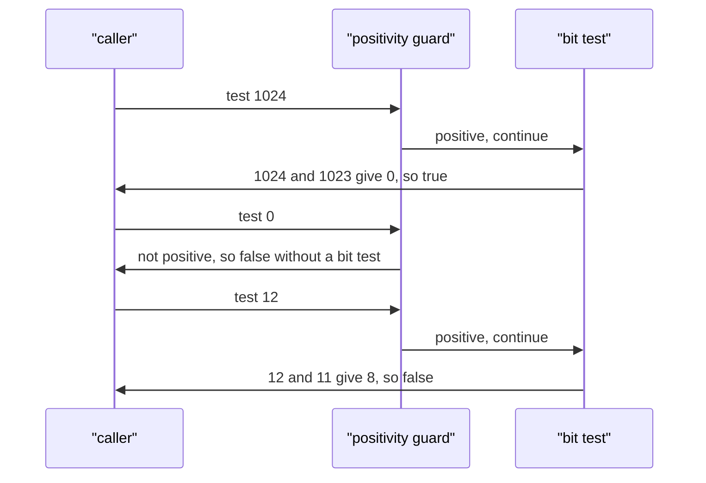

# 029 — Check if integer is power of two.

> **Tier:** Beginner · **CTCI chapter:** Ch 5 — Bit Manipulation
> **Task spec:** [029-check-if-integer-is-power-of-two.md](../../../tasks/beginner/029-check-if-integer-is-power-of-two.md)
> **Solutions:** [Python](../../../solutions/python/beginner/029-check-if-integer-is-power-of-two/solution.py) ·
> [Java](../../../solutions/java/beginner/029-check-if-integer-is-power-of-two/Solution.java) ·
> [JavaScript](../../../solutions/javascript/beginner/029-check-if-integer-is-power-of-two/solution.js) ·
> [C#](../../../solutions/csharp/beginner/029-check-if-integer-is-power-of-two/Solution.cs)

## 1. Problem restatement

**Input:** an integer `x`, possibly zero or negative.

**Output:** `true` if `x` is a power of two — one of `1, 2, 4, 8, 16, …` — and `false` for everything
else. The four files answer with a single boolean expression, with no branch and no loop.

| Call | Binary | Result | Why |
| --- | --- | --- | --- |
| `is_power_of_two(1)` | `1` | `true` | `2⁰`; there is no loop to run, only a test |
| `is_power_of_two(1024)` | `1 0000 0000 00` | `true` | `2¹⁰`, exactly one bit set |
| `is_power_of_two(0)` | `0` | `false` | the guard `x > 0` rejects it |
| `is_power_of_two(12)` | `1100` | `false` | `12 = 8 + 4`: two bits set |
| `is_power_of_two(-4)` | `1111 … 1100` | `false` | negative values are rejected by the guard |

The assertions differ slightly across the four files — Python and Java check `0`, `12` **and** `-4`,
while JavaScript and C# check `0` and `12`. The contract is the same everywhere: `x > 0` is part of
the answer, so nothing ≤ 0 is ever a power of two.

## 2. Intuition

The naive approach is to divide repeatedly:

```text
if x < 1 then
    return false
end
while x mod 2 = 0 do
    x ← x / 2
end
return x = 1
```

This is correct and takes O(log x) iterations — for a 32-bit input, up to 31 divisions. It also
quietly answers a slightly harder question than asked: it "peels" the factor of two out, which is
useful if you also need the exponent.

The insight is that peeling is unnecessary once you look at the binary form. A power of two in base
2 is a single `1` followed by zeros:

    1      = 0001
    2      = 0010
    4      = 0100
    8      = 1000
    1024   = 0000 0100 0000 0000

Every integer is a sum of distinct powers of two, so "is `x` a single power of two?" is exactly
"does the binary expansion of `x` contain exactly one set bit?". That reframes a loop over
divisions into a test on the bit pattern — and task 028 supplies the tool: **`x & (x - 1)` clears
the lowest set bit**. If clearing it leaves zero, there was only one bit to begin with.

    x        = 1024  = 0b10000000000
    x - 1    = 1023  = 0b01111111111
    x & (x-1)= 0     → exactly one set bit

    x        = 12    = 0b1100
    x - 1    = 11    = 0b1011
    x & (x-1)= 8     = 0b1000  ≠ 0 → more than one set bit

The `x > 0` guard is not decoration. `x = 0` also satisfies `x & (x - 1) == 0` (both sides are zero),
so without the guard the function would report that zero is a power of two. And every negative
32-bit value has its sign bit set along with whatever other bits its pattern carries, so all of them
have either many bits or — in the single case of `MIN_VALUE`, `0x80000000` — one bit but a negative
sign. That case is exactly why the guard has to be a *positivity* test rather than a bit-count test.



## 3. Algorithm

1. Reject non-positive `x`: if `x ≤ 0`, return `false`.
2. Compute `x & (x - 1)`, which clears the lowest set bit.
3. Return `true` if the result is `0` — meaning there was exactly one set bit — and `false`
   otherwise.

```text
procedure is_power_of_two(x)
    if x ≤ 0 then
        return false
    end
    return (x AND (x - 1)) = 0
end
```

That is the entire algorithm: one comparison and one bitwise expression, no loop. The four files
write it identically — `x > 0 && (x & (x - 1)) == 0` — with the only language differences being
Python's `and` and JavaScript's `===`.

The expression is deliberately short-circuiting in all four languages: `x > 0` is evaluated first,
so the bitwise part never runs for `0` or negatives. That matters only for readability here (the
bitwise part is harmless for every input), but it makes the intent clear: positivity first, then the
single-bit test.



## 4. Worked example

Trace `is_power_of_two(1024)`, then `is_power_of_two(12)`, then the two rejected inputs:

| Input | `x > 0` | `x - 1` | `x & (x - 1)` | verdict | reason |
| --- | --- | --- | --- | --- | --- |
| `1024` | true | `1023` | `0` | `true` | the only set bit was cleared |
| `1` | true | `0` | `0` | `true` | one bit at position 0 |
| `12` | true | `11` | `8` | `false` | `8` survived: a second bit was set |
| `0` | **false** | `-1` | `0` | `false` | rejected by the guard, even though the bit test passes |
| `-4` | **false** | `-5` | `-8` | `false` | rejected by the guard; the pattern has three low bits plus the sign |

Row 4 is the reason the expression is written `x > 0 && …` rather than `x != 0 && …`: zero passes
the bit test, so the guard must not be skipped.



The division-based version reaches the same verdicts by a different route, which is a useful
cross-check:

| Input | divisions by two | quotient when odd | verdict |
| --- | --- | --- | --- |
| `1024` | 10 | `1` | `true` |
| `12` | 2 | `3` | `false` |
| `1` | 0 | `1` | `true` |
| `0` | — | rejected up front | `false` |

## 5. Complexity

| Measure | Bound | Why it holds |
| --- | --- | --- |
| Time, best | O(1) | two operations for every input; there is no input-dependent loop |
| Time, average | O(1) | one comparison, one subtraction, one AND |
| Time, worst | O(1) | nothing iterates, so the width of the integer does not even appear |
| Space, extra | O(1) | the expression is evaluated in registers |
| Alternative: repeated halving | O(log x) time, O(1) space | up to 31 iterations for a 32-bit input |
| Alternative: `x & -x == x` | O(1) | the same idea in a different guise: `-x` is the two's-complement negation, which isolates the lowest set bit; if that isolated bit equals `x`, there is only one |
| Recursion depth | O(1) | no recursion |

The bit test wins on the constant factor, but the honest framing is that both are "constant time"
for any fixed-width integer — 31 iterations of a division is still fast. The real product of this
task is the *identity*, not the speedup: `x & (x - 1)` is the reusable primitive, and 029 is where
it turns into a predicate.

## 6. Pitfalls and edge cases

- **Zero.** `0 & (0 - 1)` is `0`, so the bit test alone would wrongly answer `true`. The `x > 0` guard
  is mandatory, and all four files assert the row.
- **`MIN_VALUE`.** In Java and C#, `Integer.MIN_VALUE` is `0x80000000`, which has exactly one set bit,
  so `(x & (x - 1)) == 0` holds for it. Only the positivity guard rejects it — a good illustration
  of why "one set bit" and "power of two" are not the same question on signed types.
- **All other negatives.** `-4` is `0xFFFFFFFC`, whose complement-style pattern has many bits set,
  so the bit test fails too; but the guard rejects it first, which is what the assertion checks.
- **One.** `1 = 2⁰` is a power of two, and it is the only power with an odd value. The algorithm
  handles it naturally (`1 - 1 = 0`, `1 & 0 = 0`).
- **JavaScript's 32-bit truncation.** Bitwise operators in JavaScript coerce their operands to
  signed 32-bit integers, so `is_power_of_two(2³²)` sees `0` and returns `false`, and
  `is_power_of_two(2³¹)` sees a negative value after coercion. The four files compare like for like
  only within the 32-bit range; Python's unbounded integers behave differently for larger inputs.
- **Python's unbounded integers.** For Python, `is_power_of_two(2**100)` correctly returns `true`,
  because `2**100 & (2**100 - 1)` is exactly `0`. Any test suite that pins Python and JavaScript to
  the same answers must therefore stay inside 32 bits.
- **Float inputs.** A non-integer argument makes the bitwise operators throw in Python and coerce to
  `0` in JavaScript. The task's input is an integer.
- **Precedence.** `x & (x - 1) == 0` without parentheses binds `==` first in C-like languages and
  compares bit-by-bit results surprisingly; all four files parenthesise the AND.
- **Alternative expression ordering.** `(x & (x - 1)) == 0 && x > 0` is logically identical, and the
  short-circuit order in the files is the reverse purely for readability.

## 7. Variants and follow-ups

- **The primitive itself.** [028-count-number-of-set-bits-in-an-integer.md](../../../tasks/beginner/028-count-number-of-set-bits-in-an-integer.md)
  explains why `x & (x - 1)` clears the lowest set bit; this task is that identity used as a test
  instead of a loop.
- **The next power of two.** Rounding up to a power of two uses the same family of bit tricks
  (spreading the highest bit across the lower ones with shifts), and is the natural follow-up
  question.
- **Parity and divisibility.**
  [032-check-prime-number-naive.md](../../../tasks/beginner/032-check-prime-number-naive.md) is the
  other "is this integer special?" loop in Ch 6, and it begins by ruling out even numbers.
- **Digit-wise twins.** [030-reverse-digits-of-an-integer.md](../../../tasks/beginner/030-reverse-digits-of-an-integer.md)
  and [031-palindrome-number-check-without-string-conversion.md](../../../tasks/beginner/031-palindrome-number-check-without-string-conversion.md)
  peel base-10 digits the way this task inspects bits.
- The chapter walkthrough in [Bit Manipulation](../../ctci/05-bit-manipulation.md) develops the
  `x & (x - 1)`, `x ^ x` and negation identities that this task and 028 exercise.

## 8. Check yourself

1. Why is `x > 0` necessary when the bit test already says "exactly one bit is set"?

<details><summary>Show answer</summary>

Because `0 & (0 - 1)` is `0`, so zero satisfies the bit test while not being a power of two — every
power of two is positive. The positivity test is also what rejects `Integer.MIN_VALUE` in Java and
C#, which genuinely has exactly one set bit in its 32-bit pattern.

</details>

2. What does `is_power_of_two(-4)` do in each of the two steps?

<details><summary>Show answer</summary>

The guard `x > 0` is false, so the function returns `false` before the bit test runs. For the record,
the bit test would also fail: `-4 & -5` is `-8`, not `0`, because the two's-complement pattern of a
negative number has the sign bit plus the inverted magnitude, so more than one bit is set.

</details>

3. How many iterations does the halving version need for `1024`, and for which input is the bit
   test dramatically better?

<details><summary>Show answer</summary>

Halving needs 10 iterations for `1024` (10 divisions until the value reaches `1`). The bit test
always uses one subtraction and one AND. The worst case for halving is a large power of two such as
`2³⁰` with 30 iterations, versus the same fixed cost for the bit test.

</details>

4. Does `is_power_of_two(2³²)` return the same answer in Python and JavaScript?

<details><summary>Show answer</summary>

No. Python's integers are unbounded, so `2³² & (2³² - 1)` is `0` and the answer is `true`.
JavaScript's bitwise operators coerce to 32-bit signed, so `2³²` becomes `0`, the guard `x > 0` is
tested on the original double (`2³² > 0` is true) but the AND is performed on the coerced `0`,
giving `true` only by accident of the coercion — and `2³¹` is coerced to a negative value, so the
And produces a negative result and the answer is `false`. Keep inputs inside 32 bits when comparing
implementations.

</details>

5. Write the same predicate using `x & -x`. Why does it work?

<details><summary>Show answer</summary>

`x > 0 && (x & -x) == x`. Negating `x` in two's complement flips every bit and adds one, which
isolates the lowest set bit of `x`; so `x & -x` is the lowest set bit as a value. It equals `x`
exactly when there is only one bit, and the `x > 0` guard handles zero and negatives, where the
negation behaves differently.

</details>
