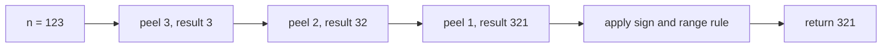
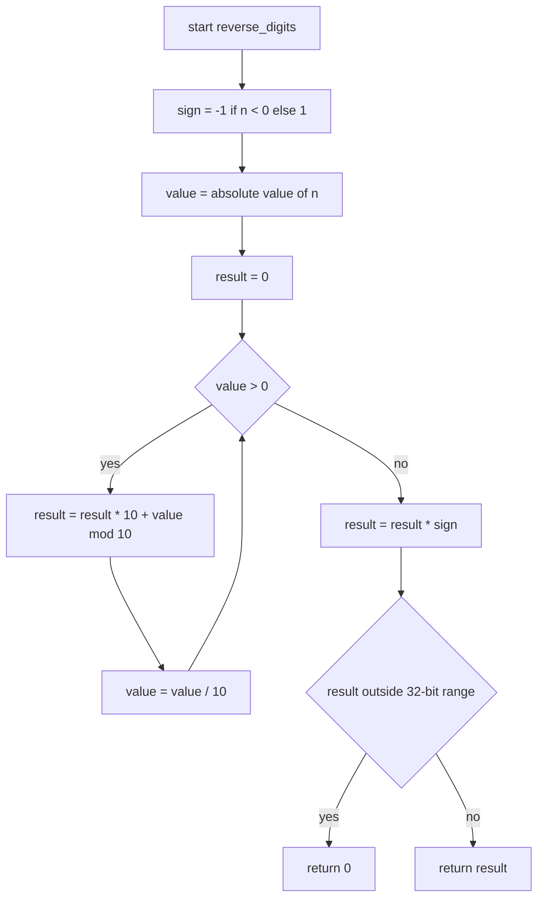
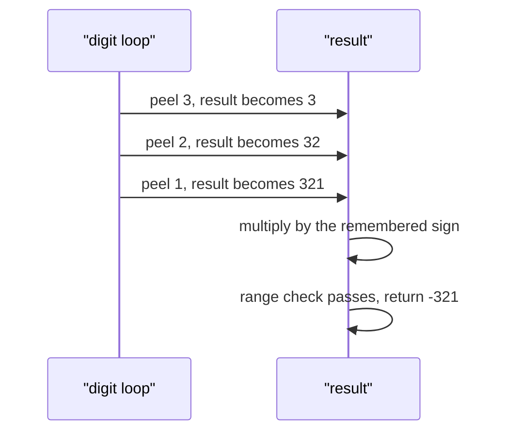

# 030 — Reverse digits of an integer.

> **Tier:** Beginner · **CTCI chapter:** Ch 6 — Math and Logic
> **Task spec:** [030-reverse-digits-of-an-integer.md](../../../tasks/beginner/030-reverse-digits-of-an-integer.md)
> **Solutions:** [Python](../../../solutions/python/beginner/030-reverse-digits-of-an-integer/solution.py) ·
> [Java](../../../solutions/java/beginner/030-reverse-digits-of-an-integer/Solution.java) ·
> [JavaScript](../../../solutions/javascript/beginner/030-reverse-digits-of-an-integer/solution.js) ·
> [C#](../../../solutions/csharp/beginner/030-reverse-digits-of-an-integer/Solution.cs)

## 1. Problem restatement

**Input:** a signed 32-bit integer `n`.

**Output:** the integer whose decimal digits are those of `n` in the opposite order, with the sign
preserved. If the reversed value does not fit in a signed 32-bit integer, the functions return `0`
instead — the same clamping convention Java and JavaScript's `parseInt` ecosystem uses.

| Call | Result | Why |
| --- | --- | --- |
| `reverse_digits(123)` | `321` | three digits, reversed |
| `reverse_digits(-123)` | `-321` | the sign is not a digit, so it is remembered and re-applied |
| `reverse_digits(0)` | `0` | the loop body never runs and the result stays zero |
| `reverse_digits(1534236469)` | `0` | the reversal is `9646324351`, past `2³¹ − 1`, so it clamps |
| `reverse_digits(120)` | `21` | the trailing zero becomes a leading zero, which integers do not keep |

The overflow row is asserted by the Python, Java and C# files and is the only reason this task
carries a range rule at all. `1534236469` is a legal signed 32-bit value (it is below `2147483647`),
but its digit reversal is not, so the answer is defined to be `0`. The `120` row is not asserted by
any file; it follows from the algorithm and shows why an integer reversal is not a text reversal —
the leading zero simply disappears.

## 2. Intuition

The naive approach converts to text, reverses the string, and parses it back:

    n → "123" → "321" → 321

That works in three library calls and it is why this task exists as a *manual* exercise: the
chapter wants to see the arithmetic, and the string route needs extra care with the minus sign
(the sign must be stripped before reversing and re-attached afterwards, otherwise `-123` becomes
`321-`).

The arithmetic route reuses the idea from
[018-convert-integer-to-string.md](../../../tasks/beginner/018-convert-integer-to-string.md), but with
the reversal *built into the accumulation* instead of being repaired afterwards. Peeling a digit is
`n % 10`; appending a digit to a value is `value * 10 + digit`. So the digits come out of the source
in reverse order and are pushed onto the result in that same order:

    n = 123
    peel 3  →  result = 0 * 10 + 3 = 3
    peel 2  →  result = 3 * 10 + 2 = 32
    peel 1  →  result = 32 * 10 + 1 = 321

No buffer, no reversal pass, one loop. The `* 10` is what shifts the digits already collected one
place to the left, and the `+ digit` is what places the newly peeled digit in the units position.
That is the whole insight: **the multiply-and-add fold appends, and appending to the tail while
peeling from the tail reverses.**

The sign is handled the way task 017 handles it: strip it up front, work with a non-negative value,
re-apply it at the end. That also keeps the peeling arithmetic free of negative remainders — some
languages give `-123 % 10 = -3`, which would corrupt the accumulated value.



## 3. Algorithm

1. Remember the sign of `n` and take the absolute value.
2. Set `result = 0`.
3. While the remaining value is non-zero:
   - `result ← result * 10 + (value mod 10)` — append the new digit;
   - `value ← value / 10` — drop it from the source, with integer division.
4. Apply the sign to `result`.
5. If `result` falls outside `−2³¹ .. 2³¹ − 1`, return `0`; otherwise return `result`.

```text
procedure reverse_digits(n)
    sign ← -1 if n < 0 else 1
    value ← absolute value of n
    result ← 0
    while value > 0 do
        result ← result * 10 + (value mod 10)
        value ← value / 10
    end
    result ← result * sign
    if result < -2147483648 or result > 2147483647 then
        return 0
    end
    return result
end
```

Two implementation details are worth calling out because they differ between the files, and neither
changes the result:

- **Widened accumulator.** Java and C# accumulate into a `long` (`long result`) so that the
  intermediate reversal of a value near `Integer.MAX_VALUE` does not wrap before the range check
  runs. Python's integers are already unbounded, and JavaScript's doubles hold every 32-bit
  reversal exactly (the largest possible intermediate is `9646324351`, far below `2⁵³`).
- **Signed peeling.** Java, C# and Python *can* peel a negative value (Java's `/` truncates toward
  zero, Python's `//` floors, so `-123 // 10` is `-13` with remainder `7` — the digits still come
  out in the right order but the remainder is positive, so the arithmetic differs). The files avoid
  that whole discussion by working on `abs(n)` and re-applying the sign.

Step 5 is a clamp, not an error: every file returns `0` for out-of-range reversals, which is why the
`1534236469` assertion is a plain equality.



## 4. Worked example

Trace `reverse_digits(-123)`. The sign is peeled off first, so the loop works on `123`:

| Step | `value` | `value mod 10` | `result` before | `result` after |
| --- | --- | --- | --- | --- |
| start | 123 | — | 0 | 0 |
| 1 | 123 | 3 | 0 | `0 * 10 + 3 = 3` |
| 2 | 12 | 2 | 3 | `3 * 10 + 2 = 32` |
| 3 | 1 | 1 | 32 | `32 * 10 + 1 = 321` |
| 4 | 0 | — | 321 | loop exits |
| sign | — | — | 321 | `321 * -1 = -321` |
| range | — | — | — | `-321` is inside the range, return it |

The accumulator column is the reversal: after each step the digits collected so far sit in reversed
order, and the next multiply pushes them further left.



The overflow row is the same loop with a wide accumulator and a reject step:

| Step | `value` | digit | `result` after |
| --- | --- | --- | --- |
| start | 1534236469 | — | 0 |
| 1 | 1534236469 | 9 | 9 |
| 2 | 153423469 | 6 | 96 |
| 3 | 15342346 | 4 | 964 |
| … | … | … | … |
| 10 | 0 | 1 | `9646324351` |
| range | — | — | `9646324351 > 2147483647`, return `0` |

In Java and C# the running value is a `long`, so `9646324351` is representable and the comparison
against `Integer.MAX_VALUE` is meaningful. Accumulating into an `int` would have wrapped somewhere
around step 9 and produced a negative number that passes the range check by accident.

## 5. Complexity

Let `d` be the number of decimal digits of `n`, so `d ≤ 10` for a 32-bit input.

| Measure | Bound | Why it holds |
| --- | --- | --- |
| Time, best | O(1) | `n = 0` skips the loop |
| Time, average | O(d) | one division, one multiply-add and one modulo per digit |
| Time, worst | O(d) | the loop runs exactly once per digit; `d = 10` for `Integer.MAX_VALUE` |
| Space, extra | O(1) | three integer variables; no buffer for the digits |
| Alternative: string conversion | O(d) time, O(d) space | and needs explicit sign handling |
| Alternative: collect digits then rebuild | O(d) time, O(d) space | exactly what the fold avoids |
| Recursion depth | O(1) | iterative |

Because `d ≤ 10` for a 32-bit integer, all four implementations are effectively constant time and
the space question is the real difference: the fold uses three scalars where the string version
allocates a buffer of `d` characters plus the string itself.

## 6. Pitfalls and edge cases

- **Zero.** The loop condition is `value > 0`, so `n = 0` performs no iterations and `result` stays
  `0`; the sign multiplication is harmless (`0 * -1 = 0`).
- **Negative inputs and remainders.** `-123 % 10` is `-3` in Java, C# and JavaScript, and `7` in
  Python (`//` floors). Stripping the sign first with `abs` removes the discrepancy entirely.
- **Trailing zeros.** `120` reverses to `21`, not `021`: the leading zero of a numeral is not
  stored. This is the difference between reversing digits and reversing text.
- **Overflow, and where it can bite.** `1534236469` reverses to `9646324351`, which is outside the
  signed 32-bit range, so the answer is `0`. The check must happen *after* the loop, on the complete
  value, and the accumulator must be wide enough to reach it (a `long` in Java and C#, Python's
  unbounded `int`, a JavaScript double).
- **No overflow happens mid-loop in a wider type.** The largest 32-bit reversal, `9646324351`, needs
  34 bits, which is why a 64-bit accumulator suffices.
- **Applying the sign twice.** The sign is re-applied once, by multiplication at the end. Folding
  the sign into the loop (negating each digit) would produce a different, wrong value.
- **Truncating division in JavaScript.** `value / 10` is floating-point, so `Math.floor` is required;
  the shipped file uses `Math.floor(value / 10)`.
- **`MIN_VALUE`.** `-2147483648` reverses to `-8463847412`, which is outside the range, so the answer
  is `0`. Java's `long` accumulator represents it correctly before the range check rejects it.
- **Return `0` is indistinguishable from a genuine reversal of `0`.** That is inherent in the
  clamping convention; a caller that needs to distinguish the two cases must check the input first.
- **No digit-count shortcut.** You cannot decide overflow from the leading digit alone in general,
  because the threshold depends on the whole value — the range check after the loop is both simpler
  and exact.

## 7. Variants and follow-ups

- **The string twin.** [018-convert-integer-to-string.md](../../../tasks/beginner/018-convert-integer-to-string.md)
  uses the same `% 10` / `/ 10` peel but keeps every digit in a buffer and reverses it, which is the
  version you write when you need the digits themselves.
- **Comparing instead of returning.**
  [031-palindrome-number-check-without-string-conversion.md](../../../tasks/beginner/031-palindrome-number-check-without-string-conversion.md)
  reverses the digits with this loop and compares the result to the original, which is how you test
  a palindrome without touching a string.
- **Overflow on the way in.** [017-convert-string-to-integer-atoi-basic.md](../../../tasks/beginner/017-convert-string-to-integer-atoi-basic.md)
  is the inverse conversion, and it is the task that deliberately *omits* the range check this one
  performs.
- **Range-bounded arithmetic in other bases.** [028-count-number-of-set-bits-in-an-integer.md](../../../tasks/beginner/028-count-number-of-set-bits-in-an-integer.md)
  is the same peel-and-fold pattern in base 2, where the "digit" is a single bit.
- The chapter walkthrough in [Math and Logic](../../ctci/06-math-and-logic.md) places this task with
  the digit-arithmetic family of Ch 6.

## 8. Check yourself

1. Why does the loop peel digits with `% 10` and append with `* 10 + digit` instead of two separate
   passes?

<details><summary>Show answer</summary>

Because the two operations compose: peeling produces the digits in the opposite order, and
`result = result * 10 + digit` appends to the least significant end, which is exactly the order the
digits arrive. The reversal is a consequence of the accumulation, so no buffer and no second pass
are needed.

</details>

2. What does `reverse_digits(-123)` do before it touches any digits?

<details><summary>Show answer</summary>

It records `sign = -1` and replaces the value with `abs(n) = 123`, so the loop only ever sees a
non-negative number. That avoids negative remainders (`-123 % 10` is `-3` in Java, C# and
JavaScript but `7` in Python) and lets the sign be re-applied once at the end.

</details>

3. `120` reverses to `21`. Where did the zero go?

<details><summary>Show answer</summary>

Into the leading position of the reversed numeral, where integers do not store it: the reversal of
the digit sequence is `021`, and `021` as an integer is `21`. Trailing zeros of the input are always
lost; only a string-based reversal would keep them.

</details>

4. Why must the range check come after the loop rather than inside it?

<details><summary>Show answer</summary>

Because the check decides whether the *final* value fits in 32 bits, and the final value is not known
until the last digit is appended. Checking partial results would need the threshold for the
remaining digits, which depends on the digit count — more code for the same decision. Accumulating
in a wider type and comparing once at the end is exact and simple.

</details>

5. Why do Java and C# accumulate into a `long` while Python and JavaScript do not?

<details><summary>Show answer</summary>

Java and C# integers are 32 bits, and the reversal of a value near `Integer.MAX_VALUE` needs up to
34 bits, so an `int` accumulator would wrap before the range check could see the true value. A
`long` holds it. Python's integers have no fixed width, and JavaScript's doubles are exact for
integers below `2⁵³`, which comfortably covers the largest possible reversal `9646324351`.

</details>
