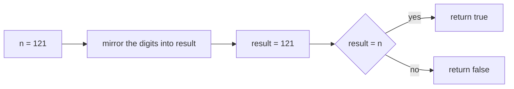
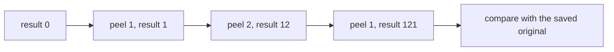
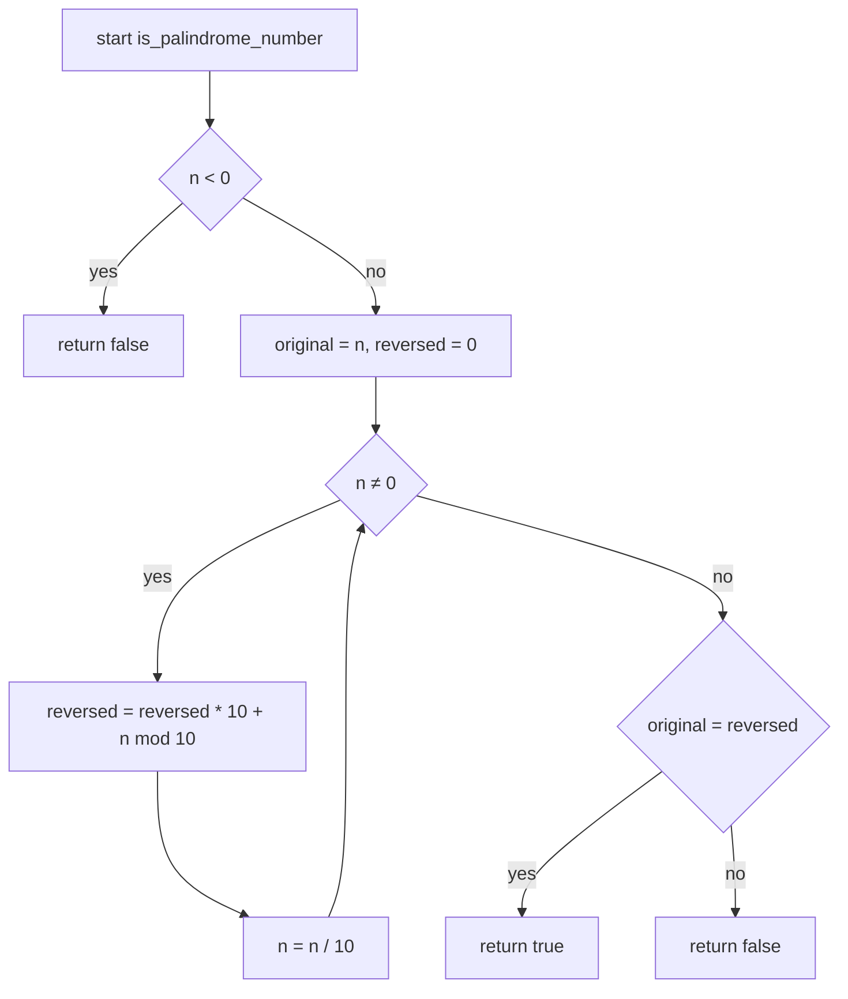
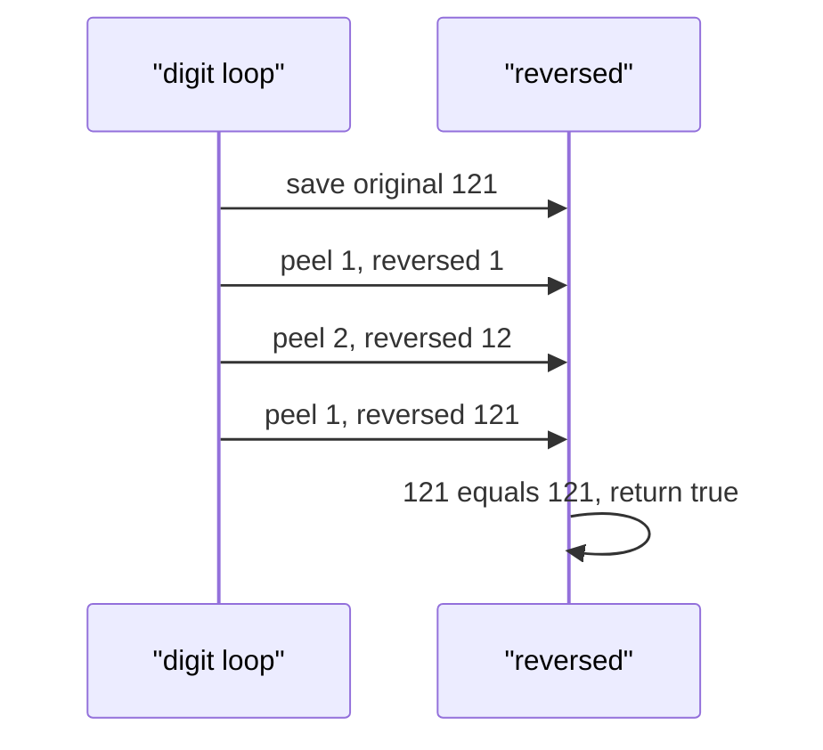

# 031 — Palindrome number check (without string conversion).

> **Tier:** Beginner · **CTCI chapter:** Ch 6 — Math and Logic
> **Task spec:** [031-palindrome-number-check-without-string-conversion.md](../../../tasks/beginner/031-palindrome-number-check-without-string-conversion.md)
> **Solutions:** [Python](../../../solutions/python/beginner/031-palindrome-number-check-without-string-conversion/solution.py) ·
> [Java](../../../solutions/java/beginner/031-palindrome-number-check-without-string-conversion/Solution.java) ·
> [JavaScript](../../../solutions/javascript/beginner/031-palindrome-number-check-without-string-conversion/solution.js) ·
> [C#](../../../solutions/csharp/beginner/031-palindrome-number-check-without-string-conversion/Solution.cs)

## 1. Problem restatement

**Input:** an integer `n`.

**Output:** `true` if the decimal representation of `n` reads the same forwards and backwards, and
`false` otherwise. The constraint in the title is part of the contract: no string conversion, no
`toString`, no digit array.

| Call | Result | Why |
| --- | --- | --- |
| `is_palindrome_number(121)` | `true` | the digits mirror around the middle `2` |
| `is_palindrome_number(-121)` | `false` | the representation is `-121`, and `121-` is not a number |
| `is_palindrome_number(0)` | `true` | a single digit is its own mirror (asserted by Python, Java and C#) |
| `is_palindrome_number(123)` | `false` | `321 ≠ 123` (asserted by Python, Java and JavaScript) |
| `is_palindrome_number(10)` | `false` | `01` is not `10` — trailing zeros break the mirror |

The negative row is not about digits at all: `-121` reversed is `121-`, which is not a valid
numeral, and every file short-circuits with `if (n < 0) return false` before any arithmetic. The
`10` row is the case people get wrong by intuition — the reversal of `10` is `1`, and `1 ≠ 10`, so
the answer is `false`.

## 2. Intuition

The obvious approach is textual: convert to a string, compare it with its reverse, and return the
verdict. It is O(d) time and trivially correct, and the task bans it — as does many an interview,
because the string version hides the two things being tested: how to mirror a number arithmetically,
and how to notice the sign trap.

The digit-level insight comes straight from
[030-reverse-digits-of-an-integer.md](../../../tasks/beginner/030-reverse-digits-of-an-integer.md):
peel digits with `% 10` and append them with `result * 10 + digit`. The loop's output *is* the
mirror image of the input's digits, so

    palindrome(n)  ⟺  n == reverse_digits(n)

and the two tasks differ only in what they do with the reversed value: 030 returns it (with a range
clamp), this task compares it with the original.

Two refinements make the check robust rather than merely short:

- **Reject negatives first.** For `n < 0` the reversal does `abs` and re-applies the sign, giving
  `-121` for `-121` — which would compare *equal* and report `true`! The shipped files avoid that
  wrong answer with an explicit `n < 0 → false` guard, and they express the reason in the title of
  the row: the `-` sign has no mirror partner on the right.
- **Compare with a widened accumulator.** You must keep the original `n` for the comparison, because
  the loop destroys its copy. The loop rebuilds the digits in reverse, and for a ten-digit input that
  rebuilt value can exceed `2³¹ − 1` — for example `1999999999` reverses to `9999999991`. Java and
  C# therefore accumulate into a `long` (and compare `int` against `long`), while Python and
  JavaScript need no special handling.

The alternative refinement — reversing only *half* the digits and stopping when the reversed half
reaches the remaining value — halves the work and needs no widened type at all, because the reversed
half never exceeds the number of digits it came from. The four files do not use it; keeping it in
mind explains why the full reversal needs the wider type.



The mirror itself is the same accumulator picture as task 030:



## 3. Algorithm

1. If `n` is negative, return `false` immediately.
2. Save `original = n` — the loop is about to consume its copy.
3. Set `reversed = 0`.
4. While `n` is non-zero:
   - `reversed ← reversed * 10 + (n mod 10)`;
   - `n ← n / 10` with integer division.
5. Return `original = reversed`.

```text
procedure is_palindrome_number(n)
    if n < 0 then
        return false
    end
    original ← n
    reversed ← 0
    while n ≠ 0 do
        reversed ← reversed * 10 + (n mod 10)
        n ← n / 10
    end
    return original = reversed
end
```

Step 1 is the only branch in the function, and it is not an optimisation — it is a correctness
requirement, because the sign-preserving reversal of `-121` is `-121`, which would compare equal.
Step 2 is what makes step 5 possible: `n` becomes `0` by the end of the loop, so the original value
must be captured before the first iteration.

The loop itself has no early exit: even a first-digit mismatch is only discovered after all `d`
digits have been rebuilt, because the comparison happens once, at the end. That is the price of the
"reverse then compare" formulation, and it is exactly what the half-reversal variant avoids by
comparing as it goes. With `d ≤ 10` for a 32-bit integer the price is invisible, which is why the
simpler formulation is the one that shipped.



## 4. Worked example

Trace `is_palindrome_number(121)`. The original is saved before the loop, and the loop consumes its
own copy of `n`:

| Step | `n` | `n mod 10` | `reversed` after | `original` |
| --- | --- | --- | --- | --- |
| start | 121 | — | 0 | 121 |
| 1 | 121 | 1 | `0 * 10 + 1 = 1` | 121 |
| 2 | 12 | 2 | `1 * 10 + 2 = 12` | 121 |
| 3 | 1 | 1 | `12 * 10 + 1 = 121` | 121 |
| 4 | 0 | — | loop exits | 121 |
| compare | — | — | 121 | 121 → `true` |

By step 3 the accumulator has walked all the way around the mirror and landed back on the starting
value. That is the visual meaning of a palindrome in this representation: the fold is a rotation of
the digit sequence that returns to its origin.



The failing and edge rows use the same loop with a different final comparison:

| Input | negative guard | `reversed` | comparison | verdict |
| --- | --- | --- | --- | --- |
| `-121` | returns early | — | not reached | `false` |
| `123` | passes | 321 | `123 = 321` false | `false` |
| `0` | passes | 0 (loop never runs) | `0 = 0` true | `true` |
| `10` | passes | 1 | `10 = 1` false | `false` |
| `7` | passes | 7 | `7 = 7` true | `true` |
| `1221` | passes | 1221 | true | `true` |

The `0` row is worth noting: the loop condition is a pre-test `while n ≠ 0`, so a zero input performs
no iterations and the initial `reversed = 0` already equals the original.

## 5. Complexity

Let `d` be the number of decimal digits of `n`, so `d ≤ 10` for a 32-bit input.

| Measure | Bound | Why it holds |
| --- | --- | --- |
| Time, best | O(1) | `n < 0` returns immediately; `n = 0` skips the loop |
| Time, average | O(d) | one modulo and one division per digit, plus the final comparison |
| Time, worst | O(d) | the loop always runs to completion — no early mismatch exit |
| Space, extra | O(1) | three scalars: `original`, `n`, `reversed` |
| Space, input | untouched | the value is a copy; nothing is mutated |
| Alternative: string reversal (banned) | O(d) time, O(d) space | the exact approach the task forbids |
| Alternative: half reversal | O(d / 2) time, O(1) space | compares digits as they are produced and needs no widened type |
| Recursion depth | O(1) | iterative |

The half-reversal variant is the interesting comparison because it changes the *shape* of the
algorithm, not just its constant: it stops as soon as the reversed part and the remaining part
overlap (with a final `/ 10` for odd digit counts), so it can return `false` at the first mismatch
and it never builds a value larger than the input. Both are O(d); both are O(1) space.

## 6. Pitfalls and edge cases

- **Negative numbers.** They must be rejected before any reversal, because the sign-preserving
  reversal of `-121` is `-121` and would compare equal. All four files guard with `n < 0` first and
  assert the `-121` row.
- **Zero.** `0` is a palindrome: the loop never runs and `reversed` starts at `0`. Asserted by
  Python, Java and C#.
- **Single digit.** Every one-digit number is a palindrome, including `7` and `9`. The loop runs
  once and `reversed` equals the input.
- **Trailing zeros.** `10` reverses to `1`, so it is not a palindrome; `100` reverses to `1` as well.
  A number ending in `0` can only be a palindrome if it *is* `0`, because a palindrome's leading
  digit cannot be zero.
- **Overflow of the reversal.** For `1999999999` the reversal is `9999999991`, past `2³¹ − 1`. Java
  and C# accumulate into a `long` and compare `int` with `long`; a plain `int` accumulator would wrap
  and could compare equal by accident. Python and JavaScript are unaffected.
- **Saving the original.** `n` is zeroed by the loop, so the comparison must use a saved copy —
  `reversed = n` after the loop would compare `0` with `0` for every input and return `true` always.
- **No early exit.** The full reversal cannot detect a mismatch until every digit has been processed.
  For performance on long inputs the half-reversal variant is the fix.
- **Comparing digits is not comparing characters.** `1210` is not a palindrome even though it starts
  and ends with the same digit twice; the algorithm compares the whole value, so the trailing zero
  ruins it.
- **JavaScript division.** `n / 10` is floating point, so the file floors it with `Math.floor`; the
  loop condition is `n > 0`, which is safe because the negative case was rejected up front.
- **Loops with `while n`.** Python's file writes `while n:` which is truthiness on an integer — fine
  for non-negative `n`, and `n` cannot be negative here because of the guard.

## 7. Variants and follow-ups

- **Reverse and return.** [030-reverse-digits-of-an-integer.md](../../../tasks/beginner/030-reverse-digits-of-an-integer.md)
  is the same loop with a range clamp instead of a comparison, and it is where the overflow of the
  full reversal becomes visible.
- **The string version.** [002-check-if-a-string-is-a-palindrome.md](../../../tasks/beginner/002-check-if-a-string-is-a-palindrome.md)
  checks a palindrome textually with two pointers and an early exit, which is the technique the
  half-reversal variant reuses for numbers.
- **The other direction of the conversion.** [018-convert-integer-to-string.md](../../../tasks/beginner/018-convert-integer-to-string.md)
  and [017-convert-string-to-integer-atoi-basic.md](../../../tasks/beginner/017-convert-string-to-integer-atoi-basic.md)
  build the digit sequence explicitly, which is what you would need if the task asked you to *show*
  the mirror instead of testing it.
- **Bit-level mirrors.** [028-count-number-of-set-bits-in-an-integer.md](../../../tasks/beginner/028-count-number-of-set-bits-in-an-integer.md)
  and [029-check-if-integer-is-power-of-two.md](../../../tasks/beginner/029-check-if-integer-is-power-of-two.md)
  inspect the binary mirror of an integer, where the "digits" are bits and the base is 2.
- The chapter walkthrough in [Math and Logic](../../ctci/06-math-and-logic.md) puts this task with
  the digit-arithmetic family of Ch 6.

## 8. Check yourself

1. Why is `-121` rejected before the reversal, when `121` is accepted?

<details><summary>Show answer</summary>

Because the minus sign has no counterpart at the other end of the numeral: the sequence of characters
is `-121`, and reading it backwards gives `121-`, which is not a number. The arithmetic reversal
would *also* fail to detect this, because the shipped one strips the sign, reverses `121` to `121`,
and re-applies the negative — giving `-121`, which compares equal to the input. Hence the explicit
`n < 0 → false` guard.

</details>

2. What does `is_palindrome_number(10)` return, and why is that not surprising once you look at the
   digits?

<details><summary>Show answer</summary>

`false`. The reversal of `10` is `1` (the trailing zero moves into the leading position, where it
is not stored), and `1 ≠ 10`. Any positive number ending in `0` fails for the same reason, because a
palindrome whose first digit is non-zero cannot end in zero.

</details>

3. Why do Java and C# accumulate `reversed` in a `long`?

<details><summary>Show answer</summary>

Because the reversal of a ten-digit value near `2³¹ − 1` can exceed the `int` range — `1999999999`
reverses to `9999999991` — and a 32-bit accumulator would wrap before the comparison, potentially
producing a false positive. A `long` holds any ten-digit reversal, and comparing an `int` with a
`long` promotes the `int` safely.

</details>

4. How many iterations does the loop perform for a ten-digit input, and can it stop early on a
   mismatch?

<details><summary>Show answer</summary>

Exactly ten, one per digit. No: the comparison happens once, after the loop, so a mismatch in the
first digit is only discovered after the whole reversal is built. The half-reversal variant compares
the two sides as it goes and can stop at the first mismatch, which is the reason to prefer it on
longer inputs.

</details>

5. Trace `is_palindrome_number(1221)` with the accumulator table.

<details><summary>Show answer</summary>

`original = 1221`. Step 1 peels `1` → `reversed = 1`; step 2 peels `2` → `reversed = 12`; step 3
peels `2` → `reversed = 122`; step 4 peels `1` → `reversed = 1221`. The loop exits with `n = 0`, the
comparison `1221 = 1221` holds, and the function returns `true`.

</details>
