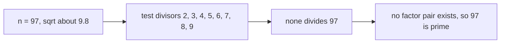
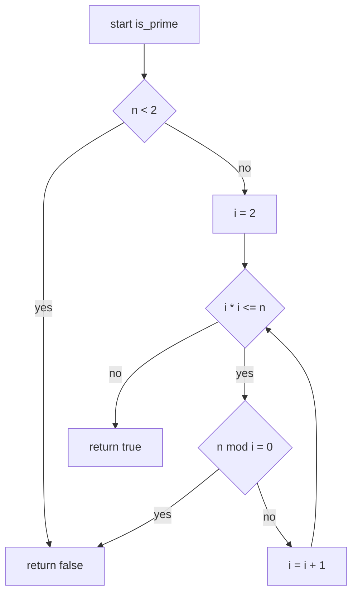
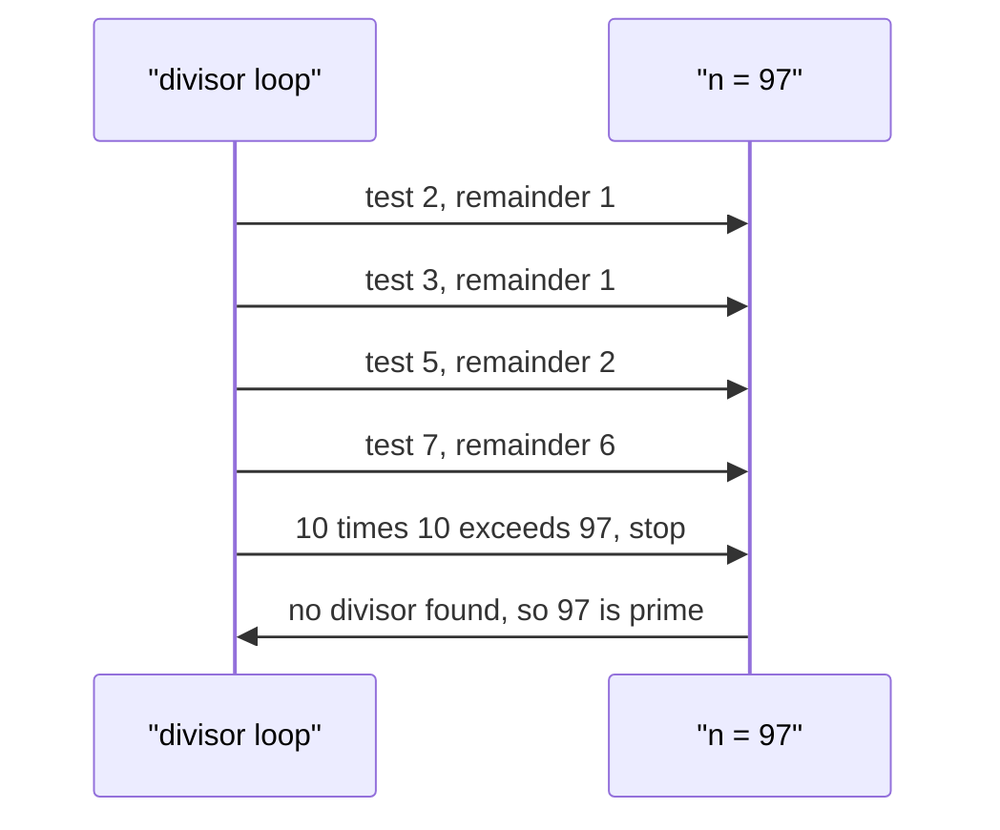

# 032 — Check prime number naive.

> **Tier:** Beginner · **CTCI chapter:** Ch 6 — Math and Logic
> **Task spec:** [032-check-prime-number-naive.md](../../../tasks/beginner/032-check-prime-number-naive.md)
> **Solutions:** [Python](../../../solutions/python/beginner/032-check-prime-number-naive/solution.py) ·
> [Java](../../../solutions/java/beginner/032-check-prime-number-naive/Solution.java) ·
> [JavaScript](../../../solutions/javascript/beginner/032-check-prime-number-naive/solution.js) ·
> [C#](../../../solutions/csharp/beginner/032-check-prime-number-naive/Solution.cs)

## 1. Problem restatement

**Input:** an integer `n`, possibly zero or negative.

**Output:** `true` if `n` is prime — greater than one and divisible only by `1` and itself — and
`false` otherwise.

| Call | Result | Why |
| --- | --- | --- |
| `is_prime(0)` | `false` | the guard `n < 2` rejects it |
| `is_prime(1)` | `false` | `1` has exactly one divisor, so it is not prime by definition |
| `is_prime(2)` | `true` | the smallest prime; the loop body never runs |
| `is_prime(97)` | `true` | no divisor up to `√97 ≈ 9.8` |
| `is_prime(100)` | `false` | divisible by `2`, rejected on the first iteration |

The "naive" in the title refers to *trial division* — testing candidate divisors one at a time,
rather than sieving or using a probabilistic test. It does not mean testing all `n - 2` candidates:
even the naive version stops at `√n`, and that single observation is the algorithm's whole idea.
The two lower-bound rows are the classic interview trap: `1` is not prime, and `0` and negative
inputs are not either, so the guard has to be `n < 2` rather than `n == 1`.

## 2. Intuition

Write the definition literally and you get:

```text
if n < 2 then
    return false
end
for d ← 2 to n - 1 do
    if n mod d = 0 then
        return false
    end
end
return true
```

That is O(n) per query, and it is correct — just wasteful. For `n = 1000003` it performs a million
divisions to answer a question that one division by `2` would not settle but a `√n` scan would.

The insight is about **factor pairs**. If `n` is composite, it can be written as `n = a · b` with
`1 < a ≤ b < n`. The smaller of the two factors is at most the square root:

    a ≤ b  ⟹  a · a ≤ a · b = n  ⟹  a ≤ √n

So a composite number always has a divisor `≤ √n`. It follows that scanning candidates only up to
`√n` is *sufficient*: if none of them divides `n`, then `n` has no factor pair at all and must be
prime. The saving is real — for a 32-bit input the scan shrinks from up to two billion candidates
to at most about 46341 (the integer part of `√(2³¹ − 1)`).

The second half of the insight is how to express that bound in code. `i <= sqrt(n)` works but
introduces floating-point rounding at exactly the boundary that matters, and `i * i <= n` is exact
integer arithmetic — as long as the square does not overflow. In Java and C# the files therefore
declare the candidate as `long i`, because `46341² = 2147488281` is larger than
`Integer.MAX_VALUE = 2147483647` and an `int` square would wrap to a negative number, making the
loop condition true forever or the answer wrong. Python and JavaScript have no such limit here
(Python's integers are unbounded, JavaScript's doubles are exact well past `2⁶⁴`).



## 3. Algorithm

1. If `n < 2`, return `false` — this covers `0`, `1` and every negative input.
2. Let `i = 2`.
3. While `i · i ≤ n`:
   - if `n mod i = 0`, return `false` — the divisor proves `n` is composite;
   - otherwise increment `i`.
4. Return `true`: no divisor at or below `√n` exists.

```text
procedure is_prime(n)
    if n < 2 then
        return false
    end
    i ← 2
    while i * i ≤ n do
        if n mod i = 0 then
            return false
        end
        i ← i + 1
    end
    return true
end
```

The loop bound `i · i ≤ n` is the `√n` cut-off written in integers, and it is evaluated *before* each
test rather than once at the start, so the loop stops as soon as the candidate passes the square
root. `n = 2` and `n = 3` never enter the body at all (`4 > 2`, `4 > 3`), which is why the smallest
primes need no special case beyond the `n < 2` guard.

The loop returns `false` as soon as it finds a divisor and otherwise falls through to `true` after
the last candidate. That gives a large practical asymmetry: composite numbers with small factors
(evens especially) are rejected almost immediately, while prime inputs pay the full `√n` scan. The
`i` in Java and C# is a `long` purely to keep `i * i` from overflowing, as described above.



## 4. Worked example

Trace `is_prime(97)`. The square root is about `9.85`, so the candidates are `2 … 9`:

| Step | `i` | `i * i` | `i * i ≤ 97` | `97 mod i` | action |
| --- | --- | --- | --- | --- | --- |
| 1 | 2 | 4 | yes | 1 | no divisor, step to 3 |
| 2 | 3 | 9 | yes | 1 | no divisor, step to 4 |
| 3 | 4 | 16 | yes | 1 | no divisor, step to 5 |
| 4 | 5 | 25 | yes | 2 | no divisor, step to 6 |
| 5 | 6 | 36 | yes | 1 | no divisor, step to 7 |
| 6 | 7 | 49 | yes | 6 | no divisor, step to 8 |
| 7 | 8 | 64 | yes | 1 | no divisor, step to 9 |
| 8 | 9 | 81 | yes | 7 | no divisor, step to 10 |
| 9 | 10 | 100 | **no** | — | loop exits, return `true` |

Eight divisors tested, and the loop stops one step past the square root. Note that only the primes
among those candidates (`2, 3, 5, 7`) could ever divide `97`; the composite candidates are wasted
work, which is what a wheel or a sieve would remove.



The composite rows show how much cheaper rejection is:

| Input | first candidate that decides | candidate count | verdict |
| --- | --- | --- | --- |
| `0` | guard `n < 2` | 0 | `false` |
| `1` | guard `n < 2` | 0 | `false` |
| `2` | loop never runs | 0 | `true` |
| `100` | `i = 2` divides | 1 | `false` |
| `97` | all 8 candidates fail | 8 | `true` |
| `97 * 97 = 9409` | `i = 97` divides exactly at the boundary | 96 | `false` |

The last row is a perfect square, and it is rejected *at* the boundary when `i · i = n` rather than
`i · i > n`, which is why the loop condition has to include the equality.

## 5. Complexity

Let `n` be the input.

| Measure | Bound | Why it holds |
| --- | --- | --- |
| Time, best | O(1) | `n < 2` is rejected by the guard and even `n` is rejected on the first test |
| Time, average | O(√n) | most composites have a small factor; a random odd number is rejected after a few tests |
| Time, worst | O(√n) | a prime performs the full scan up to `√n`, i.e. at most 46341 iterations for a 32-bit input |
| Space, extra | O(1) | one candidate and one remainder |
| Alternative: scan to `n - 1` | O(n) | same answer, up to `√n` times more work |
| Alternative: test only 2 and the odd candidates | O(√n / 2) | removes half the candidates; the shipped loop tests every integer |
| Alternative: wheel of 6k ± 1 | O(√n / 3) | skips multiples of 2 and 3 |
| Alternative: sieve of Eratosthenes up to `n` | O(n log log n) time, O(n) space | pays off only when many numbers must be tested |
| Recursion depth | O(1) | iterative |

Every bound here is per query. The task is a membership test for a single number, not a listing, so
the sieve's better complexity per number is irrelevant unless the caller asks about thousands of
numbers — which is the classic follow-up question.

## 6. Pitfalls and edge cases

- **`n < 2`, not `n <= 1` by accident.** `0`, `1` and all negatives are composite-by-convention-free
  territory: not prime. All four files assert `0` and `1` and return `false` from the guard.
- **Two and three.** The smallest primes never enter the loop, because `2 · 2 > 3`. This is why no
  "handle 2 separately" branch is needed — a common source of redundant code.
- **Perfect squares.** `9409 = 97²` is rejected when `i = 97` and `i · i = n`. Writing the condition
  as `i * i < n` would skip that boundary test and wrongly report the square as prime.
- **Overflow of `i * i`.** In a 32-bit `int`, `46341²` wraps to a negative value and the comparison
  against `n` becomes meaningless — potentially an endless loop. Java and C# avoid it by declaring
  the candidate as `long i`; Python and JavaScript need no widening.
- **Floating-point `sqrt`.** Writing `i <= sqrt(n)` invites boundary errors: `sqrt(9409)` may come
  back as `96.999999...` and the `97` test would be skipped, reporting `false` for a composite as
  `true`. Integer `i * i ≤ n` is exact and cheap.
- **Even numbers and multiples.** Nothing skips them; the loop tests `4`, `6`, `8` … even though a
  divisor of a divisor would already have been found. Correct but wasteful — the standard
  optimisations are "test 2, then only odd candidates" or a `6k ± 1` wheel.
- **Negative inputs.** `n = -7` is rejected by the guard; divisibility by negative candidates is
  never reached.
- **Very large inputs.** For `n` beyond the 32-bit range the iteration count grows as `√n` — a
  64-bit prime costs about 3 billion tests, which no trial division can afford. Real primality
  testing uses Miller–Rabin or similar, which is the natural follow-up.
- **`n` as a parameter, not a state.** The function is pure: it does not cache, and repeated calls
  repeat all the work.
- **Remainder versus division.** `n mod i = 0` is the test; `n / i = 0` is not. The former is
  constant work, the latter is a different question entirely.
- **Definition.** `1` is not prime because it has a single divisor, and that convention matters for
  factorisation and for every theorem built on prime decomposition — the guard encodes it.

## 7. Variants and follow-ups

- **Listing primes instead of testing one.** The sieve of Eratosthenes is the natural next step, and
  it is where the chapter's *Sorting and Searching* neighbours —
  [019-check-if-array-is-sorted-ascending.md](../../../tasks/beginner/019-check-if-array-is-sorted-ascending.md)
  — stop being relevant and the arithmetic chaining begins.
- **Factorisation.** The same loop with a division and a divisor-collecting buffer produces the prime
  factorisation, at the same O(√n) cost, provided you extract each factor fully before moving on.
- **Bounded-arithmetic companions.**
  [030-reverse-digits-of-an-integer.md](../../../tasks/beginner/030-reverse-digits-of-an-integer.md)
  handles the overflow of the value it builds, and
  [027-find-missing-number-in-1-n-given-n-1-elements.md](../../../tasks/beginner/027-find-missing-number-in-1-n-given-n-1-elements.md)
  widens its accumulator to keep a sum exact — the same kind of care with ranges.
- **Bit-level predicates.** [029-check-if-integer-is-power-of-two.md](../../../tasks/beginner/029-check-if-integer-is-power-of-two.md)
  and [028-count-number-of-set-bits-in-an-integer.md](../../../tasks/beginner/028-count-number-of-set-bits-in-an-integer.md)
  are the bitwise counterparts of "is this integer special?", and both are O(1) where this scan is
  O(√n).
- The chapter walkthrough in [Math and Logic](../../ctci/06-math-and-logic.md) places this task with
  the divisibility and counting problems of Ch 6.

## 8. Check yourself

1. Why is testing divisors up to `√n` sufficient?

<details><summary>Show answer</summary>

Because a factor pair `n = a · b` has at least one member no larger than `√n` (if both were larger,
their product would exceed `n`). So if `n` is composite, some divisor `≤ √n` exists; finding none
therefore proves primality. Scanning past `√n` would only re-find the larger partners of divisors
already tested.

</details>

2. Why does `is_prime(2)` return `true` without any special case?

<details><summary>Show answer</summary>

Because the loop condition `i · i ≤ n` is `4 ≤ 2`, which is false, so the body never executes and the
function reaches its final `return true`. The same holds for `3`. The guard `n < 2` is what makes
this work, since `1` would also skip the loop but must not be prime.

</details>

3. What does `is_prime(9409)` do differently from `is_prime(9408)`, and why does the boundary
   equality matter?

<details><summary>Show answer</summary>

`9408` is even, so it is rejected on the first test (`9408 mod 2 = 0`). `9409 = 97²` is rejected at
`i = 97`, where `i · i` equals `n` exactly. If the loop condition were `i * i < n`, the `97` test
would be skipped and the function would wrongly return `true` for a perfect square.

</details>

4. Why is the candidate declared as `long` in the Java and C# files?

<details><summary>Show answer</summary>

To keep `i * i` from overflowing. For `n = Integer.MAX_VALUE` the candidate can reach `46341`, whose
square (`2147488281`) exceeds `Integer.MAX_VALUE`, so a 32-bit square wraps to a negative number and
the comparison `i * i <= n` becomes meaningless. A `long` square cannot overflow for any 32-bit `n`.
Python's unbounded integers and JavaScript's exact doubles make the widening unnecessary there.

</details>

5. Give one input where the shipped loop wastes work, and the standard optimisation that removes it.

<details><summary>Show answer</summary>

`n = 97` tests `4`, `6`, `8` and `9` — composite candidates that can never be the smallest factor,
since their prime factors would have been found earlier. The standard fix is to test `2` once and
then only odd candidates (halving the count), or to use a `6k ± 1` wheel that also skips multiples
of three, cutting the work to about a third. Both changes preserve correctness because any divisor
not tested has a smaller prime factor that was.

</details>
