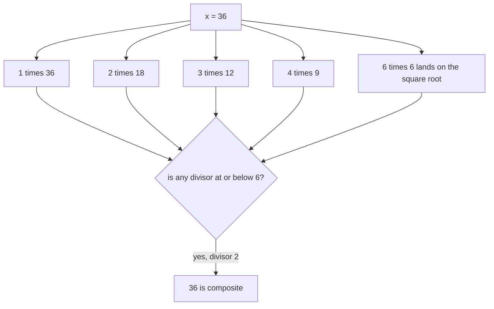
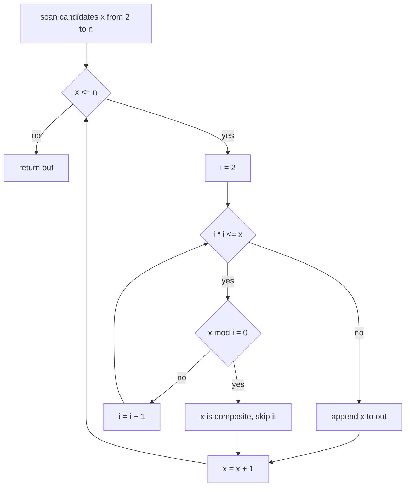
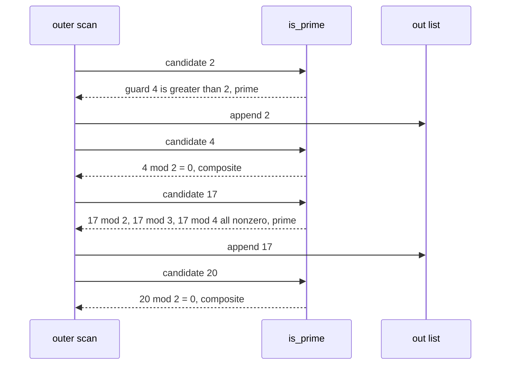

# 033 — List primes up to N using trial division.

> **Tier:** Beginner · **CTCI chapter:** Ch 6 — Math and Logic Puzzles
> **Task spec:** [033-list-primes-up-to-n-using-trial-division.md](../../../tasks/beginner/033-list-primes-up-to-n-using-trial-division.md)
> **Solutions:** [Python](../../../solutions/python/beginner/033-list-primes-up-to-n-using-trial-division/solution.py) ·
> [Java](../../../solutions/java/beginner/033-list-primes-up-to-n-using-trial-division/Solution.java) ·
> [JavaScript](../../../solutions/javascript/beginner/033-list-primes-up-to-n-using-trial-division/solution.js) ·
> [C#](../../../solutions/csharp/beginner/033-list-primes-up-to-n-using-trial-division/Solution.cs)

## 1. Problem restatement

**Input:** an integer `n` that bounds the search range. There is no constraint section in the spec
beyond "up to N", so the contract is fixed by the assertions that ship with the four solutions.

**Output:** every prime `p` with `p ≤ n`, in ascending order, as a new collection. Nothing is
mutated and no input is consumed, so calling the function twice returns equal results.

The three asserted rows are the same in all four languages:

| Call | Result | Why |
| --- | --- | --- |
| `primes_upto(1)` | `[]` | 1 is not prime, so no candidate survives |
| `primes_upto(10)` | `[2, 3, 5, 7]` | the four primes at or below ten |
| `primes_upto(20)` | `[2, 3, 5, 7, 11, 13, 17, 19]` | 9 and 15 are composites, the rest are covered by 2 |

The exported names differ only in case and word separator: `primes_upto` in Python,
`primesUpto` in Java and JavaScript, `PrimesUpto` in C#. The Python file also keeps a nested
helper `prime(x)`; Java and C# name it `isPrime` and keep it `private`.

## 2. Intuition

The definition of "prime" gives the naive algorithm directly: for each candidate `x` in
`2 … n`, try every integer `i` from `2` to `x - 1` and declare `x` prime if none of them divides
it. That is correct and hopeless: testing `x` costs up to `x - 2` modulo operations, so listing
everything up to `n` costs about `n² / 2` operations before you have printed a single result.

The key insight is that **divisors come in pairs**. If `x = d · e` with `2 ≤ d ≤ e`, then
`d · d ≤ d · e = x`, so the smaller member of every factor pair is at most `√x`. Any composite
`x` therefore has a divisor `d ≤ √x`, and once you have tried every `i` up to `√x` without a hit
there is no divisor left anywhere: `x` is prime. For `x = 36` the whole argument collapses into
one picture.



The same argument run for a prime looks different but ends the same way: nothing divides `x`
below `√x`, so nothing divides it above `√x` either. The scan is a *search for a witness*; the
absence of a witness is the proof of primality. That turns the cost of testing `x` from `x - 2`
divisions into at most `⌊√x⌋ - 1`, a square-root-sized saving that the four solutions all take.

## 3. Algorithm

All four solutions implement the same two nested procedures: an outer scan over candidates and an
inner witness search.

1. Let `out` be an empty list.
2. For each candidate `x` from `2` up to and including `n`:
   1. Let `i` start at `2`.
   2. While `i · i ≤ x`: if `x mod i = 0`, stop the inner search and report "not prime"; otherwise increment `i`.
   3. If the inner search ended because `i · i > x`, report "prime".
3. Append the prime candidates to `out` in the order they were scanned, then return `out`.

```text
procedure primes_upto(n)
    out ← empty list
    for x ← 2 to n do
        if is_prime(x) then append x to out end
    end
    return out
end

function is_prime(x)
    if x < 2 then return false end
    i ← 2
    while i * i ≤ x do
        if x mod i = 0 then return false end
        i ← i + 1
    end
    return true
end
```

The loop guard `i * i ≤ x` is where the square-root bound is hidden: the algorithm never computes
`√x`, it compares squares instead. Java and C# deliberately widen `i` to a 64-bit type before the
multiplication (`for (long i = 2; i * i <= n; i++)`), so the guard itself cannot overflow. Python
and JavaScript use arbitrary precision and IEEE-754 doubles and need no such cast.



Two nested loops, two exits: the inner loop leaves through the modulo test (composite) or through
the guard (prime), and only the second exit reaches the `append`.

## 4. Worked example

Trace `primes_upto(20)`. The `i` column shows the divisor that ended the inner search — the
witness for a composite, or the value of `i` that pushed `i · i` past `x` for a prime.

| Step | `x` | divisors `i` tested | exit condition | verdict | `out` |
| --- | --- | --- | --- | --- | --- |
| 1 | 2 | none (`2·2 > 2`) | guard before first test | prime | `[2]` |
| 2 | 3 | none (`2·2 > 3`) | guard | prime | `[2, 3]` |
| 3 | 4 | 2 | `4 mod 2 = 0` | composite | `[2, 3]` |
| 4 | 5 | 2 | `2·2 ≤ 5`, `5 mod 2 ≠ 0`, then `3·3 > 5` | prime | `[2, 3, 5]` |
| 5 | 6 | 2 | `6 mod 2 = 0` | composite | `[2, 3, 5]` |
| 6 | 7 | 2 | `7 mod 2 ≠ 0`, `3·3 > 7` | prime | `[2, 3, 5, 7]` |
| 7 | 8, 9, 10 | 2, 3, 2 | found a witness each time | composites | `[2, 3, 5, 7]` |
| 8 | 11 | 2, 3 | `11 mod 2 ≠ 0`, `11 mod 3 ≠ 0`, `4·4 > 11` | prime | `[2, 3, 5, 7, 11]` |
| 9 | 12 … 16 | — | 12, 14, 15, 16 have small witnesses; 13 does not | one prime | `[2, 3, 5, 7, 11, 13]` |
| 10 | 17 | 2, 3, 4 | `4·4 ≤ 17`, no witness, `5·5 > 17` | prime | `[…, 17]` |
| 11 | 18 | 2 | `18 mod 2 = 0` | composite | `[…, 17]` |
| 12 | 19 | 2, 3, 4 | no witness, `5·5 > 19` | prime | `[2, 3, 5, 7, 11, 13, 17, 19]` |
| 13 | 20 | 2 | `20 mod 2 = 0` | composite | unchanged, `x` reaches 21 &gt; 20 and the scan ends |

Step 10 is the interesting one: `17` is tested against `2`, `3` and `4`, which is exactly
`⌊√17⌋ = 4` divisions, and the guard stops the loop before `5`. Note that `4` is not prime
itself — the algorithm never cares, it just tests candidates. The composite steps never test more
than one or two divisors because the smallest witness is found immediately.



The scan is strictly sequential: the verdict for `x` never influences the test for `x + 1`. Each
trial-division test is self-contained, which is exactly why the sieve in the next task has to
change the data structure, not just the loop, to do better.

## 5. Complexity

Let `n` be the bound and let `π(n)` be the number of primes up to `n`.

| Measure | Bound | Why it holds |
| --- | --- | --- |
| Time, best | O(n) | still scans every candidate; composites are rejected in one division, primes need `⌊√x⌋ - 1` |
| Time, average | O(n√n) | each `x` costs at most `⌊√x⌋ - 1` modulo operations and `Σ√x` over `2 … n` is about `(2/3)·n^(3/2)` |
| Time, worst | O(n√n) | worst case is `n` prime, then every candidate runs the inner loop to the guard |
| Space, output | O(π(n)) | the returned list; by the prime number theorem this grows like `n / ln n` |
| Space, extra | O(1) | the Python helper, the Java/C# `isPrime` and the JavaScript arrow closure keep only `i` |
| Sieve alternative (task 034) | O(n log log n) time, O(n) space | trading memory for time, see [034](../../../tasks/beginner/034-sieve-of-eratosthenes-to-list-primes-up-to-n.md) |
| Single-number check (task 032) | O(√x) time | the same inner loop without the outer scan |

The extra space is the headline difference from the sieve: trial division answers "is this one
number prime?" in constant memory, while the sieve answers "which numbers are prime?" and has to
remember one bit per candidate to do it.

## 6. Pitfalls and edge cases

- **`n = 1` and `n = 0`.** `primes_upto(1)` returns `[]` in all four languages: the Python range
  `range(2, n + 1)` is empty, and the Java/JavaScript/C# `for (x = 2; x <= n; x++)` never runs.
  A negative `n` behaves the same way.
- **`n = 2`.** The answer is `[2]`. The inner guard `2 · 2 > 2` is true before any modulo is
  evaluated, so 2 is reported prime without a single division. Python asserts this row explicitly
  inside the sieve task rather than here, but all four `is_prime` implementations agree.
- **The `x < 2` guard only exists in Python.** Python's helper starts with `if x < 2: return
  false`, but Java, C# and JavaScript `isPrime` rely on the caller starting at `x = 2`. If you
  extract that helper and call it with `1` or `0`, the Java/C#/JavaScript versions return `true`.
  When you move this loop into a reusable function, keep the guard.
- **Guard overflow.** `i * i <= n` with 32-bit `i` overflows at `i = 46341`, claiming that
  `46341²` is small. Java and C# cast to `long` exactly for this reason; JavaScript stays exact
  until `2^53` and Python never overflows. This is the single most common port bug for trial
  division.
- **1 and 0 are never candidates.** Starting the outer loop at `2` is what excludes them; a loop
  starting at `0` would need the `x < 2` guard in every language.
- **Duplicate output.** Each candidate is tested once, so the result contains no repeats and is
  already sorted ascending. Callers must not sort or deduplicate.
- **Even divisors are still tested.** None of the four solutions special-cases `i = 2` and then
  steps by two, so `17` really is divided by `2, 3, 4`. That is a constant-factor choice: the
  half-step optimisation would shrink the constant but not the `O(n√n)` bound.
- **`√x` is never computed.** No floating point appears anywhere in the four files, so there is no
  rounding hazard where `√25` might come back as `4.999…`. Compare squares, do not take roots.

## 7. Variants and follow-ups

- **Sieve of Eratosthenes.** When the whole list matters, one pass of marking costs
  `O(n log log n)` instead of `O(n√n)` — see [034](../../../tasks/beginner/034-sieve-of-eratosthenes-to-list-primes-up-to-n.md)
  for the trade-off in detail.
- **Single primality test.** [032](../../../tasks/beginner/032-check-prime-number-naive.md) is the
  same inner loop extracted on its own; compare it with the trial division here to see how much of
  the cost is the outer scan and how much is the witness search.
- **Where the square-root bound comes from.** The factor-pair argument is a fact about integers,
  not about this problem, and it shows up again in [029](../../../tasks/beginner/029-check-if-integer-is-power-of-two.md)
  (is there a factor structure?) and [028](../../../tasks/beginner/028-count-number-of-set-bits-in-an-integer.md)
  (how far do you walk before the answer is settled?).
- **Modular arithmetic next.** Once you can enumerate primes, [035](../../../tasks/beginner/035-greatest-common-divisor-gcd-euclid-s-algorithm.md)
  and [036](../../../tasks/beginner/036-least-common-multiple-lcm-using-gcd.md) show the other
  half of Ch 6: reducing numbers to their prime-factor signatures with `gcd` and `lcm`.
- The chapter walkthrough [Math and Logic](../../ctci/06-math-and-logic.md) places this task
  between bit tricks and the closed-form puzzles, and [Big-O](../../00-big-o.md) covers the
  `O(n√n)`-versus-`O(n log log n)` reading of the two tables above.

## 8. Check yourself

1. Why is it enough to test divisors up to `√x` instead of up to `x - 1`?

<details><summary>Show answer</summary>

Every factorisation `x = d · e` with `d ≤ e` satisfies `d ≤ √x`, because `d · d ≤ d · e = x`.
So if `x` has any divisor other than itself and 1, its smaller partner is at or below `√x` and the
scan will find it. Finding no such divisor proves there is no factor pair at all.

</details>

2. What exactly does `primes_upto(1)` return, and which line of each solution produces that?

<details><summary>Show answer</summary>

`[]`, because the candidate range excludes 1. Python's `range(2, n + 1)` with `n = 1` is empty;
the Java, JavaScript and C# `for (x = 2; x <= n; x++)` loops fail their guard immediately and
return an empty list/array with no iterations.

</details>

3. The guard is written `i * i <= x`. Why do Java and C# write `long i = 2` instead of `int i = 2`?

<details><summary>Show answer</summary>

Because `i * i` is evaluated in the type of `i`. With `int`, the product overflows at
`i = 46341` (`46341² > 2^31 - 1`) and the comparison silently uses a negative value, so the loop
would exit early and report large composites as prime. Widening to `long` keeps the guard exact
for every 32-bit `n`.

</details>

4. How many modulo operations does `primes_upto(20)` perform in total, and which candidate is
   the most expensive?

<details><summary>Show answer</summary>

Count the tested divisions from the trace: `4` gets one, `5` one, `6` one, `7` one, `8`/`10`/`12`
one each, `9` one, `11` two, `13`, `14`, `15`, `16` one each, `17` three, `18` one, `19` three,
`20` one. The most expensive candidates are the primes `17` and `19`, each requiring `⌊√x⌋ - 1 = 3`
divisions — the worst case for a given `x` is always `x` prime.

</details>

5. Would sorting the output be a correctness improvement?

<details><summary>Show answer</summary>

No, and it would be wasted work. The outer loop walks candidates in increasing order and appends
only when the test succeeds, so the result is ascending by construction. Sorting would add an
`O(π(n) log π(n))` step on top of an already sorted list.

</details>
