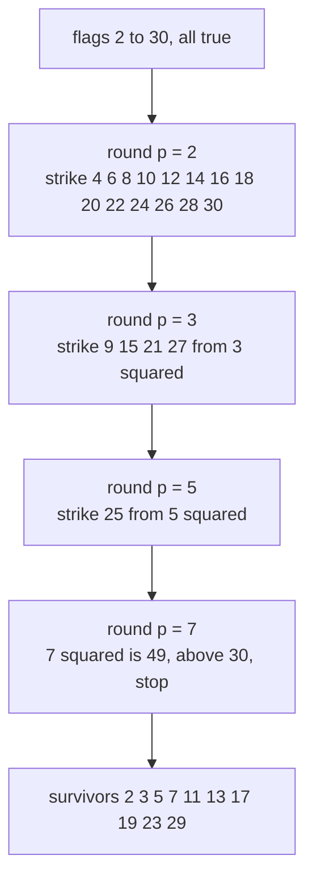
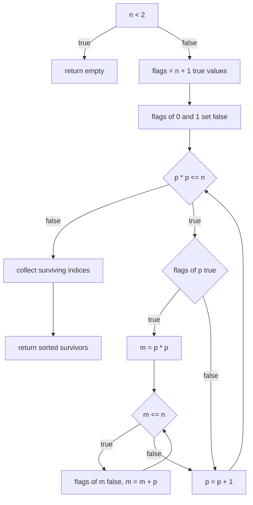
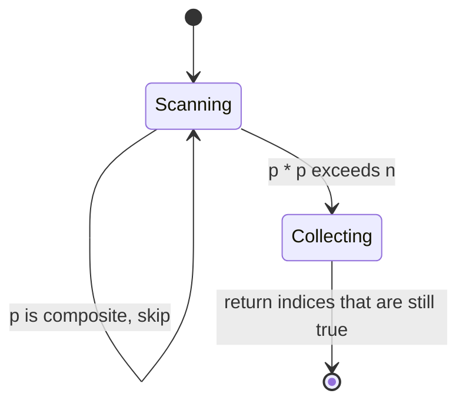

# 034 — Sieve of Eratosthenes to list primes up to N.

> **Tier:** Beginner · **CTCI chapter:** Ch 6 — Math and Logic Puzzles
> **Task spec:** [034-sieve-of-eratosthenes-to-list-primes-up-to-n.md](../../../tasks/beginner/034-sieve-of-eratosthenes-to-list-primes-up-to-n.md)
> **Solutions:** [Python](../../../solutions/python/beginner/034-sieve-of-eratosthenes-to-list-primes-up-to-n/solution.py) ·
> [Java](../../../solutions/java/beginner/034-sieve-of-eratosthenes-to-list-primes-up-to-n/Solution.java) ·
> [JavaScript](../../../solutions/javascript/beginner/034-sieve-of-eratosthenes-to-list-primes-up-to-n/solution.js) ·
> [C#](../../../solutions/csharp/beginner/034-sieve-of-eratosthenes-to-list-primes-up-to-n/Solution.cs)

## 1. Problem restatement

**Input:** an integer `n`, the inclusive upper bound of the range to inspect.

**Output:** all primes `p ≤ n` in ascending order, as a new collection. The Python file documents
the strength of the approach in its docstring: **`O(n log log n)`**.

The assertions across the four files cover three sizes — the guard, the prime edge and a range
large enough to contain several marking rounds:

| Call | Result | Why |
| --- | --- | --- |
| `sieve(1)` | `[]` | below the first prime, the early exit fires |
| `sieve(2)` | `[2]` | the marking loop never starts, `2·2 > 2` |
| `sieve(30)` | `[2, 3, 5, 7, 11, 13, 17, 19, 23, 29]` | ten primes survive two full rounds of marking |

Python asserts all three rows; Java, JavaScript and C# assert the first and the last. The exported
name is `sieve` in Python, Java and JavaScript and `Sieve` in C#.

## 2. Intuition

Trial division (task 033) asks the same question once per candidate and throws away everything it
learns. The sieve turns that around: instead of asking about each number, it lets each prime
**delete its own multiples** and then reads off whatever is left. The whole state is one array of
flags indexed by number, so a fact discovered once is reused by every later candidate.

Two observations make it fast and correct:

- **Multiples of a prime are composite, always.** When the scan reaches `p` and `p` is still
  flagged prime, no smaller number divided it, so nothing at all divides it. Every multiple
  `p, 2p, 3p, …` now has a witness and can be struck out.
- **Crossing out can start at `p²`.** Every composite `m < p²` with a divisor `p` also has a
  divisor `q = m / p < p`, and that smaller prime already deleted it in an earlier round. So the
  round for `p` only has to begin at `p · p` — the solution files all start their inner loop
  exactly there (`for (int m = p * p; m <= n; m += p)`).



The first round removes fourteen flags with one loop; the last useful prime `7` removes nothing at
all, because `49 > 30`. That is why the outer loop stops at `p · p ≤ n` — beyond that point a prime
can have no unmarked multiple left in range.

## 3. Algorithm

1. If `n < 2`, return an empty collection immediately. (This also protects the array indices used
   in step 2.)
2. Allocate a flag array of `n + 1` entries, all set to "prime". Set the entries for `0` and `1` to
   "composite" by hand — they are not covered by the marking rounds.
3. Walk `p` from `2` while `p · p ≤ n`. If `flags[p]` is still "prime", strike out `p·p, p·p + p,
   p·p + 2p, …` up to `n` by adding `p` each time.
4. Collect the indices whose flag is still "prime", in increasing order, and return them.

```text
function sieve(n)
    if n < 2 then return empty collection end
    flags ← array of n + 1 true values
    flags[0] ← false
    flags[1] ← false
    p ← 2
    while p * p ≤ n do
        if flags[p] then
            m ← p * p
            while m ≤ n do
                flags[m] ← false
                m ← m + p
            end
        end
        p ← p + 1
    end
    out ← empty list
    for x ← 2 to n do
        if flags[x] then append x to out end
    end
    return out
end
```

Note the three loops and what each one is for: the outer `p` loop finds the next surviving prime,
the inner `m` loop deletes its multiples, and the final `x` loop turns flags back into numbers.
Nothing else in the array is ever inspected, so composites that were struck out early are never
re-tested as `p`.



The inner loop is a stride walk, not a search: it never tests whether `m` is divisible by `p`,
because the stride guarantees it. That is the structural difference from trial division.

## 4. Worked example

Trace `sieve(30)`. The table records which multiples each round deletes; the rows for composite
`p` are omitted because the flag check skips them.

| Round `p` | `flags[p]` | first `m = p·p` | multiples struck in `2 … 30` | flags still true afterwards |
| --- | --- | --- | --- | --- |
| 2 | true | 4 | 4, 6, 8, 10, 12, 14, 16, 18, 20, 22, 24, 26, 28, 30 | 2, 3, 5, 7, 9, 11, 13, 15, 17, 19, 21, 23, 25, 27, 29 |
| 3 | true | 9 | 9, 12, 15, 18, 21, 24, 27, 30 | 2, 3, 5, 7, 11, 13, 17, 19, 23, 25, 29 |
| 4 | false | — | skipped, struck out by round 2 | unchanged |
| 5 | true | 25 | 25, 30 | 2, 3, 5, 7, 11, 13, 17, 19, 23, 29 |
| 6 | false | — | skipped | unchanged |
| 7 | true | 49 | none, `49 > 30`, so the loop body never runs | unchanged |
| 8, 9, 10 | false | — | skipped; `p·p > 30` ends the round loop after `p = 5` is passed | unchanged |

Round 2 deletes fourteen values, round 3 deletes eight (five of them already gone), round 5
deletes two (one already gone). The overlap is real: `30` is deleted three times and `12` twice.
The method is still fast because the *number* of deletions per round is `≈ n / p`, not `n`, and
`Σ 1/p` over primes grows like `ln ln n`.

Collecting the survivors in index order gives
`[2, 3, 5, 7, 11, 13, 17, 19, 23, 29]`, which is the asserted row for `sieve(30)`.



## 5. Complexity

Let `n` be the bound and `π(n)` the number of primes up to `n`.

| Measure | Bound | Why it holds |
| --- | --- | --- |
| Time, best | O(n) | the final collect loop always walks all `n + 1` flags, even when the marking loop does nothing |
| Time, average | O(n log log n) | round `p` performs about `n / p` markings, and the sum of `1 / p` over primes up to `√n` is `ln ln n` |
| Time, worst | O(n log log n) | same bound; the overlap of already-deleted multiples only changes the constant |
| Space, extra | O(n) | the flag array: Python `list` of booleans, Java/C# `bool[]`, JavaScript `Array` with `n + 1` slots |
| Space, output | O(π(n)) | the returned list |
| Trial division (task 033) | O(n√n) time, O(1) extra space | the same answer for much more time and much less memory |
| Linear-time predecessor | O(n) time, O(n) space | only reachable with an extra array of smallest prime factors, which is not implemented here |

The two approaches sit on opposite sides of the classic time/memory trade: the sieve buys its
speed with one flag per candidate, which makes it unusable for a single "is `x` prime?" query and
unbeatable for "list them all".

## 6. Pitfalls and edge cases

- **The early exit is load-bearing.** Without `if (n < 2) return`, the lines that write
  `flags[0]` and `flags[1]` would index out of range for `n = 0` and `n = 1` in Java, C# and
  Python alike. Every solution file checks `n < 2` first.
- **You must falsify `0` and `1` manually.** They are outside every marking round, so they would
  otherwise survive as "primes". The four files all do this with a two-target assignment before
  the main loop.
- **Start the inner loop at `p · p`, not at `p`.** Starting at `p` is still correct but redundant:
  every `k · p` with `k < p` was already deleted by the prime factor of `k`. Starting at `p · p`
  is both faster and the reason the guard is `p · p ≤ n`.
- **Guard overflow again.** Java writes `for (int p = 2; (long) p * p <= n; p++)` and C# uses
  `long p`; JavaScript and Python are exact over the whole range. As in
  [033](../../../tasks/beginner/033-list-primes-up-to-n-using-trial-division.md), the cast is what
  keeps the boundary comparison honest near `2^31`.
- **`n = 2` and `n = 3`.** Both return the prime they name. The marking loop starts at `p = 2` and
  immediately fails `2 · 2 ≤ n`, so the array is returned with no deletions. Python asserts
  `sieve(2) == [2]` explicitly.
- **Composites are never re-tested as `p`.** The flag check `if (flag[p])` is what keeps the cost
  proportional to the primes and not to all integers.
- **Memory is the real limit.** The Java and C# implementations allocate `n + 1` bytes mostly to
  store the truth value of one bit, and the JavaScript version allocates a full `Array` with `n + 1`
  slots — the constant factor is language-dependent, but all four need `O(n)` memory, so a very
  large `n` fails on allocation long before it fails on time.
- **Repeated deletions are expected.** `30` is struck in rounds 2, 3 and 5. Do not add a
  "already false" check in the inner loop to avoid redundancy; all four solutions mark blindly and
  rely on the stride.

## 7. Variants and follow-ups

- **Trial division.** [033](../../../tasks/beginner/033-list-primes-up-to-n-using-trial-division.md)
  is the memory-light alternative and the direct predecessor of this task — read them side by side
  to see the `O(n√n)` → `O(n log log n)` jump.
- **Single-number primality.** [032](../../../tasks/beginner/032-check-prime-number-naive.md) is
  the question a sieve cannot answer cheaply, since it must build the whole flag array first.
- **Primes as stepping stones.** Precomputing primes up to a bound feeds modular work such as
  [379](../../../tasks/intermediate/379-implement-combinatorics-ncr-modulo-prime-precompute-factorials.md),
  and the pairwise-coprime machinery of
  [381](../../../tasks/intermediate/381-chinese-remainder-theorem-solver-for-pairwise-coprime-moduli.md)
  starts from the same "divide the problem by its prime factors" mindset.
- **Flag arrays as a data structure.** The bitmap-of-flags pattern reappears whenever the universe
  of keys is small and dense — compare [026](../../../tasks/beginner/026-check-if-array-contains-any-duplicates-boolean.md),
  which uses one flag per value index to answer a very different question.
- The chapter walkthrough [Math and Logic](../../ctci/06-math-and-logic.md) and the asymptotics
  reference [Big-O](../../00-big-o.md) cover the `log log n` factor, which is the one bound in the
  beginner tier that interviewers like to probe.

## 8. Check yourself

1. Why does the marking loop for a prime `p` start at `p · p` rather than at `2p`?

<details><summary>Show answer</summary>

Because every multiple `k · p` with `k < p` has a factor `k` smaller than `p`, so it was already
struck out in the round of some prime dividing `k`. Only multiples from `p²` upwards can still be
marked as new work; starting earlier is correct but wastes time.

</details>

2. What does `sieve(1)` return, and what would happen without the `n < 2` guard?

<details><summary>Show answer</summary>

It returns `[]`. Without the guard, `is_prime[0] = is_prime[1] = false` would index outside the
array: for `n = 1` the array has only two slots (`0` and `1`), and for `n = 0` only one, so Java,
C#, JavaScript (writing past the end of an `Array` of length `n + 1` in a way that misreports the
length) and Python all break in their own way.

</details>

3. `30` is deleted three times during `sieve(30)`. Does that make the algorithm quadratic?

<details><summary>Show answer</summary>

No. Redundant deletions only affect the constant factor. Round `p` performs roughly `n / p` marking
steps, and the total is `n` times the sum of `1 / p` over the primes up to `√n`, which grows like
`ln ln n` — that is where the documented `O(n log log n)` comes from. A truly linear sieve would
need extra state to delete each composite exactly once.

</details>

4. Which loop in `sieve` dominates the running time for `n = 30`, and which for `n = 10^6`?

<details><summary>Show answer</summary>

For `n = 30` the work is tiny and spread across all three loops; rounds 2 and 3 dominate but the
final collect walk of 31 flags is comparable. For `n = 10^6` the marking rounds dominate
asymptotically (about `n ln ln n` steps) while the collect walk stays linear in `n`, so it becomes a
lower-order term.

</details>

5. Why do Java and C# widen `p` (or `p * p`) to `long`, and why does this matter less here than it
   might appear?

<details><summary>Show answer</summary>

`p * p` computed in 32-bit arithmetic overflows once `p > 46340`, which would end the outer loop
prematurely and leave large composites flagged as prime. The cast to `long` keeps the test exact
for any 32-bit `n`. It matters less in practice because an `O(n)` flag array already fails on
memory for `n` in that neighbourhood, but the solutions are written to be correct first.

</details>
