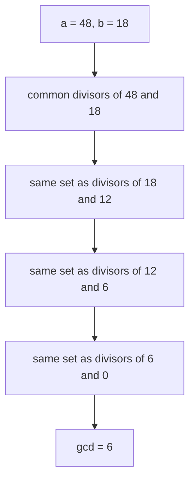
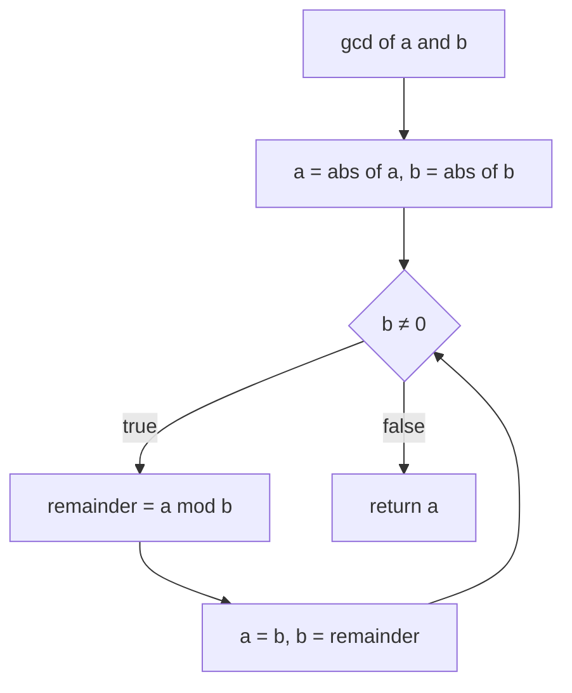
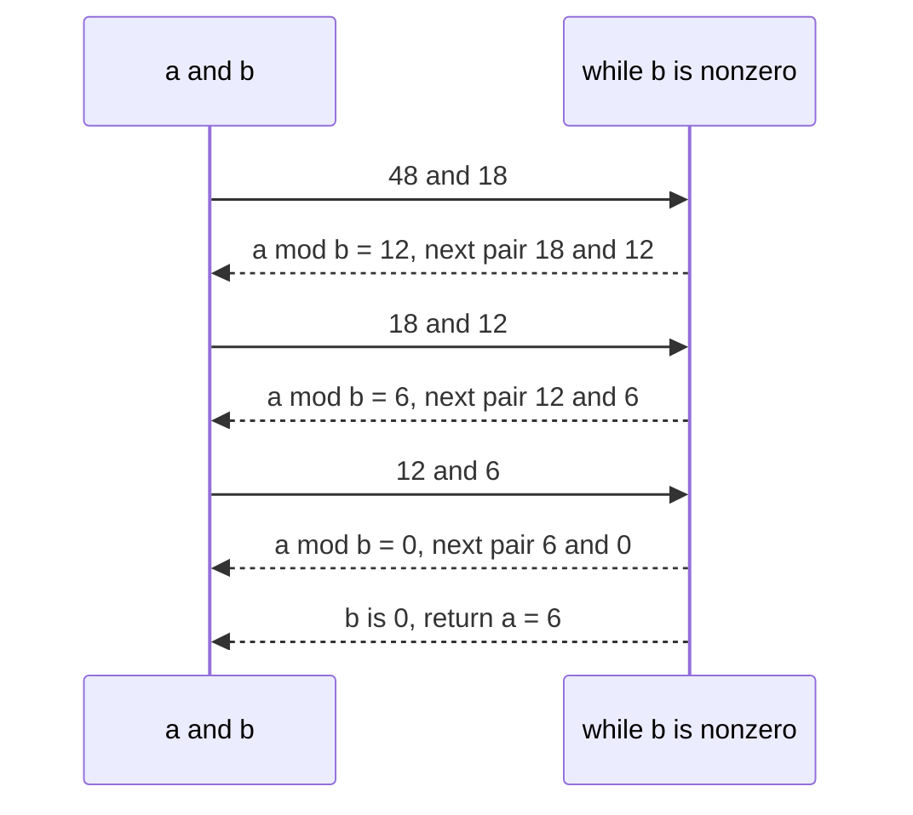

# 035 — Greatest common divisor (GCD) Euclid's algorithm.

> **Tier:** Beginner · **CTCI chapter:** Ch 11 — Testing
> **Task spec:** [035-greatest-common-divisor-gcd-euclid-s-algorithm.md](../../../tasks/beginner/035-greatest-common-divisor-gcd-euclid-s-algorithm.md)
> **Solutions:** [Python](../../../solutions/python/beginner/035-greatest-common-divisor-gcd-euclid-s-algorithm/solution.py) ·
> [Java](../../../solutions/java/beginner/035-greatest-common-divisor-gcd-euclid-s-algorithm/Solution.java) ·
> [JavaScript](../../../solutions/javascript/beginner/035-greatest-common-divisor-gcd-euclid-s-algorithm/solution.js) ·
> [C#](../../../solutions/csharp/beginner/035-greatest-common-divisor-gcd-euclid-s-algorithm/Solution.cs)

## 1. Problem restatement

**Input:** two integers `a` and `b`. The spec does not restrict their sign, and the solutions
decide what "greatest" means for negative and zero inputs by normalising with `abs` first.

**Output:** the greatest common divisor of `a` and `b` — the largest positive integer that divides
both — as a single integer. Zero is a legal result only in the degenerate case where both inputs
are zero.

The four files ship the same four assertions, and the odd ones are the whole point of the task:

| Call | Result | Why |
| --- | --- | --- |
| `gcd(48, 18)` | `6` | the textbook case: 48 and 18 share 2 and 3, but not 4 |
| `gcd(17, 5)` | `1` | coprime inputs, the worst case for a divisor-enumerating method |
| `gcd(0, 9)` | `9` | every integer divides 0, so the answer is the other argument |
| `gcd(-24, 36)` | `12` | signs are normalised away, the magnitude is what matters |

The exported name is `gcd` in Python, Java and JavaScript and `Gcd` in C#. All four files assert the
same four rows, each with its own harness (Python `assert`, Java `check`, `node:assert` in
JavaScript, and a C# `Check` helper). The solutions are **iterative** — no recursion appears in any
of the four files.

## 2. Intuition

The naive method is a linear scan: walk `d` from `min(|a|, |b|)` downwards and return the first `d`
that divides both. Correct, and `O(min(|a|, |b|))` — for `a = 48`, `b = 18` it finds `6` after a
dozen tests, but for two coprime 10-digit numbers it would walk billions of candidates.

Euclid's insight is that the divisor set is **invariant under subtraction**. If `d` divides both
`a` and `b`, it divides `a - b` as well; conversely, if `d` divides `b` and `a - b`, it divides
their sum `a`. So `(a, b)` and `(b, a - b)` have exactly the same common divisors, and the same
greatest one. Replacing the subtraction by the modulo operation — which is just "subtract `b` from
`a` as many times as possible and keep the remainder" — gives

```text
gcd(a, b) = gcd(b, a mod b)
```

and every step strictly shrinks the numbers, so the process must stop. It stops when the second
argument becomes `0`, because at that moment the first argument divides the second trivially and is
therefore the answer.



The chain of equal sets is the entire proof of correctness: nothing is lost at any hop because the
integer `a mod b` is exactly `a` minus a whole number of `b`s.

## 3. Algorithm

1. Replace `a` and `b` by their absolute values, so the loop only ever works with non-negative
   numbers and the answer's sign is decided up front.
2. While `b ≠ 0`: set `(a, b) ← (b, a mod b)`.
3. Return `a`.

```text
function gcd(a, b)
    a ← abs(a)
    b ← abs(b)
    while b ≠ 0 do
        remainder ← a mod b
        a ← b
        b ← remainder
    end
    return a
end
```

The three languages that lack tuple assignment spell step 2 out with a temporary
(`while (b != 0) { int t = b; b = a % b; a = t; }`), while Python and JavaScript assign both
targets at once (`a, b = b, a % b` and `[a, b] = [b, a % b]`). The temporary is not an
implementation detail to gloss over: writing `a = b; b = a % b;` **without** it computes
`b = b % b = 0` and silently returns `b` instead of the gcd.



The loop is a two-register machine: each iteration discards one number and keeps the remainder, so
the pair `(a, b)` is the complete state. There is no accumulator, no list and no recursion stack.

## 4. Worked example

Trace `gcd(48, 18)`. Every row shows the pair at the top of the loop body and the remainder it
produces.

| Step | `a` (before) | `b` (before) | `a mod b` | `a` (after) | `b` (after) |
| --- | --- | --- | --- | --- | --- |
| 1 | 48 | 18 | 12 | 18 | 12 |
| 2 | 18 | 12 | 6 | 12 | 6 |
| 3 | 12 | 6 | 0 | 6 | 0 |
| exit | 6 | 0 | — | — | return `6` |

Three iterations, and the first argument fell from 48 to 18, 12, 6 — roughly halving every two
steps. The asserted rows behave the same way:

- `gcd(17, 5)`: `(17, 5) → (5, 2) → (2, 1) → (1, 0)`, so the answer is `1`. The remainders shrink
  fast even for coprime inputs.
- `gcd(0, 9)`: the guard `b ≠ 0` is true, so one step runs: `a mod b = 0 mod 9 = 0`, and the pair
  becomes `(9, 0)`. The next check fails and `9` is returned. This is why no special case for zero
  is needed.
- `gcd(-24, 36)`: `abs` normalises it to `gcd(24, 36)`, which runs `(24, 36) → (36, 24) → (24, 12)
  → (12, 0)` and returns `12`. Note the first step just swaps the arguments, because `24 mod 36`
  is `24`.



## 5. Complexity

Let `m = min(|a|, |b|)` when both inputs are non-zero.

| Measure | Bound | Why it holds |
| --- | --- | --- |
| Time, best | O(1) | one iteration is enough when one argument is `0` or one divides the other |
| Time, average | O(log m) | the remainder after a step is always smaller than the smaller argument, and two steps roughly halve the larger one |
| Time, worst | O(log m) | consecutive Fibonacci numbers give the longest chains, so the step count is bounded by `log_φ(min)`, i.e. still logarithmic |
| Space | O(1) | three machine integers (`a`, `b`, and the temporary) regardless of input size |
| Naive divisor scan | O(min(|a|, |b|)) | walk candidates downwards and test both divisions (task 032 uses the same style for primality) |
| Recursive variant | O(log m) time, O(log m) stack | the same recurrence expressed as calls; none of the four files uses it |

The `mod` operation itself is a single machine instruction on 32-bit or 64-bit values (and a
`O(|a|)` digit loop in Python's arbitrary-precision integers), so the practical cost is the number
of iterations. Three iterations for `gcd(48, 18)`, and at most a few dozen for inputs at the int
limit.

## 6. Pitfalls and edge cases

- **Negative inputs must be normalised.** Python, Java and JavaScript apply `abs` to both
  arguments before the loop; C# does the same inside `Gcd`. Without it, the sign of the remainder
  in Java/C#/JavaScript can propagate and produce a negative "greatest" divisor. The asserted row
  `gcd(-24, 36) == 12` exists to catch exactly that.
- **`gcd(0, 9) == 9`.** The loop body runs once because `b = 9 ≠ 0`, then `b` becomes `0 mod 9 = 0`
  and the answer falls out. Returning early for zero inputs is also fine, but the unguarded loop is
  already correct.
- **`gcd(0, 0)` is `0`.** The guard fails immediately and `a = 0` is returned. That is the only
  case where the answer is not a positive integer; none of the four files assert it, but it is the
  reason the return type cannot be documented as "always positive".
- **Argument order does not matter.** If `a < b`, the first step computes `a mod b = a` and swaps
  the pair. That costs one iteration but removes the need for a comparison — the implementations
  never sort or swap up front.
- **Do not forget the temporary.** In Java and C# the update must be
  `t = b; b = a % b; a = t;`. Writing `a = b; b = a % b;` instead reads the *new* `a`, so the second
  statement computes `b mod b = 0` and the function returns `b`. For `gcd(48, 18)` that yields `18`,
  which does not divide 48, so the first assertion fails immediately.
- **`abs` can overflow on the most negative value.** Java's `Math.abs(Integer.MIN_VALUE)` returns
  `Integer.MIN_VALUE` (still negative), and C#'s `Math.Abs(int.MinValue)` throws
  `OverflowException`. Python and JavaScript have no such boundary. The solution files use plain
  `int`/number arithmetic and do not test that input.
- **The answer is `O(log m)` steps, not `O(log m)` *divisions*.** Do not reason about the number of
  subtractions in the loop: `a mod b` performs all of them in one operation. That is the difference
  between Euclid's algorithm and the "repeated subtraction" method found in textbooks.
- **Testing the edge cases is the chapter.** This task is mapped to the testing chapter, and the
  assertions are the deliverable: zero, negatives, coprime pairs and one identical pair are all
  covered by the four rows above.

## 7. Variants and follow-ups

- **LCM from GCD.** [036](../../../tasks/beginner/036-least-common-multiple-lcm-using-gcd.md) is
  the direct composition `|a · b| / gcd(a, b)`, and it depends on this task's contract for zero
  inputs.
- **Single number checks.** [032](../../../tasks/beginner/032-check-prime-number-naive.md) and
  [033](../../../tasks/beginner/033-list-primes-up-to-n-using-trial-division.md) use the same
  "find a witness divisor" idea, but scan upwards instead of shrinking both arguments.
- **Modular inverses and CRT.** Extending the loop to track Bézout coefficients gives the
  extended Euclidean algorithm, which is the tool behind
  [381](../../../tasks/intermediate/381-chinese-remainder-theorem-solver-for-pairwise-coprime-moduli.md).
- **Test-first thinking.** The assertions in these files are the artifact the chapter asks for:
  see [Testing](../../ctci/11-testing.md) for the checklist that turned `gcd(0, 9)` and
  `gcd(-24, 36)` into required rows, and [Big-O](../../00-big-o.md) for reading the iteration count
  as a logarithm.

## 8. Check yourself

1. Why is `gcd(a, b)` equal to `gcd(b, a mod b)`?

<details><summary>Show answer</summary>

Write `a = q · b + r` with `r = a mod b`. Any `d` dividing `b` and `r` divides `q · b + r = a`;
any `d` dividing `a` and `b` divides `a - q · b = r`. So the two pairs have exactly the same set of
common divisors, hence the same greatest one.

</details>

2. How many iterations does `gcd(17, 5)` take, and what is the state after each one?

<details><summary>Show answer</summary>

Three: `(17, 5) → (5, 2) → (2, 1) → (1, 0)`. The remainders are `17 mod 5 = 2`, `5 mod 2 = 1`,
`2 mod 1 = 0`; the loop exits and `1` is returned, matching the assertion.

</details>

3. What does `gcd(0, 9)` return, and why is no special case needed?

<details><summary>Show answer</summary>

`9`. The guard tests the *second* argument, so the body runs once with `a = 0, b = 9`, producing
`remainder = 0` and the pair `(9, 0)`. Then the guard fails and `a = 9` is returned. Zero inputs
only need a special case in the sense that `gcd(0, 0)` returns `0`.

</details>

4. In the Java and C# implementations, why is the temporary variable `t` required?

<details><summary>Show answer</summary>

Because the assignment order matters. `b = a % b` must use the *old* `a`. If `a` is overwritten
first (`a = b; b = a % b;`), the second statement computes `b % b`, which is always `0`, and the
function returns whatever `b` held — a wrong answer that no assertion in the files would miss.

</details>

5. Why is the number of iterations logarithmic rather than proportional to `min(|a|, |b|)`?

<details><summary>Show answer</summary>

Because the remainder is always less than half of the larger argument. If `b ≤ a / 2` then
`a mod b < b ≤ a / 2`; if `b > a / 2` then `a mod b = a - b < a / 2`. So the first argument at
least halves every iteration, giving at most about `log2(a)` iterations — the worst case still
being a Fibonacci pair.

</details>
