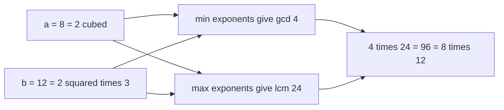
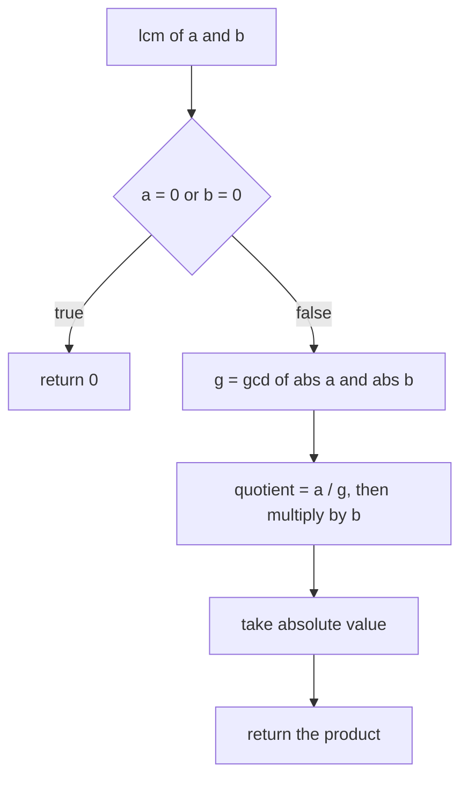
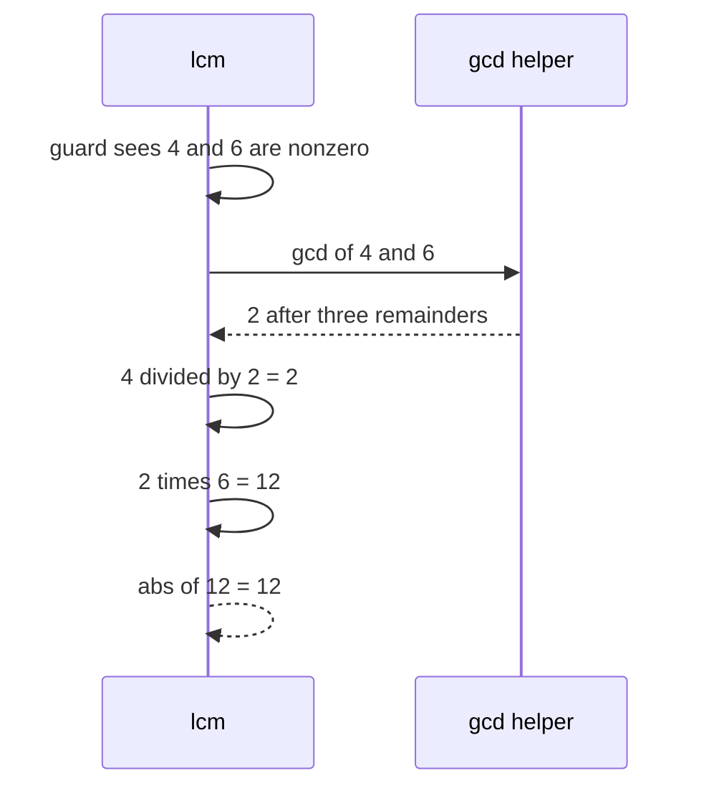

# 036 — Least common multiple (LCM) using GCD.

> **Tier:** Beginner · **CTCI chapter:** Ch 6 — Math and Logic Puzzles
> **Task spec:** [036-least-common-multiple-lcm-using-gcd.md](../../../tasks/beginner/036-least-common-multiple-lcm-using-gcd.md)
> **Solutions:** [Python](../../../solutions/python/beginner/036-least-common-multiple-lcm-using-gcd/solution.py) ·
> [Java](../../../solutions/java/beginner/036-least-common-multiple-lcm-using-gcd/Solution.java) ·
> [JavaScript](../../../solutions/javascript/beginner/036-least-common-multiple-lcm-using-gcd/solution.js) ·
> [C#](../../../solutions/csharp/beginner/036-least-common-multiple-lcm-using-gcd/Solution.cs)

## 1. Problem restatement

**Input:** two integers `a` and `b`; signs are allowed, zeros are allowed, and the spec fixes the
meaning in both cases through the assertions.

**Output:** the least common multiple of `a` and `b` — the smallest positive integer divisible by
both — as a single number. The four files return it as a 64-bit integer in Java and C# (`long`),
an arbitrary-precision integer in Python and a JavaScript `Number`.

| Call | Result | Why |
| --- | --- | --- |
| `lcm(4, 6)` | `12` | `4·6 = 24`, `gcd = 2`, `24 / 2 = 12` |
| `lcm(21, 6)` | `42` | coprime-ish pair: `gcd = 3`, `126 / 3 = 42` |
| `lcm(0, 5)` | `0` | zero has no positive multiple, so the guard returns `0` before any division |
| `lcm(-3, 5)` | `15` | signs are normalised; only magnitudes count |

Python, Java and C# assert all four rows; JavaScript asserts the first three. The exported name is
`lcm` in Python and JavaScript and `Lcm` in Java and C#. Every file also ships a small private
`gcd` helper — Java, JavaScript and C# keep it as a second function in the same file.

## 2. Intuition

The definition suggests a scan: walk the multiples of the larger number `k·max(a, b)` until one of
them is divisible by the smaller one. That is correct but takes `max(a, b) / gcd(a, b)` steps, which
can be as large as `a · b` — for coprime inputs it is exactly `a · b` steps.

The insight is that `gcd` and `lcm` are two views of the same factorisation. Split each number into
its prime powers; the gcd takes the **minimum** exponent of every prime and the lcm takes the
**maximum**. Almost everything cancels when you multiply the two together:

```text
gcd(a, b) · lcm(a, b) = |a · b|
```

so the whole problem reduces to one call of the Euclid loop from
[035](../../../tasks/beginner/035-greatest-common-divisor-gcd-euclid-s-algorithm.md):

```text
lcm(a, b) = |a · b| / gcd(a, b)
```

For `a = 8, b = 12` that reads `min(2³, 2²·3) = 2² = 4` and `max = 2³·3 = 24`, and indeed
`4 · 24 = 96 = 8 · 12`.



One formula follows from the other immediately, and that is why none of the four files enumerate
multiples at all.

## 3. Algorithm

1. If either argument is `0`, return `0`. (This is also what keeps step 3's division safe.)
2. Compute `g = gcd(|a|, |b|)` with the Euclidean loop: repeatedly replace `(a, b)` by `(b, a mod b)`
   until `b` is `0`, then return the remaining `a`.
3. Return `|a / g · b|`. The division happens **before** the multiplication, and the absolute value
   is applied to the finished product.

```text
function lcm(a, b)
    if a = 0 or b = 0 then return 0 end
    g ← gcd(abs(a), abs(b))
    return abs(a / g * b)
end

function gcd(a, b)
    while b ≠ 0 do
        remainder ← a mod b
        a ← b
        b ← remainder
    end
    return a
end
```

The order inside step 3 is deliberate and the Python file says so in a comment: `a / g · b` is
mathematically identical to `a · b / g`, but the first form reaches a much smaller intermediate
value, so it survives in a narrower integer type. Java and C# use `long` for exactly that reason
and even declare the parameter list as `long a, long b`, while Python is unbounded and JavaScript
is limited only by the `2^53` exactness range of `Number`.



## 4. Worked example

Trace `lcm(4, 6)` in full, including the gcd loop that the naive multiple-walk would not need.

| Step | Operation | State | Note |
| --- | --- | --- | --- |
| 1 | guard | `a = 4`, `b = 6`, neither is zero | continue |
| 2 | `gcd(4, 6)` iteration 1 | `(4, 6) → (6, 4 mod 6 = 4)` | `4 < 6`, so the pair just swaps |
| 3 | `gcd(4, 6)` iteration 2 | `(6, 4) → (4, 6 mod 4 = 2)` | |
| 4 | `gcd(4, 6)` iteration 3 | `(4, 2) → (2, 4 mod 2 = 0)` | |
| 5 | loop exit | `b = 0`, return `g = 2` | |
| 6 | divide first | `a / g = 4 / 2 = 2` | the quotient is exact, no fractions |
| 7 | multiply | `2 · b = 2 · 6 = 12` | |
| 8 | absolute value | `abs(12) = 12` | asserted result |

The multiple-walk alternative visits `6, 12` and stops at the second candidate; for `21` and `6`
it visits `21, 42` (two steps). Those look cheap, but the same walk on `lcm(999999937, 999999893)`
would need roughly `10^18` steps while the Euclid loop plus one division finishes in a handful.
`lcm(-3, 5)` follows the same path: `gcd(|-3|, |5|) = gcd(3, 5) = 1`, then
`abs(-3 / 1 · 5) = abs(-15) = 15`.



## 5. Complexity

Let `m = min(|a|, |b|)` when both arguments are non-zero.

| Measure | Bound | Why it holds |
| --- | --- | --- |
| Time, best | O(1) | one argument is `0` (guard) or one divides the other (gcd exits after one step) |
| Time, average | O(log m) | the Euclid loop from [035](../../../tasks/beginner/035-greatest-common-divisor-gcd-euclid-s-algorithm.md) performs `O(log m)` iterations; the division and multiplication are constant-cost per word |
| Time, worst | O(log m) | Fibonacci inputs give the longest Euclid chains, still logarithmic |
| Space | O(1) | two running values plus one temporary |
| Naive multiple walk | O(max(|a|, |b|)/g × …) | counting up to the lcm costs `lcm / max(a, b)` iterations, up to `min(a, b)` of them in the worst coprime case |
| Overflow headroom | `long` in Java and C# | `lcm` can be as large as `|a · b|`, so 32-bit `int` would overflow for two large 16-bit-ish inputs |

The interesting part is not the asymptotics but the arithmetic range: `lcm` grows like the
*product* of its inputs, so a task that returns `long` in Java and C# and `BigInt`-free `Number` in
JavaScript is really making a statement about the expected input sizes.

## 6. Pitfalls and edge cases

- **Zero inputs must be short-circuited.** The guard `if a == 0 or b == 0: return 0` is not just a
  convention: it prevents the gcd step from being meaningless and keeps the result finite. Without
  it, `lcm(0, 5)` would compute `gcd(0, 5) = 5` and return `abs(0 / 5 · 5) = 0` — accidentally right
  for this input, but only because the division happens first. State the guard instead of relying on
  the accident.
- **Divide before multiplying.** `a / g * b` keeps the intermediate value at `lcm` size, whereas
  `a * b / g` builds `a · b` first and needs the wider type to survive. Python's comment
  (`divide first to limit overflow`) records the choice.
- **Negative inputs.** Python's helper receives the raw arguments and may return a negative gcd for
  two negative inputs, but the outer `abs` in step 3 normalises the product anyway. Java and C#
  normalise earlier with `Math.abs` on both arguments. The asserted row `lcm(-3, 5) == 15` pins the
  observable behaviour in both styles.
- **Argument order does not matter.** `gcd` swaps internally when `a < b`, and multiplication is
  commutative, so `lcm(6, 4)` equals `lcm(4, 6)`.
- **`lcm(a, a) = a`.** The gcd is `a`, the quotient is `1`, and the product is `a`. No special case
  is needed, and none is written.
- **Overflow.** Java and C# declare `long Lcm(long a, long b)` so their documented domain is 64-bit
  inputs, and even then `lcm(2^40, 2^40 - 1)` exceeds `long`. Python never overflows. JavaScript's
  `Number` is only exact up to `2^53 - 1`, so a large result can be a rounded approximation — this is
  the one place where the four files differ in *correctness* rather than style, and none of the
  assertions reach that range.
- **`gcd` is duplicated locally, not imported.** Each file ships its own small helper rather than
  calling the solution of [035](../../../tasks/beginner/035-greatest-common-divisor-gcd-euclid-s-algorithm.md),
  so this task stays self-contained (and so the Java, C# and JavaScript versions do not depend on
  another file's class or module).

## 7. Variants and follow-ups

- **The gcd itself.** [035](../../../tasks/beginner/035-greatest-common-divisor-gcd-euclid-s-algorithm.md)
  is the whole engine; read it first for the proof that the divisor set is invariant under
  `(a, b) → (b, a mod b)`.
- **Coprime pairs.** "`gcd(a, b) = 1`" is the precondition for modular inverses and for the
  pairwise-coprime moduli of
  [381](../../../tasks/intermediate/381-chinese-remainder-theorem-solver-for-pairwise-coprime-moduli.md).
- **Factorisation thinking.** [033](../../../tasks/beginner/033-list-primes-up-to-n-using-trial-division.md)
  and [034](../../../tasks/beginner/034-sieve-of-eratosthenes-to-list-primes-up-to-n.md) build primes
  explicitly, which is the other route to the same min/max exponent picture used in the intuition
  above.
- **Overflow discipline.** Compare the `long`/`BigInt` choices here with the reciprocal handling in
  [037](../../../tasks/beginner/037-compute-power-x-n-iterative.md) and the squaring loop of
  [038](../../../tasks/beginner/038-implement-binary-exponentiation-fast-power.md): all three tasks
  are really about the size of the numbers in flight.
- The chapter walkthrough is [Math and Logic](../../ctci/06-math-and-logic.md); the
  [Big-O](../../00-big-o.md) reference explains why a logarithm-sized loop is the target.

## 8. Check yourself

1. Why is `lcm(a, b) = |a · b| / gcd(a, b)` true?

<details><summary>Show answer</summary>

Write `a` and `b` as products of prime powers. The gcd takes the minimum exponent of each prime and
the lcm takes the maximum, so multiplying them gives the product of the *sums* of the exponents —
which is exactly `|a · b|`. Dividing therefore recovers the lcm.

</details>

2. What does `lcm(0, 5)` return, and what would happen without the guard?

<details><summary>Show answer</summary>

It returns `0` from the guard. Without the guard the code would still produce `0` for this input,
because `gcd(0, 5) = 5` and `abs(0 / 5 · 5) = 0`, but the guard makes the zero case explicit
instead of relying on which operand is divided by which.

</details>

3. Why does the implementation divide before multiplying?

<details><summary>Show answer</summary>

Because `a / g` is always an exact integer (it is `a` with the shared factors removed) and is much
smaller than `a · b`. Computing `a · g` first would build an intermediate as large as the product of
the inputs, which is where a narrow integer type overflows.

</details>

4. `lcm(21, 6)` is `42`. How many Euclid iterations does the gcd step take?

<details><summary>Show answer</summary>

Three: `(21, 6) → (6, 21 mod 6 = 3) → (3, 6 mod 3 = 0)` and the loop exits with `g = 3`. Then
`21 / 3 = 7` and `7 · 6 = 42`.

</details>

5. Both arguments are negative, say `lcm(-4, -6)`. Does Python's helper return a negative gcd, and
   does that matter?

<details><summary>Show answer</summary>

Yes, Python's helper can return a negative value here (`-2` for `-4` and `-6`), because it does not
normalise the signs itself, but the quotient `-4 / -2 = 2` and the final `abs(2 · -6) = 12` are
correct all the same. Java, C# and JavaScript normalise inside the gcd, so their helper never goes
negative — a stylistic difference with no observable effect on the asserted behaviour.

</details>
