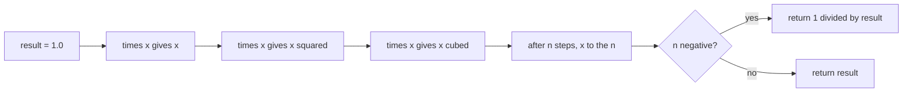
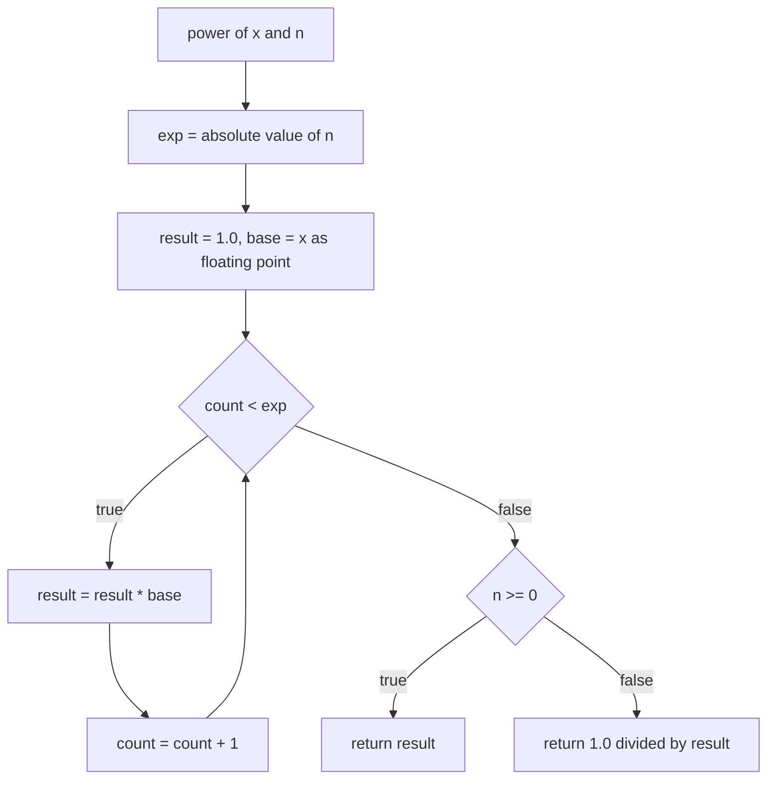

# 037 — Compute power(x, n) iterative.

> **Tier:** Beginner · **CTCI chapter:** Ch 6 — Math and Logic Puzzles
> **Task spec:** [037-compute-power-x-n-iterative.md](../../../tasks/beginner/037-compute-power-x-n-iterative.md)
> **Solutions:** [Python](../../../solutions/python/beginner/037-compute-power-x-n-iterative/solution.py) ·
> [Java](../../../solutions/java/beginner/037-compute-power-x-n-iterative/Solution.java) ·
> [JavaScript](../../../solutions/javascript/beginner/037-compute-power-x-n-iterative/solution.js) ·
> [C#](../../../solutions/csharp/beginner/037-compute-power-x-n-iterative/Solution.cs)

## 1. Problem restatement

**Input:** a base `x` and an integer exponent `n`. The exponent may be negative — the Python
docstring states the scope directly: *"Iterative; supports negative exponents via reciprocal."*

**Output:** `x` raised to the power `n` as a **floating-point** number. Every solution returns
`double` / `Number` / `float`, never an integer type, so `power(3, 3)` is `27.0`, not `27`.

| Call | Result | Why |
| --- | --- | --- |
| `power(2, 10)` | `1024.0` | ten multiplications, exactly representable |
| `power(2, -2)` | `0.25` | compute `2² = 4.0`, then take the reciprocal |
| `power(5, 0)` | `1.0` | the loop never runs; the accumulator is already the identity |
| `power(3, 3)` | `27.0` | three multiplications |

Python and Java assert all four rows, and JavaScript and C# assert the first three. The exported name
is `power` in Python, Java and JavaScript and `Power`
in C#. The Python file converts the base once with `base = float(x)`; the other three take a
`double` parameter and let the call site decide.

## 2. Intuition

The definition of an integer power is repeated multiplication, so the naive loop follows the
exponent one step at a time:

```text
result ← 1
repeat n times
    result ← result * x
```

That is `O(n)` multiplications and needs no cleverness at all — but it has three properties worth
naming before writing it:

- **The identity is `1`.** Starting the accumulator at `1` makes `n = 0` free: the loop body never
  executes and the correct answer is already in the accumulator. No special case is needed.
- **The sign of the exponent is not part of the loop.** `x^(-n) = 1 / x^n`, so the loop always runs
  `|n|` times and a single test at the end flips the result into a reciprocal.
- **The accumulator is the only state.** Each step multiplies one running value, so the memory is
  constant and the dependency chain is linear — there is nothing to reorder.



The picture also shows the weakness that [038](../../../tasks/beginner/038-implement-binary-exponentiation-fast-power.md)
fixes: every one of the `n` multiplications is on the critical path, and none of them can be
skipped.

## 3. Algorithm

1. Let `exp = |n|` so the loop only counts upwards.
2. Let `result = 1.0` and `base = x` converted to floating point once, outside the loop.
3. Repeat `exp` times: `result ← result · base`.
4. Return `result` when `n ≥ 0`, otherwise return `1.0 / result`.

```text
function power(x, n)
    exp ← abs(n)
    result ← 1.0
    base ← convert x to floating point
    i ← 0
    while i < exp do
        result ← result * base
        i ← i + 1
    end
    if n ≥ 0 then
        return result
    else
        return 1.0 / result
    end
end
```

Python expresses step 3 with `for _ in range(exp)`; Java, JavaScript and C# use a counted
`for (int i = 0; i < exp; i++)`. The loop count comes from `abs(n)` in all four files, and the sign
test at the end is written as a ternary in every language.



One loop, one branch, and no accumulation of any kind other than the single product.

## 4. Worked example

Trace `power(2, 10)`, showing the accumulator after every iteration.

| Step | `count` | `base` | `result` before | `result` after |
| --- | --- | --- | --- | --- |
| 1 | 0 | 2.0 | 1.0 | 2.0 |
| 2 | 1 | 2.0 | 2.0 | 4.0 |
| 3 | 2 | 2.0 | 4.0 | 8.0 |
| 4 | 3 | 2.0 | 8.0 | 16.0 |
| 5 | 4 | 2.0 | 16.0 | 32.0 |
| 6 | 5 | 2.0 | 32.0 | 64.0 |
| 7 | 6 | 2.0 | 64.0 | 128.0 |
| 8 | 7 | 2.0 | 128.0 | 256.0 |
| 9 | 8 | 2.0 | 256.0 | 512.0 |
| 10 | 9 | 2.0 | 512.0 | 1024.0 |
| exit | 10 | 2.0 | — | `n ≥ 0`, return `1024.0` |

Every value in the `result` column is a power of two below `2^53`, so each is represented exactly
in a double and the assertion `power(2, 10) == 1024.0` is an exact comparison, not a tolerance
check. The negative-exponent case reuses the same table: `power(2, -2)` runs two iterations to
reach `4.0`, then returns `1.0 / 4.0 = 0.25`.


`power(5, 0)` never enters the loop: `exp = 0`, the guard fails on the first test, and `1.0` is
returned with the ternary taking the `n ≥ 0` branch. That is the accumulator-as-identity trick
paying off.

## 5. Complexity

Let `n` be the exponent and `d` the number of digits needed to represent `x`.

| Measure | Bound | Why it holds |
| --- | --- | --- |
| Time, best | O(1) | `n = 0` skips the loop entirely |
| Time, average | O(\|n\|) | exactly `abs(n)` multiplications, each on fixed-size doubles |
| Time, worst | O(\|n\|) | the loop has no early exit; `n = ±10^9` means a billion multiplications |
| Space | O(1) | one accumulator, one base copy and one counter |
| Binary exponentiation (task 038) | O(log \|n\|) | squares the base instead of multiplying by it, at the price of a documented non-negative-only domain |
| Built-in alternative | library `pow`/`Math.pow` | `O(log n)` in every standard library, and not what this task asks for |

The `O(|n|)` bound is the point of the exercise: it is the baseline that the next task beats, and
it is also why a real implementation should never be handed a large exponent. For the argument
order used here the multiplications are cheap (one double multiply each); in Python the same loop
with integers would grow the product to `O(|n| · d)` digits, which is why `base = float(x)` is
applied up front.

## 6. Pitfalls and edge cases

- **`n = 0` returns `1.0`.** The loop is skipped and the accumulator is returned unchanged. Note the
  convention this implies: `0^0` also returns `1.0` in all four files, because nothing in the
  algorithm distinguishes it.
- **Negative exponents.** `exp = abs(n)` drives the loop and the final ternary computes
  `1.0 / result`. Reverse the order of operations and the answer changes: `(1/x)^n` and `1/(x^n)`
  agree mathematically but not always numerically, and the files all choose the second form.
- **`abs` on the most negative integer.** Java and C# compute `Math.abs(n)` on an `int`. For
  `n = Integer.MIN_VALUE` this is still negative in Java, so `for (i = 0; i < exp; i++)` never runs
  and the function quietly returns `1.0` — a wrong answer with no error. Python and JavaScript have
  no such boundary. If you need that range, widen to `long` before taking the absolute value.
- **`1.0 / 0.0` is not an error in three languages.** `power(0, -1)` is `1.0 / 0.0`, which yields
  `Infinity` in Java, C# and JavaScript, while Python raises `ZeroDivisionError`. The four files do
  not assert this case; know which behaviour your port produces.
- **Floating-point inexactness for large `n`.** `power(2, 10)` is exact, but the accumulator loses
  precision once results exceed `2^53` (`power(2, 53) + 1` is not representable) and the reciprocal
  of a tiny result underflows to `0.0`. The assertions deliberately stay in the exact range.
- **Return type is floating point.** `power(3, 3)` is `27.0`, and code that compares the result with
  `27` using integer equality in a strictly typed language will not compile — that is intentional in
  these files.
- **The base is converted once.** Python's `base = float(x)` and the `double` parameters elsewhere
  avoid repeating a conversion inside the loop; more importantly they document that the
  multiplication is floating-point even when both arguments are integers.
- **Sign handling of a negative base is not special-cased.** `power(-2, 3)` is `-8.0` because the
  loop multiplies the negative base an odd number of times. Only the *exponent's* sign needs the
  ternary.

## 7. Variants and follow-ups

- **Binary exponentiation.** [038](../../../tasks/beginner/038-implement-binary-exponentiation-fast-power.md)
  computes the same value in `O(log |n|)` multiplications and shows exactly what the `O(|n|)` loop
  above is paying for.
- **Powers of two.** [029](../../../tasks/beginner/029-check-if-integer-is-power-of-two.md) asks a
  yes/no question about the same family of values and answers it with a bit trick instead of a loop.
- **Repeated multiplication elsewhere.** [009](../../../tasks/beginner/009-implement-iterative-factorial.md)
  and [013](../../../tasks/beginner/013-compute-nth-fibonacci-with-memoization.md) are the other
  accumulate-in-a-loop patterns of this tier; the difference is that those grow the numbers instead
  of the exponent.
- **Where the squaring idea reappears.** The multiplicative generator in
  [039](../../../tasks/beginner/039-simple-linear-congruential-pseudorandom-generator.md) relies on
  modular multiplication with the same overflow discipline discussed above.
- The chapter context is [Math and Logic](../../ctci/06-math-and-logic.md); the
  [Big-O](../../00-big-o.md) reference contrasts the linear loop here with the logarithmic loop of
  the next task.

## 8. Check yourself

1. Why does the accumulator start at `1.0` instead of `x`?

<details><summary>Show answer</summary>

Because `1` is the multiplicative identity, so `n = 0` needs no special case: the loop runs zero
times and returns `1.0`, which is the asserted value of `power(5, 0)`.

</details>

2. How many multiplications does `power(2, 10)` perform, and how many does `power(2, -2)` perform?

<details><summary>Show answer</summary>

Ten for `power(2, 10)` — one per unit of the exponent. `power(2, -2)` performs two (reaching `4.0`)
and then one division for the reciprocal, so the loop count depends only on `|n|`, never on its
sign.

</details>

3. What does `power(0, 0)` return, and why is that a convention rather than a derivation?

<details><summary>Show answer</summary>

It returns `1.0`. The loop is skipped because the exponent is zero, so the accumulator is returned
untouched — the algorithm never inspects the base when `n = 0`. The value follows from the
"empty product is the identity" convention, not from any argument about zero to the power zero.

</details>

4. Java's `power(2, Integer.MIN_VALUE)` returns `1.0`. Where does the bug come from?

<details><summary>Show answer</summary>

`Math.abs(Integer.MIN_VALUE)` overflows and returns `Integer.MIN_VALUE`, still negative. The counted
loop `for (i = 0; i < exp; i++)` therefore fails its guard immediately, `result` stays `1.0`, and
the ternary takes the "positive exponent" branch. The fix is to widen to `long` before calling
`abs`.

</details>

5. Why is the comparison `power(2, 10) == 1024.0` safe here, when comparing doubles for equality is
   usually a mistake?

<details><summary>Show answer</summary>

Because every intermediate value is a power of two smaller than `2^53`, and doubles represent those
exactly: each multiplication doubles the exponent without rounding, and `1.0 / 0.25` is also exact
for powers of two. The assertions avoid inputs that would need rounding, so exact equality is
justified rather than lucky.

</details>
