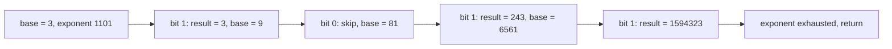
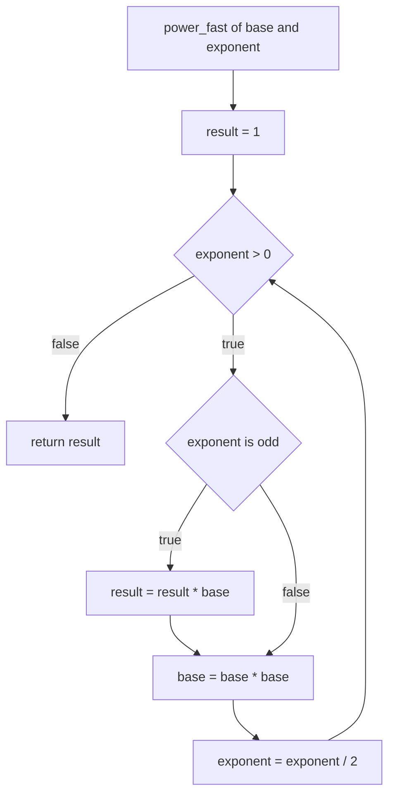
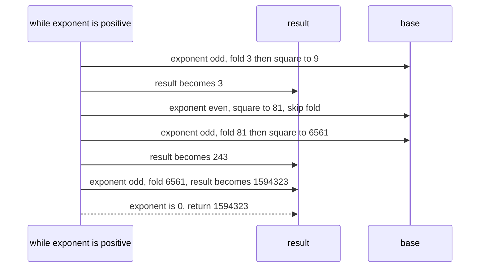

# 038 — Implement binary exponentiation (fast power).

> **Tier:** Beginner · **CTCI chapter:** Ch 6 — Math and Logic Puzzles
> **Task spec:** [038-implement-binary-exponentiation-fast-power.md](../../../tasks/beginner/038-implement-binary-exponentiation-fast-power.md)
> **Solutions:** [Python](../../../solutions/python/beginner/038-implement-binary-exponentiation-fast-power/solution.py) ·
> [Java](../../../solutions/java/beginner/038-implement-binary-exponentiation-fast-power/Solution.java) ·
> [JavaScript](../../../solutions/javascript/beginner/038-implement-binary-exponentiation-fast-power/solution.js) ·
> [C#](../../../solutions/csharp/beginner/038-implement-binary-exponentiation-fast-power/Solution.cs)

## 1. Problem restatement

**Input:** a base and a non-negative integer exponent. The Python docstring documents the domain
explicitly — *"Exponentiation by squaring: O(log exp) multiplications (exp >= 0)"* — and the Java,
JavaScript and C# loops all stop at a zero exponent.

**Output:** the exact product, in a wide integer type: `long` in Java and C#, Python's unbounded
`int`, and JavaScript's `BigInt`. Note that JavaScript is the only file that changes the *type* of
the result compared with the others, and it does so to keep large powers exact.

| Call | Result | Why |
| --- | --- | --- |
| `power_fast(3, 13)` | `1_594_323` | `13 = 1101₂`, so `3^13 = 3^8 · 3^4 · 3^1` |
| `power_fast(2, 10)` | `1024` | four squarings and two multiplications |
| `power_fast(7, 0)` | `1` | the loop never runs, the accumulator stays at the identity |

Python, Java and C# assert all three rows; JavaScript asserts the same three using `BigInt`
literals (`1594323n`). Exported names: `power_fast` (Python), `powerFast` (Java, JavaScript),
`PowerFast` (C#).

## 2. Intuition

The loop from [037](../../../tasks/beginner/037-compute-power-x-n-iterative.md) performs `n`
multiplications because it never uses anything it has already computed. But a power is not a chain
of `n` independent factors — it is built out of **powers of two**. Write the exponent in binary:

```text
13 = 8 + 4 + 1 = 1101 in binary
3^13 = 3^8 · 3^4 · 3^1
```

and each of `3^1, 3^2, 3^4, 3^8, …` is just the previous one **squared**. So instead of multiplying
by `3` thirteen times, you square the base four times and multiply the accumulated result only at
the positions where the exponent has a `1` bit:



Three multiplications into the accumulator and four squarings beat thirteen sequential
multiplications, and the gap grows linearly in the exponent while the work grows logarithmically.
The bit test `exp mod 2 = 1` and the shift `exp ← exp / 2` walk the binary digits from least
significant upwards, and the loop terminates when no digits are left.

## 3. Algorithm

1. Let `result = 1` and keep a running `base` variable that starts as the input base.
2. While the exponent is greater than `0`:
   1. If the exponent is odd (`exponent mod 2 = 1`), fold the current `base` into `result`.
   2. Square `base` — this turns `x^(2^i)` into `x^(2^(i+1))`.
   3. Halve the exponent (`exponent ← exponent / 2`, discarding the bit just consumed).
3. Return `result`.

```text
function power_fast(base, exponent)
    result ← 1
    while exponent > 0 do
        if exponent mod 2 = 1 then
            result ← result * base
        end
        base ← base * base
        exponent ← exponent / 2
    end
    return result
end
```

Java and C# test the low bit with `(exp & 1) == 1` and halve with `exp >>= 1`, and the Python
version writes the same two operations as `exp & 1` and `exp >>= 1`. The JavaScript file uses
`BigInt` throughout — `1n`, `BigInt(base)`, `e & 1n`, `e >>= 1n` — because a `Number` accumulator
would lose exactness once the product passes `2^53`.



The squaring in step 2 happens on **every** iteration, including the last one, whose result is
discarded when the exponent reaches zero. That wasted squaring is one multiplication, not a
correctness problem, and removing it would only add a branch.

## 4. Worked example

Trace `power_fast(3, 13)`. The exponent column shows the value before the shift, and the bit column
is the result of the odd test for that iteration.

| Step | `exponent` in binary | odd? | `result` after | `base` after |
| --- | --- | --- | --- | --- |
| start | 1101 | — | 1 | 3 |
| 1 | 1101 | yes | `1 · 3 = 3` | `3 · 3 = 9` |
| 2 | 110 | no | 3 | `9 · 9 = 81` |
| 3 | 11 | yes | `3 · 81 = 243` | `81 · 81 = 6561` |
| 4 | 1 | yes | `243 · 6561 = 1594323` | `6561 · 6561` (discarded) |
| exit | 0 | — | 1594323 | — |

Four iterations, seven multiplications in total (four squarings plus three accumulator folds),
against thirteen for the linear loop of [037](../../../tasks/beginner/037-compute-power-x-n-iterative.md).
The sequence of `base` values is `3, 9, 81, 6561`, i.e. `3^1, 3^2, 3^4, 3^8` — exactly the powers of
two the exponent selected. `power_fast(2, 10)` is shorter: `10 = 1010₂`, so iteration 1 skips and
squares (`base` becomes `4`), iteration 2 folds `4` into `result`, iteration 3 skips, iteration 4
folds `256`, giving `1024` in four iterations.



## 5. Complexity

Let `e` be the exponent and `b` the number of bits, `b = ⌊log2 e⌋ + 1`.

| Measure | Bound | Why it holds |
| --- | --- | --- |
| Time, best | O(1) | `e = 0` skips the loop and returns `1` |
| Time, average | O(log e) | one iteration per bit of the exponent, each doing at most one fold and always one squaring |
| Time, worst | O(log e) | all `b` bits set (`e = 2^b - 1`) needs `b` folds plus `b` squarings, still `2b` multiplications |
| Multiplications, exact count | `b` squarings + popcount(e) folds | for `e = 13`: `4 + 3 = 7` |
| Space | O(1) | three running integers, no recursion and no table |
| Linear loop (task 037) | O(e) multiplications | the baseline this task replaces |

The multiplication *count* is what matters, not just the iteration count: for `e = 10^9` the linear
loop needs a billion multiplications while this loop needs about thirty squarings and fifteen folds
— and, in Java and C#, it would overflow `long` long before finishing, which is the other half of
the story.

## 6. Pitfalls and edge cases

- **The exponent must be non-negative, and the four files fail differently if it is not.** Java and
  C# test `exp > 0` and C#'s `PowerFast(long baseV, int exp)` with a negative exponent simply
  returns `1`; the JavaScript `while (e > 0n)` loop does the same. Python's loop tests `while exp:`
  (truthiness), so a negative exponent keeps the loop alive forever: `-1 >> 1` is `-1` in Python, so
  the exponent never reaches zero. That is an infinite loop, and it is why the Python docstring
  spells out `exp >= 0`. Only Python is at risk *and* only Python documents it — do not "improve"
  the guard without deciding what negative exponents should mean.
- **`e = 0` returns `1`.** The loop is skipped, so `7^0 = 1` comes from the initialised accumulator.
  No special case is written and none is needed.
- **The last squaring is always wasted.** On the final iteration the exponent becomes `0` and the
  squared `base` is never used. Skipping it would save one multiplication out of `O(log e)` and add
  a branch; all four solutions keep the simple form.
- **Overflow is silent in Java and C#.** `result *= base` on `long` values wraps without an
  exception: `power_fast(3, 41)` overflows `2^63`. The JavaScript solution avoids the problem by
  returning `BigInt`, at the cost of a different return type from the other three files, and Python
  is unbounded.
- **`BigInt` does not mix with `Number`.** The JavaScript file starts with `1n`, converts the input
  with `BigInt(base)` and compares against BigInt literals in its assertions. Writing `result = 1`
  instead of `1n` throws a `TypeError` on the first multiplication.
- **Base `0` and base `1`.** `power_fast(0, 5)` is `0` (all folds multiply by `0`), and
  `power_fast(1, k)` is `1` for every `k`. Both fall out of the loop; only the exponent zero case
  needs the accumulator convention.
- **Negative bases are fine** as long as the exponent is non-negative: the parity of the exponent
  decides the sign and the odd test already knows the parity.
- **Do not replace `exp >>= 1` with a floating-point division.** `exp / 2` on a double exponent
  would round and break the loop; the shift (or Python's integer `>>`) is not just an optimisation.

## 7. Variants and follow-ups

- **The linear baseline.** [037](../../../tasks/beginner/037-compute-power-x-n-iterative.md) is the
  same problem in `O(e)` and explains the floating-point and reciprocal decisions that this task
  drops when it moves to exact integers.
- **Bit tricks on integers.** [028](../../../tasks/beginner/028-count-number-of-set-bits-in-an-integer.md)
  counts the `1` bits this algorithm walks, and [029](../../../tasks/beginner/029-check-if-integer-is-power-of-two.md)
  uses a single bit test as a decision procedure.
- **Modular exponentiation.** Adding a `mod` after each multiplication turns this into the
  `O(log e)` primitive used by
  [379](../../../tasks/intermediate/379-implement-combinatorics-ncr-modulo-prime-precompute-factorials.md)
  and by every cryptographic primitive that computes `x^e mod m`.
- **Where the squaring loop reappears.** [039](../../../tasks/beginner/039-simple-linear-congruential-pseudorandom-generator.md)
  multiplies and reduces at each step with the same "keep the numbers bounded" discipline, one
  iteration at a time.
- Chapter context: [Math and Logic](../../ctci/06-math-and-logic.md); asymptotics reminder:
  [Big-O](../../00-big-o.md).

## 8. Check yourself

1. Why does the algorithm work on the binary representation of the exponent?

<details><summary>Show answer</summary>

Because `x^(a + b) = x^a · x^b`, so an exponent can be split into the sum of its set bits: `13 = 8 +
4 + 1` gives `3^13 = 3^8 · 3^4 · 3^1`. The loop maintains `base = x^(2^i)` by squaring and folds it
into `result` exactly when bit `i` is set.

</details>

2. How many multiplications does `power_fast(3, 13)` perform, and how does that compare with the
   linear loop?

<details><summary>Show answer</summary>

Seven: four squarings (`3^2, 3^4, 3^8` and one discarded at the end) plus three folds into the
accumulator, one per set bit of `1101₂`. The linear loop of
[037](../../../tasks/beginner/037-compute-power-x-n-iterative.md) performs thirteen.

</details>

3. What does `power_fast(7, 0)` return, and from which line?

<details><summary>Show answer</summary>

`1`, from the initialised `result = 1`. The `while exponent > 0` guard fails immediately, so no
fold and no squaring ever run.

</details>

4. What happens in the Python file if you call `power_fast(2, -3)`?

<details><summary>Show answer</summary>

It never returns. The loop tests truthiness, and shifting a negative Python integer right keeps it
negative (`-1 >> 1` is `-1`), so the exponent never becomes zero. The docstring's `exp >= 0` is
therefore a real constraint, not a formality; the Java, C# and JavaScript versions return `1`
instead of hanging.

</details>

5. Which solution would you port for a base-10 exponent that overflows 64 bits, and what changes?

<details><summary>Show answer</summary>

The JavaScript one uses `BigInt` and stays exact; the Python one is unbounded by construction. For
Java and C# you would switch `long` to `BigInteger` / `BigInteger`-equivalent types and keep the same
loop shape — the algorithm is unchanged, only the arithmetic type widens. Assuming `long` only moves
the overflow point to `3^41`.

</details>
