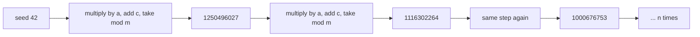
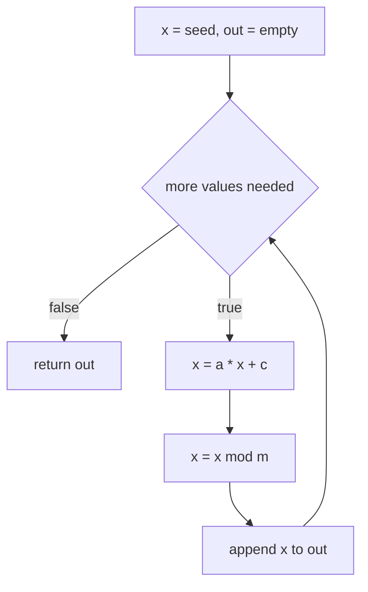
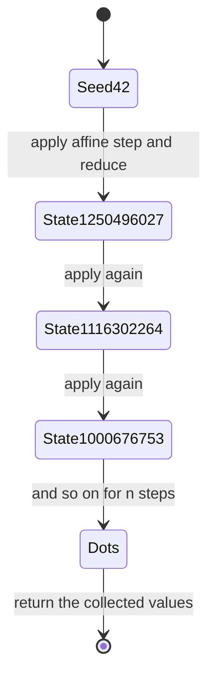

# 039 — Simple linear congruential pseudorandom generator.

> **Tier:** Beginner · **CTCI chapter:** Ch 6 — Math and Logic Puzzles
> **Task spec:** [039-simple-linear-congruential-pseudorandom-generator.md](../../../tasks/beginner/039-simple-linear-congruential-pseudorandom-generator.md)
> **Solutions:** [Python](../../../solutions/python/beginner/039-simple-linear-congruential-pseudorandom-generator/solution.py) ·
> [Java](../../../solutions/java/beginner/039-simple-linear-congruential-pseudorandom-generator/Solution.java) ·
> [JavaScript](../../../solutions/javascript/beginner/039-simple-linear-congruential-pseudorandom-generator/solution.js) ·
> [C#](../../../solutions/csharp/beginner/039-simple-linear-congruential-pseudorandom-generator/Solution.cs)

## 1. Problem restatement

**Input:** a `seed` and a count `n`, plus three constants that the Python and JavaScript versions
expose as default parameters: `a = 1103515245`, `c = 12345`, `m = 2^31`. The Python docstring
states the recurrence and the property that the tests check: *"x_{k+1} = (a · x_k + c) mod m.
Deterministic per seed."*

**Output:** the first `n` values of the sequence, as a list — `list` of Python `int`,
`long[]` in Java and C#, and in JavaScript an **array of `BigInt`** (the only file whose element
type differs from the others).

| Check | Expected | Why |
| --- | --- | --- |
| `lcg(42, 5)` length | `5` | one output per requested step |
| `lcg(42, 5) == lcg(42, 5)` | true | the sequence is a pure function of the seed |
| `lcg(43, 5) != lcg(42, 5)` | true | neighbouring seeds diverge immediately |
| every element | `0 ≤ x < 2^31` | the modulo guarantees the range (asserted in Python) |

Running the Python solution for the assert seed produces
`[1250496027, 1116302264, 1000676753, 1668674806, 908095735]` for `lcg(42, 5)`, and
`lcg(43, 5)` starts at `206527624` — a completely different first value, which is what the
seed-sensitivity assertion is checking. All four files assert the same three properties in their
own idiom: Python with `==`/`!=` on lists, Java with `Arrays.equals`, C# by comparing joined strings
and JavaScript with `deepStrictEqual` / `notDeepStrictEqual`.

## 2. Intuition

You want a sequence that looks random but is reproducible: same seed, same sequence, forever. The
cheapest such recipe is a **recurrence with no memory beyond one value** — the next number is a
fixed arithmetic function of the current one, folded back into range with a modulo:

```text
x_{k+1} = (a · x_k + c) mod m
```

Three properties make this work:

- **The modulo keeps the state bounded.** Every value lies in `[0, m)`, so no matter how long the
  sequence runs, the state fits in one machine word.
- **The arithmetic is affine, so it is a permutation of the state space** for suitable `a` and `c`.
  With `m = 2^31`, `c` odd and `a ≡ 1 (mod 4)` — and `1103515245 mod 4 = 1`, `12345` is odd, so both
  hold here — the Hull–Dobell conditions are satisfied and the sequence has full period `m` before
  it repeats: it walks through every one of the `2^31` possible states.
- **Determinism is free.** No hidden state is read, so the sequence is entirely determined by the
  seed. That is exactly what makes it testable and what makes it unsuitable for security.



The picture has no merge points and no branches: the loop is a chain, and the only thing carried
from step to step is the previous value.

## 3. Algorithm

1. Set `x = seed`.
2. Allocate an output collection with room for `n` values.
3. Repeat `n` times:
   1. `x ← (a · x + c) mod m`
   2. append the new `x` to the output.
4. Return the output.

```text
function lcg(seed, n, a, c, m)
    x ← seed
    out ← empty list
    repeat n times
        x ← (a * x + c) mod m
        append x to out
    end
    return out
end
```

The first output is the **second** state of the machine: the seed itself is never emitted, so
`lcg(42, 5)` yields `x_1 … x_5`, not `x_0 … x_4`. The recurrence is applied before the append, in
all four files, so this is part of the contract rather than an accident of ordering. Python writes
the step as `x = (a * x + c) % m` inside `for _ in range(n)`; Java and C# use `long x` with
`a = 1103515245L, c = 12345L, m = 1L << 31`; JavaScript uses `BigInt` throughout because a
`Number` cannot hold the intermediate product exactly.



Note that `a * x + c` happens *before* the reduction, so the intermediate value is up to
`a · (m - 1) + c ≈ 2.37 × 10^18`. That number is what makes the choice of storage type a real
design decision rather than a style preference.

## 4. Worked example

Trace `lcg(42, 5)` with the repository's constants. Column four is the unreduced affine value, which
is what a naive implementation would try to store in a 32-bit variable.

| Step | `x` before | `a · x + c` | quotient by `m` | `x` after (mod `m`) |
| --- | --- | --- | --- | --- |
| 1 | 42 | 46347652635 | 21 | 1250496027 |
| 2 | 1250496027 | 1379941429606443960 | 642585302 | 1116302264 |
| 3 | 1116302264 | 1231856566352027025 | 573627914 | 1000676753 |
| 4 | 1000676753 | — | — | 1668674806 |
| 5 | 1668674806 | — | — | 908095735 |

Every value stays inside `[0, 2^31)`: the largest here is `1668674806 < 2147483648`. The first step
needs only 36 bits of intermediate value (`4.6 × 10^10`), but step 2 already reaches
`1.38 × 10^18`, which is 61 bits — comfortably inside a signed 64-bit integer
(`9.22 × 10^18`) and far outside a `Number`'s exact range of `2^53`.

Because the state is a single number in `[0, m)`, the sequence is a walk on a finite set, and with
the full-period constants it visits all `m` states before repeating.



## 5. Complexity

Let `n` be the requested count and `w` the word size of the arithmetic used.

| Measure | Bound | Why it holds |
| --- | --- | --- |
| Time | O(n) | exactly one multiply, one add and one modulo per emitted value, with no branching |
| Space, output | O(n) | the returned list holds every value; the generator itself is a streaming process |
| Space, extra | O(1) | only the current `x` is carried between iterations |
| O(n) is optimal here | — | the caller asked for `n` values, so `n` steps is a lower bound |
| Cost per step, Java/C# | one 64-bit multiply and one 64-bit modulo | the intermediate `≈ 2.37 × 10^18` fits in `long` |
| Cost per step, JavaScript | one `BigInt` operation | `Number` would round the product above `2^53` and lose determinism |

The expensive operation in practice is the modulo, which costs a division per step. Since `m` is a
power of two, the reduction could be written as a mask — `x & (2^31 - 1)` and `x % 2^31` agree for
every non-negative `x` and the mask is cheaper — but none of the four files does that. Keeping the
literal modulo keeps the code a direct transcription of the recurrence and avoids one subtlety: for
a *negative* `x` the two forms disagree in Java, C# and JavaScript, where `%` preserves the sign of
the dividend while the mask always yields a value in `[0, m)`.

## 6. Pitfalls and edge cases

- **The seed is not emitted.** The first value in the output is already one step downstream of the
  seed. Emitting the seed first would produce a list of `n + 1` values, or silently shift the whole
  sequence by one — a difference the length assertion would not catch, but the determinism
  comparison against `lcg(42, 5)` would.
- **Intermediate overflow is the core hazard.** `a · x + c` needs about 61 bits. Java and C# are
  safe because `long` is 64-bit and the solutions declare `a`, `c` and `m` as `long` literals
  (`1103515245L`, `12345L`, `1L << 31`); using `int` would overflow silently and produce a *different*
  sequence that still looks random. JavaScript uses `BigInt` for the same reason. Python is
  unbounded.
- **`m = 1L << 31` is `2^31`, not `2^31 - 1`.** Writing the modulus as a bit mask is the classic
  mistake; `& (2^31 - 1)` would reduce modulo `2147483647`, a completely different generator.
- **`%` with negative operands.** A negative seed makes `x` negative in Java, C# and JavaScript
  (`%` keeps the sign of the dividend), and negative values would then be emitted. Python's `%`
  returns a non-negative result for a positive modulus, so Python would silently behave differently.
  The four files pass `42` and `43`, so this divergence is untested — do not assume the languages
  agree for negative seeds.
- **Determinism depends on the constants, not on the language.** All four files use the same
  `a = 1103515245` and `c = 12345`, so they produce the same numbers; changing one default argument
  in one file would break the cross-language property that makes the assertions meaningful.
- **`n = 0` returns an empty collection** in every language: the loop body never runs. Negative `n`
  in Python would return `[]` (`range` is empty), while a Java `for` loop with a negative bound also
  skips — but `new long[n]` would throw a `NegativeArraySizeException`, so Java and C# really do
  require `n ≥ 0`.
- **A full period is not randomness.** The Hull–Dobell conditions guarantee the sequence eventually
  visits every state, but consecutive values lie on a lattice and the low bits alternate in visible
  patterns. This is a teaching generator; the assertions test determinism and range, nothing about
  statistical quality.
- **Range never needs clamping.** Because the reduction happens on every step, every emitted value
  automatically satisfies `0 ≤ x < m`; that is what the Python assertion
  `all(0 <= x < 2**31 for x in seq)` checks.

## 7. Variants and follow-ups

- **Deterministic generation as a design idea.** [045](../../../tasks/beginner/045-replace-spaces-with-20-urlify.md)
  and the hashing-based follow-ups use the same "pure function of the input" property; for a
  scalable version see
  [345](../../../tasks/intermediate/345-design-a-randomized-set-with-insert-delete-getrandom.md).
- **Overflow-safe arithmetic.** The `BigInt` discipline here is the same one
  [038](../../../tasks/beginner/038-implement-binary-exponentiation-fast-power.md) applies to
  squaring, and the modular reduction reappears in
  [379](../../../tasks/intermediate/379-implement-combinatorics-ncr-modulo-prime-precompute-factorials.md).
- **Modular arithmetic.** [035](../../../tasks/beginner/035-greatest-common-divisor-gcd-euclid-s-algorithm.md)
  and [036](../../../tasks/beginner/036-least-common-multiple-lcm-using-gcd.md) cover the rest of the
  `mod` toolkit used by Ch 6.
- **Reproducibility as a requirement.** The seed-in, sequence-out contract is what
  [992](../../../tasks/master/992-implement-reproducible-random-seed-protocol-for-benchmarking-fai.md)
  turns into a protocol, and what makes the generator in this task testable at all.
- Chapter context: [Math and Logic](../../ctci/06-math-and-logic.md); the
  [Big-O](../../00-big-o.md) reference covers the `O(n)` streaming bound.

## 8. Check yourself

1. Why is the sequence deterministic, and what would break that property?

<details><summary>Show answer</summary>

Because each step is a pure arithmetic function of the previous value — `(a · x + c) mod m` — with
no clock, no OS entropy and no shared mutable state. Anything that reads external state, or that
truncates the intermediate product differently (a 32-bit `int` in Java, a `Number` in JavaScript),
would break the property or change the sequence.

</details>

2. Why does the JavaScript solution use `BigInt` while Java and C# get away with `long`?

<details><summary>Show answer</summary>

The intermediate `a · x + c` can be about `2.37 × 10^18`, which needs 61 bits. A JavaScript `Number`
is exact only up to `2^53 - 1`, so the product would be rounded and the sequence would diverge from
the other implementations. `long` is 64-bit and holds the product exactly, so Java and C# need no
special type.

</details>

3. How many output values does `lcg(42, 5)` return, and which state is the first one?

<details><summary>Show answer</summary>

Five values, `x_1 … x_5`, starting with `1250496027`. The seed `x_0 = 42` is only the starting state
of the recurrence and is never appended, because the update happens before the append in all four
files.

</details>

4. What does the assertion `lcg(43, 5) != lcg(42, 5)` actually demonstrate?

<details><summary>Show answer</summary>

That the mapping from seed to sequence is sensitive to the seed: seeds differing by one produce
completely different output, starting with `206527624` versus `1250496027`. It also shows that no
state leaks between calls — a cached or global `x` would have produced identical results for both
seeds.

</details>

5. Could the reduction `x % 2^31` be replaced by a bit mask, and would the four files agree?

<details><summary>Show answer</summary>

For non-negative `x` the mask `x & (2^31 - 1)` computes exactly the same value as `x % 2^31`, so it
is a legitimate optimisation of the documented state range. It is not equivalent for negative
inputs in Java, C# or JavaScript, where `%` preserves the sign of the dividend while the mask always
returns a value in `[0, m)`; Python's `%` already behaves like the mask. None of the solutions takes
the shortcut — they keep the literal modulo so the code states the recurrence as written.

</details>
