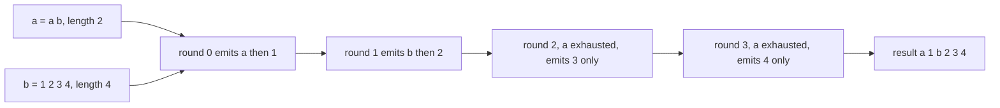
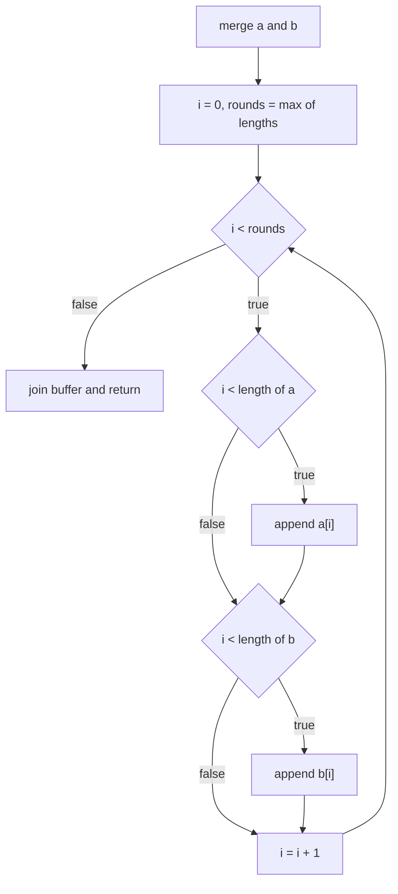
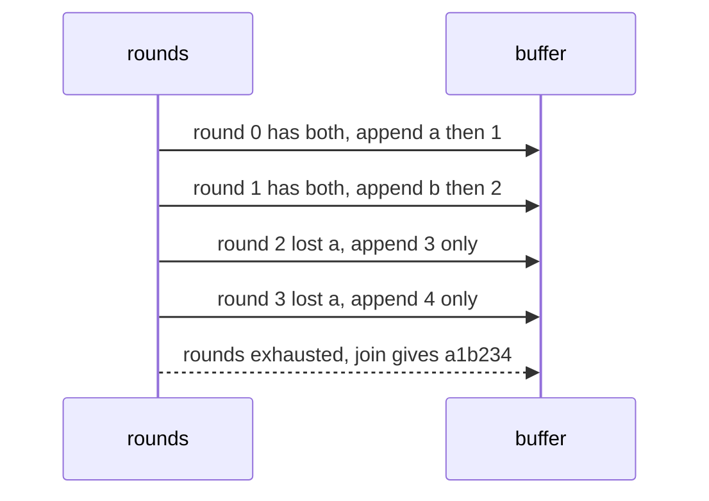

# 040 — Merge two strings alternately.

> **Tier:** Beginner · **CTCI chapter:** Ch 1 — Arrays and Strings
> **Task spec:** [040-merge-two-strings-alternately.md](../../../tasks/beginner/040-merge-two-strings-alternately.md)
> **Solutions:** [Python](../../../solutions/python/beginner/040-merge-two-strings-alternately/solution.py) ·
> [Java](../../../solutions/java/beginner/040-merge-two-strings-alternately/Solution.java) ·
> [JavaScript](../../../solutions/javascript/beginner/040-merge-two-strings-alternately/solution.js) ·
> [C#](../../../solutions/csharp/beginner/040-merge-two-strings-alternately/Solution.cs)

## 1. Problem restatement

**Input:** two strings `a` and `b`. Their lengths are independent: either may be empty, either may
be the longer one, and they may be equal.

**Output:** a new string that takes characters alternately from `a` and `b`, starting with `a`. Once
the shorter input runs out, the remaining tail of the longer one is appended unchanged. Nothing is
mutated and both inputs are left untouched.

| Call | Result | Why |
| --- | --- | --- |
| `merge_alternately("abc", "123")` | `"a1b2c3"` | equal lengths, so the interleave consumes both exactly |
| `merge_alternately("ab", "1234")` | `"a1b234"` | `a` runs out after two rounds; `"34"` is appended as a tail |
| `merge_alternately("", "xyz")` | `"xyz"` | the empty shorter string contributes nothing, so the result is just `b` |

Java, JavaScript and C# assert these three rows; the Python file asserts the same three, writing the
second expectation as `"a1b2" + "34"` to make the tail explicit. The exported name is
`merge_alternately` in Python, `mergeAlternately` in Java and JavaScript and `MergeAlternately` in
C#.

## 2. Intuition

The operation is a **two-cursor traversal** with an interleaving write rule, and the naive approach
is to walk both strings in lockstep while both still have characters, then append the remainder:

```text
while both have characters left
    take one from a, take one from b
append whatever is left in the longer string
```

That is correct — and it is also the version that most often has an off-by-one bug, because the
"whatever is left" phase needs a second loop and a length comparison. The solution files collapse
both phases into a single loop whose bound is `max(len(a), len(b))` and whose body guards each
append with its own test:

```text
for round in 0 … max(n, m) - 1
    if round < n then emit a[round]
    if round < m then emit b[round]
```

Once `round` passes the shorter length, exactly one of the two guards fires, and the tail flows out
of the same loop. One loop, two guards, no special case for emptiness — the empty-string row falls
out because `max(0, 3) = 3` and only the second guard ever fires.



The crucial detail is the *order inside one round*: `a` first, then `b`. Swapping the two guards
produces `"1a2b34"`, which is a plausible-looking result and fails the assertion immediately.

## 3. Algorithm

1. Let `n = len(a)` and `m = len(b)`.
2. Allocate a growable output buffer.
3. For each round `i` from `0` to `max(n, m) - 1`:
   1. If `i < n`, append `a[i]` to the buffer.
   2. If `i < m`, append `b[i]` to the buffer.
4. Join the buffer into one string and return it.

```text
function merge_alternately(a, b)
    n ← length of a
    m ← length of b
    out ← empty growable buffer
    i ← 0
    while i < max(n, m) do
        if i < n then append a[i] to out end
        if i < m then append b[i] to out end
        i ← i + 1
    end
    return buffer joined into one string
end
```

The four implementations differ only in how they accumulate. Python and JavaScript collect
characters in a list and call `"".join(parts)` / `out.join("")`; Java and C# append directly into a
`StringBuilder`, which is the same buffer-after-the-fact trick with a library type. The bound is
`max(len(a), len(b))` in every file (`Math.max` in Java, C# and JavaScript, the built-in `max` in
Python), and the two guards are written in the same order everywhere.



## 4. Worked example

Trace `merge_alternately("ab", "1234")` — the asserted unequal-length row.

| Round `i` | `i < 2`? | appended from `a` | `i < 4`? | appended from `b` | buffer after the round |
| --- | --- | --- | --- | --- | --- |
| 0 | yes | `a` | yes | `1` | `"a1"` |
| 1 | yes | `b` | yes | `2` | `"a1b2"` |
| 2 | no | — | yes | `3` | `"a1b23"` |
| 3 | no | — | yes | `4` | `"a1b234"` |
| exit | `i = 4` reaches `max(2, 4)` | — | — | — | return `"a1b234"` |

Rounds 2 and 3 are the tail phase, and they are handled by the same two guards — the first one is
simply false. The equal-length case `("abc", "123")` stops after three rounds with both guards true
each time, producing `"a1b2c3"`. The empty case `("", "xyz")` runs `max(0, 3) = 3` rounds in which
only the `b` guard fires, so the buffer accumulates `"x"`, `"xy"`, `"xyz"`.



## 5. Complexity

Let `n = len(a)` and `m = len(b)`; the output is `n + m` characters long.

| Measure | Bound | Why it holds |
| --- | --- | --- |
| Time, best | O(n + m) | the loop runs `max(n, m)` times and each round appends at most two characters, so the total is exactly `n + m` appends |
| Time, average | O(n + m) | same bound; the guards do not change the total work |
| Time, worst | O(n + m) | no branch can increase the append count, which is already the size of the output |
| Space, output | O(n + m) | the result contains every input character exactly once |
| Space, extra | O(n + m) | the char buffer or `StringBuilder` that becomes the result |
| Naive string concatenation | O((n + m)²) | `result = result + c` copies the whole prefix each round in Java, C# and JavaScript strings |

Building the answer through repeated string concatenation is the trap this task shares with
[001](../../../tasks/beginner/001-reverse-a-string.md): the output is immutable in every one of
these languages, so each `+` allocates. Both the Python/JavaScript list-then-join and the
Java/C# `StringBuilder` avoid it, and none of the four files grows a string inside the loop.

## 6. Pitfalls and edge cases

- **Order inside a round.** `a` first, then `b`. This is asserted by every row: `"abc"` and `"123"`
  give `"a1b2c3"`, not `"1a2b3c"`.
- **Unequal lengths.** The tail must come out in order and unchanged: `"a1b234"`, not `"a1b2"` with
  the tail dropped and not `"a1b243"` with it reversed.
- **Both empty.** `merge_alternately("", "")` returns `""`: `max(0, 0) = 0`, the loop body never
  runs, and the joined empty buffer is the empty string. No file special-cases it.
- **One empty.** Either argument may be empty; the result is then exactly the other string, which
  the third asserted row pins down.
- **Length of the output is always `n + m`.** Useful as a cheap invariant: if your implementation
  produces a shorter string, a guard fired when it should not have.
- **Do not mutate the inputs.** Strings are immutable in all four languages, so the risk here is
  index-level: writing into a caller's character array (as
  [045](../../../tasks/beginner/045-replace-spaces-with-20-urlify.md) deliberately does) would break
  the contract this task states.
- **`max(n, m)` versus `n + m` rounds.** Using `n + m` as the bound would still be correct but would
  run `min(n, m)` extra rounds in which both guards are false — wasted iterations, and a common
  off-by-one when the loop is written from the output length instead of the input lengths.
- **Surrogate pairs.** All four implementations index by code unit (Java, C#, JavaScript) or code
  point (Python), and the interleave is positional, so an emoji crossing a length boundary is
  treated as one or two units depending on the language. The assertions stay in ASCII.
- **Buffer capacity.** Java's `StringBuilder` and JavaScript's array grow geometrically, so the
  `O(n + m)` appends do not turn into `O((n + m)²)` copying; none of the files presizes the buffer,
  which is a constant-factor choice, not a correctness one.

## 7. Variants and follow-ups

- **The same index gymnastics.** [001](../../../tasks/beginner/001-reverse-a-string.md) reverses by
  permutation, [021](../../../tasks/beginner/021-rotate-array-right-by-k-positions-create-new-array.md)
  and [022](../../../tasks/beginner/022-rotate-array-in-place-by-k-positions.md) rotate, and this
  task merges — all four are pure index arithmetic over a buffer.
- **Merging when the inputs are sorted.** [020](../../../tasks/beginner/020-merge-two-sorted-arrays-into-a-sorted-array.md)
  merges two sorted arrays with two independent cursors, which is the same two-cursor machine with a
  comparison where the alternation rule is.
- **In-place compaction.** [045](../../../tasks/beginner/045-replace-spaces-with-20-urlify.md) is the
  variant that writes back into the caller's buffer with a read cursor and a write cursor, both
  moving in different directions.
- **Text handling siblings.** [043](../../../tasks/beginner/043-count-words-in-a-string.md) and
  [044](../../../tasks/beginner/044-trim-leading-and-trailing-spaces-from-string.md) are the other
  single-pass string traversals of this tier.
- Chapter context: [Arrays and Strings](../../ctci/01-arrays-and-strings.md), and
  [Big-O](../../00-big-o.md) for the quadratic trap of appending to immutable strings.

## 8. Check yourself

1. Why is `max(len(a), len(b))` the right loop bound?

<details><summary>Show answer</summary>

Because every character is emitted in exactly one round: round `i` emits `a[i]` and `b[i]` when they
exist. The last round that can emit anything is round `max(n, m) - 1`, so no tail is dropped and no
round is wasted.

</details>

2. How many characters does the output contain, always?

<details><summary>Show answer</summary>

Exactly `n + m`. Each guard appends at most one character per round, and each input character
satisfies its guard in exactly one round, so the counts add up. `"ab"` and `"1234"` therefore
produce a six-character string, and the asserted `"a1b234"` is six characters long.

</details>

3. What does `merge_alternately("a", "")` return?

<details><summary>Show answer</summary>

`"a"`. The loop runs `max(1, 0) = 1` round; the `a` guard is true and appends `a`, the `b` guard is
false, and the joined buffer is `"a"`.

</details>

4. Why do the Java and C# files use `StringBuilder` while Python and JavaScript build a list?

<details><summary>Show answer</summary>

Both are the same strategy — collect pieces in a mutable buffer and materialise the string once.
Java and C# ship a dedicated growable string builder, while in Python and JavaScript the idiomatic
mutable buffer is a list plus a single `join`. Doing it with repeated string concatenation instead
would cost `O((n + m)²)` copies.

</details>

5. What happens if you swap the two guards inside the loop?

<details><summary>Show answer</summary>

The result becomes `b`-first interleaving: `"abc"` with `"123"` yields `"1a2b3c"` and the first
assertion fails. The order of the guards encodes the stated rule "start with `a`" — the loop bound
and the tail phase are unaffected.

</details>
