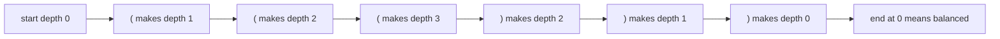
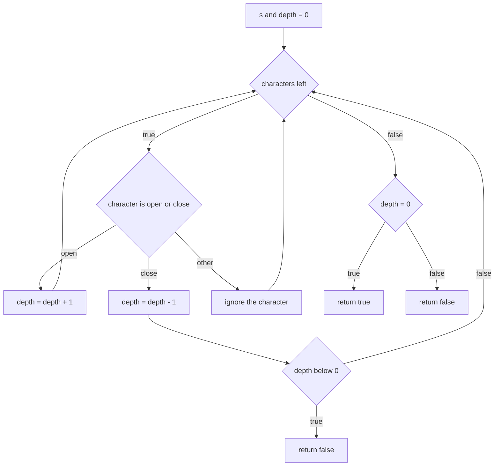
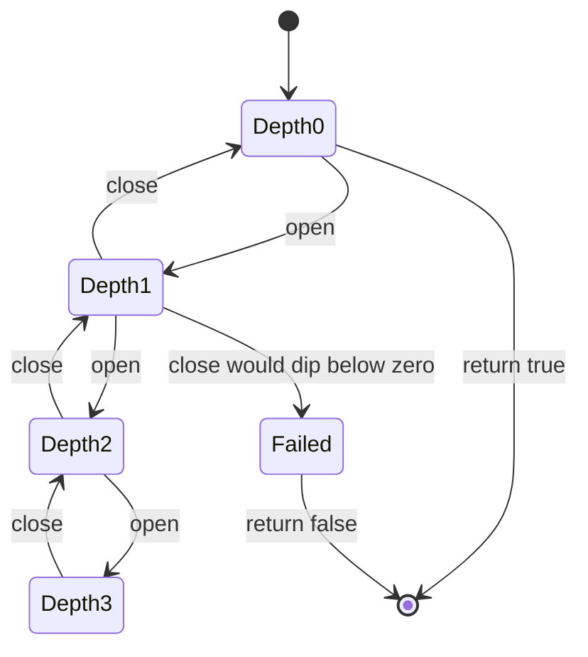

# 041 — Check if brackets are balanced (single type).

> **Tier:** Beginner · **CTCI chapter:** Ch 3 — Stacks and Queues
> **Task spec:** [041-check-if-brackets-are-balanced-single-type.md](../../../tasks/beginner/041-check-if-brackets-are-balanced-single-type.md)
> **Solutions:** [Python](../../../solutions/python/beginner/041-check-if-brackets-are-balanced-single-type/solution.py) ·
> [Java](../../../solutions/java/beginner/041-check-if-brackets-are-balanced-single-type/Solution.java) ·
> [JavaScript](../../../solutions/javascript/beginner/041-check-if-brackets-are-balanced-single-type/solution.js) ·
> [C#](../../../solutions/csharp/beginner/041-check-if-brackets-are-balanced-single-type/Solution.cs)

## 1. Problem restatement

**Input:** a string `s` that may contain `(` and `)` — and, as the implementation reveals, anything
else, because the loop ignores every character that is not one of the two brackets.

**Output:** a boolean: `true` when every `(` is closed by a later `)` and the pairs are properly
nested, `false` otherwise. Nothing is modified and the string is read once.

| Call | Result | Why |
| --- | --- | --- |
| `is_balanced("((()))")` | `true` | depth climbs to 3 and returns to 0 with no dip below |
| `is_balanced("()()()")` | `true` | three separate groups, depth oscillates 1, 0, 1, 0, 1, 0 |
| `is_balanced("")` | `true` | an empty string has nothing to close |
| `is_balanced("(()")` | `false` | depth ends at 1, so one bracket is unclosed |
| `is_balanced(")(")` | `false` | depth would go negative: a close arrives with nothing open |

Java asserts all five rows, Python asserts all five, and JavaScript and C# assert four (they omit the
empty-string row). The exported name is `is_balanced` in Python and JavaScript and `IsBalanced` in
Java and C#.

## 2. Intuition

The obvious tool for bracket matching is a stack, and for three bracket types it is the *only*
workable tool — see [042](../../../tasks/beginner/042-check-balanced-parentheses-with-three-bracket-types.md).
With a single bracket type there is nothing to distinguish one open bracket from another, so you do
not need to remember *which* brackets are open, only **how many**. That count is `depth`, and the
whole algorithm is a walk over the string that increments it on `(` and decrements it on `)`.

Three facts make the counter sufficient:

- **A close with nothing open is always an error.** If `depth` would fall below zero, no earlier
  `(` exists to match this `)`, so the answer is `false` immediately.
- **Anything left open at the end is an error.** After the last character, `depth == 0` is exactly the
  statement "nothing is unresolved".
- **The count is the nesting height.** Reading `depth` after each character traces the outline of the
  nesting, and the two failure modes are precisely a dip below the floor and a non-zero final height.



Note that the picture is a *profile*, not a set: the string `"()()()"` reaches the same heights in a
different order and still ends at `0`.

## 3. Algorithm

1. Set `depth = 0`.
2. For each character `c` of `s`:
   1. If `c = '('`, increment `depth`.
   2. Otherwise, if `c = ')'`, decrement `depth` and return `false` immediately if `depth < 0`.
   3. Any other character is ignored.
3. Return `depth = 0`.

```text
function is_balanced(s)
    depth ← 0
    for each character c in s do
        if c = '(' then
            depth ← depth + 1
        else if c = ')' then
            depth ← depth - 1
            if depth < 0 then return false end
        end
    end
    return depth = 0
end
```

The early `return false` inside the decrement branch is the part that a first draft usually misses.
Without it, `")("` would produce `depth = -1` and then `0`, and the final test would report the string
as balanced. With it, the counter never needs to represent a negative height at all, which is why the
file can document the answer as "never deeper than it should be, and empty at the end".



## 4. Worked example

Trace the three character strings in one table. Each row is one character consumed; the verdict
column only appears when the function returns early.

**`"((()))"`**

| Step | character | `depth` after | note |
| --- | --- | --- | --- |
| 1 | `(` | 1 | |
| 2 | `(` | 2 | |
| 3 | `(` | 3 | peak of the nesting |
| 4 | `)` | 2 | |
| 5 | `)` | 1 | |
| 6 | `)` | 0 | exactly closed |
| exit | — | 0 | return `true` |

**`"(()"`**

| Step | character | `depth` after | note |
| --- | --- | --- | --- |
| 1 | `(` | 1 | |
| 2 | `(` | 2 | |
| 3 | `)` | 1 | |
| exit | — | 1 | not zero, return `false` |

**`")("`**

| Step | character | `depth` after | note |
| --- | --- | --- | --- |
| 1 | `)` | -1 | negative, so return `false` immediately |
| — | `(` | not read | the loop exited before the second character |

The third trace is the one that justifies the early exit: had the function kept scanning, the `(`
would have brought `depth` back to `0` and the final test would have wrongly answered `true`. The
asserted row `not is_balanced(")(")` exists precisely to lock that behaviour in.



## 5. Complexity

Let `n` be the length of `s`.

| Measure | Bound | Why it holds |
| --- | --- | --- |
| Time, best | O(1) | a string starting with `)` returns after the first character |
| Time, average | O(n) | one comparison and at most one increment per character |
| Time, worst | O(n) | `"((((…"` never triggers the early exit, so the whole string is read |
| Space | O(1) | one integer counter; no stack, no array, no recursion |
| Stack version (task 042) | O(n) time, O(n) space | three bracket types force you to store the open brackets themselves |
| Balance check by counting | O(n) time, O(1) space | testing `count('(') == count(')')` is *not* sufficient: it accepts `")("` |

The last row is the reason the algorithm cannot be reduced to two independent character counts even
for a single bracket type: order matters, and `depth` is the smallest piece of state that records the
order.

## 6. Pitfalls and edge cases

- **Empty string is balanced.** `is_balanced("")` returns `true` in all four files: the loop body
  never runs and `depth == 0`. Java and Python assert this row; the JavaScript and C# files do not,
  so if you edit them, keep the behaviour.
- **`")("` needs the early exit.** Without the `if depth < 0` check, the counter would end at zero
  and report balanced. The Java assertion label for this row is literally `"bad order"`.
- **Unclosed prefix.** `"(()"` ends at depth 1 and is rejected by the final `depth == 0` test — the
  counterpart of the early exit.
- **Non-bracket characters are invisible.** A `b` or a space neither increments nor decrements, so
  `is_balanced("a(b)c")` is `true`. The loop uses `if`/`else if` on the two ASCII brackets rather
  than a "valid character" check, in all four files.
- **Only ASCII parentheses exist here.** The full-width parentheses or the mathematical bracket
  characters are just "other characters" and are ignored, so `is_balanced("（）")` returns `true`
  for the wrong reason. A production parser would reject unknown characters instead.
- **Depth is a small integer.** It is bounded by `n`, so no overflow is possible for any realistic
  string, and the counter can be a plain `int`.
- **The test is not "equal counts".** `")("` has one of each and is still invalid; only the
  order-aware counter rejects it. If you refactor to two counters you lose correctness, not just
  speed.
- **Filtering first is not a shortcut.** Stripping the non-parenthesis characters and reusing the
  stack version of [042](../../../tasks/beginner/042-check-balanced-parentheses-with-three-bracket-types.md)
  gives the same verdict, but it needs an `O(n)` copy of the string for no benefit; the counter
  answers in place.

## 7. Variants and follow-ups

- **Three bracket types.** [042](../../../tasks/beginner/042-check-balanced-parentheses-with-three-bracket-types.md)
  is the direct generalisation and the reason the stack appears in Ch 3; the counter here is the
  degenerate stack where every element is identical.
- **Stack implementations.** [049](../../../tasks/beginner/049-implement-stack-with-array-push-pop.md)
  and [050](../../../tasks/beginner/050-implement-queue-with-array-enqueue-dequeue.md) build the
  structure that the next task uses; this task shows a case where you can avoid it entirely.
- **Longest valid substring.** [341](../../../tasks/intermediate/341-balanced-parentheses-longest-valid-substring-stack.md)
  turns the same depth profile into a lookup: track the earliest index at each depth and the widest
  span between equal depths.
- **Counting versus ordering.** [016](../../../tasks/beginner/016-count-occurrences-of-each-character-in-a-string.md)
  counts characters without caring about their order, which is exactly the shortcut that fails here.
- Chapter context: [Stacks and Queues](../../ctci/03-stacks-and-queues.md).

## 8. Check yourself

1. Why is a single integer enough for one bracket type, when three types need a stack?

<details><summary>Show answer</summary>

Because with one type every open bracket is interchangeable: knowing *how many* are open determines
whether the next close is legal, with no need to remember which kind of bracket is on top. The
counter is a stack whose elements are all identical, so it can be represented by its size.

</details>

2. Where exactly does `is_balanced(")(")` return `false`, and what would happen without that line?

<details><summary>Show answer</summary>

On the first character: `)` decrements `depth` to `-1`, the guard fires and the function returns
`false` before reading `(`. Without the guard, the second character would raise `depth` back to `0`
and the final `depth == 0` test would return `true`, accepting a string that closes before it opens.

</details>

3. What is the value of `depth` after processing `"(()"`, and what is the verdict?

<details><summary>Show answer</summary>

`depth` is `1` — the two opens were matched by only one close — so the final test fails and the
function returns `false`. No early exit is involved in this case.

</details>

4. Is `count('(') == count(')')` a valid implementation of this check?

<details><summary>Show answer</summary>

No. It accepts `")("`, which has equal counts but violates nesting order. It also accepts any
permutation such as `"))((" `, so the counter has to be maintained in reading order with the
below-zero check.

</details>

5. How does the behaviour change if the input contains letters, and is that the intent?

<details><summary>Show answer</summary>

Letters and spaces are ignored entirely, so `"a(b)c"` is reported balanced. That is what the
`if`/`else if` on the two ASCII brackets in the solution files produces, and it is a reasonable
reading of "check if brackets are balanced" — but a parser that must reject stray characters would
need an extra branch that returns `false` for anything outside the bracket alphabet.

</details>
