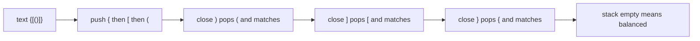
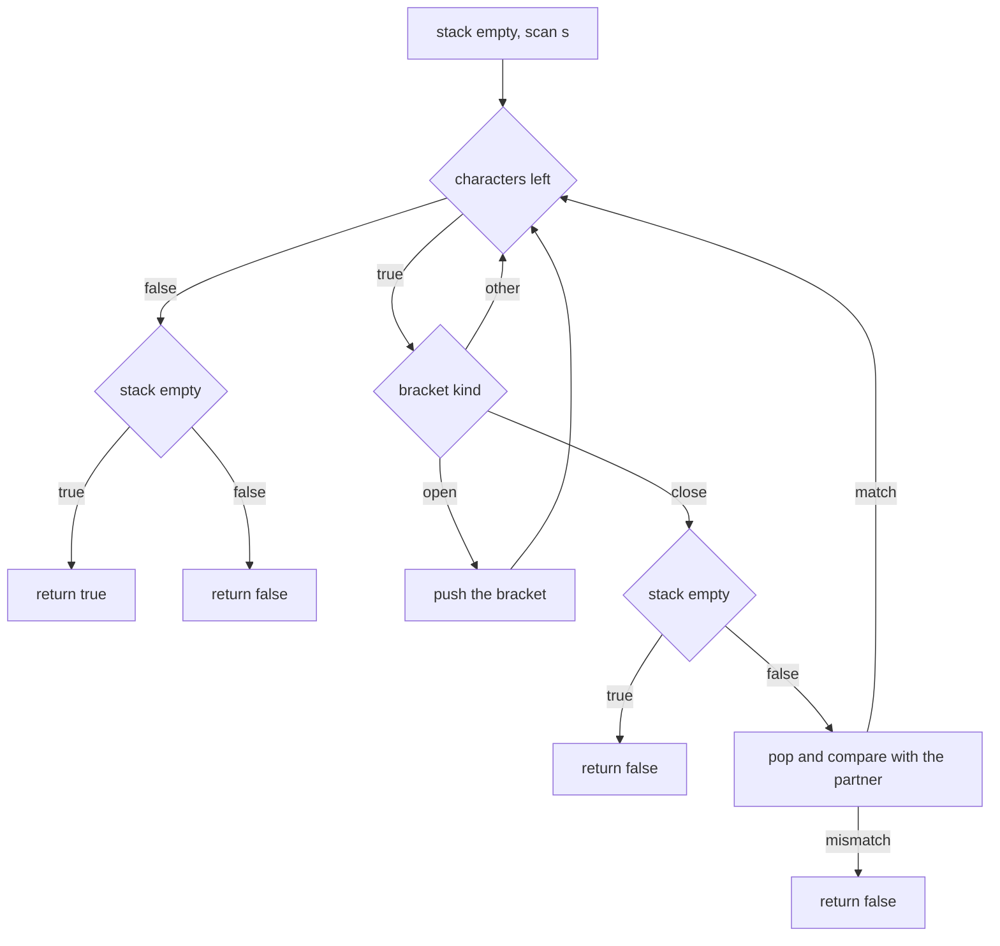
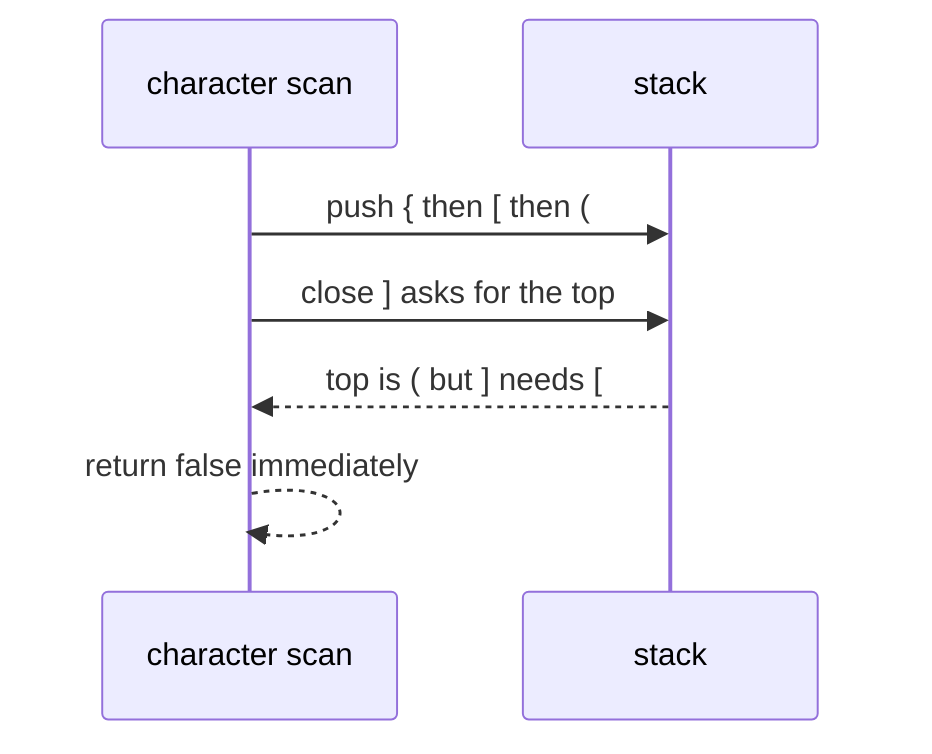

# 042 — Check balanced parentheses with three bracket types.

> **Tier:** Beginner · **CTCI chapter:** Ch 3 — Stacks and Queues
> **Task spec:** [042-check-balanced-parentheses-with-three-bracket-types.md](../../../tasks/beginner/042-check-balanced-parentheses-with-three-bracket-types.md)
> **Solutions:** [Python](../../../solutions/python/beginner/042-check-balanced-parentheses-with-three-bracket-types/solution.py) ·
> [Java](../../../solutions/java/beginner/042-check-balanced-parentheses-with-three-bracket-types/Solution.java) ·
> [JavaScript](../../../solutions/javascript/beginner/042-check-balanced-parentheses-with-three-bracket-types/solution.js) ·
> [C#](../../../solutions/csharp/beginner/042-check-balanced-parentheses-with-three-bracket-types/Solution.cs)

## 1. Problem restatement

**Input:** a string `s` that may contain `(`, `)`, `[`, `]`, `{`, `}` — plus arbitrary other
characters, which are ignored exactly as in [041](../../../tasks/beginner/041-check-if-brackets-are-balanced-single-type.md).

**Output:** a boolean: `true` when every opening bracket is closed by the matching *type* in the
correct nesting order, `false` otherwise. The string is not modified.

| Call | Result | Why |
| --- | --- | --- |
| `is_balanced("{[()]}")` | `true` | three nested types, each closed by its own partner |
| `is_balanced("()[]{}")` | `true` | three sequential groups, never nested |
| `is_balanced("{[(])}")` | `false` | `]` tries to close a `(` — balanced counts, wrong types |
| `is_balanced("(")` | `false` | the stack is not empty when the input ends |
| `is_balanced(")")` | `false` | a close arrives while the stack is empty |

Python and Java assert all five rows; JavaScript and C# assert the two successful rows and the
`"{[(])}"` / `")"` failures. The exported name is `is_balanced` in Python and JavaScript and
`IsBalanced` in Java and C#.

## 2. Intuition

With one bracket type, a counter of how many are open is enough
([041](../../../tasks/beginner/041-check-if-brackets-are-balanced-single-type.md)). With three types
that counter loses exactly the information that matters: `"{[(])}"` has perfectly balanced counts of
each type, yet it is nonsense, because `]` is trying to close a `(`. You must remember **which
brackets are still waiting, and in which order**, which is the definition of a stack.

The nesting has a last-in-first-out structure: the most recently opened bracket is the only one that
can legally be closed next. So the algorithm keeps the open brackets on a stack, and every closing
bracket must match the element on top:

- **Push on open.** `(`, `[` and `{` are pushed as they appear.
- **Match on close.** A close pops the top and compares types. Different type means `false` — this is
  what rejects crossings like `"{[(])}"`.
- **An empty stack on close means `false`.** There is no open bracket left for this close, which is
  the three-type version of the negative-depth check in
  [041](../../../tasks/beginner/041-check-if-brackets-are-balanced-single-type.md).
- **A non-empty stack at the end means `false`.** Something is still open, as in `"("`.



The stack after each character is a snapshot of the unresolved prefix, which is why the two failure
conditions at the end of the walk are exactly "stack empty" and "stack not empty".

## 3. Algorithm

1. Create an empty stack and a lookup table from each closing bracket to its opening partner:
   `) → (`, `] → [`, `} → {`.
2. For each character `c` of `s`:
   1. If `c` is one of `(`, `[`, `{`, push it.
   2. Otherwise, if `c` is one of `)`, `]`, `}`, pop the stack and compare the popped value with the
      partner of `c`. If the stack was empty or the values differ, return `false`.
   3. Any other character is ignored.
3. Return `true` if the stack is empty, `false` otherwise.

```text
function is_balanced(s)
    pairs ← table mapping ')' to '(', ']' to '[', '}' to '{'
    stack ← empty stack
    for each character c in s do
        if c is '(' or '[' or '{' then
            push c onto stack
        else if c is a key of pairs then
            if stack is empty then return false end
            open ← pop from stack
            if open ≠ pairs[c] then return false end
        end
    end
    return stack is empty
end
```

The four files use their language's natural stack: a Python `list` with `append`/`pop`, a Java
`ArrayDeque` with `push`/`pop`, a JavaScript array, and a C# `Stack<char>`. Java spells the match out
with three explicit comparisons instead of a lookup table, JavaScript and C# use a dictionary, and
Python uses a literal `dict`. Java and C# guard the pop with an emptiness test first; JavaScript
relies on `[].pop()` returning `undefined`, which can never equal a stored opening bracket, so the
comparison itself rejects the stray close.



## 4. Worked example

Trace the two instructive inputs. The stack is written with its top on the right.

**`"{[()]}"` — the asserted success**

| Step | character | action | stack after |
| --- | --- | --- | --- |
| 1 | `{` | push | `{` |
| 2 | `[` | push | `{ [` |
| 3 | `(` | push | `{ [ (` |
| 4 | `)` | pop `(`, partner of `)` is `(` | `{ [` |
| 5 | `]` | pop `[`, partner of `]` is `[` | `{` |
| 6 | `}` | pop `{`, partner of `}` is `{` | empty |
| exit | — | stack is empty | return `true` |

**`"{[(])}"` — the asserted failure**

| Step | character | action | stack after |
| --- | --- | --- | --- |
| 1 | `{` | push | `{` |
| 2 | `[` | push | `{ [` |
| 3 | `(` | push | `{ [ (` |
| 4 | `]` | pop `(` but the partner of `]` is `[` | return `false` |

Step 4 of the second trace is the entire point of the task: the counts are perfect — one of each
type, each closed in some order — and only the stack knows that the *order* is wrong. `"()[]{}"`
passes with three push/pop pairs and an empty stack at the end, and `")"` fails on the first
character through the emptiness guard.



## 5. Complexity

Let `n` be the length of `s`.

| Measure | Bound | Why it holds |
| --- | --- | --- |
| Time, best | O(1) | a string starting with `)` returns after one character |
| Time, average | O(n) | each character causes at most one push, one pop and one comparison |
| Time, worst | O(n) | `"((((…"` never fails early, so every character is processed |
| Space | O(n) | the stack holds every unmatched opening bracket; `"(((("` stores all of them |
| Counter version (task 041) | O(n) time, O(1) space | only possible because a single type makes all open brackets interchangeable |
| Counts-only check | O(n) time, O(1) space | wrong: it accepts `"{[(])}"` |

The space bound is now proportional to the input, and that is unavoidable: the string
`"{[("[…` forces the algorithm to remember the exact sequence of types. This is the first task in
the tier where the natural solution needs a data structure rather than a scalar.

## 6. Pitfalls and edge cases

- **Empty stack on close.** Must be tested before popping. Java and C# write
  `if (stack.isEmpty()) return false;` / `if (stack.Count == 0 || …) return false;`; JavaScript gets
  the same protection implicitly because `pop()` on an empty array yields `undefined`, which never
  equals a bracket. Do not "optimise" that into a direct `pop() !== pairs[ch]` comparison in a
  language where popping an empty container is an error.
- **Leftovers at the end.** `"("` leaves `[` on the stack, so the final test must be
  `stack is empty`, not `true`. Every file returns the emptiness of the stack rather than a literal.
- **Crossings must be rejected.** `"{[(])}"` passes a counts-based check and fails this one. The
  comparison against `pairs[c]` — not just "any pop succeeds" — is what detects it.
- **Type mismatch versus emptiness are different errors.** `"]"` fails because the stack is empty;
  `"{]"` fails because the popped type is wrong. The Java file checks emptiness first, then the
  three type comparisons in order.
- **Non-bracket characters are ignored**, so `"a(b)c"` is `true`. Only the three opening and three
  closing characters change the stack; there is no "unknown character" rejection anywhere.
- **Only the six ASCII brackets exist.** Full-width or mathematical brackets fall into the ignored
  category and are silently accepted, exactly as in the single-type task.
- **Do not convert the input first.** Trimming, reversing or upper-casing the string changes nothing
  useful, and reversing would break the nesting structure entirely — compare the index gymnastics of
  [001](../../../tasks/beginner/001-reverse-a-string.md), which is the wrong tool here.
- **Stack depth is bounded by `n`.** A 1 MB input of `"("` allocates a 1 MB stack in the push-only
  case, which is the intended behaviour and the reason the space bound cannot be tightened.
- **Language details.** Python's `list.pop()` and JavaScript's `Array.pop()` remove from the end;
  Java's `Deque.push`/`pop` and C#'s `Stack.Push`/`Pop` are the same LIFO pair. Mixing in a queue
  operation would silently reverse the nesting requirement.

## 7. Variants and follow-ups

- **One bracket type.** [041](../../../tasks/beginner/041-check-if-brackets-are-balanced-single-type.md)
  is the special case where the stack degenerates into a counter — read it first if you are unsure
  why the stack is necessary here.
- **Implementing the stack.** [049](../../../tasks/beginner/049-implement-stack-with-array-push-pop.md)
  and [050](../../../tasks/beginner/050-implement-queue-with-array-enqueue-dequeue.md) build the
  container by hand; this task is the canonical use of the push/pop pair.
- **Longest valid substring.** [341](../../../tasks/intermediate/341-balanced-parentheses-longest-valid-substring-stack.md)
  keeps the same stack but records indices, turning a boolean into an optimisation.
- **Generating instead of validating.** [289](../../../tasks/intermediate/289-restore-ip-addresses-from-string-backtracking.md)
  and [290](../../../tasks/intermediate/290-palindrome-partitioning-all-partitions-backtracking.md)
  produce every well-formed split of a string, which is the constructive sibling of this checker.
- Chapter context: [Stacks and Queues](../../ctci/03-stacks-and-queues.md).

## 8. Check yourself

1. Why can `"{[(])}"` not be detected with counters, and what does the stack record that they do not?

<details><summary>Show answer</summary>

Counters see three opens and three closes, perfectly matched by type. The stack records the *nesting
order*, so when `]` arrives the top entry is `(` and the comparison fails. Order and type are both
needed, and the stack stores both at once.

</details>

2. What are the two ways a close can be illegal, and how does each show up in the code?

<details><summary>Show answer</summary>

Either the stack is empty (nothing is open, as with `")"`), or the popped bracket has the wrong type
(as with `"{]"`). The first is the emptiness guard before the pop; the second is the comparison of
the popped value with the partner of the closing bracket.

</details>

3. What does `is_balanced("(")` return, and at which point is the decision made?

<details><summary>Show answer</summary>

`false`, decided after the loop finishes: `(` is pushed, the string ends, and the final test sees a
non-empty stack. No character triggers an early return in this case.

</details>

4. Why does the JavaScript version not need an explicit emptiness check?

<details><summary>Show answer</summary>

Because `[].pop()` returns `undefined` rather than throwing, and `undefined !== "("` is `true`, so
the mismatch test rejects the stray close on its own. The Java and C# containers throw or behave
differently, which is why those files check the size first.

</details>

5. How much stack space does `"()[]{}"` use, and how much does `"([{"` use?

<details><summary>Show answer</summary>

`"()[]{}"` never holds more than one element — each open is popped before the next one arrives, so
the peak depth is 1. `"([{"` pushes all three and ends with three entries, so the peak is 3 and the
final test fails. Peak depth is the maximum nesting level, not the number of brackets.

</details>
