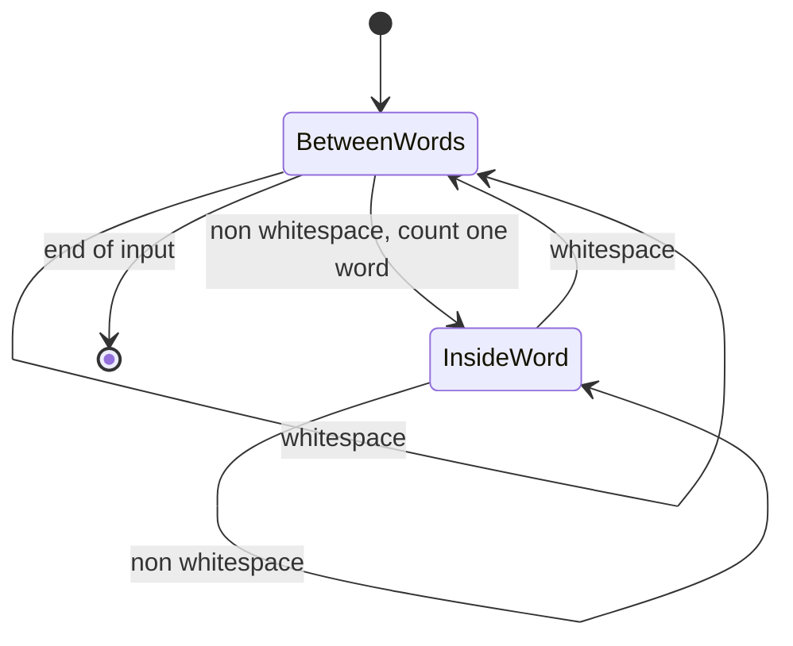
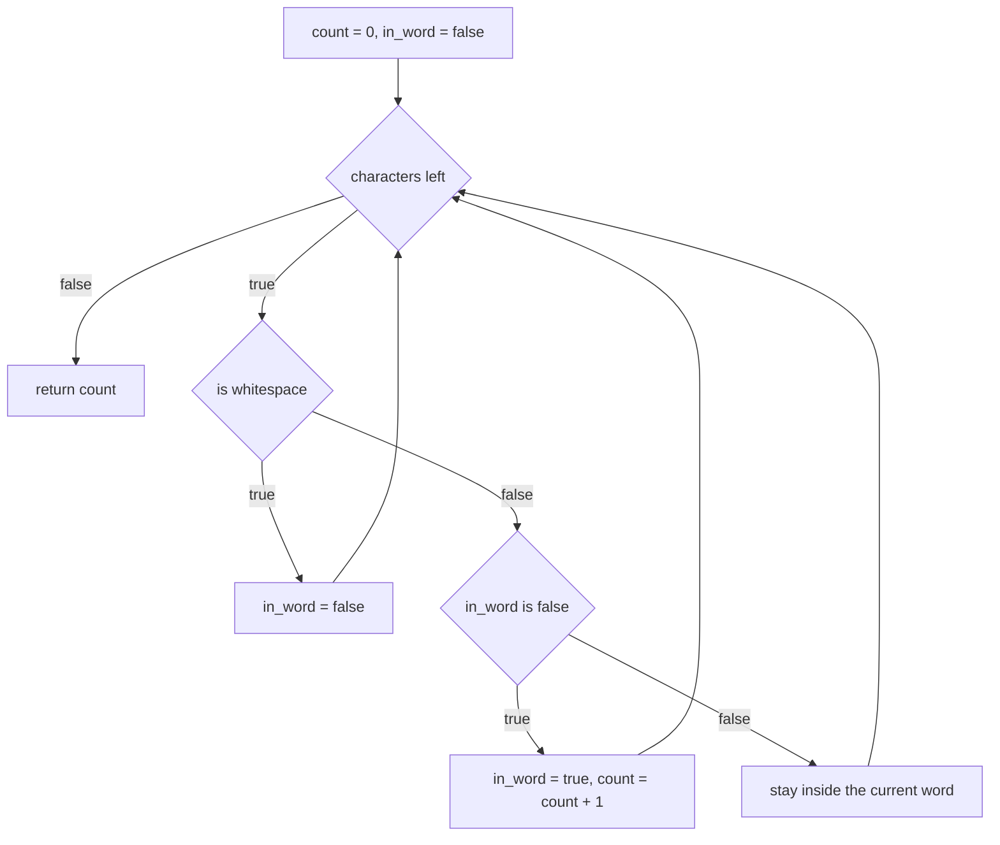
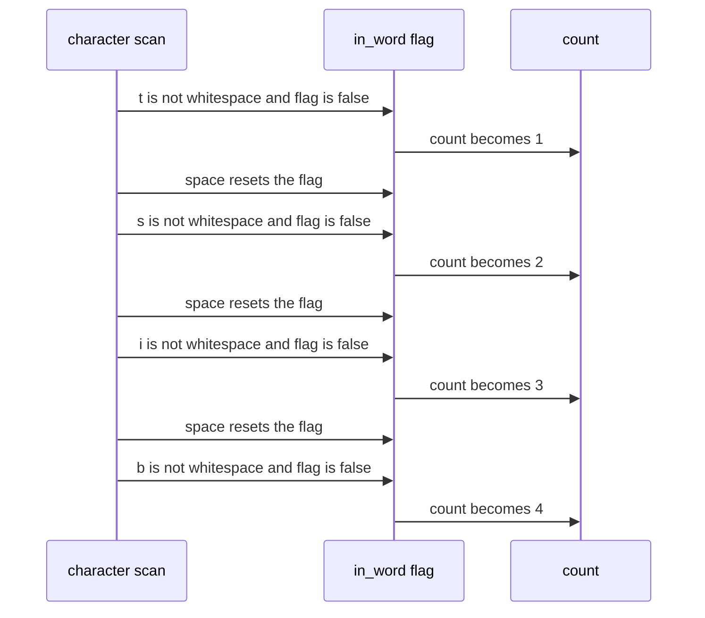

# 043 — Count words in a string.

> **Tier:** Beginner · **CTCI chapter:** Ch 1 — Arrays and Strings
> **Task spec:** [043-count-words-in-a-string.md](../../../tasks/beginner/043-count-words-in-a-string.md)
> **Solutions:** [Python](../../../solutions/python/beginner/043-count-words-in-a-string/solution.py) ·
> [Java](../../../solutions/java/beginner/043-count-words-in-a-string/Solution.java) ·
> [JavaScript](../../../solutions/javascript/beginner/043-count-words-in-a-string/solution.js) ·
> [C#](../../../solutions/csharp/beginner/043-count-words-in-a-string/Solution.cs)

## 1. Problem restatement

**Input:** a string `s`. Leading, trailing and repeated whitespace are all allowed, and the string
may be empty.

**Output:** the number of maximal runs of non-whitespace characters — the "words" — as an integer.
Runs of whitespace, wherever they appear, do not add to the count.

| Call | Result | Why |
| --- | --- | --- |
| `count_words("the sky is blue")` | `4` | four separated runs |
| `count_words("   ")` | `0` | whitespace only, no run ever starts |
| `count_words("")` | `0` | nothing to scan |
| `count_words("one")` | `1` | a single run with no separator at either end |

Python and Java assert all four rows; C# and JavaScript assert three of them, omitting the empty
string. The exported name is
`count_words` in Python, `countWords` in Java and JavaScript and `CountWords` in C#.

## 2. Intuition

The naive method is a split: break the string at whitespace and count the pieces. That is exactly
what the Python file does in one line — `len(s.split())` — because `str.split()` with no arguments
splits on any run of whitespace and discards leading and trailing separators. The JavaScript file
composes the same idea from two library calls, `s.trim().split(/\s+/).length`, with an explicit
zero-guard because `"".split(/\s+/)` yields a one-element array containing the empty string.

The Java and C# files take the more instructive route: a single scan with a **state flag**. Treat
the string as a sequence of two phases — *between words* and *inside a word* — and count the
transitions into the second phase:

- Standing between words, a non-whitespace character starts a word, so increment the count and enter
  the in-word state.
- Inside a word, a whitespace character drops you back to between-words.
- Everything else leaves the state unchanged.



The count is therefore the number of *edges* from `BetweenWords` to `InsideWord`, and it is
unaffected by how long the words are or how much whitespace separates them.

## 3. Algorithm

1. Set `count = 0` and `in_word = false`.
2. For each character `c` of `s`:
   1. If `c` is whitespace, set `in_word = false`.
   2. Otherwise, if `in_word` is still `false`, set `in_word = true` and increment `count`.
3. Return `count`.

```text
function count_words(s)
    count ← 0
    in_word ← false
    for each character c in s do
        if c is whitespace then
            in_word ← false
        else if in_word = false then
            in_word ← true
            count ← count + 1
        end
    end
    return count
end
```

The flag is the whole state machine: it never records *which* word is being read, only whether the
scan is currently inside one. Notice that the increment is attached to the transition, not to the
whitespace test — a three-space gap between two words still counts one word, and leading whitespace
counts none.



## 4. Worked example

Trace `count_words("the sky is blue")` with the flag implementation.

| Step | character | whitespace? | `in_word` before | action | `count` after |
| --- | --- | --- | --- | --- | --- |
| 1 | `t` | no | false | start a word | 1 |
| 2 | `h` | no | true | stay | 1 |
| 3 | `e` | no | true | stay | 1 |
| 4 | ` ` | yes | true | leave the word | 1 |
| 5 | `s` | no | false | start a word | 2 |
| 6 | `k`, `y` | no | true | stay twice | 2 |
| 7 | ` ` | yes | true | leave | 2 |
| 8 | `i`, `s` | no | false then true | start the third word | 3 |
| 9 | ` ` | yes | true | leave | 3 |
| 10 | `b`, `l`, `u`, `e` | no | false then true | start the fourth word | 4 |
| exit | — | — | true | end of input | return `4` |

The degenerate inputs behave as the assertions require: `"   "` produces no non-whitespace character,
so the `in_word → count + 1` transition never happens and the answer is `0`; `"one"` starts in the
between-words state, so the first character counts the only word; `""` never enters the loop.



## 5. Complexity

Let `n` be the length of `s`.

| Measure | Bound | Why it holds |
| --- | --- | --- |
| Time, best | O(n) | every character must be inspected to know whether another word starts |
| Time, average | O(n) | one whitespace test and one flag test per character |
| Time, worst | O(n) | no input can be counted without reading it, and the loop has no early exit |
| Space, extra (Java, C#) | O(1) | one integer and one boolean, streamed character by character |
| Space, extra (Python) | O(n) | `s.split()` builds the whole token list before `len` is taken |
| Space, extra (JavaScript) | O(n) | `trim()` copies the string and `split(/\s+/)` builds an array of tokens |
| Space, output | O(1) | a single integer |

Two of the four implementations are library one-liners and two are explicit state machines, and the
difference shows up in the space column: streaming a counter uses constant memory, while
materialising the words uses memory proportional to the input. Both are `O(n)` in time.

## 6. Pitfalls and edge cases

- **Empty string.** `count_words("")` is `0`. In Python `"".split()` is `[]`, so the length is `0`; in
  Java and C# the loop simply does not run; in JavaScript `"".split(/\s+/)` is `[""]`, whose length is
  **1**, which is precisely why that file guards with `trimmed === "" ? 0 : …`.
- **Whitespace only.** `"   "` is `0` in all four languages. Python's `split()` drops the empty
  pieces, and the flag machine never leaves the between-words state.
- **Repeated spaces.** `"a  b"` is `2`: the second space finds `in_word` already `false` and does
  nothing. Counting spaces instead of transitions would give `3` here — the classic wrong answer.
- **Leading and trailing whitespace.** `"  a "` is `1`. No transition happens before the first `a`,
  and the trailing space only resets the flag.
- **Tabs and newlines count as whitespace in Java and C#.** `Character.isWhitespace` and
  `char.IsWhiteSpace` cover the standard control characters, `\n`, `\t` and `\r`, and Python's
  `split()` does the same. A version that tested `c == ' '` instead would treat `"a\tb"` as one word.
- **The three definitions are not identical.** Python's `split()` and JavaScript's `\s+` include the
  non-breaking space `U+00A0`, and so does C#'s `char.IsWhiteSpace`, but Java's
  `Character.isWhitespace` is documented to exclude it. So `count_words("a\u00A0b")` is `2` in
  Python, JavaScript and C#, and `1` in Java. None of the assertions touch this case.
- **Punctuation is part of a word.** `"hello,world"` is `1` word here; the task says nothing about
  punctuation, and no file splits on it.
- **Case is irrelevant, and so is punctuation.** There is no normalisation or tokenisation beyond
  whitespace, so `"The the"` is `2` words and `"hello,world"` is `1`. For case-insensitive or
  distinct-word work, fold the text first as in
  [015](../../../tasks/beginner/015-check-if-two-strings-are-anagrams.md).
- **Return type.** The answer is a plain `int`; an empty input is `0`, never `null` or `-1`.

## 7. Variants and follow-ups

- **Trimming first.** [044](../../../tasks/beginner/044-trim-leading-and-trailing-spaces-from-string.md)
  is the two-pointer counterpart that removes the edges the flag machine merely ignores.
- **Splitting and rejoining.** [040](../../../tasks/beginner/040-merge-two-strings-alternately.md)
  shows the other direction of the same token machinery.
- **Character counting.** [016](../../../tasks/beginner/016-count-occurrences-of-each-character-in-a-string.md)
  counts occurrences per character instead of runs, which is the same single-pass idea with a map
  instead of a flag.
- **Word-level matching.** Once you can tokenise, the sliding-window searches of
  [232](../../../tasks/intermediate/232-minimum-window-substring-covering-all-chars-of-pattern.md)
  and the compression routines of
  [388](../../../tasks/intermediate/388-implement-string-compression-run-length-encoding-decode.md)
  become reachable.
- Chapter context: [Arrays and Strings](../../ctci/01-arrays-and-strings.md).

## 8. Check yourself

1. Why does the counter increment on the transition into a word rather than on the word's characters?

<details><summary>Show answer</summary>

Because a word is a maximal run, and a run has exactly one start. Counting transitions counts runs;
counting characters would count letters. This is also why repeated separators are free: the second
space contains no transition.

</details>

2. What does `count_words("a  b")` return, and what would a "count the spaces" implementation
   return?

<details><summary>Show answer</summary>

`2`. The two consecutive spaces produce one transition out of the word and no transition back in. A
space-counting implementation would answer `3` (or `2` if it added one), because it treats the
separator rather than the run as the unit.

</details>

3. Why does the JavaScript file need the `trimmed === ""` guard?

<details><summary>Show answer</summary>

Because `"".split(/\s+/)` returns `[""]` — one empty token — so its `.length` is `1` while the correct
answer for an empty string is `0`. Trimming first makes an all-whitespace string empty as well, so a
single guard covers both the empty and the whitespace-only case.

</details>

4. Which implementation uses constant extra space, and which does not?

<details><summary>Show answer</summary>

Java's `inWord` flag and C#'s `bool inWord` stream the characters and keep one boolean plus one
counter, so they use `O(1)` extra space. Python's `s.split()` and JavaScript's `trim()` plus
`split(/\s+/)` materialise the words, so they use `O(n)` extra space.

</details>

5. Where do the four implementations disagree, and does it matter for the assertions?

<details><summary>Show answer</summary>

On exotic whitespace: Java's `Character.isWhitespace` excludes the non-breaking space `U+00A0` while
Python's `split()`, JavaScript's `\s` and C#'s `char.IsWhiteSpace` include it, so `"a\u00A0b"` counts
as one word in Java and two elsewhere. The asserted inputs use plain spaces only, so the shipped
tests do not exercise the divergence.

</details>
