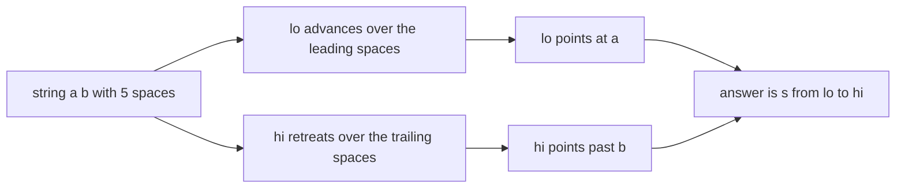
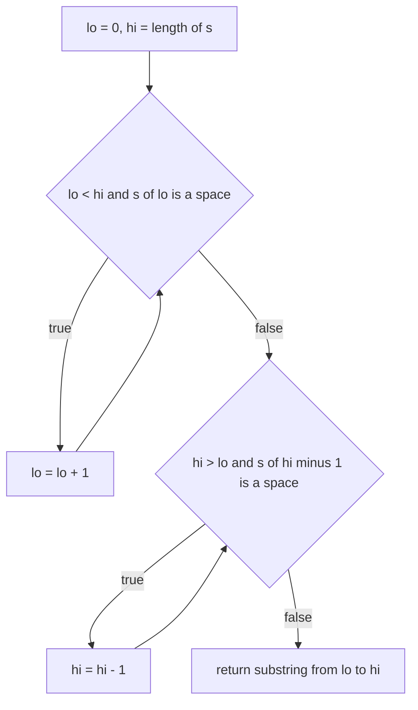
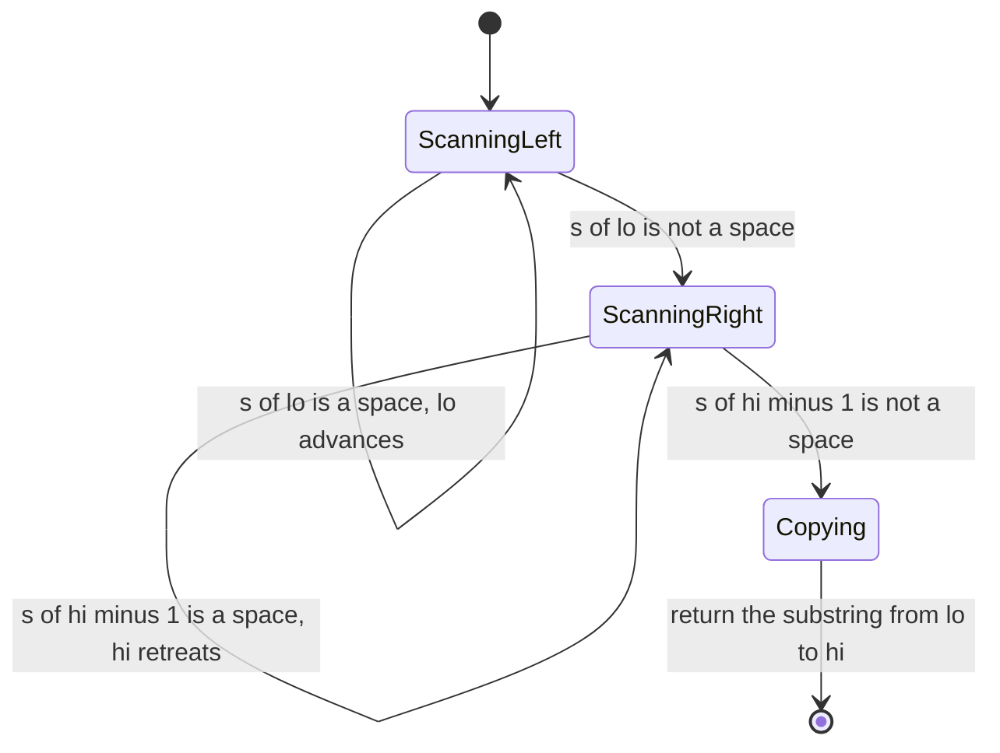

# 044 — Trim leading and trailing spaces from string.

> **Tier:** Beginner · **CTCI chapter:** Ch 1 — Arrays and Strings
> **Task spec:** [044-trim-leading-and-trailing-spaces-from-string.md](../../../tasks/beginner/044-trim-leading-and-trailing-spaces-from-string.md)
> **Solutions:** [Python](../../../solutions/python/beginner/044-trim-leading-and-trailing-spaces-from-string/solution.py) ·
> [Java](../../../solutions/java/beginner/044-trim-leading-and-trailing-spaces-from-string/Solution.java) ·
> [JavaScript](../../../solutions/javascript/beginner/044-trim-leading-and-trailing-spaces-from-string/solution.js) ·
> [C#](../../../solutions/csharp/beginner/044-trim-leading-and-trailing-spaces-from-string/Solution.cs)

## 1. Problem restatement

**Input:** a string `s`, which may be empty, may be entirely spaces, or may carry spaces on either
side. The spec asks specifically about **spaces** — the implementations compare against the single
character `' '`, not against a general whitespace class.

**Output:** a new string containing the same characters with the leading and trailing spaces
removed and every interior character left in place, in order.

| Call | Result | Why |
| --- | --- | --- |
| `trim("  hello  ")` | `"hello"` | two spaces on each side removed |
| `trim("hello")` | `"hello"` | nothing to remove; the pointers already meet |
| `trim("   ")` | `""` | every character is a boundary space |
| `trim("  a b ")` | `"a b"` | the interior space between `a` and `b` survives |

Python and Java assert all four rows; JavaScript asserts the first, third and fourth; C# asserts the
first, third and fourth as well. The exported name is `trim` in Python, Java and JavaScript and
`Trim` in C# — a plain function, not the platform's own `trim`/`Trim`/`strip`, which is a deliberate
part of the task.

## 2. Intuition

Trimming looks like a job for a character loop, but there is nothing to count: the answer is a
**contiguous range** of the input. All that the algorithm has to produce is a pair of indices,
`lo` and `hi`, such that the answer is `s[lo:hi]`.

The key insight is that the two ends are independent and can be found by two pointers that move
inwards from opposite sides:

- `lo` walks forward while it is looking at a space, and stops at the first character that is not
  one — or when it meets `hi`.
- `hi` walks backward while the character **just before** it is a space, and stops once it is not —
  or when it meets `lo`.
- Everything between the two pointers is returned unchanged, interior spaces included.



Because the pointers only ever look at boundary spaces, the interior of the string is never
inspected. `trim("  a b ")` never even reads the middle space in the sense that matters: it is
inside the range that gets copied wholesale.

## 3. Algorithm

1. Set `lo = 0` and `hi = length(s)`.
2. While `lo < hi` and `s[lo]` is a space, increment `lo`.
3. While `hi > lo` and `s[hi - 1]` is a space, decrement `hi`.
4. Return the substring from `lo` to `hi` (exclusive).

```text
function trim(s)
    lo ← 0
    hi ← length(s)
    while lo < hi and s[lo] = ' ' do
        lo ← lo + 1
    end
    while hi > lo and s[hi - 1] = ' ' do
        hi ← hi - 1
    end
    return substring of s from lo to hi
end
```

Both loops carry a `lo`/`hi` comparison in their guard, and both guards earn their place. In step 2
the comparison stops `lo` from running off the end of an all-space string; in step 3 it stops `hi`
from walking past `lo` after the first loop has already consumed the whole string. The final copy is
a library call in every language — Python's `s[lo:hi]`, Java's `s.substring(lo, hi)`, JavaScript's
`s.slice(lo, hi)` and C#'s `s.Substring(lo, hi - lo)` — each of which materialises a new string of
length `hi - lo`.



## 4. Worked example

Trace `trim("  hello  ")`, an eleven-character string with two spaces on each side.

| Step | loop | `lo` | `hi` | character examined | action |
| --- | --- | --- | --- | --- | --- |
| 1 | leading | 0 | 11 | `s[0] = ' '` | `lo` becomes 1 |
| 2 | leading | 1 | 11 | `s[1] = ' '` | `lo` becomes 2 |
| 3 | leading | 2 | 11 | `s[2] = 'h'` | stop, five letters ahead |
| 4 | trailing | 2 | 11 | `s[10] = ' '` | `hi` becomes 10 |
| 5 | trailing | 2 | 10 | `s[9] = ' '` | `hi` becomes 9 |
| 6 | trailing | 2 | 9 | `s[8] = 'o'` | stop |
| 7 | copy | 2 | 9 | — | return `s[2:9] = "hello"` |

Now the two inputs that test the guards.

| Input | leading loop | trailing loop | result |
| --- | --- | --- | --- |
| `"hello"` | `s[0] = 'h'`, `lo` stays 0 | `s[4] = 'o'`, `hi` stays 5 | `s[0:5] = "hello"` |
| `"   "` | `lo` advances to 3, then `lo < hi` fails and the loop stops | `hi > lo` is `3 > 3`, false, so this loop never runs | `s[3:3] = ""` |
| `"  a b "` | `lo` becomes 2 | `hi` becomes 6 (`s[6] = 'b'`) | `s[2:6] = "a b"` |

The all-space row is why the guards are written as `lo < hi` and `hi > lo` rather than as bare
character tests: without them, `lo` would keep incrementing past the end of the string, or `hi` would
keep decrementing below `lo`, and the slice bounds would be nonsense.



## 5. Complexity

Let `n` be the length of `s` and `k` the number of leading spaces plus the number of trailing spaces.

| Measure | Bound | Why it holds |
| --- | --- | --- |
| Time, best | O(1) | `"hello"` examines exactly two characters and copies nothing new to inspect |
| Time, average | O(k + (n - k)) | the loops touch only boundary spaces, then one copy produces the output |
| Time, worst | O(n) | an all-space string advances `lo` through all `n` characters; the copy is `O(n)` too |
| Space, output | O(n - k) | the returned substring, which can be as large as the input |
| Space, extra | O(1) | two integer indices |
| Whole-string scan alternative | O(n) time, O(n) space | copying character by character into a buffer visits the interior unnecessarily |

The output allocation is unavoidable: strings are immutable in all four languages, so a trimmed
result is a new object. The win compared with a character-by-character rebuild is that the interior
neither gets inspected nor gets copied twice — the library slice does one bulk copy.

## 6. Pitfalls and edge cases

- **Empty string.** `trim("")` gives `lo = 0`, `hi = 0`; both guards fail immediately and the result
  is `""`. No file asserts this row, but all four behave the same way.
- **All spaces.** `trim("   ")` must be `""`, and it is the case that forces the `lo < hi` guard in
  the first loop. Without it, `lo` would reach `n` and then index past the end of the string.
- **The first loop can consume everything.** After the leading loop, `hi > lo` may already be false,
  which is exactly why the second loop repeats the comparison instead of testing `s[hi - 1]`
  unconditionally.
- **Only `' '` is trimmed.** The comparison is against a literal space, so `"\thello\t"` comes back
  unchanged — tab, newline and carriage return are not boundary spaces for this task. This is a
  deliberate difference from the platform helpers: Python's `strip()` and Java's `strip()` remove all
  Unicode whitespace, while Java's older `String.trim()` removes every character `<= ' '`, which
  includes the tab.
- **Interior spaces are preserved exactly.** `"  a b "` becomes `"a b"` — one interior space, not
  zero and not two. Rewriting the function as `" ".join(s.split())` would "fix" the interior as well
  and fail this assertion.
- **The result is a new string.** Nothing in place is modified; the caller's string is untouched
  (contrast [045](../../../tasks/beginner/045-replace-spaces-with-20-urlify.md), which deliberately
  writes into the caller's buffer).
- **`hi - 1` is the right index.** `hi` is exclusive throughout, both as the initial length and as
  the second argument of the substring call. Writing `s[hi]` in the trailing loop is the classic
  off-by-one that trims one character too few.
- **Non-space characters are not inspected at all.** A string with no boundary spaces performs two
  comparisons total, regardless of how long it is — this is the property the two-pointer form has
  and the character-rebuild form does not.
- **Unicode.** Trimming is defined on single code units, so a string beginning with an emoji trims
  correctly while a combining mark directly after a boundary space stays attached to its base
  character. The assertions are ASCII.

## 7. Variants and follow-ups

- **URLify.** [045](../../../tasks/beginner/045-replace-spaces-with-20-urlify.md) is the opposite
  operation: it makes boundary-free interior spaces *longer*, writing into a padded buffer from the
  right.
- **Counting what the trim would discard.** [043](../../../tasks/beginner/043-count-words-in-a-string.md)
  counts runs of non-whitespace without needing indices at all, which is the alternative whenever you
  do not actually need the substring.
- **Two-pointer work.** [022](../../../tasks/beginner/022-rotate-array-in-place-by-k-positions.md)
  and [024](../../../tasks/beginner/024-remove-element-at-index-from-array-in-place.md) move pointers
  inward or compact in place; [001](../../../tasks/beginner/001-reverse-a-string.md) swaps from the
  two ends. These are the other members of the index-gymnastics family of Ch 1.
- **Where trimming matters.** Parsing pipelines trim before tokenising — compare the whitespace
  handling of [017](../../../tasks/beginner/017-convert-string-to-integer-atoi-basic.md), which has to
  decide what to do with leading spaces before digits.
- Chapter context: [Arrays and Strings](../../ctci/01-arrays-and-strings.md).

## 8. Check yourself

1. Why is trimming a "find two indices" problem rather than a "build a new string" problem?

<details><summary>Show answer</summary>

Because the answer is a contiguous slice of the input: no character is transformed, reordered or
dropped from the middle. Once `lo` and `hi` are known, the whole output is one bulk copy, and the
interior never has to be examined.

</details>

2. What guards does the algorithm need, and what breaks without each?

<details><summary>Show answer</summary>

`lo < hi` in the leading loop stops `lo` from walking past the end of an all-space string; `hi > lo`
in the trailing loop stops `hi` from crossing below `lo` after the leading loop has consumed the
entire string. Both are needed for `"   "` to return `""` instead of failing or producing bad slice
bounds.

</details>

3. What does `trim("\thello\t")` return, and why?

<details><summary>Show answer</summary>

`"\thello\t"` unchanged. The boundary test compares against the literal space character, and a tab is
not a space, so neither loop moves. The task is about spaces, not about whitespace in general.

</details>

4. How many characters does `trim("hello")` examine?

<details><summary>Show answer</summary>

Two: `s[0] = 'h'` fails the leading test, and `s[4] = 'o'` fails the trailing test. The interior
characters are never read individually — they are simply inside the returned slice.

</details>

5. What does `trim("   ")` return, and how many iterations do the loops perform?

<details><summary>Show answer</summary>

`""`. The leading loop runs three times, advancing `lo` from 0 to 3, and then exits because `lo < hi`
is now `3 < 3`. The trailing loop performs zero iterations because its guard `hi > lo` is already
false.

</details>
