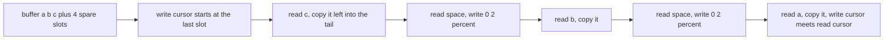
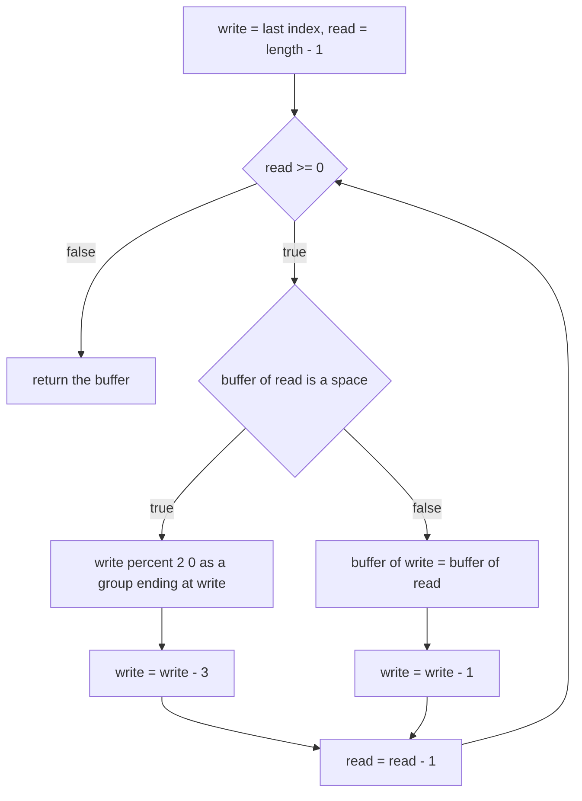
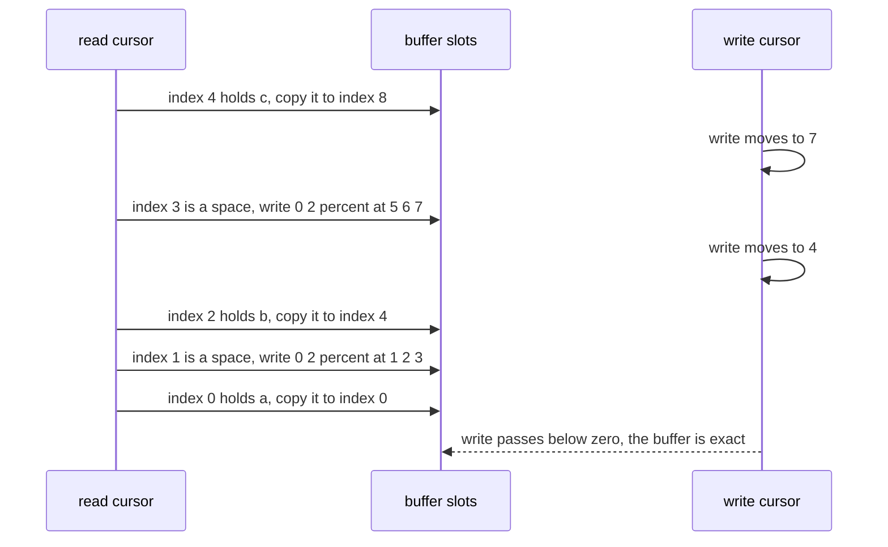

# 045 — Replace spaces with `%20` (URLify).

> **Tier:** Beginner · **CTCI chapter:** Beyond — Software Engineering & Tooling
> **Task spec:** [045-replace-spaces-with-20-urlify.md](../../../tasks/beginner/045-replace-spaces-with-20-urlify.md)
> **Solutions:** [Python](../../../solutions/python/beginner/045-replace-spaces-with-20-urlify/solution.py) ·
> [Java](../../../solutions/java/beginner/045-replace-spaces-with-20-urlify/Solution.java) ·
> [JavaScript](../../../solutions/javascript/beginner/045-replace-spaces-with-20-urlify/solution.js) ·
> [C#](../../../solutions/csharp/beginner/045-replace-spaces-with-20-urlify/Solution.cs)

## 1. Problem restatement

**Input:** a mutable character buffer plus the number of *real* characters it holds. The buffer is
already sized for the answer — the Python docstring says it plainly: *"Replace spaces with %20 in a
char list padded with trailing capacity (in place)."* The trailing slots beyond `length` are spare
room, not data.

**Output:** the same buffer, rewritten in place so that the first `length` real characters have every
space replaced by the three characters `%`, `2`, `0`. The function returns the buffer rather than a
new string.

| Call | Result | Why |
| --- | --- | --- |
| `urlify(list("a b c" + " " * 4), 5)` | `"a%20b%20c"` | two spaces, each needing three slots, so four spare slots are exactly enough |
| `urlify(list("abc"), 3)` | `"abc"` | no spaces and no spare capacity; the loop copies each character onto itself |

Python asserts both rows, and Java, JavaScript and C# construct the same padded buffer
(`"a b c" + " ".repeat(4)` / `new string(' ', 4)`) and assert the identical two results. The exported
name is `urlify` in Python, Java and JavaScript and `Urlify` in C#.

## 2. Intuition

Forward rewriting looks easy and is a trap. If you walk the buffer left to right and write `%20`
wherever you see a space, you immediately overwrite characters you have not read yet, because three
output characters are being produced from one input character. The safe forward version needs extra
memory for a second buffer.

The key insight is that the buffer is **padded at the end and rewritten from the end**:

- The final length is known in advance: `length + 2 · (number of spaces)`.
- Writing from the right means the output region is always *behind* the read position, and reading
  happens from right to left too, so every unread character sits to the left of everything written.
- Consequently nothing is ever overwritten before it is read, and one pass is enough.



Both cursors start near the end and move left. The read cursor walks the real characters only; the
write cursor advances three slots for a space and one for anything else, so it consumes the spare
capacity exactly as the expansions require.

## 3. Algorithm

1. Let `write = len(buffer) - 1`, the index of the last slot in the padded buffer.
2. For each `read` from `length - 1` down to `0`:
   1. If `buffer[read]` is a space, write the three characters `%`, `2`, `0` into positions
      `write - 2`, `write - 1`, `write` (in that order), then set `write = write - 3`.
   2. Otherwise, copy `buffer[read]` into `buffer[write]`, then set `write = write - 1`.
3. Return the buffer.

```text
function urlify(buffer, length)
    write ← length of buffer - 1
    read ← length - 1
    while read ≥ 0 do
        if buffer[read] = ' ' then
            buffer[write - 2] ← '%'
            buffer[write - 1] ← '2'
            buffer[write] ← '0'
            write ← write - 3
        else
            buffer[write] ← buffer[read]
            write ← write - 1
        end
        read ← read - 1
    end
    return buffer
end
```

The three writes are listed in ascending index order, but the Java, C#, JavaScript and Python files
all assign them `%` first (Python's single slice assignment `buffer[write-2:write+1] = ["%", "2",
"0"]` writes the group at once). What matters is that the group's **rightmost** cell is `write`, so
the write cursor then jumps back by three. The `"abc"` case exercises the other branch three times
with `write` and `read` walking in lockstep, copying each character onto itself.



## 4. Worked example

Trace `urlify` on `"a b c"` padded with four spaces: a nine-slot buffer holding
`a ␣ b ␣ c ␣ ␣ ␣ ␣` with `length = 5`, so `write` starts at 8 and `read` at 4.

| Step | `read` | `buffer[read]` | writes | `write` after | buffer (slots 0-8) |
| --- | --- | --- | --- | --- | --- |
| start | 4 | — | — | 8 | `a ␣ b ␣ c ␣ ␣ ␣ ␣` |
| 1 | 4 | `c` | slot 8 ← `c` | 7 | `a ␣ b ␣ c ␣ ␣ ␣ c` |
| 2 | 3 | space | slots 5,6,7 ← `%20` | 4 | `a ␣ b ␣ % 2 0 c` |
| 3 | 2 | `b` | slot 4 ← `b` | 3 | `a ␣ b b % 2 0 c` |
| 4 | 1 | space | slots 1,2,3 ← `%20` | 0 | `a % 2 0 b % 2 0 c` |
| 5 | 0 | `a` | slot 0 ← `a` | -1 | `a % 2 0 b % 2 0 c` |
| exit | -1 | — | — | — | join gives `"a%20b%20c"` |

Step 2 is the one that shows why the direction matters: at that moment slots 5, 6 and 7 are still
holding spare padding, while the unread characters `a`, `␣` and `b` live in slots 0, 1 and 2 —
strictly to the left of the write group, so they survive. Counting the arithmetic:
two spaces add four characters, and the buffer has exactly four spare slots, so `write` lands on `-1`
after the last real character is copied, which is the signature of a perfectly sized buffer.



## 5. Complexity

Let `length` be the number of real characters, `s` the number of spaces among them and `m` the total
buffer size (`m = length + 2s` when the buffer is exactly sized).

| Measure | Bound | Why it holds |
| --- | --- | --- |
| Time | O(length) | one iteration per real character; each iteration does one copy or one three-character group write |
| Space, extra | O(1) | two indices and no auxiliary buffer; the Python version's slice assignment is handled by the list itself |
| Space, output | 0 extra | the result is written into the caller's buffer |
| Second-buffer alternative | O(n + 2s) extra space | the straightforward forward build, which the in-place requirement rules out |
| Repeated concatenation | O((n + 2s)²) | building the answer with `result = result + …` copies the prefix every time |

The trick that makes the in-place version `O(1)` in extra space is the padding contract: the caller
has already reserved the space, so the algorithm only has to decide *where* each character goes. That
is exactly the trade-off this task is about, and it is the reason the buffer size is an input rather
than something the function computes.

## 6. Pitfalls and edge cases

- **The write cursor starts at the end of the buffer, not at `length - 1`.** Starting inside the real
  characters would overwrite unread data on the very first space; the whole algorithm rests on
  `write = len(buffer) - 1`.
- **Spare capacity must be exactly `2 · spaces`.** Too little and the write cursor runs off the front
  (a negative index in Java, C# and JavaScript; in Python a slice assignment can silently *resize*
  the list instead of failing, which is worse). Too much and the returned buffer keeps stray trailing
  spaces that no assertion would catch but every consumer would trip over.
- **The group's order is `%`, `2`, `0`.** The Java, C# and JavaScript files write `'0'` at `write`,
  `'2'` at `write - 1` and `'%'` at `write - 2`, which produces the correct left-to-right order
  because the cursor is moving leftwards. Writing the group left to right while the cursor moves left
  gives `02%`.
- **`write -= 3` for a space, `write -= 1` for anything else.** Swapping the decrements is a subtle
  bug that still passes some inputs, because one character differences accumulate only when more
  spaces follow.
- **No trailing terminator is written.** The buffer is exactly sized, so the last write lands on index
  0 and the cursor ends at `-1`. Languages that expect a terminator after the content would need one
  extra slot and one extra decrement.
- **The no-space case is not a special case.** For `urlify(list("abc"), 3)` the buffer is exactly
  three slots, so `write` and `read` start equal at 2 and every iteration copies a character onto its
  own index. This is why the assertion exists: the function must not corrupt a buffer that needs no
  expansion.
- **Only `' '` expands.** Tabs, newlines and other whitespace are copied verbatim; the comparison is
  against a literal space in all four files.
- **All spaces.** `urlify` on `"   "` with six spare slots produces `"%20%20%20"`: each iteration
  takes the group branch and the buffer fills exactly.
- **Mutating the caller's data is the point here.** This is the opposite of the contract in
  [044](../../../tasks/beginner/044-trim-leading-and-trailing-spaces-from-string.md) and
  [001](../../../tasks/beginner/001-reverse-a-string.md); document the in-place behaviour or callers
  will be surprised.

## 7. Variants and follow-ups

- **Trimming.** [044](../../../tasks/beginner/044-trim-leading-and-trailing-spaces-from-string.md)
  finds a range and copies it out; this task writes an expanded copy back into the same buffer.
- **In-place rotation and compaction.** [022](../../../tasks/beginner/022-rotate-array-in-place-by-k-positions.md)
  and [024](../../../tasks/beginner/024-remove-element-at-index-from-array-in-place.md) are the other
  two-pointer in-place rewrites of this tier — the same "read and write cursors at different speeds"
  pattern.
- **Reversing.** [001](../../../tasks/beginner/001-reverse-a-string.md) uses the mirrored read/write
  idea in its simplest form, and its section on immutability explains why the string and buffer
  variants differ.
- **Encoding in general.** Once a buffer can be rewritten in place, run-length compression
  ([388](../../../tasks/intermediate/388-implement-string-compression-run-length-encoding-decode.md))
  is the natural next step: it changes the output length per input character in both directions.
- Related chapter material: [Arrays and Strings](../../ctci/01-arrays-and-strings.md), and
  [Big-O](../../00-big-o.md) for the quadratic cost of appending to immutable strings.

## 8. Check yourself

1. Why must the rewrite go from the end of the buffer instead of from the beginning?

<details><summary>Show answer</summary>

Because each space produces three characters from one, so a forward write would land on characters
that have not been read yet and destroy them. Writing rightwards-to-leftwards keeps every unread
character to the left of the write cursor, so no read is ever clobbered.

</details>

2. How much spare capacity does the buffer need, and why?

<details><summary>Show answer</summary>

Exactly two extra slots per space: `length + 2 · spaces`. In the asserted example `"a b c"` has two
spaces, so four spare slots — and the trace shows the write cursor landing on `-1` after the final
character, which is the sign that the sizing was exact rather than generous.

</details>

3. What does `urlify(list("abc"), 3)` change in the buffer?

<details><summary>Show answer</summary>

Nothing: the buffer is `"abc"` with no spare slots, so `write` and `read` start equal and each
iteration copies a character onto its own index. No space is encountered, so the group branch never
runs.

</details>

4. Where does the `%20` group get written, and in which order do the files assign it?

<details><summary>Show answer</summary>

It ends at `write`, occupying `write - 2`, `write - 1` and `write`. Java, C# and JavaScript assign
`'0'` at `write`, `'2'` at `write - 1` and `'%'` at `write - 2`; Python assigns the list
`["%", "2", "0"]` to the slice `buffer[write-2:write+1]`. Both produce `%20` left to right, and the
cursor then retreats by three.

</details>

5. What goes wrong if the caller passes a buffer that is one slot too small?

<details><summary>Show answer</summary>

The write cursor runs past the front. In Java, C# and JavaScript that is an out-of-range index (an
exception or, for a plain JavaScript array, a negative-property write that silently does not store
the character). In Python the slice assignment on a negative start index reaches outside the intended
geometry and can even change the list's length instead of failing. The padding contract is
load-bearing, which is why the docstring states it.

</details>
