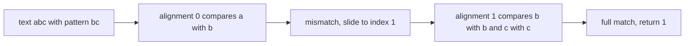
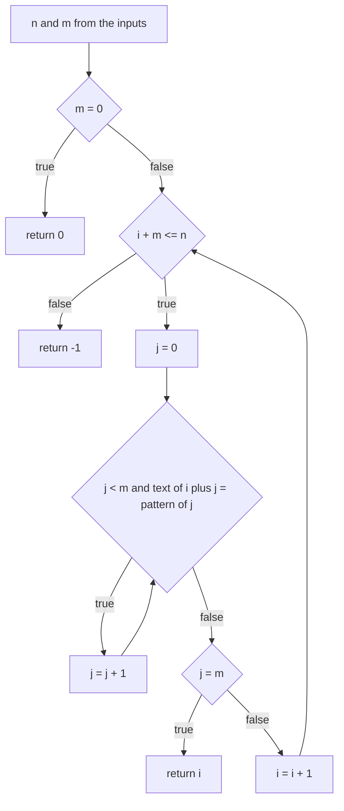
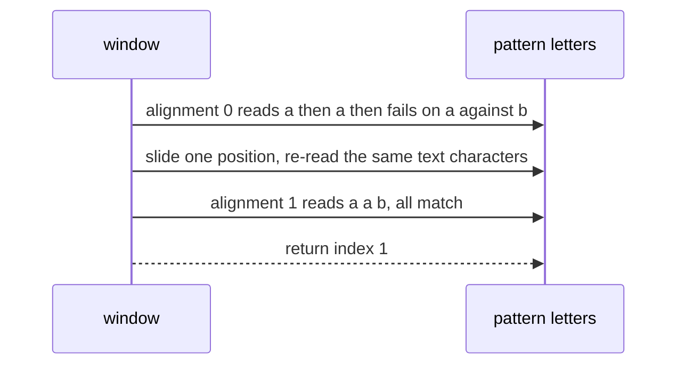

# 046 — Implement substring search (naive).

> **Tier:** Beginner · **CTCI chapter:** Ch 10 — Sorting and Searching
> **Task spec:** [046-implement-substring-search-naive.md](../../../tasks/beginner/046-implement-substring-search-naive.md)
> **Solutions:** [Python](../../../solutions/python/beginner/046-implement-substring-search-naive/solution.py) ·
> [Java](../../../solutions/java/beginner/046-implement-substring-search-naive/Solution.java) ·
> [JavaScript](../../../solutions/javascript/beginner/046-implement-substring-search-naive/solution.js) ·
> [C#](../../../solutions/csharp/beginner/046-implement-substring-search-naive/Solution.cs)

## 1. Problem restatement

**Input:** a `text` string and a `pattern` string. The pattern may be longer than the text, may be
empty, and may occur more than once.

**Output:** the index of the **first** occurrence of `pattern` inside `text`, or `-1` when it never
occurs. The Python docstring states both the contract and the cost: *"Return the first index of
pattern in text, or -1. O(n*m) worst case."*

| Call | Result | Why |
| --- | --- | --- |
| `substring_search("hello world", "world")` | `6` | the window slides to index 6 and matches all five characters |
| `substring_search("aaaa", "aa")` | `0` | overlapping matches are allowed; the earliest one wins |
| `substring_search("abc", "xyz")` | `-1` | every alignment fails on its first character |
| `substring_search("abc", "")` | `0` | the empty pattern matches at the start by convention |

Python asserts all four rows, Java and C# assert the first three, and JavaScript asserts the first and
the third. The exported name is `substring_search` in Python, `substringSearch` in Java and
JavaScript and `SubstringSearch` in C#.

## 2. Intuition

The only way to find a substring without extra machinery is to **try every alignment**. Number the
starting positions of the text `0 … n - m`; the pattern can only start at one of them, so compare the
pattern against `text[i … i + m - 1]` and stop at the first alignment that matches in full.

The naive method is exactly that, character by character:

- The bound `i ≤ n - m` is the only place a length comparison is needed: at `i = n - m` the window
  ends exactly at the last character, and beyond that the pattern would not fit.
- A mismatch does not teach anything in this version. The scan abandons the current alignment and
  restarts at `i + 1`, re-comparing characters it has already looked at.
- The empty pattern is the one degenerate case: it matches at position `0` before any comparison, and
  all four files return `0` early rather than letting the loop produce a different convention.



The sliding window is the whole picture: nothing is remembered between alignments, which is what makes
the worst case quadratic and what the more advanced string algorithms in Ch 10 are built to fix.

## 3. Algorithm

1. Let `n = len(text)` and `m = len(pattern)`.
2. If `m = 0`, return `0`.
3. For each `i` from `0` to `n - m`:
   1. Set `j = 0`.
   2. While `j < m` and `text[i + j] = pattern[j]`, increment `j`.
   3. If `j = m`, the whole pattern matched: return `i`.
4. Return `-1`.

```text
function substring_search(text, pattern)
    n ← length of text
    m ← length of pattern
    if m = 0 then return 0 end
    i ← 0
    while i + m ≤ n do
        j ← 0
        while j < m and text[i + j] = pattern[j] do
            j ← j + 1
        end
        if j = m then return i end
        i ← i + 1
    end
    return -1
end
```

The Java, C# and JavaScript files use this two-loop form; JavaScript needs a labelled `outer:` loop
so that the inner mismatch can `continue outer`, a language-level way of saying "go to the next
alignment". Python writes the inner comparison as a slice equality
(`if text[i:i + m] == pattern: return i`), which is the same test performed by the runtime, at the price
of allocating a temporary substring of length `m` per alignment.



## 4. Worked example

Trace `substring_search("hello world", "world")` — the asserted found case. The window column shows the
characters compared against `"world"` at each alignment.

| Alignment `i` | window | outcome | comparisons performed |
| --- | --- | --- | --- |
| 0 | `hello` | `h` vs `w` mismatch | 1 |
| 1 | `ello ` | `e` vs `w` mismatch | 1 |
| 2 | `llo w` | `l` vs `w` mismatch | 1 |
| 3 | `lo wo` | `l` vs `w` mismatch | 1 |
| 4 | `o wor` | `o` vs `w` mismatch | 1 |
| 5 | ` worl` | space vs `w` mismatch | 1 |
| 6 | `world` | five matches, `j` reaches `m = 5` | 5 |
| exit | — | return `6` | 11 total |

Only the successful alignment does more than one comparison, which is the common case: mismatches
usually die on the first character. Now the case that makes the naive method expensive — the same
character compared against different pattern positions.

| Alignment `i` | window | outcome | comparisons |
| --- | --- | --- | --- |
| 0 | `aaab` | `a`, `a` match, then `a` vs `b` mismatch at `j = 2` | 3 |
| 1 | `aab` | `a`, `a`, `b` all match, `j` reaches `m` | 3 |
| exit | — | return `1` | 6 total |

The character `text[2] = 'a'` is compared twice — once against `pattern[2] = 'b'` and once against
`pattern[1] = 'a'` — and that re-comparison is exactly the waste that KMP and the other linear-time
matchers eliminate. Run the scan on `text = "a" * 10` with `pattern = "aaab"` and the cost becomes
visible: seven alignments, four comparisons each, 28 character comparisons, found `-1`.



## 5. Complexity

Let `n = len(text)` and `m = len(pattern)`.

| Measure | Bound | Why it holds |
| --- | --- | --- |
| Time, best | O(m) | when the pattern matches at index 0, the first alignment succeeds after `m` comparisons |
| Time, average | O(n · p) | with a random alphabet each alignment fails after about `1/(1 - 1/σ)` comparisons, so the practical cost is close to linear |
| Time, worst | O(n · m) | a text of `n` copies of one character and a pattern of `m - 1` copies plus a different character forces almost `m` comparisons at every one of the `n - m + 1` alignments |
| Space, extra (Java, C#, JavaScript) | O(1) | two indices and no buffers; the strings are read in place |
| Space, extra (Python) | O(m) | `text[i:i + m] == pattern` materialises a temporary substring per alignment |
| Space, output | O(1) | a single integer index |

The quadratic worst case is not a bug in the implementations — the task is named "naive" on purpose —
and the verified count above (`28` comparisons for ten characters and a four-character pattern) is
what the bound looks like on a small input. Linear-time alternatives exist and are the subject of
Ch 10's advanced material.

## 6. Pitfalls and edge cases

- **Empty pattern returns `0`.** All four files short-circuit before the loop. Without the early
  return, Python's `range(n - m + 1)` would still produce `i = 0` and `text[0:0] == ""` is `true`, so
  it would also return `0` — but Java, C# and JavaScript would enter the inner loop with `m = 0` and
  return `0` too, so the guard mostly documents the convention rather than changing behaviour.
- **Pattern longer than the text.** `n - m` is negative, the loop bound `i + m <= n` fails
  immediately, and the answer is `-1`. This is the same branch that catches the "never occurs" case.
- **First occurrence, not any occurrence.** The scan returns on the first full match, so
  `substring_search("aaaa", "aa")` is `0`, not `1` or `2`. Keeping a counter instead of an index would
  answer a different question; for that, see the suffix-array variants.
- **Overlapping matches count.** `"aaaa"` contains `"aa"` at 0, 1 and 2; the result is the first one.
- **The last legal alignment is `n - m`.** Using `i < n` as the bound would compare past the end of
  the text; using `i <= n - m` as written is what keeps `text[i + j]` in range for every `j < m`.
- **Python allocates per alignment.** The slice comparison builds a temporary string of length `m` for
  each `i`, so the Python version is slower than the character-by-character files even though both are
  `O(n · m)` asymptotically.
- **Case and Unicode are not normalised.** Matching is exact and code-unit based; `"Hello"` and
  `"hello"` are different, and a case-folding search must fold both sides first, as in
  [015](../../../tasks/beginner/015-check-if-two-strings-are-anagrams.md).
- **Do not mutate the inputs.** The function only reads, so unlike
  [045](../../../tasks/beginner/045-replace-spaces-with-20-urlify.md) it must never write into a
  caller's buffer.
- **A labelled loop is not a goto.** The JavaScript `outer:` label is scoped to the following
  statement; using `break outer` instead of `continue outer` would abandon the search after the first
  mismatch.

## 7. Variants and follow-ups

- **First versus all occurrences.** [312](../../../tasks/intermediate/312-find-substring-occurrences-with-suffix-array-lcp.md)
  and the rolling-hash approach of
  [315](../../../tasks/intermediate/315-rolling-hash-double-hash-to-reduce-collisions.md) answer "how many,
  and where" instead of "where first".
- **Substring search inside a bigger problem.** The sliding window returns in
  [232](../../../tasks/intermediate/232-minimum-window-substring-covering-all-chars-of-pattern.md), which
  searches for a *set* of characters rather than an exact sequence.
- **Character counting as a feasibility test.** [047](../../../tasks/beginner/047-find-first-non-repeating-character-in-a-string.md)
  and [016](../../../tasks/beginner/016-count-occurrences-of-each-character-in-a-string.md) build the
  histograms that many string-matching algorithms use as a first filter.
- **Searching for a value instead of a pattern.** [008](../../../tasks/beginner/008-find-the-index-of-a-target-in-an-unsorted-array-linear-search.md)
  is the same first-match scan over an array, and
  [020](../../../tasks/beginner/020-merge-two-sorted-arrays-into-a-sorted-array.md) moves into the sorted
  world where comparisons can be ordered and halved.
- Chapter context: [Sorting and Searching](../../ctci/10-sorting-and-searching.md).

## 8. Check yourself

1. Why is the outer loop bound `i <= n - m` rather than `i < n`?

<details><summary>Show answer</summary>

Because at alignment `i` the comparison reads `text[i + j]` for `j` up to `m - 1`, so the last legal
start is `n - m`. Allowing `i` beyond that would read past the end of the text — or, in Python's slice
form, silently compare a shorter substring that could never equal a longer pattern.

</details>

2. What does `substring_search("abc", "")` return, and why is the early return written first?

<details><summary>Show answer</summary>

`0`: the empty pattern is defined to match at the start. The guard documents that convention
explicitly instead of leaving it to the loop's arithmetic, and it also protects the `n - m` bound from
being computed for an empty pattern in languages where the loop form is written with an explicit
`j < m` test that would otherwise be vacuous.

</details>

3. How many character comparisons does `substring_search("hello world", "world")` perform?

<details><summary>Show answer</summary>

Eleven: six failed alignments at indices 0 to 5, each costing exactly one comparison, plus five
successful comparisons at index 6. Only the matching alignment does more than one comparison, which is
typical for a random alphabet.

</details>

4. Give an input that forces the quadratic behaviour, and the number of comparisons it performs.

<details><summary>Show answer</summary>

A text of ten `a` characters with the pattern `"aaab"`: each of the seven alignments compares `a`, `a`,
`a` and then fails on the final character, for 28 comparisons and a result of `-1`. In general a text
of `n` copies of one character and a pattern of `m - 1` copies plus a different character yields about
`(n - m + 1) · m` comparisons.

</details>

5. Which solution has extra space proportional to the pattern length, and why?

<details><summary>Show answer</summary>

Python, because `text[i:i + m] == pattern` allocates a temporary substring of length `m` for every
alignment. Java, C# and JavaScript compare characters directly and keep only two indices, so their
extra space is `O(1)`.

</details>
