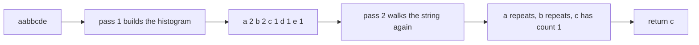
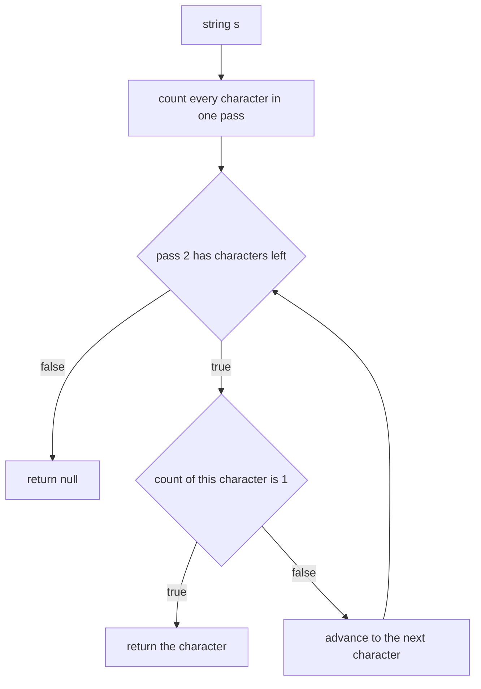
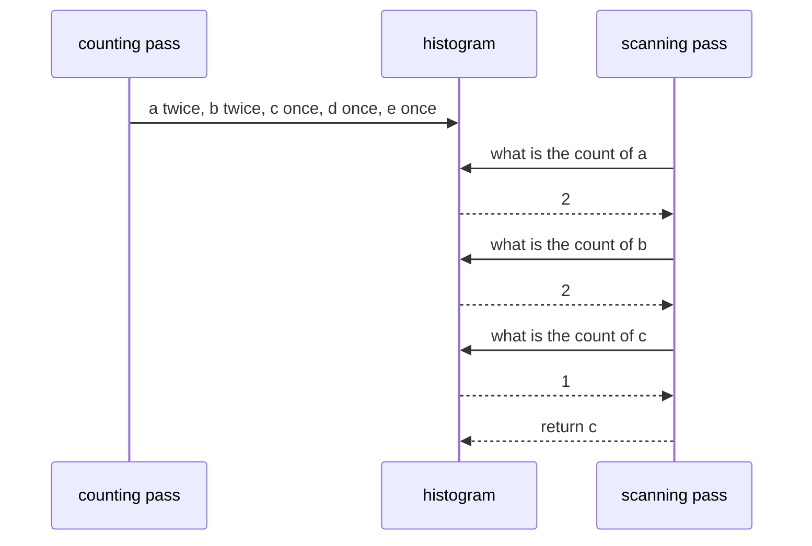

# 047 — Find first non-repeating character in a string.

> **Tier:** Beginner · **CTCI chapter:** Ch 1 — Arrays and Strings
> **Task spec:** [047-find-first-non-repeating-character-in-a-string.md](../../../tasks/beginner/047-find-first-non-repeating-character-in-a-string.md)
> **Solutions:** [Python](../../../solutions/python/beginner/047-find-first-non-repeating-character-in-a-string/solution.py) ·
> [Java](../../../solutions/java/beginner/047-find-first-non-repeating-character-in-a-string/Solution.java) ·
> [JavaScript](../../../solutions/javascript/beginner/047-find-first-non-repeating-character-in-a-string/solution.js) ·
> [C#](../../../solutions/csharp/beginner/047-find-first-non-repeating-character-in-a-string/Solution.cs)

## 1. Problem restatement

**Input:** a string `s`, which may be empty and may contain any characters.

**Output:** the character that appears **exactly once** and whose *first* occurrence is earliest in
the string — that is, the first character, reading left to right, whose total count is `1`. When no
such character exists, the answer is the language's null value rather than an exception.

| Call | Result | Why |
| --- | --- | --- |
| `first_non_repeating("aabbcde")` | `"c"` | `a` and `b` repeat; `c` is the first single-use character |
| `first_non_repeating("aabb")` | `null` | every character repeats |
| `first_non_repeating("x")` | `"x"` | a single character trivially occurs once |

Python, Java and C# assert all three rows; JavaScript asserts the same three. The exported name is
`first_non_repeating` in Python, `firstNonRepeating` in Java and JavaScript and `FirstNonRepeating` in
C#. The return types differ in an interesting way: Python returns `None` or a one-character string,
Java a boxed `Character`, C# a nullable `char?`, and JavaScript `null` or a string.

## 2. Intuition

Checking one character means scanning the rest of the string for it, which makes the naive method
`O(n²)` — and worse, it re-scans the same characters over and over for every position. The fix is to
separate the two questions the problem actually asks:

1. **How often does each character occur?** That is a histogram, built in one pass.
2. **Which is the first one with count `1`?** That is a second pass over the original string in its
   original order.

Splitting the work this way turns an `O(n²)` search into two linear passes, and it also makes the
correctness argument trivial: the histogram is exact, and the second pass visits characters in the
order the problem statement demands.



The second pass must walk the **string**, not the histogram. Iterating a hash map would produce an
arbitrary order in Java and JavaScript and a hash order in Python, so the answer would depend on the
language's map implementation instead of on the input.

## 3. Algorithm

1. Build a histogram of character counts in one pass over `s`.
2. Walk `s` again from left to right:
   1. If the count of the current character is exactly `1`, return that character.
3. If the walk finishes without returning, return the null value.

```text
function first_non_repeating(s)
    counts ← empty histogram from character to count
    for each character c in s do
        counts[c] ← counts[c] + 1
    end
    for each character c in s do
        if counts[c] = 1 then return c end
    end
    return null
end
```

The four files build the histogram differently, and the difference is worth understanding. Java and
C# allocate a fixed `int[128]` array and index it by character code, which is *fast* but only covers
the ASCII range. Python uses `collections.Counter` and JavaScript a `Map`, both of which handle any
character the language can represent, at the cost of hashing each key.



## 4. Worked example

Trace `first_non_repeating("aabbcde")`. The histogram is finished before the second pass starts.

**Pass 1 — build the histogram**

| Step | character | count after |
| --- | --- | --- |
| 1 | `a` | `a: 1` |
| 2 | `a` | `a: 2` |
| 3 | `b` | `b: 1` |
| 4 | `b` | `b: 2` |
| 5 | `c` | `c: 1` |
| 6 | `d` | `d: 1` |
| 7 | `e` | `e: 1` |

**Pass 2 — find the first count of 1**

| Step | character | count | verdict |
| --- | --- | --- | --- |
| 1 | `a` | 2 | repeats, continue |
| 2 | `a` | 2 | repeats, continue |
| 3 | `b` | 2 | repeats, continue |
| 4 | `b` | 2 | repeats, continue |
| 5 | `c` | 1 | return `"c"` |

For `"aabb"` the same passes end differently: the histogram is `a: 2, b: 2`, every character in the
second pass has count `2`, and the function falls out of the loop and returns the null value —
`None` in Python, `null` in Java's `Character` and JavaScript, and `null` for C#'s `char?`. For
`"x"` the histogram is `x: 1` and the very first character of the second pass is returned.



## 5. Complexity

Let `n` be the length of `s` and `σ` the size of the alphabet actually used.

| Measure | Bound | Why it holds |
| --- | --- | --- |
| Time, best | O(n) | the histogram pass always reads every character; no early exit is possible before the counts are complete |
| Time, average | O(n) | two linear passes, each doing constant work per character |
| Time, worst | O(n) | the second pass may walk the entire string before reporting that nothing qualifies |
| Space, extra (Python, JavaScript) | O(σ) | a hash-based counter with one entry per distinct character, `σ ≤ n` |
| Space, extra (Java, C#) | O(1) in practice | a fixed `int[128]` array, independent of the input length |
| Space, output | O(1) | one character or the null value |
| Naive pairwise scan | O(n²) time, O(1) space | compare each character against all others until one has no duplicate |

The trade between the two histogram styles is explicit in the code: an array indexed by code point is
constant-space and extremely fast, but it silently restricts the input to 128 characters; a hash map
accepts anything but costs hashing and allocation.

## 6. Pitfalls and edge cases

- **"No answer" is a null, not an exception.** `first_non_repeating("aabb")` returns `None`, `null`,
  `null` and `null`. The declared return types matter: Java returns `Character` (boxed, nullable) and
  C# returns `char?`, so callers must handle the null case. Returning an empty string or `'\0'`
  instead would be a silent contract change.
- **The second pass must use the original order.** Iterating the histogram instead of the string gives
  a different answer for the tie cases and, worse, a *language-dependent* one: Java's `HashMap`
  order, Python's insertion order and JavaScript's `Map` order are three different orders. Every file
  re-walks `s`.
- **The Java and C# array versions are ASCII-only.** `int[] counts = new int[128]` indexed by the
  character code throws `ArrayIndexOutOfBoundsException` (Java) or `IndexOutOfRangeException` (C#) for
  any code unit above 127, so an accented or non-Latin character crashes rather than returning a
  value. The Python `Counter` and the JavaScript `Map` have no such limit.
- **Case matters.** `"Aa"` has no repeating character at all, because upper and lower case are
  distinct characters; the answer is `"A"`. Fold the case first if you want case-insensitive
  counting, as in [015](../../../tasks/beginner/015-check-if-two-strings-are-anagrams.md).
- **The empty string.** The histogram is empty, the second loop does not run, and the null value is
  returned. No file asserts this row, but all four behave identically.
- **A single-use character later in the string beats a repeater earlier.** In `"aabbcde"` both `d`
  and `e` also have count `1`, and `c` wins purely because it comes first — the assertion pins the
  ordering rule down.
- **Whitespace is just another character.** `" a b "` has spaces with count `2`, so the answer is
  `"a"`. Nothing is trimmed; compare [044](../../../tasks/beginner/044-trim-leading-and-trailing-spaces-from-string.md)
  if the spaces should be ignored.
- **Two passes, not one.** A single streaming pass cannot answer the question, because a character
  that looks unique early in the string may be repeated later. This is the reason no elegant
  one-pass variant exists for the exact "first" definition.
- **Code points versus code units.** Java and C# index UTF-16 code units, so a surrogate pair counts
  as two "characters" in the array version; Python iterates code points and JavaScript's `for … of`
  does the same. The assertions are ASCII.

## 7. Variants and follow-ups

- **Counting as a primitive.** [016](../../../tasks/beginner/016-count-occurrences-of-each-character-in-a-string.md)
  is the histogram itself, without the second pass; [015](../../../tasks/beginner/015-check-if-two-strings-are-anagrams.md)
  compares two histograms to decide whether two strings are rearrangements of each other.
- **The opposite selection rule.** [048](../../../tasks/beginner/048-find-most-frequent-element-in-array.md)
  takes the maximum of the same histogram rather than the first count of one, and documents its own
  tie-breaking rule.
- **Finding the first occurrence of anything.** [046](../../../tasks/beginner/046-implement-substring-search-naive.md)
  performs an ordered scan with an equality test, which is the pattern that the second pass here uses.
- **Streaming without a second pass.** [026](../../../tasks/beginner/026-check-if-array-contains-any-duplicates-boolean.md)
  answers a yes/no question about duplicates with one pass and a flag array — the same fixed-array
  trick the Java and C# files use, applied to a decision problem instead of a selection problem.
- **Bigger versions of the same idea.** [256](../../../tasks/intermediate/256-top-k-frequent-elements-in-array-heap.md)
  generalises counting to the top `k` frequencies with a heap, and
  [257](../../../tasks/intermediate/257-top-k-frequent-words-heap-lexicographic-tie.md) adds a
  lexicographic tie-break — the same lesson about making the tie rule explicit.
- Chapter context: [Arrays and Strings](../../ctci/01-arrays-and-strings.md).

## 8. Check yourself

1. Why does the algorithm need a second pass instead of deciding while counting?

<details><summary>Show answer</summary>

Because "non-repeating" is a property of the whole string. A character that appears once so far may
appear again later, so no decision can be final until all characters have been counted. The histogram
makes the decision cheap, but it cannot be made early.

</details>

2. What compels the second pass to iterate over the string rather than over the histogram?

<details><summary>Show answer</summary>

The definition of "first": the winner is the earliest-occurring character with count `1`. Hash-based
containers have no defined or semantically meaningful order — Java's `HashMap` differs from
JavaScript's `Map` and Python's insertion-ordered `dict` — so iterating the histogram would make the
answer implementation-dependent.

</details>

3. What do the Java and C# files get for free, and what do they give up?

<details><summary>Show answer</summary>

They get an `O(1)`-space, allocation-free count table (`int[128]`) indexed by character code, and it is
the fastest of the four approaches for ASCII text. They give up generality: any character above code
127 throws an out-of-range exception. Python's `Counter` and JavaScript's `Map` trade a little speed
and memory for accepting arbitrary text.

</details>

4. What is returned for `"aabb"`, and what should callers check?

<details><summary>Show answer</summary>

The null value: `None` in Python, `null` as a Java `Character`, `char?` with `null` in C#, `null` in
JavaScript. Callers must handle the null case — for example, Java's `Character` must be unboxed only
after a null check.

</details>

5. How would you answer "first character that occurs an odd number of times" using the same skeleton?

<details><summary>Show answer</summary>

Keep the two-pass structure unchanged and change the predicate in the second pass from `count == 1`
to `count mod 2 = 1`. The histogram is built identically; only the test that decides "qualifies" is
different, which is exactly why separating counting from selecting pays off.

</details>
