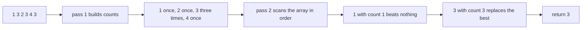
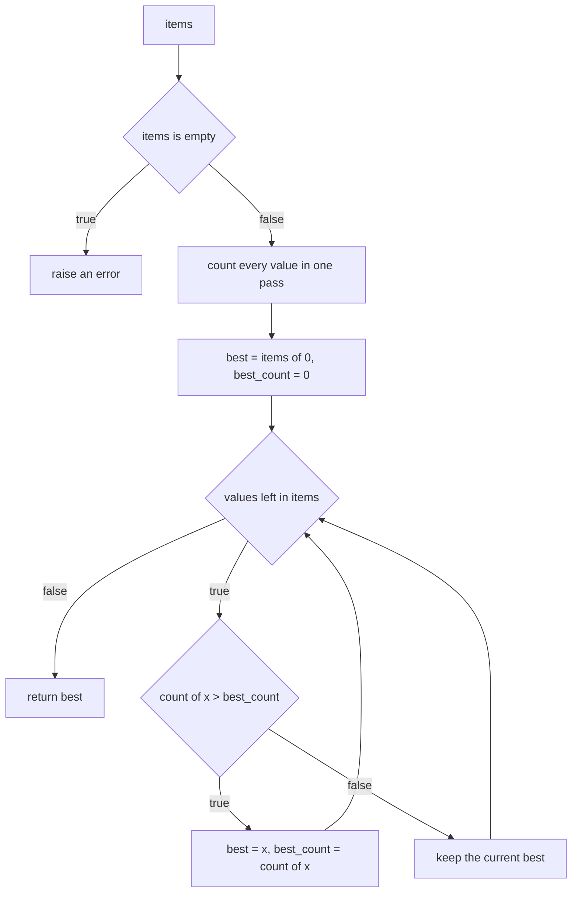
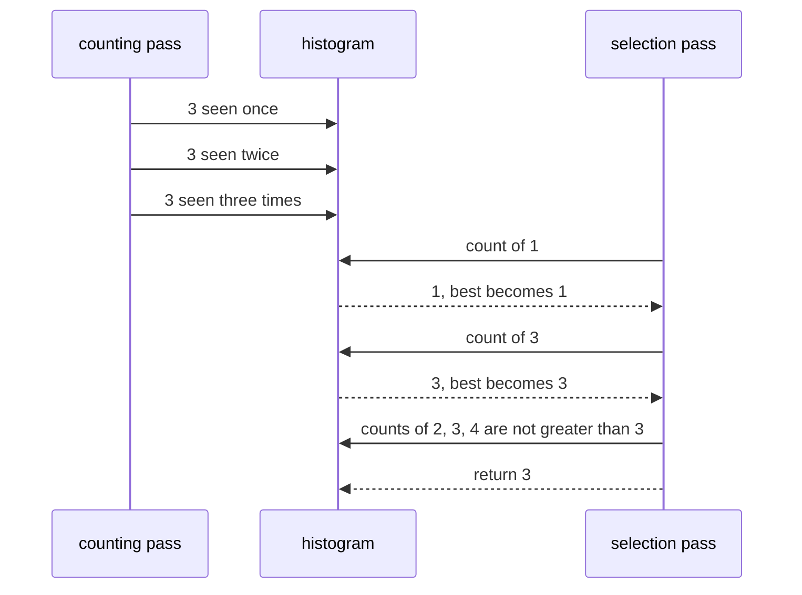

# 048 — Find most frequent element in array.

> **Tier:** Beginner · **CTCI chapter:** Ch 1 — Arrays and Strings
> **Task spec:** [048-find-most-frequent-element-in-array.md](../../../tasks/beginner/048-find-most-frequent-element-in-array.md)
> **Solutions:** [Python](../../../solutions/python/beginner/048-find-most-frequent-element-in-array/solution.py) ·
> [Java](../../../solutions/java/beginner/048-find-most-frequent-element-in-array/Solution.java) ·
> [JavaScript](../../../solutions/javascript/beginner/048-find-most-frequent-element-in-array/solution.js) ·
> [C#](../../../solutions/csharp/beginner/048-find-most-frequent-element-in-array/Solution.cs)

## 1. Problem restatement

**Input:** an array of integers `items`. It may hold a single element, may hold ties, and the spec
does not say what an empty array means — so each file decides for itself, and all four agree on
raising an error. The Python docstring records the tie rule: *"Ties resolved by first occurrence."*

**Output:** the element with the highest number of occurrences. When two or more elements share the
maximum count, the one that **appears first** in the input wins.

| Call | Result | Why |
| --- | --- | --- |
| `most_frequent([1, 3, 2, 3, 4, 3])` | `3` | `3` occurs three times, everything else once |
| `most_frequent([5])` | `5` | a single element is trivially the most frequent |
| `most_frequent([1, 2, 1, 2])` | `1` | tie at count 2, and `1` occurs first |
| `most_frequent([])` | raises | no element can be returned, so each file throws its own exception type |

Python and Java assert the first three rows, C# and JavaScript assert the first row and the tie row.
None of the four asserts the empty-array behaviour, so the exception is a documented-by-code decision
rather than a tested one. The exported name is `most_frequent` in Python, `mostFrequent` in Java and
JavaScript and `MostFrequent` in C#.

## 2. Intuition

The naive method — for each element, count how often it appears by scanning the whole array — is
`O(n²)`, and it recomputes the same counts for duplicate values. Since the answer depends only on
*how many times* each value occurs, a histogram is the natural representation: one pass to build it,
one pass to select from it.

The subtle part is the tie rule. Two perfectly reasonable answers exist for `[1, 2, 1, 2]` — `1` and
`2` both occur twice — and a program that does not decide will produce whichever the container
happens to hand back first. The four files all pick **first occurrence in the input** and enforce it
with two deliberate choices:

- The selection walks the **original array**, not the histogram, so the order is the input order.
- The comparison is strict — `count > best_count` — so an element tied with the current best never
  displaces it.



Selecting over the histogram rather than over the array would also be `O(n)`, and it would be wrong
here: hash containers have no promise about iteration order, so the tie-break would differ between
Java, Python, JavaScript and C#.

## 3. Algorithm

1. If the array is empty, raise an error / throw an exception.
2. Build a histogram of value → count in one pass.
3. Set `best = items[0]` and `best_count = 0`.
4. For each value `x` in the array, in order:
   1. If `counts[x] > best_count`, set `best = x` and `best_count = counts[x]`.
5. Return `best`.

```text
function most_frequent(items)
    if items is empty then raise an error end
    counts ← empty histogram from value to count
    for each value x in items do
        counts[x] ← counts[x] + 1
    end
    best ← items[0]
    best_count ← 0
    for each value x in items do
        if counts[x] > best_count then
            best ← x
            best_count ← counts[x]
        end
    end
    return best
end
```

The initial `best_count = 0` is what makes the first iteration always assign, guaranteeing that `best`
is never left as the initial `items[0]` when that element is not the winner. The strict `>` then does
the tie-breaking for free: once `1` has set `best_count = 2` in `[1, 2, 1, 2]`, `2`'s count of `2` is
not *greater*, so `1` survives.



## 4. Worked example

Trace `most_frequent([1, 3, 2, 3, 4, 3])`.

**Pass 1 — histogram**

| Step | value | count after |
| --- | --- | --- |
| 1 | `1` | `1: 1` |
| 2 | `3` | `3: 1` |
| 3 | `2` | `2: 1` |
| 4 | `3` | `3: 2` |
| 5 | `4` | `4: 1` |
| 6 | `3` | `3: 3` |

**Pass 2 — selection**

| Step | `x` | count of `x` | `best_count` before | strict greater? | `best` after |
| --- | --- | --- | --- | --- | --- |
| 1 | `1` | 1 | 0 | yes | `1` |
| 2 | `3` | 3 | 1 | yes | `3` |
| 3 | `2` | 1 | 3 | no | `3` |
| 4 | `3` | 3 | 3 | no | `3` |
| 5 | `4` | 1 | 3 | no | `3` |
| 6 | `3` | 3 | 3 | no | `3` |
| exit | — | — | — | — | return `3` |

The tie case `[1, 2, 1, 2]` shows the rule from the other side: step 1 sets `best = 1` with
`best_count = 2`, and step 2 sees `counts[2] = 2`, which is **not** `> 2`, so `1` stays. Replacing `>`
with `>=` would return `2` and fail the assertion — the strictness is the tie rule.



## 5. Complexity

Let `n` be the length of `items` and `k` the number of distinct values.

| Measure | Bound | Why it holds |
| --- | --- | --- |
| Time, best | O(n) | both passes always touch every element; a single-element array is the only trivial case |
| Time, average | O(n) | one hash lookup per element in each pass, so `2n` expected constant-cost operations |
| Time, worst | O(n) | the two passes have no early exit; only the hash container's collision behaviour could add a factor |
| Space, extra | O(k) | the histogram, at most one entry per distinct value; the array is not copied |
| Space, output | O(1) | one element |
| Naive pairwise count | O(n²) time, O(1) space | re-scanning for each distinct value |

`k` can be as large as `n`, which is the worst case for memory (all values distinct) and the best
case for the histogram's usefulness. The two-pass structure is what keeps the time linear: the
histogram is built once and every later lookup is constant-time on average.

## 6. Pitfalls and edge cases

- **Empty array must raise.** There is no sensible return value, so each file throws: Python
  `ValueError("empty array")`, Java `IllegalArgumentException("empty array")`, JavaScript
  `Error("empty array")` and C# `ArgumentException("empty array")`. Callers that check for a sentinel
  such as `0` or `-1` instead will misread a legitimate array of zeros. This is the one branch no
  assertion exercises.
- **Ties go to the first occurrence, enforced twice.** Once by iterating the array in order and once
  by using strict `>`. Changing either one — iterating the histogram, or using `>=` — breaks the rule,
  and `[1, 2, 1, 2]` is the assertion that catches it.
- **`best_count` starts at `0`, not at `counts[items[0]]`.** With a zero start, the first iteration
  always assigns and the code has no special case; starting from the first element's count would
  require the first element to be the initial best.
- **Single element.** `[5]` returns `5` on the first iteration with `best_count = 1`. No index beyond
  `items[0]` is ever read as a *value* except inside the loop, so a one-element array is safe.
- **Negative values are fine.** The histogram is keyed by value, so `[-5, -5, 3]` returns `-5`; the
  only operation applied to a value is hashing.
- **Values must be hashable.** Python's `Counter` requires hashable items, so a list of lists raises
  `TypeError`; Java, C#, JavaScript and Python's integer arrays have no such issue, and the task
  specifies integers.
- **Floating-point keys are treacherous.** In a JavaScript `Map`, keys use SameValueZero, so `0` and
  `-0` are the same key while `NaN` equals itself — but `0.1 + 0.2` and `0.3` are different keys. The
  task is integer-based for a reason.
- **Hash collisions are not a correctness issue, only a speed one.** The histogram is a container
  lookup per element; the assertions `[1, 3, 2, 3, 4, 3]` and `[1, 2, 1, 2]` exercise the counts, not
  the hash quality.
- **`items[0]` is read before the loop but never after the emptiness check.** Order matters: the check
  must come first, or the initialisation would throw `IndexOutOfBounds` for an empty array instead of
  the documented error.
- **The result is a value, not an index.** `most_frequent([1, 3, 2, 3, 4, 3])` is `3`, not `1` or `5`.
  Compare [023](../../../tasks/beginner/023-find-second-largest-element-in-an-array.md), which returns
  a value, with [008](../../../tasks/beginner/008-find-the-index-of-a-target-in-an-unsorted-array-linear-search.md),
  which returns an index.

## 7. Variants and follow-ups

- **The inverse selection rule.** [047](../../../tasks/beginner/047-find-first-non-repeating-character-in-a-string.md)
  picks the first element with count `1` using the same two-pass skeleton — maximum versus first-unique
  is only a different predicate.
- **Counting primitives.** [016](../../../tasks/beginner/016-count-occurrences-of-each-character-in-a-string.md)
  is the histogram for characters, and
  [015](../../../tasks/beginner/015-check-if-two-strings-are-anagrams.md) compares two histograms
  instead of selecting from one.
- **Duplicates as a decision problem.** [026](../../../tasks/beginner/026-check-if-array-contains-any-duplicates-boolean.md)
  answers "is any count above 1?" with one pass and no histogram pass at all.
- **Scaling the idea.** [256](../../../tasks/intermediate/256-top-k-frequent-elements-in-array-heap.md)
  returns the `k` most frequent elements with a heap, and
  [257](../../../tasks/intermediate/257-top-k-frequent-words-heap-lexicographic-tie.md) shows what
  happens when the tie rule becomes lexicographic instead of positional.
- **Extremes and ties elsewhere.** [023](../../../tasks/beginner/023-find-second-largest-element-in-an-array.md)
  handles a different kind of tie (equal values) with the same "make the rule explicit" discipline.
- Chapter context: [Arrays and Strings](../../ctci/01-arrays-and-strings.md).

## 8. Check yourself

1. Why must the selection pass iterate the array instead of the histogram?

<details><summary>Show answer</summary>

Because the tie rule is "first occurrence in the input", and hash containers make no promise about
iteration order — Java's `HashMap`, JavaScript's `Map` and Python's `dict` would each give a different
answer on `[1, 2, 1, 2]`. Walking the array restores the input order that the rule refers to.

</details>

2. Why is the comparison strict (`>`), and what changes if it becomes `>=`?

<details><summary>Show answer</summary>

A strict comparison keeps the earliest winner when counts are equal, which is the documented
first-occurrence rule. With `>=` the last tied element would win, so `most_frequent([1, 2, 1, 2])`
would return `2` and the assertion would fail.

</details>

3. What does `most_frequent([])` do, and why is that better than returning `0`?

<details><summary>Show answer</summary>

It raises: `ValueError`, `IllegalArgumentException`, `Error` and `ArgumentException` respectively. A
sentinel such as `0` cannot be distinguished from a legitimate answer (`most_frequent([0, 0])` is `0`),
so an exception is the only honest response to an unsatisfiable request.

</details>

4. Why does `best_count` start at `0` rather than at the count of `items[0]`?

<details><summary>Show answer</summary>

Starting at `0` makes the first iteration always assign, so the loop needs no special case for the
first element and `best` is guaranteed to come from an actual comparison. Starting from
`counts[items[0]]` would also work, but only if `items[0]` were known to be a valid initial winner.

</details>

5. How much extra memory does `most_frequent([1, 3, 2, 3, 4, 3])` use, and what is the worst case for
   an array of length `n`?

<details><summary>Show answer</summary>

Four histogram entries, one per distinct value (`1`, `2`, `3` and `4`). The worst case for an array
of length `n` is `n` distinct values, giving `n` entries — `O(n)` extra space — while the input array
itself is only read, never copied.

</details>
