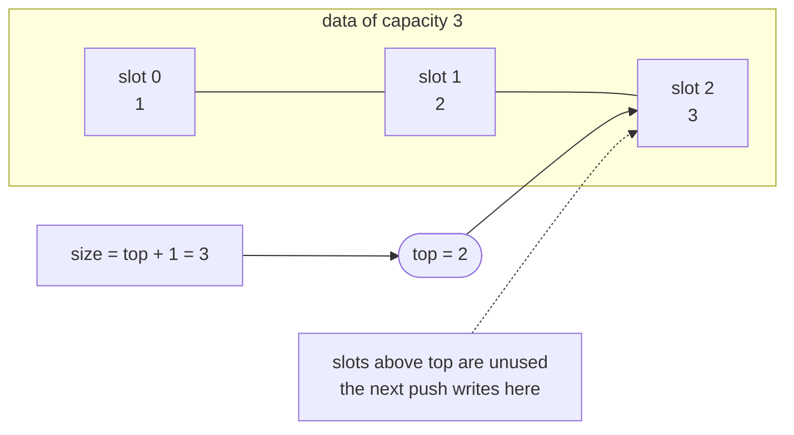
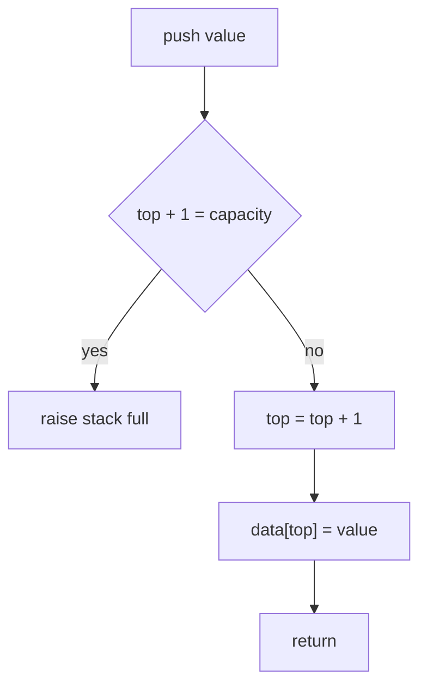
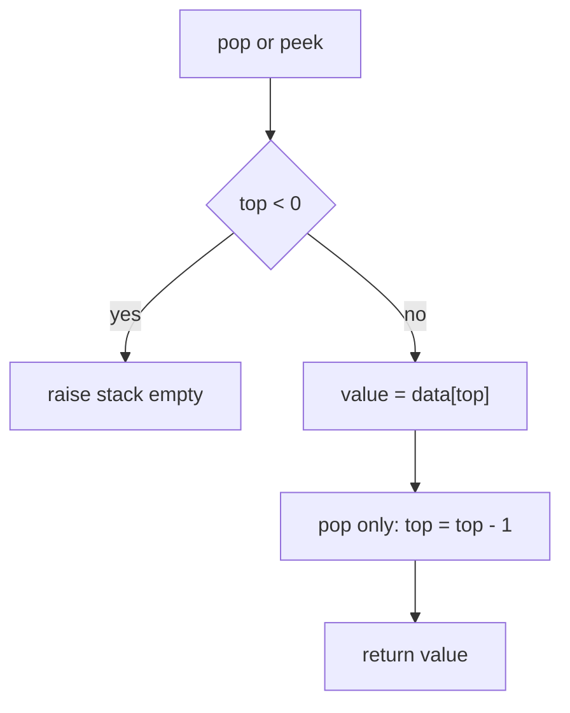
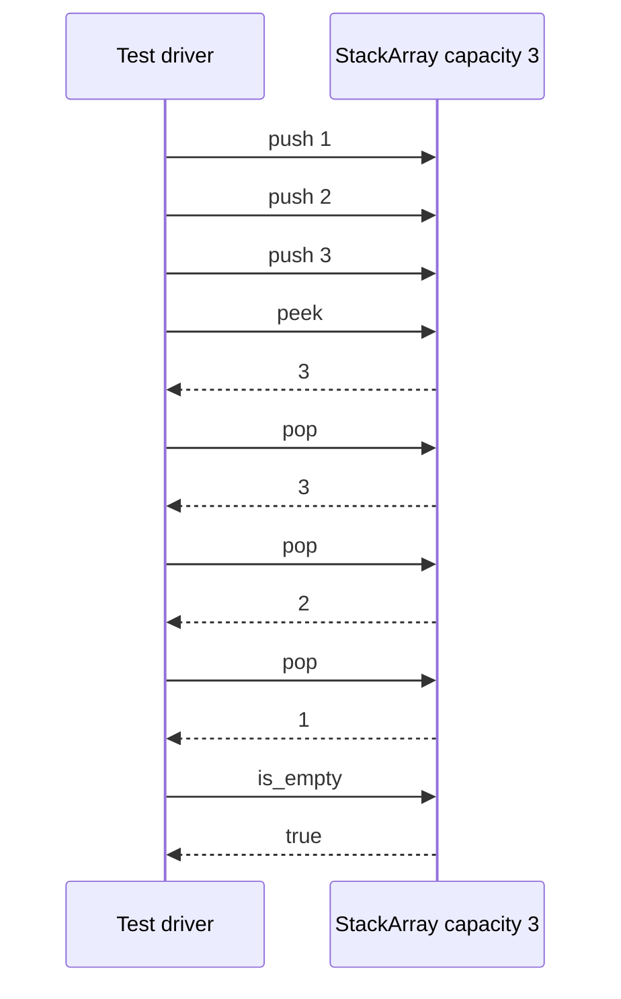

# 049 — Implement stack with array (push/pop).

> **Tier:** Beginner · **CTCI chapter:** Ch 3 — Stacks and Queues
> **Task spec:** [049-implement-stack-with-array-push-pop.md](../../../tasks/beginner/049-implement-stack-with-array-push-pop.md)
> **Solutions:** [Python](../../../solutions/python/beginner/049-implement-stack-with-array-push-pop/solution.py) ·
> [Java](../../../solutions/java/beginner/049-implement-stack-with-array-push-pop/Solution.java) ·
> [JavaScript](../../../solutions/javascript/beginner/049-implement-stack-with-array-push-pop/solution.js) ·
> [C#](../../../solutions/csharp/beginner/049-implement-stack-with-array-push-pop/Solution.cs)

## 1. Problem restatement

**Input:** an integer `capacity` handed to the constructor, then a stream of operations —
`push(value)`, `pop()`, `peek()`, `is_empty()`, `size()`.

**Output:** a last-in-first-out container backed by a plain array of exactly `capacity` slots.
`push` stores a value, `pop` removes and returns the newest value, `peek` returns that value
without removing it, and the two predicates report the state. Nothing in this task grows the
array: the capacity is a constructor argument and stays fixed.

The spec is one line ("Implement stack with array (push/pop)."), so the contract is pinned by the
assertions the four solution files ship with. All of them drive a capacity-3 stack through the
same script:

| Call (capacity 3) | Result | Why |
| --- | --- | --- |
| `is_empty()` before any push | `true` | `top` starts at `-1`, so no slot is live |
| `push(1)`, `push(2)`, `push(3)` | — | three writes into slots 0, 1, 2 |
| `peek()` | `3` | slot `top` holds the newest value |
| `size()` | `3` | `top + 1` |
| `pop()` | `3` | the newest value leaves first |
| `pop()`, `pop()` | `2`, then `1` | LIFO order, not FIFO |
| `is_empty()` after the third pop | `true` | `top` is back to `-1` |

Every file also guards two paths the assertions never take — pushing into a full stack and
popping/peeking an empty one:

| Situation | Python | Java / C# | JavaScript |
| --- | --- | --- | --- |
| push when full | `OverflowError("stack full")` | `IllegalStateException` / `InvalidOperationException` | `Error("stack full")` |
| pop or peek when empty | `IndexError("stack empty")` | same as above | `Error("stack empty")` |

The class is called `StackArray` in all four files; Python and JavaScript additionally export it
so a harness can import it, and Java's `Solution` wraps it together with a `check` helper.

## 2. Intuition

The naive array stack keeps a `size` counter and *shifts*. Push writes at `data[size]`; pop reads
`data[0]` and slides the remaining elements one slot left. That is queue behaviour applied to a
stack: each pop costs **O(n)** and the structure loses its reason to exist. A milder version of the
same mistake is to fill the array from the front and "compact" the tail after every pop — still
O(n) per pop, and the middle of the array becomes dead space.

The insight is that a stack never needs to know *where* its elements are, only **how many** there
are and which slot holds the newest one. One integer carries both facts:

- slots `0 .. top` are the live stack, with the newest element at `top`;
- `push`, `pop` and `peek` only ever touch slot `top`;
- slots `top + 1 .. capacity - 1` are unused, and their leftover contents do not matter.

Empty is exactly `top = -1`, and size is exactly `top + 1`. Push is "step up, then write", pop is
"read, then step down", and neither operation moves a single existing element.



Because `top` is the only mutable state, the empty/partial/full distinction is a comparison, not a
scan: `top < 0` is empty, `top + 1 = capacity` is full, and anything in between is partial.

## 3. Algorithm

1. **Construct.** Allocate an array of `capacity` slots (zero-filled in every solution) and set
   `top = -1`.
2. **Push.** If `top + 1 = capacity` the stack is full — raise. Otherwise increment `top` and write
   the value into `data[top]`.
3. **Pop.** If `top < 0` the stack is empty — raise. Otherwise read `data[top]`, decrement `top`,
   and return the value that was read.
4. **Peek.** If empty, raise; otherwise return `data[top]` and change nothing.
5. **Predicates.** `is_empty` returns `top < 0`; `size` returns `top + 1`.

```text
procedure make_stack(capacity)
    stack.data ← new array of capacity slots
    stack.top ← -1
end

procedure push(stack, value)
    if stack.top + 1 = length(stack.data) then
        raise "stack full"
    end
    stack.top ← stack.top + 1
    stack.data[stack.top] ← value
end

procedure pop(stack)
    if stack.top < 0 then
        raise "stack empty"
    end
    value ← stack.data[stack.top]
    stack.top ← stack.top - 1
    return value
end

function peek(stack)
    if stack.top < 0 then
        raise "stack empty"
    end
    return stack.data[stack.top]
end

function is_empty(stack)
    return stack.top < 0
end

function size(stack)
    return stack.top + 1
end
```

The Java, C# and JavaScript files compress steps 2 and 3 into the update expressions
`data[++top] = value` and `data[top--]`; Python spells the two statements out. The order matters in
both directions: the bound check happens **before** `top` moves, and `pop` reads **before** the
decrement.





## 4. Worked example

Trace the script from section 1 on a capacity-3 stack. `_` marks a slot that has never been
written.

| Step | Operation | `top` before | work done | `top` after | `data` | returned |
| --- | --- | --- | --- | --- | --- | --- |
| 0 | construct | — | allocate three zeroed slots | `-1` | `[_, _, _]` | — |
| 1 | `push(1)` | `-1` | slot 0 was free | `0` | `[1, _, _]` | — |
| 2 | `push(2)` | `0` | slot 1 was free | `1` | `[1, 2, _]` | — |
| 3 | `push(3)` | `1` | slot 2 was free | `2` | `[1, 2, 3]` | — |
| 4 | `peek()` | `2` | read slot 2, nothing changes | `2` | `[1, 2, 3]` | `3` |
| 5 | `pop()` | `2` | read slot 2, step down | `1` | `[1, 2, 3]` | `3` |
| 6 | `pop()` | `1` | read slot 1, step down | `0` | `[1, 2, 3]` | `2` |
| 7 | `pop()` | `0` | read slot 0, step down | `-1` | `[1, 2, 3]` | `1` |
| 8 | `is_empty()` | `-1` | comparison only | `-1` | `[1, 2, 3]` | `true` |
| 9 | `pop()` | `-1` | empty guard fires | `-1` | `[1, 2, 3]` | error |

Rows 5 to 7 are the part that separates an array stack from an array queue: the payload never
moves, only `top` walks backwards, and the array still contains `1, 2, 3` at the end. A push after
step 7 would overwrite slot 0 with the new value, which is why the stale contents are harmless.



## 5. Complexity

Let `n` be the capacity.

| Measure | Bound | Why it holds |
| --- | --- | --- |
| push, best | O(1) | one comparison, one increment, one write; no loop anywhere |
| push, average | O(1) | the guard fails early only when the stack is full, and that is detected in one comparison |
| push, worst | O(1) | the work does not depend on how many elements are live |
| pop | O(1) | one array read and one decrement; the elements below `top` are untouched |
| peek | O(1) | reads slot `top` and changes nothing |
| is_empty / size | O(1) | a comparison and an addition on `top` alone |
| Space | O(capacity) | the array is allocated in the constructor and never resized |
| Shift-on-pop alternative | O(n) per pop, O(1) extra | moving the `top` elements one slot left after each removal |

Full and empty are both detected without touching the array, which is what keeps the worst case
equal to the best case. The cost of the design is the fixed allocation: an empty stack of capacity
1000 still owns 1000 slots. When the upper bound is unknown, the doubling container from
[051-implement-dynamic-array-basic-arraylist.md](../../../tasks/beginner/051-implement-dynamic-array-basic-arraylist.md)
trades that waste for occasional copying.

## 6. Pitfalls and edge cases

- **The full test uses the next slot index.** `top + 1 = capacity` means `top` already sits on the
  last slot, so the stack holds `capacity` elements. Writing the test as `top = capacity` would let
  one extra push through and index past the end of the array in Java, C# and JavaScript.
- **Empty is `top < 0`, not `top = 0`.** A one-element stack has `top = 0`; treating that as empty
  makes `pop` raise on a perfectly valid state.
- **Python's negative indexing hides the guard bug.** `self._data[self._top]` with `top = -1` reads
  the *last* slot instead of failing, so the `is_empty` check inside `pop` and `peek` is
  load-bearing and cannot be "optimised away".
- **Stale slots are not a bug here.** `pop` decrements `top` without clearing the slot. The four
  files store `int`s, so nothing leaks; with reference elements (Java `Object[]`, C# `T[]`,
  JavaScript `Array`) the reference would stay reachable and the slot would have to be cleared.
- **Capacity 0 is constructible.** The stack starts empty and the very first `push` raises
  "stack full" because `top + 1 = 0 = capacity`. No assertion in the four files covers it.
- **Error types are language-specific.** `IndexError`/`OverflowError` in Python,
  `IllegalStateException` in Java, `InvalidOperationException` in C#, plain `Error` in JavaScript —
  same message text, no common supertype, so a ported test must catch the local type.
- **`size` is derived, never stored.** Computing `top + 1` removes an entire class of bugs: there is
  no counter that can drift out of sync after a failed push or a pop of an empty stack.
- **Peeking a full stack is legal.** The full guard belongs to `push` only; `peek` and `pop` care
  about emptiness alone.
- **Not thread-safe.** Concurrent pushes race on `top`; the lock-free outline in
  [356-implement-lock-free-stack-outline-cas.md](../../../tasks/intermediate/356-implement-lock-free-stack-outline-cas.md)
  is the continuation of this task for that setting.
- **The assertions check order, not just contents.** Java, JavaScript and C# all compare the popped
  values against `3, 2, 1` rather than comparing a set, because a FIFO bug would keep the same
  elements in the same array.

## 7. Variants and follow-ups

- **Grow instead of refusing.** Keep `top` but double the array when it fills up: that is
  [051-implement-dynamic-array-basic-arraylist.md](../../../tasks/beginner/051-implement-dynamic-array-basic-arraylist.md),
  where `push_back` replaces `push` and `pop_back` replaces `pop`.
- **Same array, FIFO order.** A queue cannot use a bare `top`, because removing from the front
  would either shift elements or leak capacity — see
  [050-implement-queue-with-array-enqueue-dequeue.md](../../../tasks/beginner/050-implement-queue-with-array-enqueue-dequeue.md)
  and the ring-buffer version in
  [064-implement-circular-queue-ring-buffer.md](../../../tasks/beginner/064-implement-circular-queue-ring-buffer.md).
- **Node-based stack.** Replacing the array with a singly linked list turns `push` into insert-at-head
  ([052-implement-simple-linkedlist-insert-at-head.md](../../../tasks/beginner/052-implement-simple-linkedlist-insert-at-head.md)),
  giving unbounded depth at the cost of one pointer per element.
- **Augmented stack.** Carry a second stack of running minima to answer `getMin` in O(1):
  [172-implement-stack-that-supports-getmin-in-o-1.md](../../../tasks/beginner/172-implement-stack-that-supports-getmin-in-o-1.md).
- **What stacks are for.** Bracket matching pushes openers and pops on closers —
  [041-check-if-brackets-are-balanced-single-type.md](../../../tasks/beginner/041-check-if-brackets-are-balanced-single-type.md)
  and [042-check-balanced-parentheses-with-three-bracket-types.md](../../../tasks/beginner/042-check-balanced-parentheses-with-three-bracket-types.md).
- **The stack you already use.** Every recursive call pushes a frame; the iterative reverse in
  [061-reverse-singly-linked-list-iterative.md](../../../tasks/beginner/061-reverse-singly-linked-list-iterative.md)
  is the explicit-stack version of [062](../../../tasks/beginner/062-reverse-singly-linked-list-recursive.md).
- The chapter walkthrough in [Stacks and Queues](../../ctci/03-stacks-and-queues.md) places this
  implementation next to the queue ring buffer and the queue-via-two-stacks exercise.

## 8. Check yourself

1. Why does `pop` in this design not have to move any of the remaining elements?

<details><summary>Show answer</summary>

Because the elements live at slots `0 .. top` and `top` itself is the boundary. Removing the newest
element is just `top = top - 1`; the elements below it are already in the right slots, so no
shifting is needed. A front-removal structure cannot do that, which is why queues need a head index
instead.

</details>

2. A stack of capacity 3 has `top = 2`. Which operations still succeed, and which raise?

<details><summary>Show answer</summary>

`peek` and `pop` succeed and return the value in slot 2; `is_empty` returns `false` and `size`
returns `3`. `push` raises "stack full" because `top + 1 = 3` equals the capacity. The array is not
full of *data* in a semantic sense — it is full of live slots.

</details>

3. What is the exact value of `size` after `push`, `pop`, `pop` on a fresh capacity-3 stack?

<details><summary>Show answer</summary>

The first `pop` on an empty stack raises, so no valid trace reaches two pops. If instead the trace is
`push(7)`, `pop()`, then `size` is `0` and `is_empty` is `true` — `top` went `-1 → 0 → -1`. The
solution files never store a size counter, so `size` cannot disagree with `top`.

</details>

4. Why does the full check compare `top + 1` with the capacity instead of comparing `top` with the
   capacity?

<details><summary>Show answer</summary>

`top` is the index of the newest element, so a stack with `k` elements has `top = k - 1`. Full means
`k = capacity`, i.e. `top + 1 = capacity`. Comparing `top = capacity` would only fire after a push
that already wrote out of bounds.

</details>

5. The three pop assertions in Java read `s.pop() == 3 && s.pop() == 2 && s.pop() == 1`. Why does
   `&&` short-circuit make this a valid test of order?

<details><summary>Show answer</summary>

Java evaluates left to right and stops at the first `false`, so the three calls happen in the
written order — `3` must come out first, then `2`, then `1`. A FIFO implementation would return `1`
first and fail the leftmost comparison immediately. Python, JavaScript and C# assert the same
sequence through their own comparison or list-building forms.

</details>
