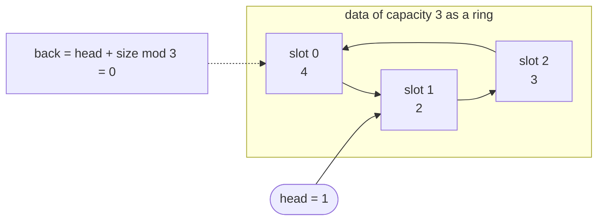
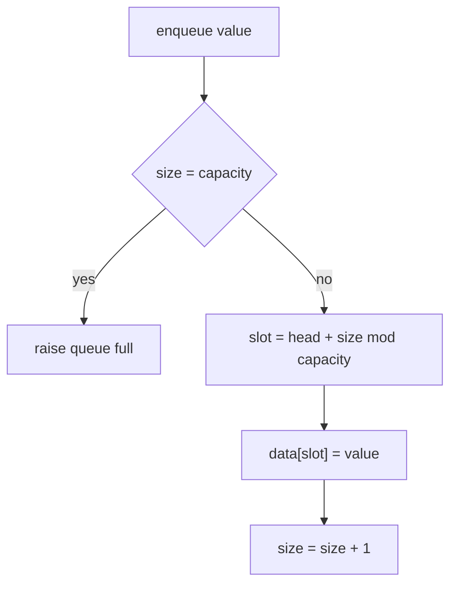
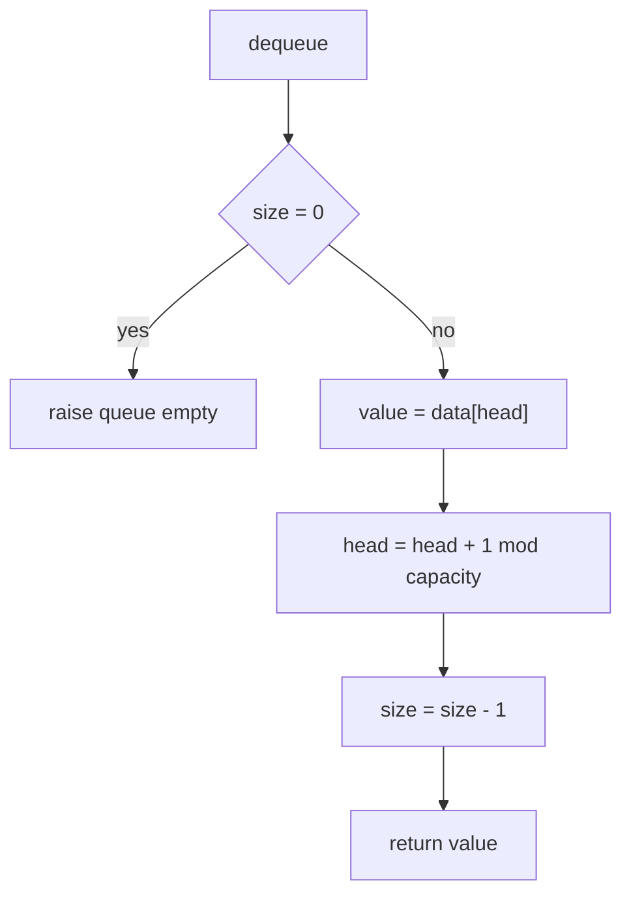
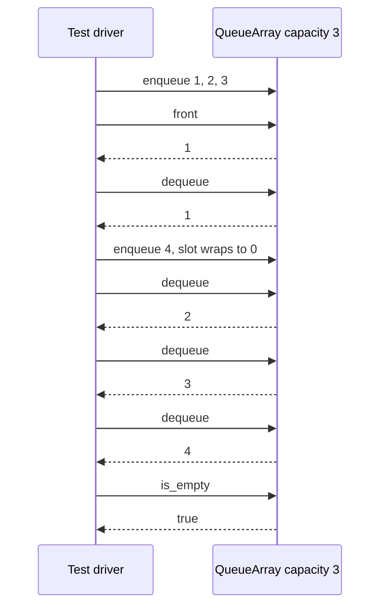

# 050 — Implement queue with array (enqueue/dequeue).

> **Tier:** Beginner · **CTCI chapter:** Ch 3 — Stacks and Queues
> **Task spec:** [050-implement-queue-with-array-enqueue-dequeue.md](../../../tasks/beginner/050-implement-queue-with-array-enqueue-dequeue.md)
> **Solutions:** [Python](../../../solutions/python/beginner/050-implement-queue-with-array-enqueue-dequeue/solution.py) ·
> [Java](../../../solutions/java/beginner/050-implement-queue-with-array-enqueue-dequeue/Solution.java) ·
> [JavaScript](../../../solutions/javascript/beginner/050-implement-queue-with-array-enqueue-dequeue/solution.js) ·
> [C#](../../../solutions/csharp/beginner/050-implement-queue-with-array-enqueue-dequeue/Solution.cs)

## 1. Problem restatement

**Input:** an integer `capacity` given to the constructor, then a stream of operations —
`enqueue(value)`, `dequeue()`, `front()`, `is_empty()`, `size()`.

**Output:** a first-in-first-out container over a fixed array of `capacity` slots. `enqueue`
appends at the back, `dequeue` removes and returns the oldest element, `front` looks at the oldest
element without removing it. The Python docstring states the design goal outright: *"Circular
buffer: O(1) enqueue and dequeue, no shifting."*

The spec is one line, so the contract is fixed by the assertions the four solutions ship. All four
run the same capacity-3 script, including one deliberate wrap-around:

| Call (capacity 3) | Result | Why |
| --- | --- | --- |
| `enqueue(1)`, `enqueue(2)`, `enqueue(3)` | — | fills slots 0, 1, 2 |
| `front()` | `1` | the oldest element is at the head |
| `dequeue()` | `1` | FIFO: the first element in is the first out |
| `enqueue(4)` | — | the back index wraps to slot 0 |
| `dequeue()` three times | `2`, `3`, then `4` | the wrapped element keeps its place in line |
| `is_empty()` after the last dequeue | `true` | `size` is back to 0 |

Both guard paths exist in every file although the assertions only exercise the trace above:

| Situation | Python | Java / C# | JavaScript |
| --- | --- | --- | --- |
| enqueue when full | `OverflowError("queue full")` | `IllegalStateException` / `InvalidOperationException` | `Error("queue full")` |
| dequeue or front when empty | `IndexError("queue empty")` | same as above | `Error("queue empty")` |

The class is `QueueArray` in all four files. Java's wrapper helper and the C# `Check` helper carry
the same labels as the Python asserts, with one typo worth knowing: the Java label for the
wrap-around step reads "wrap-around FIFA order" while the assertion itself verifies FIFO order.

## 2. Intuition

Take the array stack of [049-implement-stack-with-array-push-pop.md](../../../tasks/beginner/049-implement-stack-with-array-push-pop.md)
and swap the removal end. Now the newest element is at `size - 1` and the oldest is at `0`, and
removing the oldest element means everything after it has to slide one slot left — **O(n)** per
dequeue, and the queue is reduced to a slow stack.

The usual second attempt keeps two indices, `head` and `tail`, and simply advances `head` on
dequeue without shifting. That is O(1), but the storage leaks: after `capacity` dequeues the array
still looks occupied at the front and `tail` has walked off the end, so the queue reports "full"
while holding two elements.

The insight is that the array is a **ring**, not a line. An index is really a position modulo
`capacity`, so `tail + 1` after the last slot is slot `0` again. Writing the back position as
`(head + size) mod capacity` means the structure stores only two numbers — where the line starts
and how long it is:

- `head` is the slot holding the oldest element;
- `size` is the number of live elements, so the element after the newest one sits at
  `(head + size) mod capacity`;
- every live element occupies exactly the `size` consecutive slots that start at `head` and wrap
  around the end of the array.

Storing `size` instead of tracking a `tail` index solves a second problem for free: a bare
`head = tail` is ambiguous (empty or full?), and the classic fix wastes one slot to escape the
ambiguity. An explicit count distinguishes empty (`size = 0`) from full (`size = capacity`) while
using the whole array.



The ring picture explains the modulo: after three enqueues and one dequeue, `head = 1` and
`size = 2`, so the live slots are 1 and 2; the next enqueue lands in slot `(1 + 2) mod 3 = 0`,
which is free even though the queue is *not* empty.

## 3. Algorithm

1. **Construct.** Allocate `capacity` slots, set `head = 0` and `size = 0`.
2. **Enqueue.** If `size = capacity` the queue is full — raise. Otherwise compute
   `slot = (head + size) mod capacity`, write the value there, and increment `size`.
3. **Dequeue.** If `size = 0` the queue is empty — raise. Otherwise read `data[head]`, advance
   `head = (head + 1) mod capacity`, decrement `size`, and return the value read.
4. **Front.** If empty, raise; otherwise return `data[head]` and change nothing.
5. **Predicates.** `is_empty` returns `size = 0`; the size accessor returns `size`.

```text
procedure make_queue(capacity)
    queue.data ← new array of capacity slots
    queue.head ← 0
    queue.size ← 0
end

procedure enqueue(queue, value)
    if queue.size = length(queue.data) then
        raise "queue full"
    end
    slot ← (queue.head + queue.size) mod length(queue.data)
    queue.data[slot] ← value
    queue.size ← queue.size + 1
end

procedure dequeue(queue)
    if queue.size = 0 then
        raise "queue empty"
    end
    value ← queue.data[queue.head]
    queue.head ← (queue.head + 1) mod length(queue.data)
    queue.size ← queue.size - 1
    return value
end

function front(queue)
    if queue.size = 0 then
        raise "queue empty"
    end
    return queue.data[queue.head]
end

function count(queue)
    return queue.size
end

function is_empty(queue)
    return queue.size = 0
end
```

The four files spell this identically; the only naming difference is Python's private `_head` and
`_size` and the JavaScript/C# field called `count` instead of `size`. Both the enqueue slot and the
dequeue advance use the same modulo, which is what lets `head` cross the end of the array safely.





## 4. Worked example

Trace the capacity-3 script from section 1. `size` is shown before the operation, `_` marks a slot
never written.

| Step | Operation | `head` | `size` | `(head + size) mod 3` | `data` afterwards | returned |
| --- | --- | --- | --- | --- | --- | --- |
| 0 | construct | `0` | `0` | — | `[_, _, _]` | — |
| 1 | `enqueue(1)` | `0` | `0` | `0` | `[1, _, _]` | — |
| 2 | `enqueue(2)` | `0` | `1` | `1` | `[1, 2, _]` | — |
| 3 | `enqueue(3)` | `0` | `2` | `2` | `[1, 2, 3]` | — |
| 4 | `front()` | `0` | `3` | read slot `head` | `[1, 2, 3]` | `1` |
| 5 | `dequeue()` | `1` | `3` | read slot 0 | `[1, 2, 3]` | `1` |
| 6 | `enqueue(4)` | `1` | `2` | `(1 + 2) mod 3 = 0` | `[4, 2, 3]` | — |
| 7 | `dequeue()` | `2` | `3` | read slot 1 | `[4, 2, 3]` | `2` |
| 8 | `dequeue()` | `0` | `2` | read slot 2 | `[4, 2, 3]` | `3` |
| 9 | `dequeue()` | `1` | `1` | read slot 0 | `[4, 2, 3]` | `4` |
| 10 | `is_empty()` | `1` | `0` | — | `[4, 2, 3]` | `true` |
| 11 | `dequeue()` | `1` | `0` | empty guard fires | `[4, 2, 3]` | error |

Step 6 is the whole point of the task. After step 5 the queue holds two elements that occupy slots
1 and 2, so the array *looks* almost full but slot 0 is dead — the modulo makes the new element
land there and the logical order stays `2, 3, 4`. Step 9 wraps `head` back to 0, proving that a
non-zero `head` does not mean "the front is lost".



## 5. Complexity

Let `n` be the capacity.

| Measure | Bound | Why it holds |
| --- | --- | --- |
| enqueue, best | O(1) | one comparison, one modulo, one write |
| enqueue, average | O(1) | no branch depends on the number of live elements |
| enqueue, worst | O(1) | the "full" case is detected in one comparison, and it is the only rejection path |
| dequeue, best / average / worst | O(1) | one read, one modulo, one decrement; nothing else in the array is touched |
| front | O(1) | reads `data[head]` |
| is_empty / size | O(1) | a comparison on `size` / returning `size` |
| Space | O(capacity) | the array is allocated in the constructor and never resized |
| Shift-on-dequeue alternative | O(n) per dequeue, O(1) extra | moving every remaining element one slot towards the front |
| Head/tail-without-size alternative | O(1) but capacity - 1 usable slots | one slot must stay empty to distinguish full from empty |

The modulo is an arithmetic on two small integers, so it adds a constant, not a factor: the ring
buffer reaches the same asymptotics as the naive shift version's *best* case in every case.

## 6. Pitfalls and edge cases

- **Full is `size = capacity`, not `head = tail`.** The two-index scheme has no way to tell a full
  queue from an empty one, which is why this implementation stores a count and can use every slot.
- **Modulo, not plain increment.** `head + 1` and `head + size` must both be reduced modulo the
  capacity. Using the raw values lets `head` reach `capacity` and index out of bounds — the
  wrap-around assertion in step 6 of the trace is what catches this.
- **The back index is a formula, not a field.** `(head + size) mod capacity` is the slot the next
  enqueue will use; the *last* element lives at `(head + size - 1) mod capacity`. Confusing the two
  writes one slot past the back.
- **Capacity 0 breaks the modulo.** `mod length(data)` with a zero-length array is a division by
  zero, and no assertion in the four files constructs a zero-capacity queue.
- **JavaScript allocates holes.** `new Array(capacity)` leaves `undefined` slots; the Python file
  uses `[0] * capacity` and the Java/C# files use zero-filled `int[]`. Reading a slot before a
  matching enqueue therefore yields `undefined` in JavaScript rather than `0` — the tests never do.
- **Stale slots survive dequeue.** `dequeue` advances `head` and decrements `size` but never clears
  the slot, so the array still holds `[4, 2, 3]` at the end of the trace. Harmless with `int`
  payloads, a retention risk with object payloads.
- **Empty means `size = 0`, not `head = 0`.** After step 9 in the trace the queue is empty while
  `head = 1`; testing `head = 0` for emptiness would report a non-empty queue.
- **`front` is not `dequeue`.** Peeking must not advance `head`; the Python, Java, JavaScript and C#
  files only read the slot, and the trace asserts `front()` without disturbing the following pops.
- **Error types are language-specific** (`OverflowError`/`IndexError`, `IllegalStateException`,
  `InvalidOperationException`, `Error`) with the messages "queue full" and "queue empty".
- **Not thread-safe.** Two concurrent enqueues can compute the same slot; the lock-free ring buffer
  in [492-implement-circular-buffer-with-lock-free-design-atomic.md](../../../tasks/advanced/492-implement-circular-buffer-with-lock-free-design-atomic.md)
  is the advanced continuation.

## 7. Variants and follow-ups

- **The same ring, wrapping by hand.** [064-implement-circular-queue-ring-buffer.md](../../../tasks/beginner/064-implement-circular-queue-ring-buffer.md)
  builds the identical structure from a `head`/`tail` pair plus an explicit full test, which is worth
  comparing against the `head`/`size` pair used here.
- **The other end.** A stack needs only one index because it never removes from the front:
  [049-implement-stack-with-array-push-pop.md](../../../tasks/beginner/049-implement-stack-with-array-push-pop.md).
- **Unbounded instead of fixed.** Combining the ring with doubling yields a growable queue; the
  growth half is [051-implement-dynamic-array-basic-arraylist.md](../../../tasks/beginner/051-implement-dynamic-array-basic-arraylist.md).
- **Both ends open.** A deque (double-ended queue) generalises the ring to remove from either side;
  see [092-max-over-sliding-window-using-deque.md](../../../tasks/beginner/092-max-over-sliding-window-using-deque.md)
  and [208-implement-sliding-window-minimum-using-deque.md](../../../tasks/intermediate/208-implement-sliding-window-minimum-using-deque.md)
  for what that buys.
- **Augmented queue.** Tracking running minima alongside the elements gives O(1) `getMin`:
  [173-implement-queue-that-supports-getmin-in-o-1.md](../../../tasks/beginner/173-implement-queue-that-supports-getmin-in-o-1.md);
  the heap-backed priority queue is
  [065-implement-priority-queue-using-built-in-heap.md](../../../tasks/beginner/065-implement-priority-queue-using-built-in-heap.md).
- **Concurrent queues.** [621-implement-scalable-concurrent-queue-michael-scott-queue.md](../../../tasks/expert/621-implement-scalable-concurrent-queue-michael-scott-queue.md)
  is the concurrent version of exactly this interface.
- The chapter walkthrough in [Stacks and Queues](../../ctci/03-stacks-and-queues.md) puts the ring
  buffer next to the array stack and the queue-via-two-stacks trick.

## 8. Check yourself

1. Why does this implementation need a `size` field when a `head` and a `tail` index would describe
   the same ring?

<details><summary>Show answer</summary>

Because `head = tail` is ambiguous: it can mean "empty" or "full". The standard workaround wastes
one slot so that the full condition becomes `(tail + 1) mod capacity = head`. Storing `size` removes
the ambiguity outright and lets the queue use all `capacity` slots.

</details>

2. In the trace, after four successful operations the array is `[4, 2, 3]` with `head = 1`. What is
   `front()` at that moment, and what is the slot of the next enqueue?

<details><summary>Show answer</summary>

`front()` returns `2`, the element at slot `head = 1`. With `size = 3` the queue is full, so the next
enqueue raises "queue full"; conceptually its slot would be `(1 + 3) mod 3 = 1`, which is exactly
where the oldest element sits.

</details>

3. How many elements can a capacity-3 ring buffer hold, and how many can a `head`/`tail`
   implementation that reserves one slot hold?

<details><summary>Show answer</summary>

Three, because `size` can reach `capacity`. The reserving variant tops out at two, since `tail`
must never catch up with `head`. That missing slot is the price of not storing a count.

</details>

4. Why is `dequeue` still O(1) even though it removes from the front of an array?

<details><summary>Show answer</summary>

Because it does not remove anything from the array: it reads `data[head]` and moves the logical
front forward with `head = (head + 1) mod capacity`. The elements behind the new `head` never move,
and the modulo prevents the moving index from leaving the array.

</details>

5. What would break if `enqueue` used `data[head + size] = value` without the modulo?

<details><summary>Show answer</summary>

Once `head + size` reaches `capacity`, the write lands past the end of the array — an
`IndexError` in Python, an `ArrayIndexOutOfBoundsException` in Java, `undefined` assignment noise
in JavaScript, and an `IndexOutOfRangeException` in C#. Step 6 of the trace is precisely the moment
the sum equals 3 = capacity, so the wrap-around assertion fails first.

</details>
