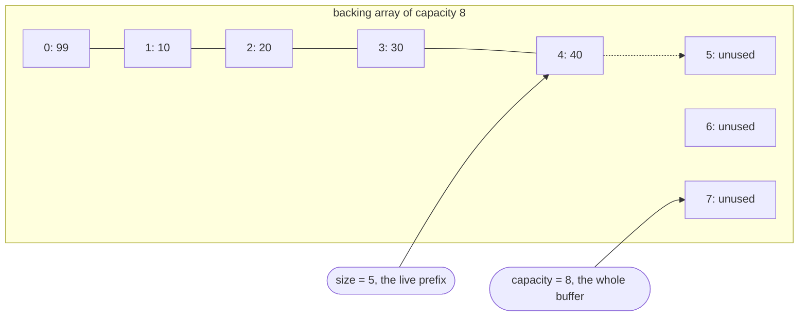
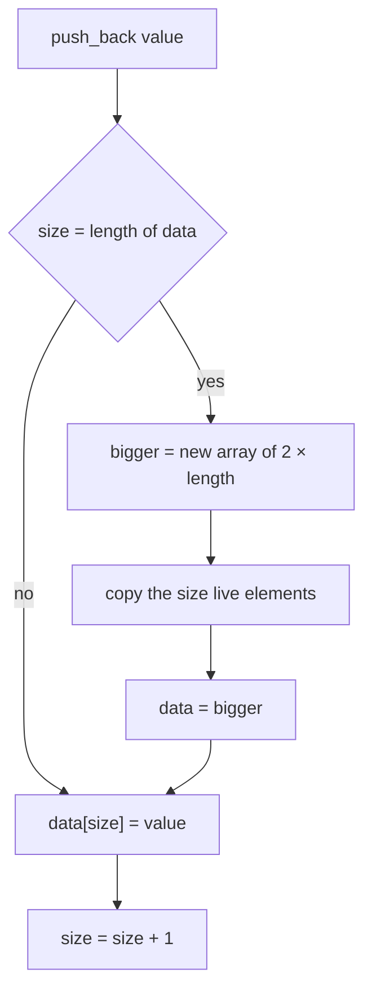
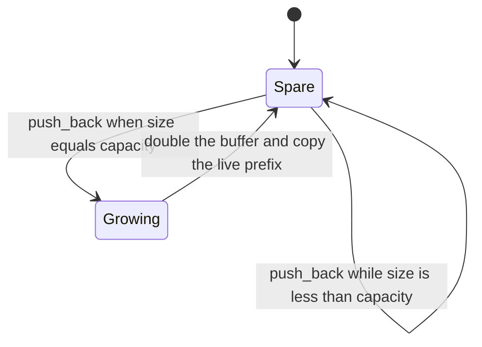
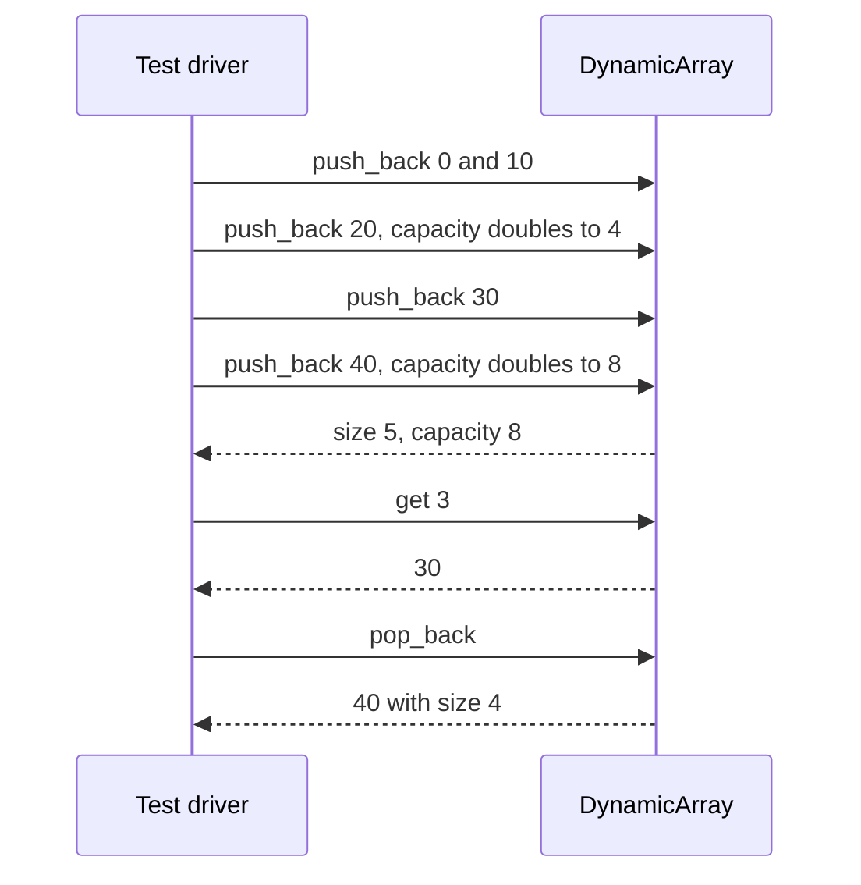

# 051 — Implement dynamic array (basic ArrayList).

> **Tier:** Beginner · **CTCI chapter:** Ch 1 — Arrays and Strings
> **Task spec:** [051-implement-dynamic-array-basic-arraylist.md](../../../tasks/beginner/051-implement-dynamic-array-basic-arraylist.md)
> **Solutions:** [Python](../../../solutions/python/beginner/051-implement-dynamic-array-basic-arraylist/solution.py) ·
> [Java](../../../solutions/java/beginner/051-implement-dynamic-array-basic-arraylist/Solution.java) ·
> [JavaScript](../../../solutions/javascript/beginner/051-implement-dynamic-array-basic-arraylist/solution.js) ·
> [C#](../../../solutions/csharp/beginner/051-implement-dynamic-array-basic-arraylist/Solution.cs)

## 1. Problem restatement

**Input:** an empty array structure, then a stream of operations — `push_back(value)`, `get(index)`,
`set(index, value)`, `pop_back()`, `size()`, `capacity()`.

**Output:** a growable array with the semantics of a language `ArrayList`/`List`. The Python docstring
states the growth policy: *"Doubling amortized O(1) append, like ArrayList."* The backing array starts
at **2** slots and doubles whenever an append finds it full.

The assertions drive the structure through one growth sequence and one bounds-checked access each way:

| Call | Result | Why |
| --- | --- | --- |
| five `push_back` calls with `0, 10, 20, 30, 40` | — | the fifth append forces a second growth |
| `size()` | `5` | five elements are live |
| `capacity()` | `8` | the buffer doubled `2 → 4 → 8` |
| `get(3)` | `30` | random access is an index into the buffer |
| `set(0, 99)` then `get(0)` | `99` | `set` overwrites in place and changes no size |
| `pop_back()` | `40` | the last element leaves, `size` drops to `4` |
| `get(7)` on a size-5 array | error `"index out of range"` | `capacity` is 8 but only indices `0 .. 4` are live |

All four files assert the same six steps with the labels "size 5", "capacity doubled", "get", "set" and
"pop". The bounds errors are language-specific: `IndexError` in Python, `IndexOutOfBoundsException` in
Java (and `IllegalStateException` for the empty pop), `RangeError` in JavaScript, and
`IndexOutOfRangeException` in C#.

## 2. Intuition

A plain array is exactly what a dynamic array needs for storage — O(1) indexed read and write — except
for one thing: its length is fixed at allocation. The naive fix is to reallocate on every append into
a buffer of `size + 1`, which is correct but costs O(n) per append and O(n²) to build an array of `n`
elements, because each append copies everything that came before it.

The insight is that overflow is rare if you buy slack in bulk: when the buffer is full, allocate a
buffer of **twice** the size and copy the live elements once. The cost of an append is then O(1) most
of the time and O(size) occasionally, and those occasional copies are spaced far enough apart to
average out:

- the first growth copies 2 elements, the next 4, then 8, then 16 …;
- the sum `2 + 4 + ... + n/2` is less than `n`, so building an array of `n` elements performs fewer
  than `2n` copies in total — O(1) amortised per append;
- after any growth the capacity is at most twice the size, so the wasted slack is proportional to the
  live data, never unbounded.

The second insight is that the structure must therefore track **two numbers**, not one:

- `size` — how many elements are live, which is what `get` and `set` validate against;
- `capacity` — how many slots exist, which is the length of the backing array.

Confusing them is the classic bug in this task: an index between `size` and `capacity` is inside the
array but outside the data.



Only the prefix `0 .. size - 1` is data. The tail exists so that appends do not have to allocate, and it
is exactly the region that the `2 → 4 → 8` doubling policy keeps proportionate.

## 3. Algorithm

1. **Construct.** Allocate a buffer of 2 slots and set `size = 0`.
2. **push_back(value).** If `size` equals the buffer length, grow first; then write the value at
   `data[size]` and increment `size`.
3. **grow.** Allocate a buffer of twice the current length, copy the first `size` elements into it, and
   replace the buffer reference.
4. **get(index) / set(index, value).** Check `0 ≤ index < size`; raise otherwise; read or write that
   slot.
5. **pop_back().** If `size = 0`, raise "empty"; otherwise decrement `size` and return the value that
   was at `data[size]`. Nothing is shifted.
6. **size() / capacity().** Return `size` and the buffer length respectively.

```text
procedure push_back(array, value)
    if array.size = length(array.data) then
        grow(array)
    end
    array.data[array.size] ← value
    array.size ← array.size + 1
end

procedure grow(array)
    bigger ← new array of 2 × length(array.data) slots
    for i ← 0 to array.size - 1 do
        bigger[i] ← array.data[i]
    end
    array.data ← bigger
end

function get(array, index)
    check_index(array, index)
    return array.data[index]
end

procedure set(array, index, value)
    check_index(array, index)
    array.data[index] ← value
end

procedure check_index(array, index)
    if index < 0 or index ≥ array.size then
        raise "index out of range"
    end
end

function pop_back(array)
    if array.size = 0 then
        raise "empty"
    end
    array.size ← array.size - 1
    return array.data[array.size]
end
```

The `check_index` bound is `size`, never the buffer length: reading slot 6 of an array with 5 elements
would return a leftover zero rather than failing, which is why the tasks' `get(7)` case is expected to
raise even though it is physically inside the buffer. Java and C# express step 5 as `return data[--size]`
and JavaScript the same way; Python decrements on its own line.



## 4. Worked example

Trace the five appends of the assertions, starting from a 2-slot buffer.

| Step | `push_back` | `size` before | buffer before | grow? | elements copied | slot written | `size` after | capacity after |
| --- | --- | --- | --- | --- | --- | --- | --- | --- |
| 0 | construct | — | — | — | — | — | `0` | `2` |
| 1 | `0` | `0` | capacity 2 | no | — | `0` | `1` | `2` |
| 2 | `10` | `1` | capacity 2 | no | — | `1` | `2` | `2` |
| 3 | `20` | `2` | capacity 2, full | **yes → 4** | `2` | `2` | `3` | `4` |
| 4 | `30` | `3` | capacity 4 | no | — | `3` | `4` | `4` |
| 5 | `40` | `4` | capacity 4, full | **yes → 8** | `4` | `4` | `5` | `8` |

The two growths copy 2 and 4 elements, which is why the assertion can state `capacity() == 8`
unconditionally: the policy is deterministic, and the buffer doubles exactly at the moments it fills.
The remaining operations are single-slot work:

| Step | Operation | `size` before | work | `size` after | returned |
| --- | --- | --- | --- | --- | --- |
| 6 | `get(3)` | `5` | index in range | `5` | `30` |
| 7 | `set(0, 99)` | `5` | slot 0 overwritten | `5` | — |
| 8 | `get(0)` | `5` | index in range | `5` | `99` |
| 9 | `pop_back()` | `5` | decrement, read slot 4 | `4` | `40` |
| 10 | `get(7)` | `4` | `7 ≥ size` | `4` | error |

Step 9 shows the asymmetry with `push_back`: removal needs no allocation and no copying, because the
last element is the only one that has to go. Step 10 shows why the bounds check uses `size` — slot 7 is
inside the 8-slot buffer but outside the data.





## 5. Complexity

Let `n` be the number of live elements.

| Measure | Bound | Why it holds |
| --- | --- | --- |
| get(index) / set(index, value), best / average / worst | O(1) | one bounds comparison and one array access |
| push_back, best / average | O(1) | the common case is one comparison and one write; growth is rare |
| push_back, worst | O(n) | the append that triggers growth copies all `n` live elements |
| push_back, amortised | O(1) | copies total `2 + 4 + ... + n < 2n` across `n` appends, so the average is under two copies |
| pop_back | O(1) | decrement the size and read one slot; no shifting, no shrinking |
| size / capacity | O(1) | a field read and a buffer-length read |
| Space | O(n) | capacity never exceeds twice the size after a growth, so the slack is proportional to the data |
| Grow-by-one alternative | O(n) per append, O(n²) per build | every append allocates and copies the whole prefix |

The growth policy is the whole reason this structure is worth implementing: O(1) amortised append with
O(1) random access, plus a bounded waste factor of 2. The trade is that the buffer is never shrunk —
`pop_back` can leave a capacity of 8 for a single live element, which is the price of never reallocating
on the way down.

## 6. Pitfalls and edge cases

- **Growing by a constant instead of doubling.** `capacity + 1` or `capacity + 10` reinstates the
  O(n²) build; doubling is what makes the total copy count linear.
- **Multiplying by one by accident.** A growth factor of 1 allocates a buffer of the same size and the
  next check finds it full again — every append then triggers a copy, and the sequence can loop.
- **Copying the whole buffer instead of the live prefix.** Copying `capacity` slots is harmless with a
  zero-filled array but wasteful; copying `size` slots is what the Java, JavaScript and C# files do,
  and Python slices `data[:size]` for the same effect.
- **Forgetting to reassign the buffer.** `grow` produces a new array; the structure must replace its
  `data` reference, otherwise the appended value lands in a discarded buffer.
- **Bounds check against `capacity`.** `get(7)` on a size-5 array is physically valid and must still
  fail; the assertion in every file pins the error message ("index out of range").
- **Negative indices.** `index < 0` must be rejected explicitly. Python's negative indexing would
  otherwise silently read from the end of the buffer, which is a different element or a stale zero.
- **Empty pop.** `pop_back` on a size-0 array raises "empty" (`IndexError`, `IllegalStateException`,
  `Error`, `InvalidOperationException`) rather than returning a default.
- **The order of the decrement and the read in `pop_back`.** Java, JavaScript and C# write
  `data[--size]`, which decrements first; Python decrements and then indexes. Reading with the old
  `size` would return the wrong element.
- **Stale slots after `pop_back`.** The removed value is left in the buffer, so a later `push_back`
  overwrites it. With reference payloads that means a retained object until the next append; clearing
  the slot is the fix if that matters.
- **`set` does not change the size.** It overwrites an existing element; growing the array through
  `set(index, value)` is not part of this contract.
- **Capacity is not the size.** The two accessors exist separately precisely because code that reports
  `capacity` as the length is a common bug in hand-written dynamic arrays.
- **Unused helper leftovers.** The Java and C# files carry the `ListNode`/`fromList`/`toList` helpers
  shared by the surrounding linked-list tasks; this task does not use them, so they can be ignored when
  reading those two files.
- **Integer capacity growth.** Doubling repeatedly reaches the language's maximum array length; the
  files do not guard against it, and a real implementation would switch to an overflow check.

## 7. Variants and follow-ups

- **The fixed-capacity cousins.** [049-implement-stack-with-array-push-pop.md](../../../tasks/beginner/049-implement-stack-with-array-push-pop.md)
  refuses a push when full, and [050-implement-queue-with-array-enqueue-dequeue.md](../../../tasks/beginner/050-implement-queue-with-array-enqueue-dequeue.md)
  wraps a fixed ring; this task is what you get when you choose growth instead of rejection.
- **Growth in the other containers.** [064-implement-circular-queue-ring-buffer.md](../../../tasks/beginner/064-implement-circular-queue-ring-buffer.md)
  deliberately keeps the ring fixed, which is the opposite design decision for the same trade-off.
- **Appending while preserving order.** The linked-list version of append is
  [053-implement-linkedlist-insert-at-tail.md](../../../tasks/beginner/053-implement-linkedlist-insert-at-tail.md),
  which is O(n) per call precisely because it has no spare capacity to exploit.
- **Building a new array instead of growing one.** [004-remove-duplicates-from-an-array-create-new-array.md](../../../tasks/beginner/004-remove-duplicates-from-an-array-create-new-array.md)
  allocates its result once and writes into it, the pattern this structure generalises.
- **Index arithmetic on the result.** [097-flatten-a-2d-array-row-major.md](../../../tasks/beginner/097-flatten-a-2d-array-row-major.md)
  is the same index-into-a-buffer reasoning applied to a rectangular shape.
- **Where the slack shows up in interviews.** Amortised analysis of doubling is the standard question
  attached to this structure, and [00-big-o.md](../../00-big-o.md) works through the same summation.
- The chapter walkthrough in [Arrays and Strings](../../ctci/01-arrays-and-strings.md) treats the
  dynamic array as the bridge from fixed arrays to the container types used everywhere else.

## 8. Check yourself

1. Why is `push_back` O(1) amortised rather than O(1) worst case?

<details><summary>Show answer</summary>

Most appends write into spare capacity and cost a constant. The append that finds the buffer full copies
every live element, which is O(n) for that call. Because the buffer doubles, those expensive calls are
spaced out — their total cost over `n` appends is `2 + 4 + ... + n`, which is under `2n`, so the average
per append is a constant.

</details>

2. An array has `size = 5` and `capacity = 8`. Which indices are valid, and what happens at index 6?

<details><summary>Show answer</summary>

Valid indices are `0 .. 4`. Index 6 is physically inside the buffer but outside the live prefix, so
`get(6)` raises "index out of range" — the bounds check compares against `size`, not against the buffer
length.

</details>

3. How many element copies happen in total while appending the values `0, 10, 20, 30, 40` to a fresh
   dynamic array?

<details><summary>Show answer</summary>

Six: two when the buffer grows from 2 to 4 (at the third append) and four when it grows from 4 to 8 (at
the fifth). The five appends themselves are single writes. That is why the assertion can check
`capacity() == 8` after exactly five appends.

</details>

4. What does `pop_back()` do to the buffer, and what does it leave behind?

<details><summary>Show answer</summary>

It decrements `size` and returns the old last element; the buffer, its capacity and all other elements
are untouched — no shifting and no shrinking. The removed value stays in the slot until a later
`push_back` overwrites it, which is why capacity can exceed size by a wide margin.

</details>

5. Why does the structure not shrink when elements are removed?

<details><summary>Show answer</summary>

Because shrinking would reintroduce the reallocation cost on alternating push/pop sequences, creating
the same quadratic trap that growth was designed to avoid. Keeping the slack trades a bounded amount of
unused memory (at most a factor of 2 after a growth) for predictable O(1) operations.

</details>
