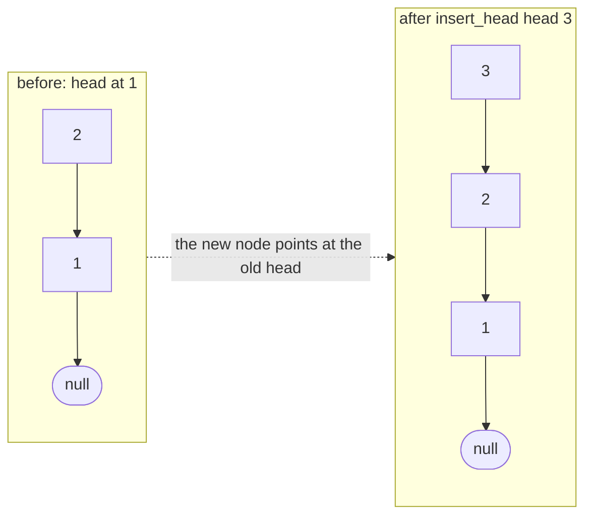
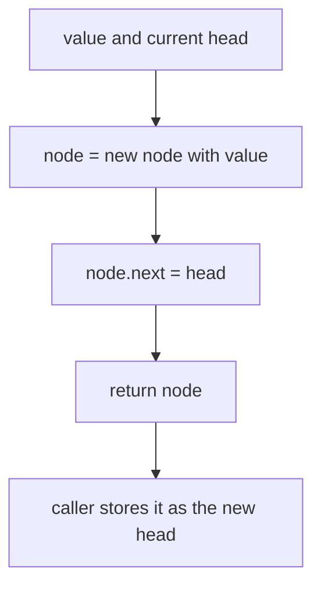
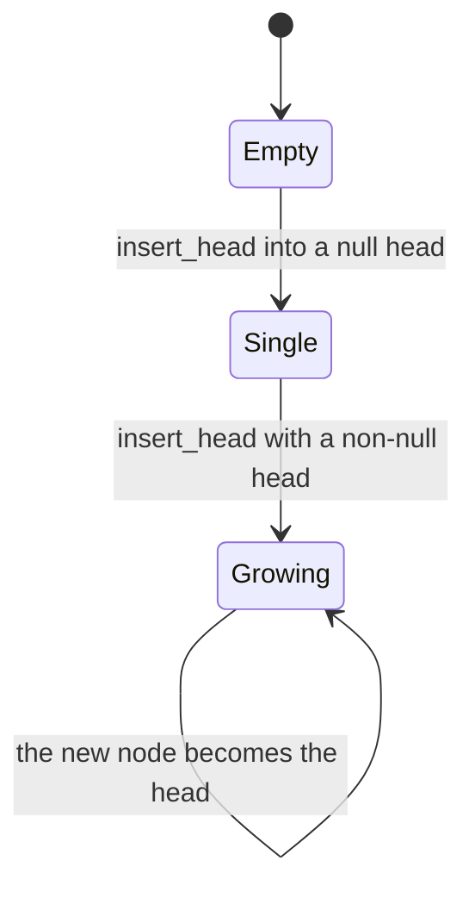
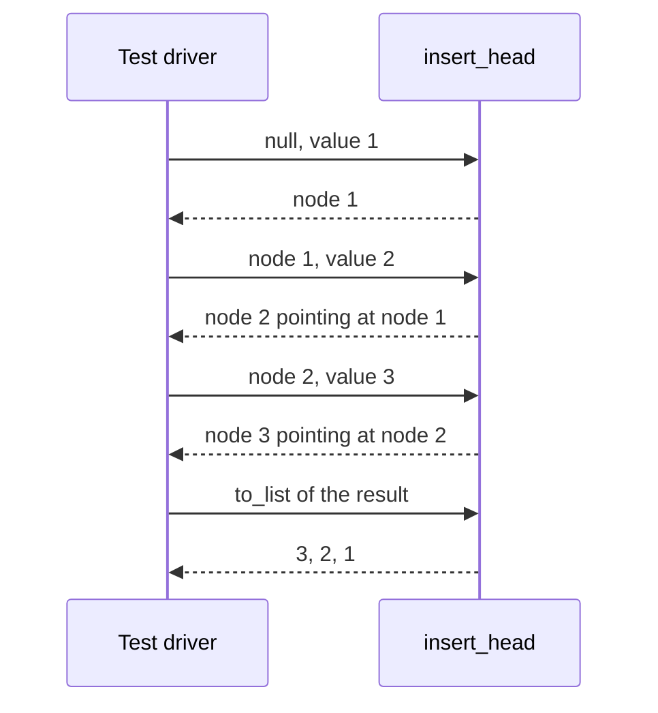

# 052 — Implement simple LinkedList insert at head.

> **Tier:** Beginner · **CTCI chapter:** Ch 1 — Arrays and Strings
> **Task spec:** [052-implement-simple-linkedlist-insert-at-head.md](../../../tasks/beginner/052-implement-simple-linkedlist-insert-at-head.md)
> **Solutions:** [Python](../../../solutions/python/beginner/052-implement-simple-linkedlist-insert-at-head/solution.py) ·
> [Java](../../../solutions/java/beginner/052-implement-simple-linkedlist-insert-at-head/Solution.java) ·
> [JavaScript](../../../solutions/javascript/beginner/052-implement-simple-linkedlist-insert-at-head/solution.js) ·
> [C#](../../../solutions/csharp/beginner/052-implement-simple-linkedlist-insert-at-head/Solution.cs)

## 1. Problem restatement

**Input:** the head of a singly linked list (possibly `null`/`None`) and a value to insert.

**Output:** the head of the list with a new node holding that value at the front. The Python docstring
states the contract: *"Insert at head; returns the new head."* The new node becomes the head, its `next`
points at the previous head, and the old nodes are untouched.

| Call | Result | Why |
| --- | --- | --- |
| `insert_head(None, 1)` | `1` | into an empty list: the new node is the entire list |
| `insert_head(node_1, 2)` | `2 → 1` | three separate appends at the head reverse the insertion order |
| `insert_head(node_2, 3)` | `3 → 2 → 1` | the assertion `to_list(head) == [3, 2, 1]` is labelled "reversed by head inserts" |
| `insert_head(None, 9)` | `9` | the same empty-list case asserted again, with the label "into empty" |

The four files run the identical script: loop over `1, 2, 3`, assigning the result back to `head` each
time, and then insert into `None` separately. The second assertion is the one that matters most in
practice — a head insertion into an empty list is where an implementation that forgets to return the new
node silently loses the element.

## 2. Intuition

Insertion at the head is the one linked-list operation that needs no search, no predecessor and no loop.
The reason is structural: a singly linked list is addressed by its head, and a node's identity does not
depend on where it sits — anything can become the head simply by pointing at the old head and being
handed to the caller.

Compare the two ways of building `[1, 2, 3]`:

- with head insertion, each new node points at the previous head and the cost is O(1) per insert, but
  the resulting order is reversed (`3 → 2 → 1`) because the last inserted node ends up first;
- with tail insertion ([053](053-implement-linkedlist-insert-at-tail.md)) the order is preserved, but
  every append walks to the end, O(n) per insert and O(n²) to build the list.

Head insertion is therefore what you use when the order is irrelevant or when you *want* the reversal —
building a list from an array in reverse order is exactly the same operation, which is why the
`from_list` helper in all four files iterates its input backwards and prepends.



The picture shows the whole algorithm: one new node, one link, and a new head reference. Nothing else in
the list is read, and no existing node is modified — the old head keeps its own `next` unchanged, which
is why the operation is safe to perform on a list that other code is already holding.

## 3. Algorithm

1. Create a node holding `value` whose `next` is the current `head`.
2. Return the new node. The caller must use the returned reference as the new head, because the
   function cannot change the caller's variable.

```text
function insert_head(head, value)
    node ← new node
    node.val ← value
    node.next ← head
    return node
end
```

All four files write this as a single expression — `ListNode(value, head)` in Python and JavaScript,
`new ListNode(value) { Next = head }` in C# — which is the same three steps without the temporaries.
The two details that carry the correctness are the order of the two assignments on the new node and the
fact that the *old* head is stored in the new node's `next`:

- building the node's links first and returning it keeps the old list reachable;
- omitting `node.next = head` (for example by constructing the node with a default null `next`) turns
  the operation into "discard the list and return a one-node list".



## 4. Worked example

Trace the assertion loop. Each row applies `head = insert_head(head, v)` with the value shown, so the
returned node becomes the input to the next row.

| Step | `value` | `head` before | new node's `next` | list after | new `head` |
| --- | --- | --- | --- | --- | --- |
| 0 | — | `null` | — | empty | `null` |
| 1 | `1` | `null` | `null` | `1` | node `1` |
| 2 | `2` | node `1` | node `1` | `2 → 1` | node `2` |
| 3 | `3` | node `2` | node `2` | `3 → 2 → 1` | node `3` |
| 4 | `9` (fresh list) | `null` | `null` | `9` | node `9` |

After step 3 the assertion `to_list(head) == [3, 2, 1]` confirms the reversal: the values were inserted in
the order `1, 2, 3` and the list reads in the opposite order, because every insertion put its node in
front of the accumulator. Step 4 is the same empty-list case as step 1, asserted separately under the
label "into empty" so a regression in the null branch is caught even if the loop's first iteration
were to be skipped.





## 5. Complexity

Let `n` be the number of nodes already in the list.

| Measure | Bound | Why it holds |
| --- | --- | --- |
| insert_head, best / average / worst | O(1) | one node allocation and one pointer assignment; no loop and no search |
| Building `n` nodes by repeated head insertion | O(n) | `n` constant-time inserts, unlike the tail-insert version's O(n²) |
| Space, extra | O(1) | one new node; nothing is copied and no sentinel is needed |
| Space, result | O(n) | the list owns one node per inserted value |
| Tail-insert alternative, time | O(n) per insert | [053](053-implement-linkedlist-insert-at-tail.md) walks to the end because no tail pointer is kept |
| Array counterpart | O(n) per head insert | inserting at the front of an array shifts every element — [051](051-implement-dynamic-array-basic-arraylist.md) cannot do this in O(1) |

The comparison with the array is the reason linked lists exist: prepending to an array is O(n) because
storage is positional, while prepending to a linked list touches a single link because storage is
address-based. The reversal of order is the price, and it is a semantic difference rather than a cost.

## 6. Pitfalls and edge cases

- **Ignoring the return value.** A head insertion that is not assigned back to the caller's head pointer
  is lost — the node exists but nothing references it. Every call in the four files is written as
  `head = insert_head(head, v)` or `head = InsertHead(head, v)`.
- **Constructing the node with a null `next`.** The new node must point at the *old* head. A node built
  with the default null link truncates the list to a single element, and the assertion
  `to_list(head) == [3, 2, 1]` fails on the first insertion into a non-empty list.
- **Head insertion into an empty list is not a special case.** `node.next = null` is exactly right, so
  no branch is needed; the "into empty" assertion exists because a naive implementation often adds a
  wrong branch here (returning a sentinel node, for instance).
- **The order is reversed.** Building `[1, 2, 3]` by head insertion yields `3, 2, 1`. Callers who need
  input order must insert at the tail ([053](053-implement-linkedlist-insert-at-tail.md)) or reverse
  afterwards ([061](061-reverse-singly-linked-list-iterative.md)).
- **No sentinel needed.** Unlike deletion or tail removal, nothing has to be relinked *behind* a node, so
  the dummy-node trick from [055](055-delete-node-by-value-in-singly-linked-list.md) has no role here.
- **The old head reference stays valid but is no longer the head.** A caller holding the previous head
  can still walk the tail of the list, but entering through it skips the new element.
- **Aliasing the same node twice.** Inserting an existing node again would link a node to itself and
  create a cycle; the files always allocate a fresh node per insert.
- **Repeated insertions are O(1) each but O(n) in memory.** The list grows by one node per call with no
  spare capacity, so there is no amortised-growth slack of the kind
  [051](051-implement-dynamic-array-basic-arraylist.md) relies on — a linked list pays per node instead
  of per growth.
- **No length is maintained.** Nothing in the node type counts elements, so a caller that needs the size
  must walk the list ([056](056-find-length-of-linked-list.md)).
- **`ListNode` construction differs per language.** Python and JavaScript take the successor as an
  optional second constructor argument, Java assigns `next` afterwards, and C# uses an object
  initialiser; all three produce the same two-link state.

## 7. Variants and follow-ups

- **The other end.** [053-implement-linkedlist-insert-at-tail.md](../../../tasks/beginner/053-implement-linkedlist-insert-at-tail.md)
  keeps the input order at the cost of a walk to the tail per insert — the direct trade against this
  task.
- **Reversal as a side effect.** [061-reverse-singly-linked-list-iterative.md](../../../tasks/beginner/061-reverse-singly-linked-list-iterative.md)
  rewires every link, which is what a head-insertion rebuild does implicitly; the
  helper `from_list` in this task's files builds arrays into lists exactly that way.
- **Prepending versus pushing.** [049-implement-stack-with-array-push-pop.md](../../../tasks/beginner/049-implement-stack-with-array-push-pop.md)
  is the array version of "add at one end in O(1)"; a linked stack is just this operation plus a pop at
  the head.
- **Prepending versus indexing.** [051-implement-dynamic-array-basic-arraylist.md](../../../tasks/beginner/051-implement-dynamic-array-basic-arraylist.md)
  cannot prepend in O(1) at all, which is the clearest single argument for linked storage.
- **Deletion in the same position.** [055-delete-node-by-value-in-singly-linked-list.md](../../../tasks/beginner/055-delete-node-by-value-in-singly-linked-list.md)
  has to handle the head case with a sentinel because deleting the first node changes the head — the
  mirror image of this task's trivial insertion.
- **Two-ended structures.** [063-implement-doubly-linked-list-insert-delete.md](../../../tasks/beginner/063-implement-doubly-linked-list-insert-delete.md)
  keeps a `tail` pointer so both ends are O(1), which is the generalisation of this task's guarantee.
- The chapter walkthrough in [Linked Lists](../../ctci/02-linked-lists.md) starts with head insertion as
  the first pointer drill before moving to traversal and reversal.

## 8. Check yourself

1. Why does `insert_head` need no search and no predecessor pointer?

<details><summary>Show answer</summary>

Because the head is the entry point of the list, so the new node can simply become it: point the new
node's `next` at the current head and hand the new node back. No other node's link changes, which is why
the cost is a constant independent of list length.

</details>

2. Building a list by three head insertions of `1, 2, 3` gives `3 → 2 → 1`. Why?

<details><summary>Show answer</summary>

Each insertion places its node in front of the accumulated list, so the most recent element is always
first. The insertion order `1, 2, 3` therefore produces the value order `3, 2, 1` — the same reason the
`from_list` helper iterates an input array in reverse to reconstruct it.

</details>

3. What breaks if the new node is created with a null `next` instead of `head`?

<details><summary>Show answer</summary>

The rest of the list becomes unreachable: the returned node is a one-element list, and the previous nodes
survive only through whatever references the caller still holds. Every assertion except the empty-list one
would fail, because `to_list` would report a single value.

</details>

4. How does this operation compare with prepending to a dynamic array?

<details><summary>Show answer</summary>

Prepending to an array is O(n) because all existing elements must shift up to make room at index 0, and
the dynamic array in [051](051-implement-dynamic-array-basic-arraylist.md) does not even expose such an
operation. Head insertion into a linked list is O(1) with no shifting, because the elements are not
positional — which is the trade a linked list makes for losing random access.

</details>

5. A caller inserts at the head twice without keeping the results. What is the state of the list?

<details><summary>Show answer</summary>

The list is unchanged: both new nodes were created but nothing points at them, so they are unreachable and
are collected as garbage. The caller's `head` still refers to the original first node, which is why the
return value of `insert_head` must be assigned.

</details>
