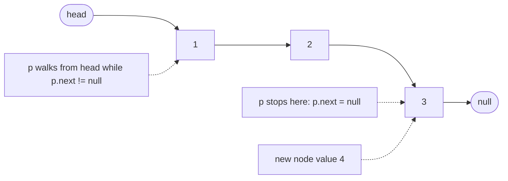
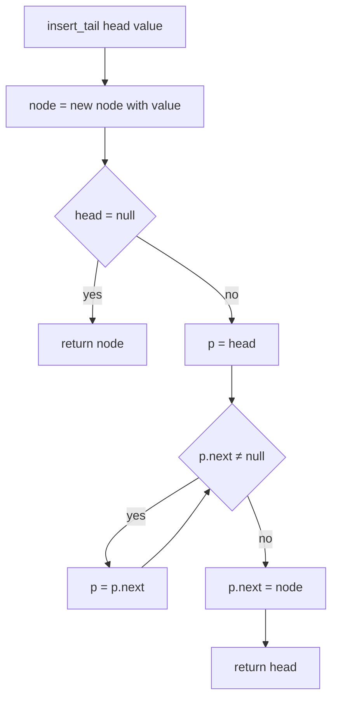
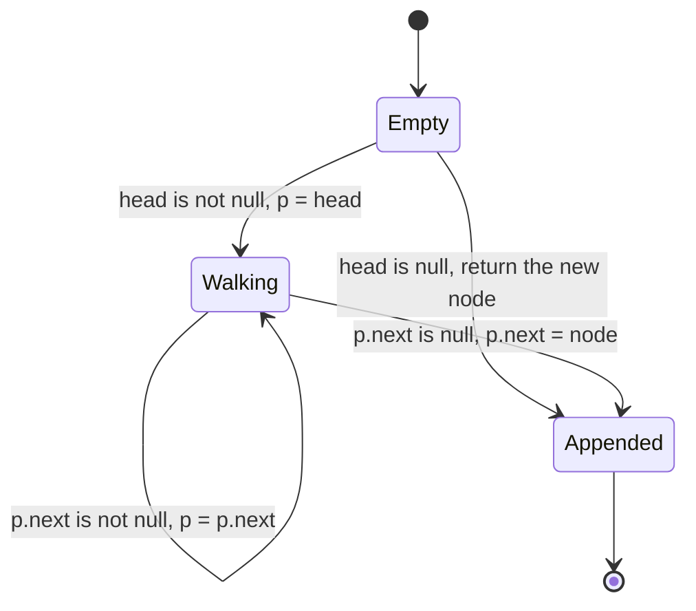
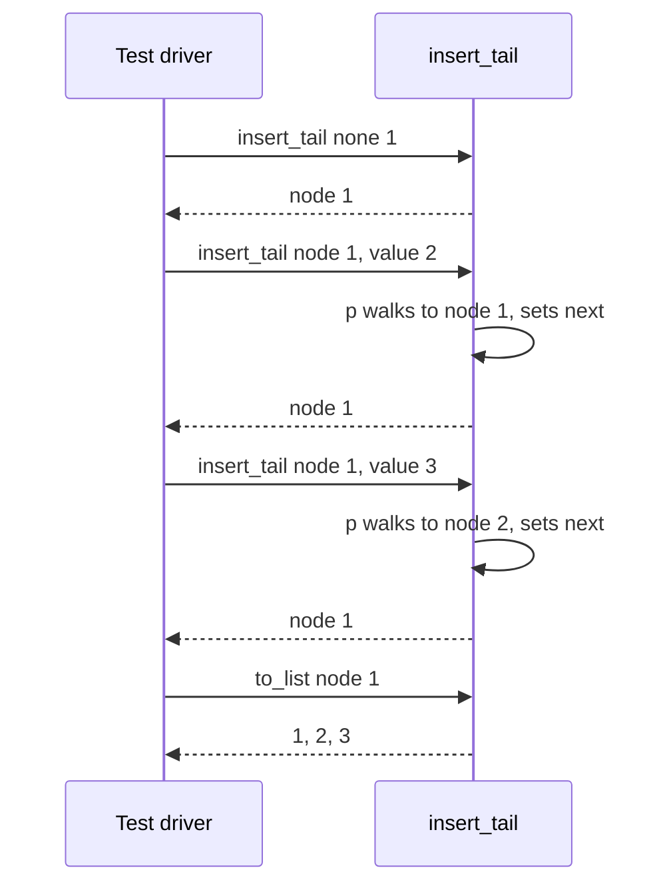

# 053 — Implement LinkedList insert at tail.

> **Tier:** Beginner · **CTCI chapter:** Ch 1 — Arrays and Strings
> **Task spec:** [053-implement-linkedlist-insert-at-tail.md](../../../tasks/beginner/053-implement-linkedlist-insert-at-tail.md)
> **Solutions:** [Python](../../../solutions/python/beginner/053-implement-linkedlist-insert-at-tail/solution.py) ·
> [Java](../../../solutions/java/beginner/053-implement-linkedlist-insert-at-tail/Solution.java) ·
> [JavaScript](../../../solutions/javascript/beginner/053-implement-linkedlist-insert-at-tail/solution.js) ·
> [C#](../../../solutions/csharp/beginner/053-implement-linkedlist-insert-at-tail/Solution.cs)

## 1. Problem restatement

**Input:** the head of a singly linked list (possibly `null`/`None`) and a value to append.

**Output:** the head of the same list with a new node holding that value at the end. The Python
docstring states the contract and the cost in one line: *"Append at tail in O(n); returns head."*
The function returns the head rather than mutating a container object, because a list whose head is
`null` has no node to hang the new element from — the caller must accept the returned pointer.

The spec is one line ("Implement LinkedList insert at tail."), so the assertions in the four files
define the behaviour. All four build `[1, 2, 3]` by appending one value at a time and also append
into an empty list:

| Call | Result | Why |
| --- | --- | --- |
| `insert_tail(None, 1)` | `1` | empty list: the new node *is* the head |
| `insert_tail(node_1, 2)` | `1 → 2` | one walk, tail was the only node |
| `insert_tail(node_2, 3)` | `1 → 2 → 3` | two walks, tail found at the end |
| `to_list` of the result | `[1, 2, 3]` | insertion order is preserved — unlike prepending |
| `insert_tail(None, 7)` | `7` | the empty case again, from a fresh list |

The label the Java and C# files attach to the first two rows is "appended", and both compare the
serialised list against `[1, 2, 3]` / `1,2,3`. The single-element append into `None` is asserted
separately with the label "into empty", which is the case that would be lost if the function forgot
to return the new node.

**Documented simplification:** the node type carries an `int` value in all four languages
(`__slots__ = ("val", "next")` in Python, `int val` in Java, `Val`/`Next` in C#, `val`/`next` in
JavaScript). The helpers `from_list`/`fromList` and `to_list`/`toList` exist only to build test
inputs and to read results back, so the assertions can compare plain arrays.

## 2. Intuition

The tempting first move is "insertion at the tail is just insertion at the head from the other
side": build the list by prepending and reverse at the end. That is O(1) per insert, but the order of
the finished list is backwards — `from_list([1, 2, 3])` walks the input in reverse precisely because
it prepends, and no caller wants `insert_tail` to behave that way.

The second naive move is to keep only the head and walk to the end on every append. That is exactly
what the repository implements, and it is honest about the price: each append touches `k - 1` links
for a list of length `k`, because a singly linked list stores no backward pointer and no tail
pointer. There is no shortcut — the last node is reachable only from the first.

The insight is therefore about *where the walk stops*, not about avoiding it. The cursor `p` must
stop on a node whose `next` is `null` — that node is the tail — so the loop condition is `p.next`,
not `p`:

- `while p` would leave the loop with `p = null` and the assignment `p.next = node` would throw;
- `while p.next` leaves `p` on the last node, which is the only node whose `next` may be rewritten;
- the new node is created with `next = null` already, so it becomes the new tail with no extra work.



The empty list is not a special algorithm, only a special *shape*: with no node to walk from, the
tail is missing, so the new node becomes the head. Every file writes that as one early return.

## 3. Algorithm

1. Create a node holding `value`; its `next` is `null`.
2. If `head` is `null`, the list is empty — return the new node as the head.
3. Otherwise set a cursor `p = head`.
4. While `p.next` is not `null`, advance `p = p.next`.
5. Now `p` is the last node: set `p.next = node`.
6. Return the original `head` (unchanged) so the caller keeps a valid entry point.

```text
function insert_tail(head, value)
    node ← new node with value and next = null
    if head = null then
        return node
    end
    p ← head
    while p.next ≠ null do
        p ← p.next
    end
    p.next ← node
    return head
end
```

The four files are the same six lines: Python uses the truthiness of `p.next`, Java and C# test
`!= null`, and JavaScript tests truthiness as well. Only the returned value changes per branch —
`node` in the empty case, `head` otherwise — and that single difference is what the "into empty"
assertion protects.



## 4. Worked example

Trace the assertions from section 1. The middle column shows what the cursor visits, i.e. the nodes
examined by the `while p.next` loop.

| Step | Call | List before | cursor visits | List after | returned |
| --- | --- | --- | --- | --- | --- |
| 1 | `insert_tail(None, 1)` | empty | none — early return | `1` | the node `1` |
| 2 | `insert_tail(head, 2)` | `1` | `1` (its `next` is null, loop exits immediately) | `1 → 2` | the node `1` |
| 3 | `insert_tail(head, 3)` | `1 → 2` | `1` (next is `2`), then `2` (next is null, exit) | `1 → 2 → 3` | the node `1` |
| 4 | `to_list(head)` | `1 → 2 → 3` | reads `1`, `2`, `3`, then null | unchanged | `[1, 2, 3]` |
| 5 | `insert_tail(None, 7)` | empty | none — early return | `7` | the node `7` |
| 6 | `to_list(node_7)` | `7` | reads `7`, then null | unchanged | `[7]` |

Step 1 is the one that must return a *new* head: the caller assigned the result to `head`, and if the
function returned `null` the node would be unreachable and the list would still be empty at step 4.
Steps 2 and 3 show the cost growing linearly — one node visited, then two — because the cursor
restarts at the head every time.





## 5. Complexity

Let `k` be the number of nodes already in the list.

| Measure | Bound | Why it holds |
| --- | --- | --- |
| insert_tail, best | O(1) | the empty list takes the early return and never enters the loop |
| insert_tail, average | O(k) | the cursor stops on the last node, so it follows `k - 1` links on average |
| insert_tail, worst | O(k) | a list of `k` nodes always costs exactly `k - 1` link hops; there is no shortcut |
| Building `n` nodes by repeated append | O(n²) | appends cost `0 + 1 + ... + (n - 1)` hops, the sum that the trace shows growing |
| Building `n` nodes by `from_list` | O(n) | prepending while walking the input backwards touches each node once |
| Space, extra | O(1) | one cursor plus the new node; nothing is copied |
| Space, node allocation | O(1) per call | each append allocates exactly one node |

The O(n²) build is the reason a production list type keeps a `tail` pointer: appending then costs
O(1) because the last node is remembered instead of rediscovered. This task deliberately does not do
that — its signature takes a bare `head` and has nowhere to store a tail, which is also why
`insert_tail` has to return the head even though it usually returns it unchanged.

## 6. Pitfalls and edge cases

- **The empty list changes the returned pointer.** Returning `head` (which is `null`) instead of the
  new node silently drops the element; the "into empty" assertion in every file catches it.
- **`while p.next` versus `while p`.** Testing `p` walks one node too far, leaves `p = null`, and
  makes `p.next = node` throw a null-reference error instead of appending.
- **The new node must have `next = null`.** Appending a node that still points at its old successor
  either creates a cycle or truncates the list — the constructors set `next = null` by default.
- **Parameter passing hides the mutation.** Python, Java, JavaScript and C# all pass the head
  reference by value, so reassigning `head` inside the function would be invisible to the caller.
  Only the *returned* pointer matters, and only `p.next = node` mutates shared state.
- **Single-node lists.** `head.next` is already `null`, the loop body never runs, and the append is
  O(1) — the same code path as the trace's step 2.
- **Order proves which end you appended to.** Prepending `1, 2, 3` yields `[3, 2, 1]` (that is
  [052-implement-simple-linkedlist-insert-at-head.md](../../../tasks/beginner/052-implement-simple-linkedlist-insert-at-head.md));
  appending yields `[1, 2, 3]`. The assertion `to_list(head) == [1, 2, 3]` is really an assertion
  about which end was touched.
- **Appending the same node twice** links a node to itself and produces an infinite list. The four
  files never do it, but a caller that reuses a `ListNode` will.
- **`from_list` uses the opposite strategy.** It iterates the input in reverse and prepends, which is
  O(n) for the whole input; that is why the assertions build the initial lists with it and then test
  `insert_tail` on the result.
- **No cycle protection.** If the input already contains a cycle, the cursor loops forever. The
  guarded version of this walk is
  [058-detect-cycle-in-linked-list-floyd.md](../../../tasks/beginner/058-detect-cycle-in-linked-list-floyd.md).
- **Tail pointer alternative.** With a `tail` field the same append is O(1), at the cost of keeping
  two invariants in sync on every insert and delete; [063-implement-doubly-linked-list-insert-delete.md](../../../tasks/beginner/063-implement-doubly-linked-list-insert-delete.md)
  shows the bookkeeping that buys.

## 7. Variants and follow-ups

- **The other end, in O(1).** Head insertion never walks:
  [052-implement-simple-linkedlist-insert-at-head.md](../../../tasks/beginner/052-implement-simple-linkedlist-insert-at-head.md).
- **The walk itself.** Appending and traversing share the same cursor discipline; the read-only
  version is [054-traverse-linked-list-and-print-nodes.md](../../../tasks/beginner/054-traverse-linked-list-and-print-nodes.md),
  and counting the hops gives [056-find-length-of-linked-list.md](../../../tasks/beginner/056-find-length-of-linked-list.md).
- **Append in a queue.** Enqueue-at-back is exactly this operation, which is why the array version in
  [050-implement-queue-with-array-enqueue-dequeue.md](../../../tasks/beginner/050-implement-queue-with-array-enqueue-dequeue.md)
  and the ring in [064-implement-circular-queue-ring-buffer.md](../../../tasks/beginner/064-implement-circular-queue-ring-buffer.md)
  bother to keep a tail index.
- **Circular lists need a tail that points back.** [154-implement-a-basic-circular-linked-list.md](../../../tasks/beginner/154-implement-a-basic-circular-linked-list.md)
  turns the null at the end into a link to the head.
- **Why a tail pointer matters.** [160-implement-lru-cache-using-linked-list-hashmap.md](../../../tasks/beginner/160-implement-lru-cache-using-linked-list-hashmap.md)
  needs O(1) removal at both ends, which a singly linked list with a bare head cannot provide.
- The chapter walkthrough in [Linked Lists](../../ctci/02-linked-lists.md) treats head and tail
  insertion as the two pointer drills that precede reversal.

## 8. Check yourself

1. Why must `insert_tail` return the head when appending to a non-empty list, even though the head
   node never changes?

<details><summary>Show answer</summary>

For symmetry and safety: the same function must handle the empty list, where the new node *is* the
head, so callers have to use the return value in both cases. Returning a value that is sometimes
required and sometimes unchanged keeps a single call idiom — `head = insert_tail(head, v)` — that
cannot silently drop the first element.

</details>

2. How many link hops does `insert_tail(head, 4)` perform on a list of four nodes, and why not fewer?

<details><summary>Show answer</summary>

Three: the cursor starts at the head and follows `next` until it reaches the node whose `next` is
null, which is the fourth node. There is no shortcut because a singly linked list stores no tail
pointer and no predecessor links, so the last node is only reachable by following the chain.

</details>

3. What is the total cost of building a list of `n` elements by calling `insert_tail` `n` times in a
   loop, and what is the alternative in the same files?

<details><summary>Show answer</summary>

O(n²): the appends walk 0, 1, 2, ..., n-1 links, which sums to n(n-1)/2. The alternative is
`from_list`, the helper that walks the input array in reverse and prepends each element, touching
each node exactly once for O(n) total.

</details>

4. What breaks if the loop condition is `while p is not null` instead of `while p.next is not null`?

<details><summary>Show answer</summary>

The cursor leaves the loop with `p = null`, having visited the tail as the final step. The next
statement, `p.next = node`, then dereferences null — a null-pointer error in Java, C# and
JavaScript, or an `AttributeError` in Python. The correct condition stops *on* the tail rather than
stepping past it.

</details>

5. After step 3 of the trace, how many nodes does the list contain, and what is the value of
   `head.next.next.next`?

<details><summary>Show answer</summary>

Three nodes hold `1`, `2` and `3`, so `head.next.next` is the node `3` and `head.next.next.next` is
`null` — the new node was created with a null `next` and never reassigned, which is why it is the
tail. Reading that link is safe here, unlike in a list where the append forgot to return the head.

</details>
