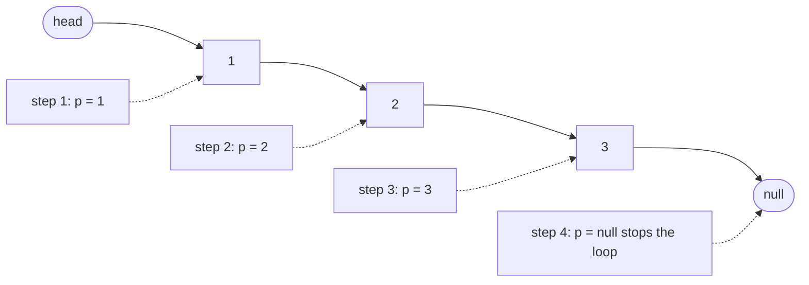
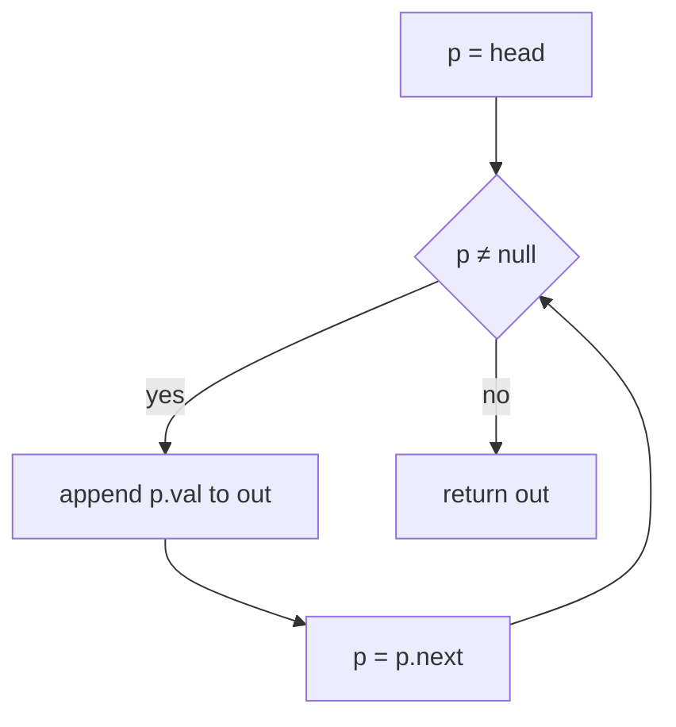
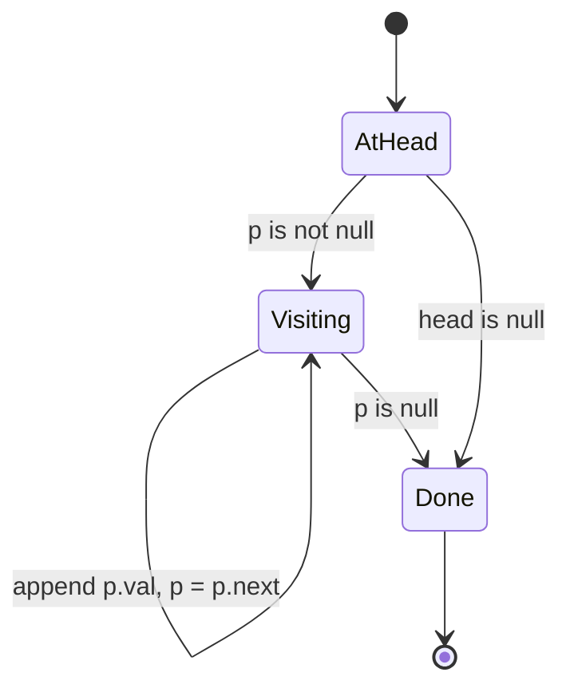
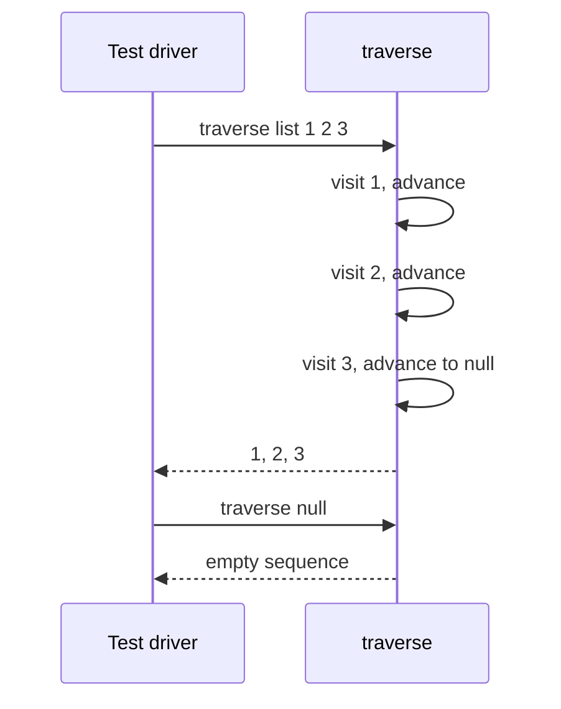

# 054 — Traverse linked list and print nodes.

> **Tier:** Beginner · **CTCI chapter:** Ch 2 — Linked Lists
> **Task spec:** [054-traverse-linked-list-and-print-nodes.md](../../../tasks/beginner/054-traverse-linked-list-and-print-nodes.md)
> **Solutions:** [Python](../../../solutions/python/beginner/054-traverse-linked-list-and-print-nodes/solution.py) ·
> [Java](../../../solutions/java/beginner/054-traverse-linked-list-and-print-nodes/Solution.java) ·
> [JavaScript](../../../solutions/javascript/beginner/054-traverse-linked-list-and-print-nodes/solution.js) ·
> [C#](../../../solutions/csharp/beginner/054-traverse-linked-list-and-print-nodes/Solution.cs)

## 1. Problem restatement

**Input:** the head of a singly linked list, possibly `null`/`None`/`nil`.

**Output:** every node's value, in list order, one per step of the walk. The Python docstring makes
the testable contract explicit: *"Return node values in order (the testable form of 'print each
node')."*

That sentence is the **documented simplification** of this task. Printed text cannot be asserted
portably across four languages, so `traverse` returns the sequence of values instead of writing to
standard output; the order of the returned values is exactly the order in which a printing loop would
have emitted them. Every file implements `traverse` as a one-line delegation to `to_list`/`ToList`,
and the harness helpers in the same file are what the assertions compare against.

| Call | Result | Why |
| --- | --- | --- |
| `traverse(from_list([1, 2, 3]))` | `[1, 2, 3]` | three nodes visited left to right |
| `traverse(None)` | `[]` | an empty list produces nothing — not an error, and not `null` |
| `traverse(from_list([7]))` | `[7]` | single node: one visit, then the null link ends the walk |

The Java assertion is `traverse(fromList(1, 2, 3)).toString().equals("[1, 2, 3]")`, the JavaScript
one is `assert.deepStrictEqual(traverse(fromList([1, 2, 3])), [1, 2, 3])`, and the C# one joins the
list with commas and compares against `"1,2,3"` — three encodings of the same ordered sequence. The
empty case is asserted with `.isEmpty()` in Java, `.Count == 0` in C# and `deepStrictEqual(..., [])`
in JavaScript.

## 2. Intuition

There is no direct-access version of this problem to fall back on. An array lets you write
`for i in 0 .. n - 1` and index into it; a linked list has no index operation at all, so a "loop over
positions" is not available. The two ideas a beginner reaches for instead are both wrong:

- accumulate nodes into an array *while building* the list and then print that array — that changes
  the data structure and only works for lists this program created;
- recurse to the end and print while unwinding — that reverses the output order and costs O(n) stack
  frames for a problem that needs one variable.

The insight is that traversal does not need to know the list's length, its last node, or any
position. It only needs a **cursor and an invariant**:

- the cursor `p` always points at the next node that has not been reported yet;
- everything before `p` has been emitted exactly once;
- the list ends exactly when `p` becomes `null`.

Advancing is a single assignment, `p = p.next`, and the loop condition is simply `p`. That is why the
walk is O(1) extra space while producing n values: the linked structure already encodes the order,
and the cursor is the whole state machine.



Note the two different kinds of pointer in the picture. The arrows inside the chain are the list's
own links and never change; the dashed arrows are the cursor's positions over time. Traversal reads
the first kind and writes the second, which is why it cannot corrupt the list.

## 3. Algorithm

1. Start with an empty result sequence and the cursor at the head.
2. While the cursor is not `null`: append the cursor's value to the result, then move the cursor to
   the next node.
3. When the cursor reaches `null`, the list is exhausted; return the result sequence.

```text
function traverse(head)
    out ← empty sequence
    p ← head
    while p ≠ null do
        append p.val to out
        p ← p.next
    end
    return out
end
```

The loop body is order-sensitive: the value is read *before* the cursor moves, otherwise the first
node is skipped and a null dereference waits at the end. The four files differ only in surface
detail — Python and JavaScript test the pointer's truthiness, Java and C# compare against `null`, and
Python's `to_list` walks the parameter itself (`while head: ... head = head.next`) while the other
three languages use a dedicated `p`. Rebinding a local parameter is safe: it moves the local copy of
the reference, not the list.



## 4. Worked example

Trace `traverse(from_list([1, 2, 3]))`. `from_list` builds the chain `1 → 2 → 3`, so the cursor
visits three nodes and then hits the null link of the last node.

| Step | `p` before | `p.val` | action | `out` after | `p` after |
| --- | --- | --- | --- | --- | --- |
| 0 | `1` | — | loop entered | `[]` | `1` |
| 1 | `1` | `1` | append, advance | `[1]` | `2` |
| 2 | `2` | `2` | append, advance | `[1, 2]` | `3` |
| 3 | `3` | `3` | append, advance | `[1, 2, 3]` | `null` |
| 4 | `null` | — | condition false, exit | `[1, 2, 3]` | `null` |

The second trace, `traverse(None)`, stops at step 0: the condition is false before the body runs even
once, so the result is `[]` and no value is ever read. That is the same code path that ends the first
trace, which is why the empty case needs no special branch anywhere in the four files.





## 5. Complexity

Let `n` be the number of nodes.

| Measure | Bound | Why it holds |
| --- | --- | --- |
| Time, best | O(n) | even the smallest non-empty list has to be visited; only `null` costs O(1) |
| Time, average | O(n) | one value read and one pointer follow per node, both constant work |
| Time, worst | O(n) | there is no early exit — "print every node" means every node |
| Space, output | O(n) | the returned sequence holds one value per node; the printing variant would need none |
| Space, extra | O(1) | a single cursor; the walk is iterative, so no call frames accumulate |
| Recursive alternative, time | O(n) | the same visits, in the same order |
| Recursive alternative, space | O(n) frames | the call stack replaces the cursor and can overflow on long lists |

Writing the values straight to a stream instead of returning them would drop the output term to O(1)
and keep the O(n) time, at the cost of an untestable result — exactly the trade the `traverse`
docstring describes. The container helpers that the assertions rely on (`to_list`,
`from_list`) have the same O(n) walk and O(n) storage, so they do not change the bounds.

## 6. Pitfalls and edge cases

- **Empty list is a valid input, not an error.** `traverse(None)` must return an empty sequence;
  Java asserts `.isEmpty()`, C# asserts `.Count == 0`, JavaScript and Python compare against `[]`.
  Returning `null` here fails immediately in all four languages.
- **Advance after reading.** Reading `p.val` after `p = p.next` drops the first value and skips every
  second node — a classic off-by-one that still "works" on a one-node list.
- **The cursor is not the head.** Rebinding the loop variable walks the local reference only. Python's
  `to_list` rebinds its own `head` parameter and is safe precisely because the caller still holds the
  original head; mutating `head.next` would not be.
- **Cycles turn this into an infinite loop.** A malformed list that points back into itself never
  reaches `null`, and `traverse` appends forever. The guarded walk is
  [058-detect-cycle-in-linked-list-floyd.md](../../../tasks/beginner/058-detect-cycle-in-linked-list-floyd.md).
- **The output is an ordered sequence, not a set.** Duplicates such as `1, 2, 2, 3` are reported
  twice; the assertions compare sequences position by position (`deepStrictEqual`, `toString`,
  `string.Join`), not multiset equality.
- **Serialisation differences between languages.** Java's `List.toString` emits `[1, 2, 3]` with
  spaces, C# joins with `,` to produce `1,2,3`. Neither is the data structure — both are encodings
  of the visit order that the assertions happen to compare.
- **Recursion is legal but heavier.** A recursive traversal prints in the same order and needs O(n)
  stack frames; on a list of a few hundred thousand nodes it overflows. The iterative cursor is the
  safer default.
- **No mutation happens here.** Unlike the deletion in
  [055-delete-node-by-value-in-singly-linked-list.md](../../../tasks/beginner/055-delete-node-by-value-in-singly-linked-list.md)
  or the reversal in [061-reverse-singly-linked-list-iterative.md](../../../tasks/beginner/061-reverse-singly-linked-list-iterative.md),
  traversal must leave every link exactly as it found it; a traversal that rewires links is a
  different algorithm with a different contract.
- **Node values are `int`s in all four files.** Nothing in the walk cares about the payload type, but
  the string comparisons in the assertions do, so a port to strings has to revisit them.
- **Helpers are part of the file.** `from_list` builds by iterating the input in reverse and
  prepending, which is why the list order in the assertions matches the array order.

## 7. Variants and follow-ups

- **Count while walking.** [056-find-length-of-linked-list.md](../../../tasks/beginner/056-find-length-of-linked-list.md)
  is this exact loop with a counter instead of a result sequence — the minimal delta between two
  linked-list tasks.
- **Two cursors instead of one.** [057-find-middle-node-of-linked-list-two-pointers.md](../../../tasks/beginner/057-find-middle-node-of-linked-list-two-pointers.md)
  moves a fast and a slow cursor over the same links, and
  [058-detect-cycle-in-linked-list-floyd.md](../../../tasks/beginner/058-detect-cycle-in-linked-list-floyd.md)
  uses the same trick to survive a cyclic list that would hang this traversal.
- **Walk while rewiring.** [061-reverse-singly-linked-list-iterative.md](../../../tasks/beginner/061-reverse-singly-linked-list-iterative.md)
  keeps the cursor discipline but repoints each link as it goes, and
  [062-reverse-singly-linked-list-recursive.md](../../../tasks/beginner/062-reverse-singly-linked-list-recursive.md)
  shows the recursive unwind mentioned in section 5.
- **Walk while unlinking.** [055-delete-node-by-value-in-singly-linked-list.md](../../../tasks/beginner/055-delete-node-by-value-in-singly-linked-list.md)
  needs the *previous* node, so the single cursor becomes a `prev`/`prev.next` pair.
- **Walk a tree instead.** [149-convert-binary-tree-to-linked-list-flatten.md](../../../tasks/beginner/149-convert-binary-tree-to-linked-list-flatten.md)
  generalises "visit every node in order" to a structure where one cursor is no longer enough.
- The chapter walkthrough in [Linked Lists](../../ctci/02-linked-lists.md) starts with this walk
  before introducing the runner technique and in-place reversal.

## 8. Check yourself

1. Why does `traverse` return a sequence instead of printing the nodes directly?

<details><summary>Show answer</summary>

Because printing is not assertable across four languages: the assertion would have to capture
standard output, and the four test harnesses in the repository do not. Returning the values in visit
order gives the same observable sequence with a comparable value type, which the file's own docstring
calls "the testable form of 'print each node'".

</details>

2. How many times is `p.next` read on a list of four nodes, and how many values are appended?

<details><summary>Show answer</summary>

`p.next` is read four times — once per node, including the last one, whose `next` is `null` and ends
the loop. Four values are appended, one per node. The null read is not a wasted iteration; it is the
termination test.

</details>

3. What does `traverse` do with a list containing the values `3, 1, 3`?

<details><summary>Show answer</summary>

It returns `[3, 1, 3]`: traversal reports the structure as it is. It does not sort, deduplicate, or
treat the repeated `3` specially. Order comes from the links, and duplicates are simply separate
nodes.

</details>

4. Why is the iterative walk O(1) extra space while the recursive version is O(n)?

<details><summary>Show answer</summary>

The iterative version keeps one cursor variable, since the loop reuses it for every node. The
recursive version must remember the caller's position at each level — one stack frame per node —
because after visiting the tail it still has to return through all the pending calls.

</details>

5. A reviewer says "traverse(None) should raise, an empty list is a caller bug". What do the four
   solution files assert instead, and why is that the better contract?

<details><summary>Show answer</summary>

They assert an empty result (`[]`, `.isEmpty()`, `.Count == 0`). `null` is the canonical way to
represent the empty list in every one of the four languages, and the same loop condition that ends a
normal walk (`p` is null) handles it for free. Rejecting `null` would add a branch that buys nothing
and would contradict the list-building helpers, which return `null` for an empty input.

</details>
