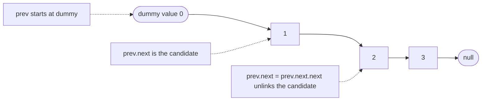
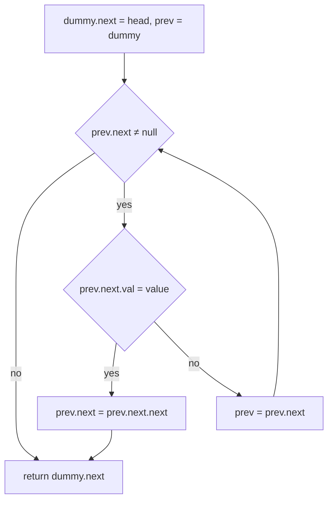
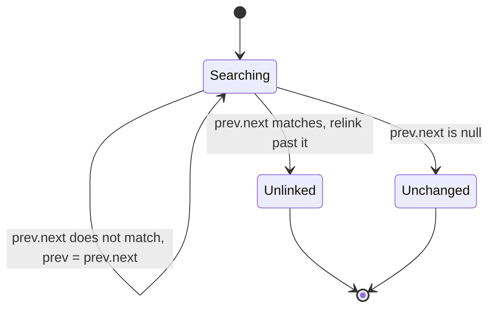
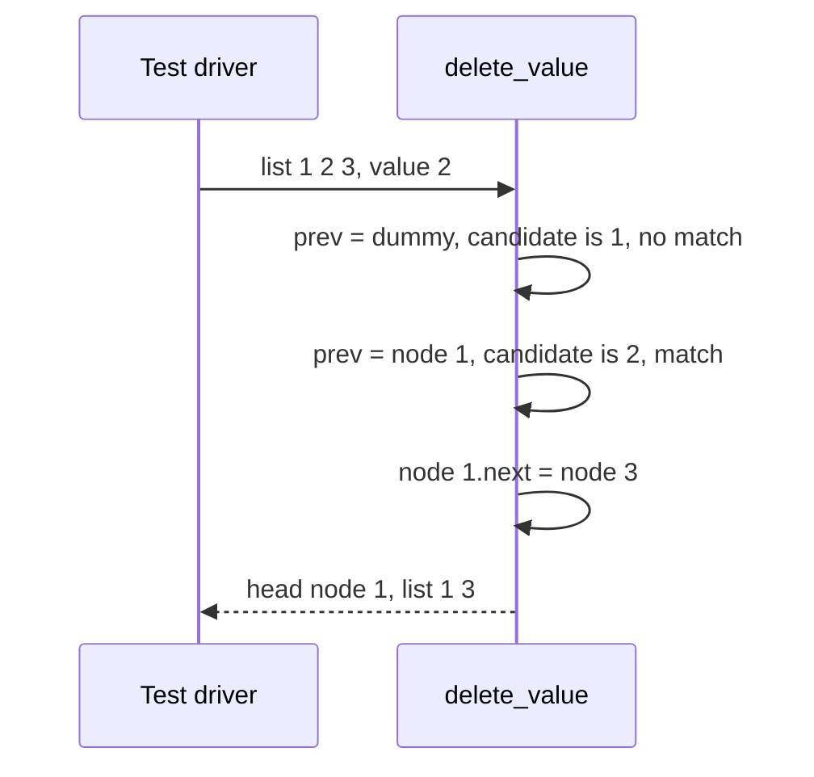

# 055 — Delete node by value in singly linked list.

> **Tier:** Beginner · **CTCI chapter:** Ch 2 — Linked Lists
> **Task spec:** [055-delete-node-by-value-in-singly-linked-list.md](../../../tasks/beginner/055-delete-node-by-value-in-singly-linked-list.md)
> **Solutions:** [Python](../../../solutions/python/beginner/055-delete-node-by-value-in-singly-linked-list/solution.py) ·
> [Java](../../../solutions/java/beginner/055-delete-node-by-value-in-singly-linked-list/Solution.java) ·
> [JavaScript](../../../solutions/javascript/beginner/055-delete-node-by-value-in-singly-linked-list/solution.js) ·
> [C#](../../../solutions/csharp/beginner/055-delete-node-by-value-in-singly-linked-list/Solution.cs)

## 1. Problem restatement

**Input:** the head of a singly linked list (possibly `null`) and a value to remove.

**Output:** the head of the list with the **first** node holding that value unlinked, or the
unchanged list if no node matches. The Python docstring fixes both halves of the contract:
*"Deletes the first node with the value; returns (possibly new) head."* The word *first* matters —
duplicates are not swept up — and the parenthesis tells the caller that the returned pointer can
differ from the argument, which is exactly what happens when the head itself is deleted.

The four files assert four shapes of the same operation:

| Call | Result | Why |
| --- | --- | --- |
| `delete_value(from_list([1, 2, 3]), 2)` | `[1, 3]` | middle node: its predecessor is relinked past it |
| `delete_value(from_list([1, 2, 3]), 1)` | `[2, 3]` | head node: the returned head is a different node |
| `delete_value(from_list([1]), 1)` | `[]` | the only node: the result is an empty list (`null`) |
| `delete_value(from_list([1, 2]), 9)` | `[1, 2]` | value not present: a silent no-op, not an error |

Python and Java assert all four rows; the labels there read "middle", "head", "only node" and
"missing no-op". JavaScript and C# assert the first three. The missing-value row is the one that
distinguishes "delete if present" from "assert present": this task is the former.

## 2. Intuition

Deleting a node from a singly linked list means rewriting the `next` pointer of its **predecessor**.
The naive implementation therefore walks with two cursors, `prev` and `curr = prev.next`, and then
handles the head as a special case:

```text
if head.val = value then
    return head.next
end
prev ← head
while prev.next ≠ null do
    if prev.next.val = value then
        prev.next ← prev.next.next
        return head
    end
    prev ← prev.next
end
return head
```

That is correct, but the special case is the whole problem. The head has no predecessor to relink,
so its deletion changes the identity of the list; an implementation that forgets the branch either
loses the rest of the list or crashes, and a caller that forgets to use the return value keeps a
pointer to a node that is no longer in the list.

The insight that removes the branch is a **sentinel node**: allocate a throwaway node whose `next` is
the real head, and let the cursor start there. Now the head is an ordinary node with an ordinary
predecessor — the dummy itself — so one loop shape covers every position:

- `prev` always points at the node *before* the candidate, so `prev.next` is the candidate;
- the loop tests `prev.next.val`, which means the head is examined on the first iteration like any
  other node;
- the result is always `dummy.next`, which is the original head in every case except a head deletion.



Two consequences follow from the picture. First, the deleted node is not "freed" — in all four
languages the garbage collector takes care of it once nothing references it, and the algorithm
simply stops pointing at it. Second, the deleted node still holds its own `next` link, so a caller
that kept a reference to it can still walk into the tail of the list; that is a memory-retention
detail, not a correctness bug in this function.

## 3. Algorithm

1. Create a dummy node with `next = head`; set `prev = dummy`.
2. While `prev.next` is not `null`:
   - if `prev.next.val` equals the target value, set `prev.next = prev.next.next` and stop;
   - otherwise advance `prev = prev.next`.
3. Return `dummy.next`, which is the new head (the original head unless that node was deleted).

```text
function delete_value(head, value)
    dummy ← new node with next = head
    prev ← dummy
    while prev.next ≠ null do
        if prev.next.val = value then
            prev.next ← prev.next.next
            break
        end
        prev ← prev.next
    end
    return dummy.next
end
```

The loop has one invariant worth stating: at the top of each iteration, every node strictly before
`prev.next` has already been inspected and none of them held `value`. That invariant plus `break` is
what makes "first occurrence" precise — after a match the function stops instead of continuing, so a
second node with the same value survives.



## 4. Worked example

Trace `delete_value(from_list([1, 2, 3]), 2)`. The dummy holds value `0`, which no assertion ever
searches for.

| Step | `prev` | `prev.next` | `prev.next.val = 2` | action | chain from `dummy` |
| --- | --- | --- | --- | --- | --- |
| 0 | dummy | node `1` | no | advance `prev` | `dummy → 1 → 2 → 3` |
| 1 | node `1` | node `2` | yes | relink and break | `dummy → 1 → 3` |
| 2 | — | — | — | return `dummy.next` | result `1 → 3` |

The same function on the head value `1` matches at step 0: `prev` is still the dummy, so
`dummy.next = node_2` and the returned head is node `2` — the special case that the naive
implementation needed a branch for. On `[1]` with value `1`, the relink makes `dummy.next` null, and
`to_list` of that is `[]`. On `[1, 2]` with value `9`, the cursor advances through both nodes, never
matches, and the function returns the original chain untouched.





## 5. Complexity

Let `n` be the number of nodes.

| Measure | Bound | Why it holds |
| --- | --- | --- |
| Time, best | O(1) | a match on the first candidate — the head, or the value on the head |
| Time, average | O(n) | the cursor advances one node per non-matching iteration |
| Time, worst | O(n) | the value is at the tail, or absent entirely, so every node is inspected |
| Space, extra | O(1) | one sentinel, one cursor, one temporary reference to the removed node |
| Space, node allocation | O(1) | a single dummy node per call, released when the call returns |
| Doubly linked list, delete given the node | O(1) | the back pointer supplies the predecessor directly — see task 063 |

Nothing about the operation depends on the position of the match except the number of hops, and no
allocation grows with `n`. If the caller needs to delete *every* occurrence, the `break` goes away
and the loop continues with `prev` unchanged after a relink, which is still one pass but may remove
`n` nodes — the same asymptotic cost, a different result.

## 6. Pitfalls and edge cases

- **Returning `head` instead of `dummy.next`.** After a head deletion the original `head` variable
  still points at the unlinked node, so the caller sees a list that starts with the value it just
  deleted. The dummy exists to make this mistake hard to write.
- **The head has no predecessor.** Without a sentinel the deletion of the first node needs its own
  branch; forgetting it drops the node from the result or produces a null dereference.
- **Only the first match is removed.** The `break` is deliberate and matches the docstring; removing
  all occurrences requires an explicit change of contract.
- **A missing value is not an error.** Row four of the assertion table returns the list unchanged.
  Throwing instead would break `delete_value(from_list([1, 2]), 9)` in every language.
- **Empty list.** `dummy.next` is `null`, the loop condition fails immediately, and the function
  returns `null` — the same value the empty list started as. No file asserts this path, but it costs
  nothing.
- **The single-node list collapses to empty.** `prev.next = prev.next.next` sets `dummy.next = null`,
  which is asserted as "only node" returning `[]`.
- **The unlinked node keeps its link to the tail.** After `dummy → 1 → 3`, the removed node `2` may
  still point at `3`. If a caller holds that reference and later relinks it, the tail comes back —
  the retention detail behind the "delete a node in the middle without the head" interview classic.
- **Value comparison.** All four files use plain equality on `int` values (`==`, `===` in
  JavaScript). Comparing object payloads would need an explicit equality rule instead of `===`.
- **Two cursors must move together.** `prev = prev.next` happens only when there is no match;
  advancing it in the match branch would skip nodes on a multi-delete variant.
- **Cyclic input loops forever.** The walk terminates on `null` and nothing else; the detection
  variants are [058-detect-cycle-in-linked-list-floyd.md](../../../tasks/beginner/058-detect-cycle-in-linked-list-floyd.md).
- **No cache invalidation to worry about here**, unlike a length field: deletion shrinks the list by
  one, and any code that caches `length` from task 056 must be told.

## 7. Variants and follow-ups

- **Delete by position from the end.** [060-remove-nth-node-from-end-of-linked-list.md](../../../tasks/beginner/060-remove-nth-node-from-end-of-linked-list.md)
  keeps the dummy-sentinel trick and adds the two-pointer gap, because the predecessor cannot be
  computed without knowing the length.
- **Delete in O(1) with a back pointer.** [063-implement-doubly-linked-list-insert-delete.md](../../../tasks/beginner/063-implement-doubly-linked-list-insert-delete.md)
  stores `prev`, so no search is needed; the price is one extra pointer per node to maintain.
- **Deletion driven by recency.** [160-implement-lru-cache-using-linked-list-hashmap.md](../../../tasks/beginner/160-implement-lru-cache-using-linked-list-hashmap.md)
  unlinks the least recently used node in O(1) using a doubly linked list plus a hash map.
- **Insertion, the mirror image.** [052-implement-simple-linkedlist-insert-at-head.md](../../../tasks/beginner/052-implement-simple-linkedlist-insert-at-head.md)
  and [053-implement-linkedlist-insert-at-tail.md](../../../tasks/beginner/053-implement-linkedlist-insert-at-tail.md)
  are the same pointer surgery in the other direction.
- **Same walk, no writes.** [054-traverse-linked-list-and-print-nodes.md](../../../tasks/beginner/054-traverse-linked-list-and-print-nodes.md)
  and [056-find-length-of-linked-list.md](../../../tasks/beginner/056-find-length-of-linked-list.md)
  traverse without touching a link, which is what makes them safe to run on a shared list.
- **Circular lists delete differently.** [154-implement-a-basic-circular-linked-list.md](../../../tasks/beginner/154-implement-a-basic-circular-linked-list.md)
  must also fix the tail's link when the head disappears.
- The chapter walkthrough in [Linked Lists](../../ctci/02-linked-lists.md) treats deletion as the
  first exercise in maintaining a predecessor pointer.

## 8. Check yourself

1. What exactly does the dummy node buy you in this implementation?

<details><summary>Show answer</summary>

It gives the head a predecessor. With `prev` starting at the dummy, the head node is just
`prev.next` on the first iteration, so the relink `prev.next = prev.next.next` works for the head,
the middle and the tail alike, and the function never needs a head-specific branch. The cost is one
throwaway allocation per call.

</details>

2. On `[1, 2, 3, 2]` with value `2`, what does the function return, and how many nodes does it
   inspect?

<details><summary>Show answer</summary>

It returns `[1, 3, 2]` — only the first `2` is removed, because the loop breaks on the first match.
It inspects the dummy's successor (`1`), then `2`, and stops: one match, at most a handful of hops.
The second `2` survives because the invariant is "first occurrence", not "all occurrences".

</details>

3. Why is deleting the head O(1) here while deleting the tail is O(n)?

<details><summary>Show answer</summary>

A match on the head is found on the first loop iteration, so the best case is one comparison and one
relink. Deleting the tail means the tail's predecessor has to be found, and a singly linked list only
offers forward links, so the cursor walks the whole chain — n hops in the worst case.

</details>

4. The list `1 → 2 → 3` had its node `2` removed. Is node `2` unreachable?

<details><summary>Show answer</summary>

Unreachable *from the list*: nothing links to it once `1.next = 3`. It is still reachable from any
variable that holds it, and it still points at `3`, so a caller that kept the reference can walk the
tail through the deleted node. The garbage collector reclaims it only when the last such reference
disappears.

</details>

5. What changes if the caller wants every `2` removed from `[2, 1, 2, 2]`?

<details><summary>Show answer</summary>

Remove the `break` and, after a match, do not advance `prev` — the new `prev.next` is the node after
the removed one and must be inspected next. The walk stays one pass, returns `[1]`, and the head
deletion is still handled by the dummy, since `dummy.next` ends up as the node `1`.

</details>
