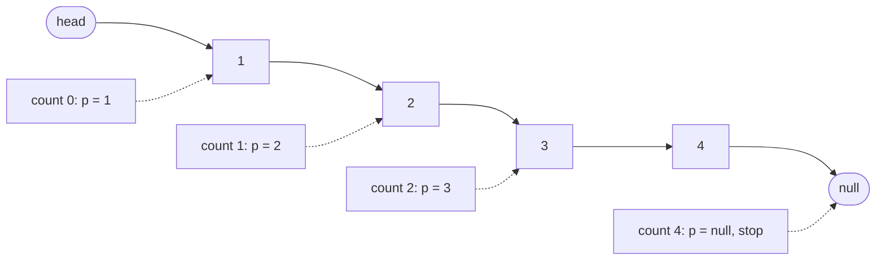
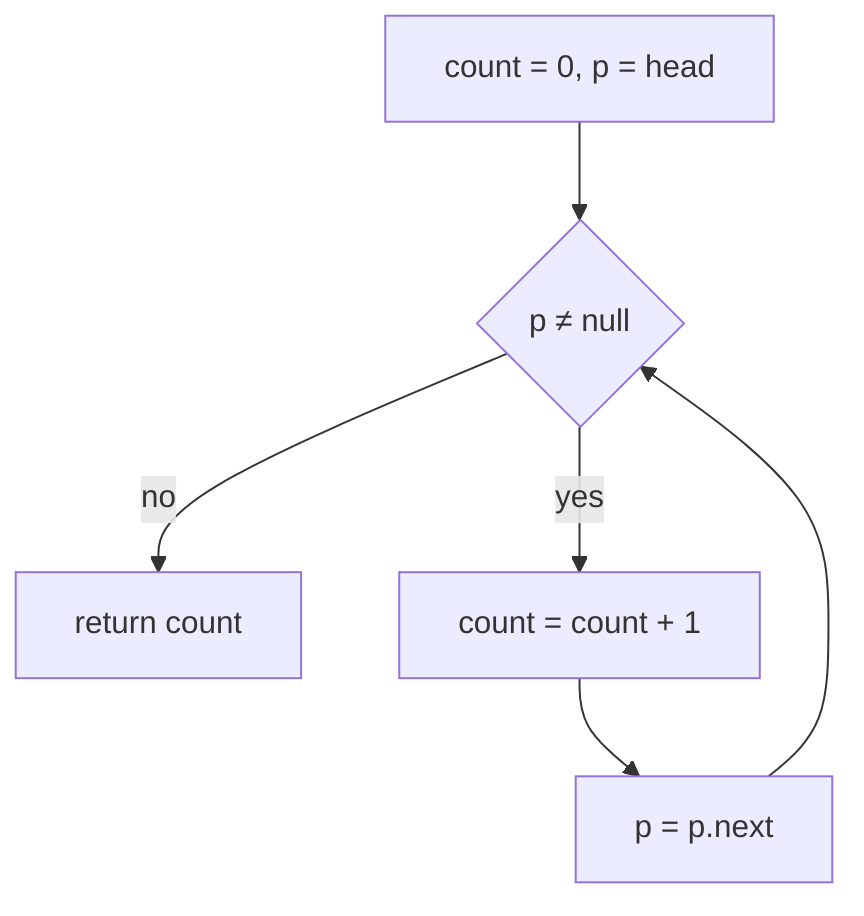
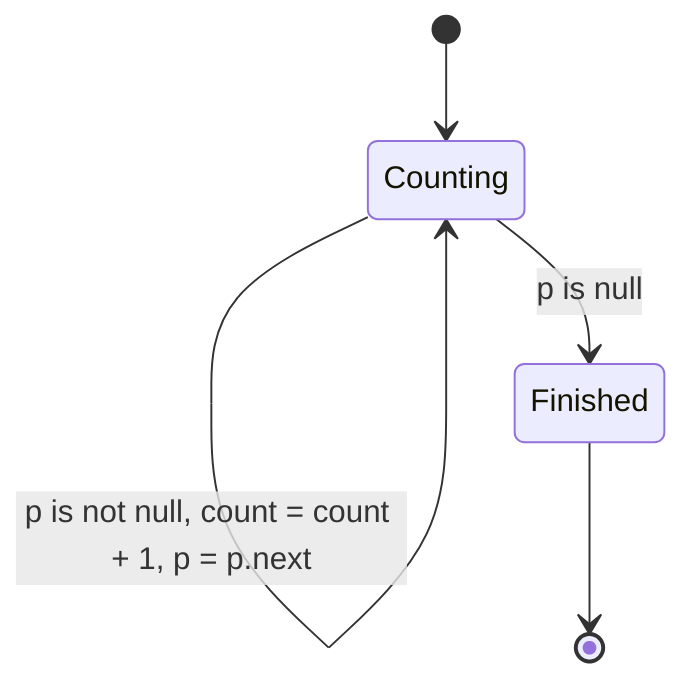
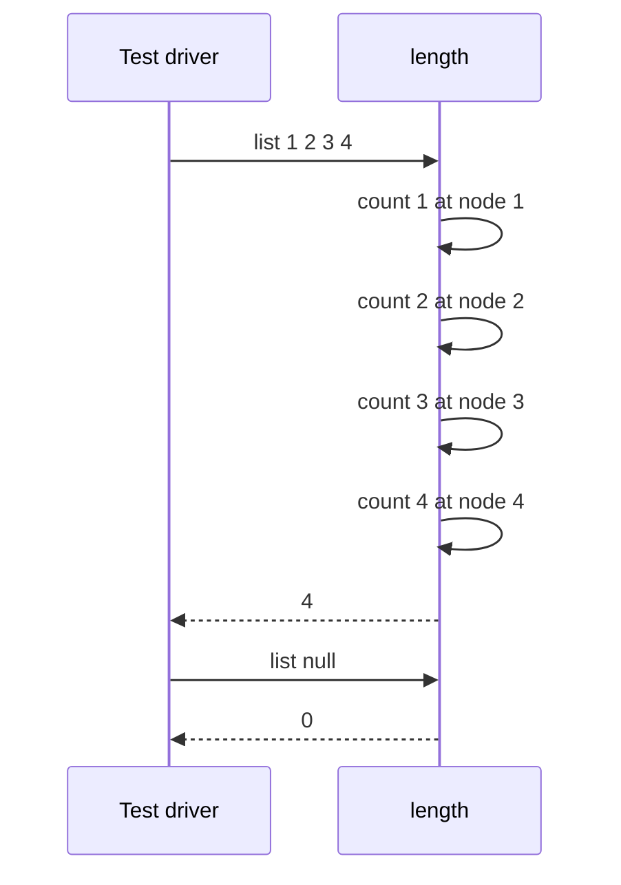

# 056 — Find length of linked list.

> **Tier:** Beginner · **CTCI chapter:** Ch 2 — Linked Lists
> **Task spec:** [056-find-length-of-linked-list.md](../../../tasks/beginner/056-find-length-of-linked-list.md)
> **Solutions:** [Python](../../../solutions/python/beginner/056-find-length-of-linked-list/solution.py) ·
> [Java](../../../solutions/java/beginner/056-find-length-of-linked-list/Solution.java) ·
> [JavaScript](../../../solutions/javascript/beginner/056-find-length-of-linked-list/solution.js) ·
> [C#](../../../solutions/csharp/beginner/056-find-length-of-linked-list/Solution.cs)

## 1. Problem restatement

**Input:** the head of a singly linked list, possibly `null`/`None`.

**Output:** the number of nodes in the list, counted by walking it. There is no `size` field to read —
the list is a bare chain of nodes, so the only way to learn how many there are is to follow every
link until one of them is null.

The spec is one line ("Find length of linked list."), so the assertions define the contract. Python,
Java and C# assert all three rows below; JavaScript asserts the first two:

| Call | Result | Why |
| --- | --- | --- |
| `length(from_list([1, 2, 3, 4]))` | `4` | four nodes, four increments |
| `length(None)` | `0` | the loop never runs; an empty list has length zero, not `null` |
| `length(from_list([7]))` | `1` | one increment, then the null link ends the walk |

**Documented simplification:** the four files share the same `ListNode` type and the same
`from_list`/`to_list` helpers as the rest of the Ch 2 beginner tasks, so a test can build a list from
an array and read it back. The payload is an `int` in all four languages, and `length` never looks at
it — the count is a property of the links, not of the values.

## 2. Intuition

The three ideas that look attractive before you write the loop:

- **Read a stored size.** There is none. This node type holds only `val` and `next`, so any cached
  count would have to be maintained by every insert and delete in the program — the trade that
  [051-implement-dynamic-array-basic-arraylist.md](../../../tasks/beginner/051-implement-dynamic-array-basic-arraylist.md)
  makes for arrays, where `size` is a field because the array can grow.
- **Recurse.** `length(head) = 1 + length(head.next)` with `0` for null is elegant and correct, but it
  builds one stack frame per node; a long list overflows the stack for a problem that needs one
  integer.
- **Stop when `next` is null and add one.** That counts the internal nodes and then has to patch in
  the tail, an off-by-one that only shows up on the last node.

The insight is that a traversal counts its own iterations. The same cursor walk as
[054-traverse-linked-list-and-print-nodes.md](../../../tasks/beginner/054-traverse-linked-list-and-print-nodes.md)
already visits each node exactly once; adding an increment inside the loop turns "visit" into "count",
and the termination condition is unchanged. The invariant is simple and local:

- at the top of the loop, `count` equals the number of nodes strictly before `p`;
- each iteration advances `p` by one node and increments `count` by one, so the invariant holds;
- when `p` is `null`, no node remains, so `count` equals the total.



Because the count is not stored, it is also never stale: an insert or a delete changes the answer
automatically, at the cost of an O(n) walk per query. That is the whole trade of this task, and it is
worth saying out loud in an interview before optimising anything.

## 3. Algorithm

1. Set `count = 0`.
2. Set the cursor `p = head`.
3. While `p` is not `null`: increment `count`, then advance `p = p.next`.
4. When `p` reaches `null`, return `count`.

```text
function length(head)
    count ← 0
    p ← head
    while p ≠ null do
        count ← count + 1
        p ← p.next
    end
    return count
end
```

The increment must come before the advance, and both must be inside the loop; moving the increment
outside counts only the last node, and testing `p.next` instead of `p` undercounts by exactly one.
The four files are line-for-line equivalents: Python walks the parameter directly
(`while head: count += 1; head = head.next`), while Java, JavaScript and C# use an explicit `p`
(`for (ListNode p = head; p != null; p = p.next) count++;`).



## 4. Worked example

Trace `length(from_list([1, 2, 3, 4]))`. The chain is `1 → 2 → 3 → 4 → null`.

| Step | `p` | `count` before | action | `p` after | `count` after |
| --- | --- | --- | --- | --- | --- |
| 0 | node `1` | `0` | condition true | `1` | `0` |
| 1 | node `1` | `0` | increment, advance | node `2` | `1` |
| 2 | node `2` | `1` | increment, advance | node `3` | `2` |
| 3 | node `3` | `2` | increment, advance | node `4` | `3` |
| 4 | node `4` | `3` | increment, advance | `null` | `4` |
| 5 | `null` | `4` | condition false, exit | `null` | `4` |

Row 5 is the null node that ended
[054-traverse-linked-list-and-print-nodes.md](../../../tasks/beginner/054-traverse-linked-list-and-print-nodes.md)
as well: it is not a node of the list and must not be counted, which is why the increment sits inside
the body rather than after the loop. The second assertion, `length(None)`, stops at step 0 with
`count = 0` and an empty `p`.





## 5. Complexity

Let `n` be the number of nodes.

| Measure | Bound | Why it holds |
| --- | --- | --- |
| Time, best | O(1) | an empty list fails the loop condition immediately and returns `0` |
| Time, average | O(n) | one increment and one link follow per node |
| Time, worst | O(n) | every node is visited; there is no early exit and no way to skip a link |
| Space, extra | O(1) | one cursor and one counter, independent of `n` |
| Recursive alternative, time | O(n) | identical visits |
| Recursive alternative, space | O(n) frames | one frame per node, with a real risk of stack overflow |
| Stored-size alternative, time | O(1) per query | but every insert and delete must update the field, and the field can go stale |
| Repeated queries | O(n) each | nothing is cached, so `k` calls to `length` cost O(k · n) |

The two competing designs are "count on demand" (this task: O(n) per query, O(1) extra state, never
wrong) and "cache the count" (O(1) per query, one integer of state that every mutating operation must
maintain). Which one wins depends on the read/write ratio, not on the asymptotics of a single call.

## 6. Pitfalls and edge cases

- **Empty list returns `0`, not `null` or an error.** `length(None)` is asserted directly; the loop
  body simply never executes.
- **Testing `p.next` instead of `p` undercounts.** A loop guarded by `p.next ≠ null` visits only the
  first `n - 1` nodes and needs a `+ 1` patch that is easy to forget.
- **The increment belongs inside the loop.** Placing it after the loop counts one node regardless of
  the list length, which still passes a single-element assertion — one reason the assertions include a
  four-node list.
- **Cycles make the loop run forever.** Termination depends on reaching `null`; a list that links back
  into itself never gets there. Detect it first with
  [058-detect-cycle-in-linked-list-floyd.md](../../../tasks/beginner/058-detect-cycle-in-linked-list-floyd.md),
  or bound the walk by a known maximum.
- **Recursion risks stack overflow.** A million-node list exhausts the call stack in Java, C# and
  Python long before it exhausts memory; the iterative version has no such ceiling.
- **Counter overflow is theoretical but real.** The count is an `int` in Java, JavaScript and C#; a
  list longer than the `int` range would need a `long`. Python integers are unbounded.
- **Nothing is cached.** Two consecutive `length` calls walk the list twice; code that needs the
  count repeatedly should compute it once and keep the value (as the `from_list` helpers effectively
  do for arrays).
- **`length` must not modify the list.** Like the traversal, it only reads `val` and `next`; a
  counting loop that rewires links would corrupt the structure for every later caller.
- **Rebinding the parameter is safe.** Python's version reassigns `head` inside the loop, which moves
  the local reference only; the caller's head is untouched because the nodes themselves are never
  modified.
- **Duplicates and values do not matter.** `1, 1, 1` has length `3`; `length` never inspects `val`, so
  it cannot accidentally count distinct values.

## 7. Variants and follow-ups

- **The same walk, producing values.** [054-traverse-linked-list-and-print-nodes.md](../../../tasks/beginner/054-traverse-linked-list-and-print-nodes.md)
  differs from this task only in what the loop body appends; reading the two side by side is the
  fastest way to see that traversal is the primitive.
- **Length without counting.** [057-find-middle-node-of-linked-list-two-pointers.md](../../../tasks/beginner/057-find-middle-node-of-linked-list-two-pointers.md)
  reaches position `n/2` with a fast and a slow cursor, exactly because computing `n` first would
  cost a full pass.
- **Length as a gap.** [060-remove-nth-node-from-end-of-linked-list.md](../../../tasks/beginner/060-remove-nth-node-from-end-of-linked-list.md)
  advances a leading cursor `n` steps instead of measuring the list, which converts "nth from the
  end" into "nth from a pointer".
- **Guarding the walk.** [058-detect-cycle-in-linked-list-floyd.md](../../../tasks/beginner/058-detect-cycle-in-linked-list-floyd.md)
  answers the question this task cannot: does the walk even terminate?
- **Where a cached size is worth it.** [051-implement-dynamic-array-basic-arraylist.md](../../../tasks/beginner/051-implement-dynamic-array-basic-arraylist.md)
  keeps an explicit `size` field; [063-implement-doubly-linked-list-insert-delete.md](../../../tasks/beginner/063-implement-doubly-linked-list-insert-delete.md)
  is the node-based structure where maintaining such a field is a real design decision.
- **Counting while unlinking.** [055-delete-node-by-value-in-singly-linked-list.md](../../../tasks/beginner/055-delete-node-by-value-in-singly-linked-list.md)
  changes the answer to this task's question and must be reasoned about together with any cached
  length.
- The chapter walkthrough in [Linked Lists](../../ctci/02-linked-lists.md) uses this walk as the
  baseline before introducing the runner technique.

## 8. Check yourself

1. Why does `length` need an explicit counter instead of computing the answer from the head node
   alone?

<details><summary>Show answer</summary>

Because a singly linked node stores only its value and the link to the next node. Nothing in the
structure records how many nodes follow it, so the count has to be discovered by following links
until one of them is null — O(n) work with O(1) extra state.

</details>

2. How many times is the update `p = p.next` executed for a four-node list, and how many times is
   the counter incremented?

<details><summary>Show answer</summary>

Four times each. The loop body runs once per node, and the final iteration's advance moves `p` to
`null`, which is what makes the next condition test fail. The counter and the advance stay in step,
which is precisely the loop invariant of the trace.

</details>

3. What does `length` return for a list whose head points to itself?

<details><summary>Show answer</summary>

Nothing — it loops forever, appending one to the count on every lap. A self-referential list never
reaches `null`, so termination is guaranteed only for acyclic input. A cycle check (Floyd's two
pointers, [058-detect-cycle-in-linked-list-floyd.md](../../../tasks/beginner/058-detect-cycle-in-linked-list-floyd.md))
or a step limit would be needed to make this robust.

</details>

4. A colleague stores the result of `length` in a field and inserts a node at the head afterwards.
   What is the field worth now?

<details><summary>Show answer</summary>

It is one short. Any cached length must be updated by every mutation — head insert
([052-implement-simple-linkedlist-insert-at-head.md](../../../tasks/beginner/052-implement-simple-linkedlist-insert-at-head.md)),
tail insert ([053-implement-linkedlist-insert-at-tail.md](../../../tasks/beginner/053-implement-linkedlist-insert-at-tail.md))
and deletion ([055-delete-node-by-value-in-singly-linked-list.md](../../../tasks/beginner/055-delete-node-by-value-in-singly-linked-list.md)).
Counting on demand cannot drift; caching is faster per query but adds an invariant to maintain.

</details>

5. Why is the iterative walk preferred over the one-line recursion
   `1 + length(head.next)`?

<details><summary>Show answer</summary>

Both are O(n) in time, but the recursion uses one stack frame per node, so a long list overflows the
call stack in Java, C# and Python. The iterative loop keeps a single counter and a single cursor, so
its memory use is O(1) regardless of list length — and it is easier to interrupt or bound, which is
what a cycle guard would need.

</details>
