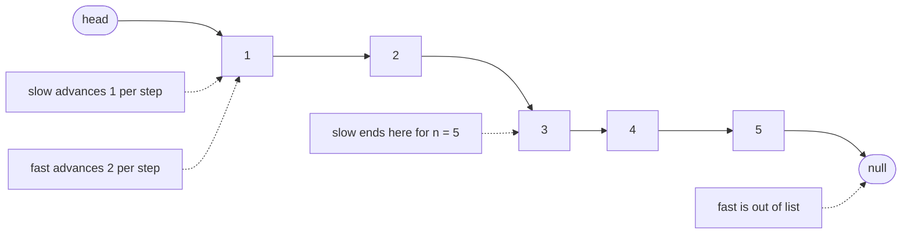
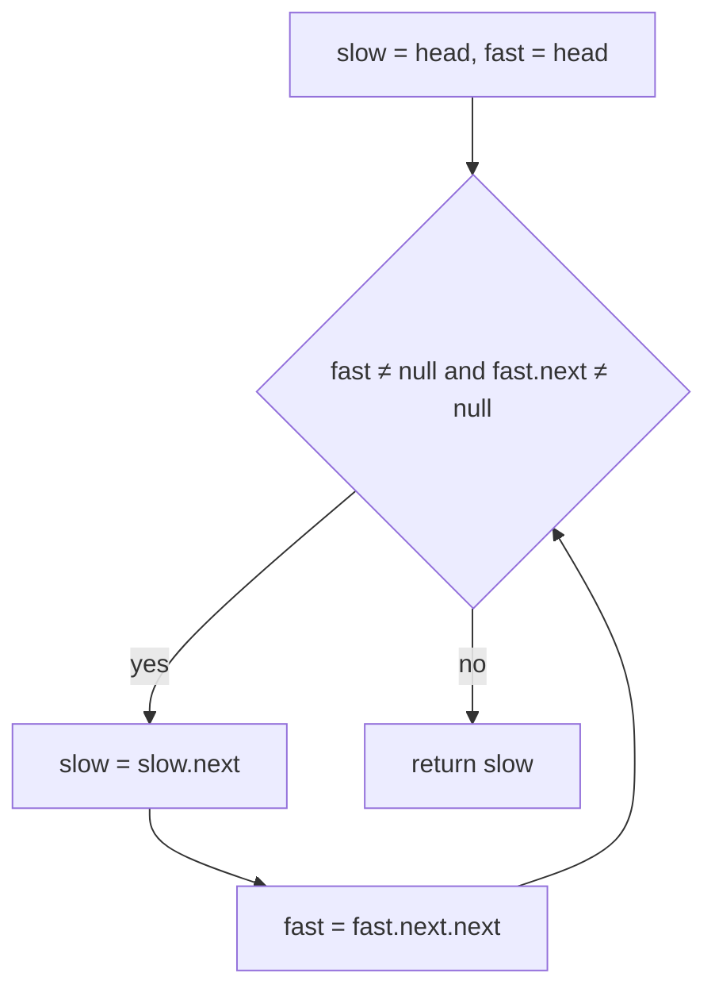
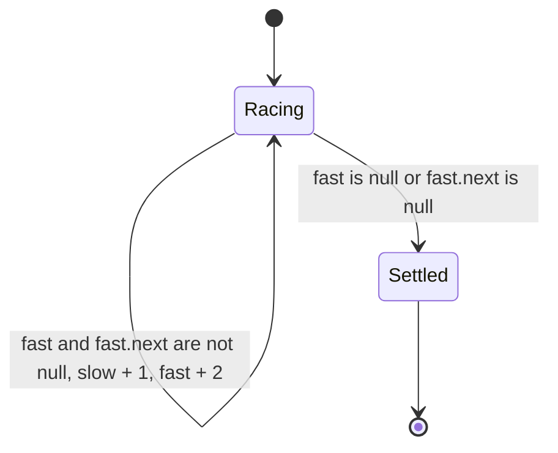
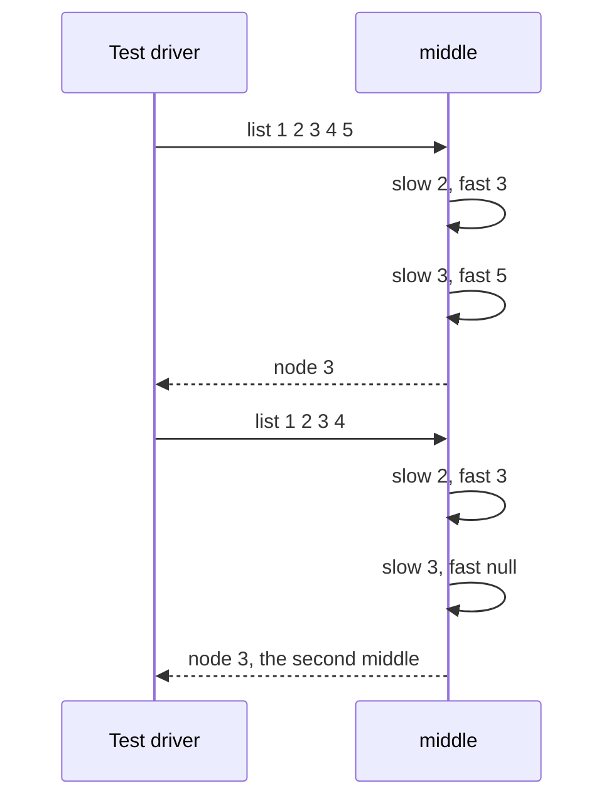

# 057 — Find middle node of linked list (two pointers).

> **Tier:** Beginner · **CTCI chapter:** Ch 2 — Linked Lists
> **Task spec:** [057-find-middle-node-of-linked-list-two-pointers.md](../../../tasks/beginner/057-find-middle-node-of-linked-list-two-pointers.md)
> **Solutions:** [Python](../../../solutions/python/beginner/057-find-middle-node-of-linked-list-two-pointers/solution.py) ·
> [Java](../../../solutions/java/beginner/057-find-middle-node-of-linked-list-two-pointers/Solution.java) ·
> [JavaScript](../../../solutions/javascript/beginner/057-find-middle-node-of-linked-list-two-pointers/solution.js) ·
> [C#](../../../solutions/csharp/beginner/057-find-middle-node-of-linked-list-two-pointers/Solution.cs)

## 1. Problem restatement

**Input:** the head of a singly linked list, possibly `null`/`None`.

**Output:** the **middle node** itself (a node reference, not a value). The Python docstring fixes the
convention for even-length lists: *"Slow/fast pointers; for even length returns the second middle."*

That convention is the only real decision in the problem, and the assertions pin it down:

| Call | Result | Why |
| --- | --- | --- |
| `middle(from_list([1, 2, 3, 4, 5]))` | node `3` | odd length: the unique middle |
| `middle(from_list([1, 2, 3, 4]))` | node `3`, not `2` | even length: the **second** of the two middle nodes |
| `middle(from_list([9]))` | node `9` | a one-node list is its own middle |
| `middle(None)` | `null` | empty list has no middle; the result is not an error |

Python and Java assert all four rows; the labels read "odd", "even -> second middle", "single" and
"empty". C# asserts the odd, even and empty rows, and JavaScript asserts the odd, even and empty rows
as well, both comparing `.val`. Returning the node rather than its value is deliberate: a middle node
is normally the anchor for a follow-up operation, such as splitting a list in two or deleting the
middle, and both need the reference.

## 2. Intuition

The obvious plan is two passes: walk the list once to count `n` with the technique from
[056-find-length-of-linked-list.md](../../../tasks/beginner/056-find-length-of-linked-list.md), then
walk `floor(n / 2)` steps to land on the middle. It is correct, and it costs one and a half passes
over the list plus the bookkeeping of the count.

A second idea is to copy the nodes into an array and index the middle directly. That is a single pass
but O(n) extra memory for a problem whose answer needs two pointers, and it stops working the moment
the payload is not copyable.

The insight is to let the "half" relationship do the counting: run **two cursors at different
speeds**. `slow` advances one link per step, `fast` advances two. Starting together at the head,
after `k` steps `slow` has covered `k` links and `fast` has covered `2k`, so when `fast` runs out of
list, `slow` is exactly halfway — no length is ever computed:

- the loop continues while `fast` and `fast.next` are both non-null, i.e. while two more hops are
  available;
- for odd `n = 2m + 1`, `fast` stops on the last node and `slow` is on node `m + 1` — the middle;
- for even `n = 2m`, `fast` becomes `null` after landing on the last node, `slow` is on node `m + 1`,
  which is the second middle;
- for `n = 0` the loop never runs and `slow` is still `null`.



Both cursors start on the same node, and the *only* thing that distinguishes them is how far they
move per iteration. That is why the technique generalises so well: with `fast` advancing `k` links at
a time you find the node at position `n/k`, and with `fast` advancing two links you can also detect
loops, as [058-detect-cycle-in-linked-list-floyd.md](../../../tasks/beginner/058-detect-cycle-in-linked-list-floyd.md)
does with the same loop skeleton.

## 3. Algorithm

1. Set `slow = head` and `fast = head`.
2. While `fast` is not null **and** `fast.next` is not null:
   - advance `slow` by one link;
   - advance `fast` by two links.
3. Return `slow`, which now points at the middle node.

```text
function middle(head)
    slow ← head
    fast ← head
    while fast ≠ null and fast.next ≠ null do
        slow ← slow.next
        fast ← fast.next.next
    end
    return slow
end
```

The loop condition carries both guards for a reason and they must be checked in this order:

- `fast ≠ null` prevents dereferencing `fast.next` once the fast cursor has run off the end;
- `fast.next ≠ null` prevents dereferencing `fast.next.next` when `fast` sits on the last node.

`and`/`&&` short-circuits in all four languages, so a single expression is safe; swapping the two
tests to `fast.next ≠ null and fast ≠ null` would crash on the final step. Nothing in the loop touches
`val`, so the function works for any payload type.



## 4. Worked example

Trace the odd case, `[1, 2, 3, 4, 5]` (the chain `1 → 2 → 3 → 4 → 5 → null`).

| Iteration | `slow` before | `fast` before | guards | `slow` after | `fast` after |
| --- | --- | --- | --- | --- | --- |
| 0 | node `1` | node `1` | both pass | — | — |
| 1 | node `1` | node `1` | both pass | node `2` | node `3` |
| 2 | node `2` | node `3` | `fast.next` = node `4`, passes | node `3` | node `5` |
| 3 | node `3` | node `5` | `fast.next` = null, exit | node `3` | node `5` |

The exit at iteration 3 leaves `slow` on node `3`, the unique middle. Now trace the even case
`[1, 2, 3, 4]`:

| Iteration | `slow` before | `fast` before | guards | `slow` after | `fast` after |
| --- | --- | --- | --- | --- | --- |
| 0 | node `1` | node `1` | both pass | — | — |
| 1 | node `1` | node `1` | both pass | node `2` | node `3` |
| 2 | node `2` | node `3` | `fast.next` = node `4`, passes | node `3` | `null` |
| 3 | node `3` | `null` | `fast` is null, exit | node `3` | `null` |

Here `fast` steps off the end, and `slow` stops on node `3` — the second of the two middles, exactly
as the docstring promises. The single-node and empty cases exit at iteration 0 with `slow` on the only
node and on `null` respectively.





## 5. Complexity

Let `n` be the number of nodes.

| Measure | Bound | Why it holds |
| --- | --- | --- |
| Time, best | O(1) | a list of zero or one node exits the loop immediately |
| Time, average | O(n) | `fast` covers two links per iteration and stops after about `n/2` iterations |
| Time, worst | O(n) | the loop runs `floor(n / 2)` times, each doing constant pointer work |
| Space, extra | O(1) | two cursors, no count, no copied nodes |
| Two-pass alternative, time | O(n) | one pass to measure, then about `n/2` more steps — 1.5 passes of constant work |
| Two-pass alternative, space | O(1) | same constant state, different constant factor |
| Array-of-nodes alternative, space | O(n) | stores every node reference just to index the middle |

The single-pass version is not asymptotically better than two passes — both are O(n) — but it does
strictly less work, never needs the length, and therefore keeps working on a stream of nodes that has
no end in sight until it is consumed. Floyd's algorithm in the next task reuses the identical skeleton
for a problem where the extra `fast` cursor buys an asymptotic win in *space*.

## 6. Pitfalls and edge cases

- **Even-length convention is a contract, not a detail.** This implementation returns the second
  middle (`[1, 2, 3, 4]` gives node `3`). Callers that want the first middle must either stop one
  iteration earlier or track `prev` alongside `slow`; mixing the two conventions silently changes
  which node a split or a delete operates on.
- **Both guards in the loop condition are required.** With `fast.next` alone, a list of even length
  dereferences `fast.next` after `fast` becomes null; with `fast` alone, `fast.next.next` is
  evaluated while `fast` sits on the last node. Order matters only because of short-circuiting.
- **The comparison is on nodes, not values.** The assertions read `.val` at the end, but the walk
  itself never inspects payloads, so duplicate values cannot mislead it.
- **Empty list returns `null`.** No assertion in C# covers it, but Python, Java and JavaScript assert
  `middle(None) is None` / `middle(null) == null`, which is only true because `slow` is initialised
  from the head and never advanced.
- **A cyclic list hangs.** There is no null at the end to stop the loop, so `fast` keeps lapping the
  cycle and the function never returns. Detect the cycle first with
  [058-detect-cycle-in-linked-list-floyd.md](../../../tasks/beginner/058-detect-cycle-in-linked-list-floyd.md).
- **Getting the predecessor needs a third pointer.** If the follow-up is "delete the middle node", the
  loop needs `prev` to hold the node before `slow`; otherwise the middle can be found but not unlinked
  with the technique from [055-delete-node-by-value-in-singly-linked-list.md](../../../tasks/beginner/055-delete-node-by-value-in-singly-linked-list.md).
- **The result is a node, not an index.** A linked list has no positional access, so "the middle" is
  the node at position `floor(n / 2) + 1` in 1-based terms; the returned reference is what callers
  chain from.
- **Two-node lists.** `[1, 2]` returns node `2` after one iteration — the tests here stop at four
  nodes, but the convention is unchanged.
- **Nothing is mutated.** The function reads `next` links and never writes one, so it is safe to call
  on a list that other code still uses.

## 7. Variants and follow-ups

- **The same loop with a verdict instead of a node.**
  [058-detect-cycle-in-linked-list-floyd.md](../../../tasks/beginner/058-detect-cycle-in-linked-list-floyd.md)
  keeps the two cursors and compares them, turning "where are we halfway" into "do these two ever
  meet".
- **Counting instead of racing.** [056-find-length-of-linked-list.md](../../../tasks/beginner/056-find-length-of-linked-list.md)
  is the one-cursor version of the same walk, and its result is what a two-pass middle would need.
- **A gap of `n` instead of a speed of two.**
  [060-remove-nth-node-from-end-of-linked-list.md](../../../tasks/beginner/060-remove-nth-node-from-end-of-linked-list.md)
  advances a leading cursor a fixed number of steps and then moves both together, which converts
  "nth from the end" into "nth from a pointer".
- **Splitting a list at the middle** is the natural next exercise: detach `slow.next` and recurse or
  iterate — the merge-sort skeleton that
  [059-merge-two-sorted-linked-lists.md](../../../tasks/beginner/059-merge-two-sorted-linked-lists.md)
  supplies the combining half for.
- **Finding the map position of a node.** [160-implement-lru-cache-using-linked-list-hashmap.md](../../../tasks/beginner/160-implement-lru-cache-using-linked-list-hashmap.md)
  pairs a hash map with a doubly linked list so that "the middle" is replaced by "the least recently
  used", maintained in O(1) without any walk.
- The chapter walkthrough in [Linked Lists](../../ctci/02-linked-lists.md) presents the runner
  technique with this task as the first example.

## 8. Check yourself

1. Why does `fast` moving two links per step make `slow` land on the middle?

<details><summary>Show answer</summary>

After `k` iterations `slow` has advanced `k` links and `fast` has advanced `2k`. The loop ends when
`fast` can no longer advance, which happens after about `n/2` iterations. At that point `slow` has
advanced about `n/2` links from the head, which by definition is the middle position.

</details>

2. On `[1, 2, 3, 4]` the function returns node `3`. What single change makes it return node `2`
   instead, and what does that break?

<details><summary>Show answer</summary>

Stop the race one iteration earlier — for example by tracking `prev` and returning it when the loop
ends on an even-length list, or by using a loop that terminates on `fast.next.next`. Either way the
convention flips to "first middle", which contradicts the docstring and the "even -> second middle"
assertion in Python, Java and C#.

</details>

3. How many iterations does `middle` run on a five-node list, and how many does it run on a list of
   one node?

<details><summary>Show answer</summary>

Two iterations for five nodes (the third check fails because `fast` sits on node `5` with a null
`next`), and none for a single node, since `fast.next` is already null at the first test. The
asymmetry is the whole reason the loop guard tests both `fast` and `fast.next`.

</details>

4. What happens if `middle` is called on a list whose tail links back to its third node?

<details><summary>Show answer</summary>

It never returns. `fast` never reaches null, so the loop keeps advancing both cursors around the
cycle forever. Only a cycle check can make the walk safe — see
[058-detect-cycle-in-linked-list-floyd.md](../../../tasks/beginner/058-detect-cycle-in-linked-list-floyd.md).

</details>

5. Why is the extra `fast` cursor described as an O(1)-space technique when it stores a second
   pointer?

<details><summary>Show answer</summary>

Because O(1) counts asymptotically: two references are a constant number of references regardless of
list length, exactly as one reference is. The technique trades a constant amount of extra state for
not needing a stored length or a copied array, and that trade holds at any `n`.

</details>
