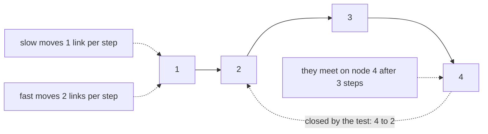
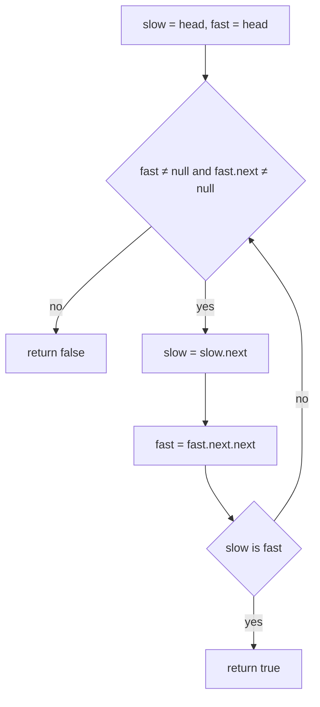
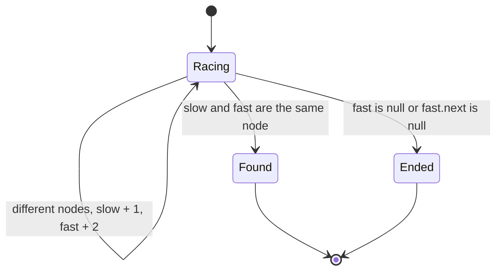
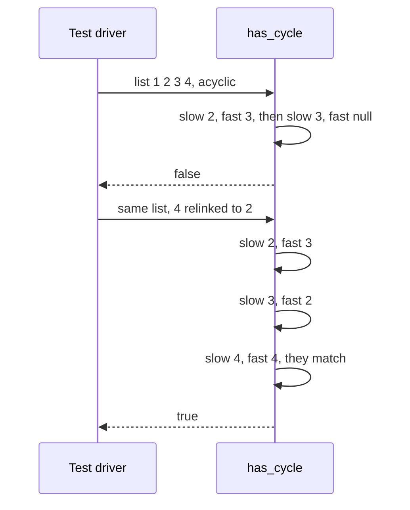

# 058 — Detect cycle in linked list (Floyd).

> **Tier:** Beginner · **CTCI chapter:** Ch 2 — Linked Lists
> **Task spec:** [058-detect-cycle-in-linked-list-floyd.md](../../../tasks/beginner/058-detect-cycle-in-linked-list-floyd.md)
> **Solutions:** [Python](../../../solutions/python/beginner/058-detect-cycle-in-linked-list-floyd/solution.py) ·
> [Java](../../../solutions/java/beginner/058-detect-cycle-in-linked-list-floyd/Solution.java) ·
> [JavaScript](../../../solutions/javascript/beginner/058-detect-cycle-in-linked-list-floyd/solution.js) ·
> [C#](../../../solutions/csharp/beginner/058-detect-cycle-in-linked-list-floyd/Solution.cs)

## 1. Problem restatement

**Input:** the head of a singly linked list, possibly `null`. The list may end with a `null` link or
may loop back into one of its own nodes.

**Output:** a boolean — `true` if the chain revisits a node, `false` if it terminates. The Python
docstring names the technique and the justification: *"Tortoise & hare: they meet iff a cycle
exists."*

The assertions build a four-node list and then deliberately close a loop by hand:

| Call | Result | Why |
| --- | --- | --- |
| `has_cycle(from_list([1, 2, 3, 4]))` | `false` | the chain ends in `null` after four nodes |
| …then `a.next.next.next.next = a.next` | — | makes node `4` point back at node `2`: a loop of length 3 |
| `has_cycle(a)` | `true` | the two cursors meet inside the loop |
| `has_cycle(None)` | `false` | empty list, nothing to revisit |

The labels in Java read "no cycle", "cycle detected" and "empty"; Python asserts the same three;
JavaScript and C# assert the first two, and both write the loop-closing line with the same comment,
`// 4 -> 2`. Note what the mutation does *not* change: the list still has four nodes and the same
four values. Only the last link differs, which is why no value-based test could tell the two cases
apart.

## 2. Intuition

The naive answer is to remember what you have seen. Keep a hash set of visited nodes, walk the list,
and report a cycle the moment a node repeats. That is correct and O(n) time — but it costs O(n)
memory, which is exactly what this problem is famous for avoiding on a constrained machine.

A second idea is to bound the walk: iterate `n` times and see whether `null` shows up. That needs the
length, which this list may not have, and a cycle shorter than `n` would simply keep revisiting nodes
without ever reaching the bound.

The insight is that a cycle makes two walkers at **different speeds** collide. Put a tortoise and a
hare on the same node:

- with no cycle, the hare reaches `null` first and the answer is `false` — no extra memory needed;
- with a cycle, the hare enters the loop before the tortoise and then laps it: the distance between
  them shrinks by exactly one link per iteration, and inside a loop of length `L` a distance that
  decreases by one must reach zero within `L` steps.



The meeting point is not necessarily the *start* of the cycle, and this task does not ask for it —
only for the yes/no answer. What matters is that inside a loop the gap cannot stay non-zero forever:
the hare gains one link on the tortoise every iteration, so the gap cycles through `0 .. L - 1` and
must hit zero.

## 3. Algorithm

1. Set `slow = head` and `fast = head`.
2. While `fast` is not null **and** `fast.next` is not null:
   - advance `slow` by one link;
   - advance `fast` by two links;
   - if `slow` and `fast` are the same node, return `true`.
3. If the loop exits, `fast` reached the end of the list — return `false`.

```text
function has_cycle(head)
    slow ← head
    fast ← head
    while fast ≠ null and fast.next ≠ null do
        slow ← slow.next
        fast ← fast.next.next
        if slow is fast then
            return true
        end
    end
    return false
end
```

Two details carry the correctness:

- the identity test happens **after** both moves, so the trivial `slow = fast = head` at the start
  does not report a cycle for every non-empty list;
- the test asks whether the two references point at the *same node*, so Python's `is`, Java's `==`,
  JavaScript's `===` and C#'s `ReferenceEquals` are the right operators — comparing `val` fields
  would confuse equal values with a revisit.



## 4. Worked example

Trace the cyclic list from the assertions: nodes `1 → 2 → 3 → 4`, with `4.next` pointing at node `2`.
The loop contains `2 → 3 → 4`, so its length is 3.

| Iteration | `slow` before | `fast` before | `slow` after | `fast` after | same node? |
| --- | --- | --- | --- | --- | --- |
| 0 | node `1` | node `1` | — | — | not compared before the first move |
| 1 | node `1` | node `1` | node `2` | node `3` | no |
| 2 | node `2` | node `3` | node `3` | node `2` (3 → 4 → 2) | no |
| 3 | node `3` | node `2` | node `4` | node `4` (2 → 3 → 4) | **yes** → return `true` |

Now the acyclic control case `[1, 2, 3, 4]`, where `4.next` is `null`:

| Iteration | `slow` before | `fast` before | `slow` after | `fast` after | same node? |
| --- | --- | --- | --- | --- | --- |
| 0 | node `1` | node `1` | — | — | not compared before the first move |
| 1 | node `1` | node `1` | node `2` | node `3` | no |
| 2 | node `2` | node `3` | node `3` | `null` (3 → 4 → null) | no |
| 3 | node `3` | `null` | — | — | exit: `fast` is null → return `false` |

The two traces diverge on the same iteration count, which is the point: the hare reaching `null`
proves the list ends, and the hare landing back on the tortoise proves it does not. Notice in
iteration 2 of the cyclic trace that `slow` and `fast` have effectively swapped positions — the hare
has lapped past the tortoise and is closing the gap from behind.





## 5. Complexity

Let `n` be the number of nodes and `L` the length of the cycle if one exists.

| Measure | Bound | Why it holds |
| --- | --- | --- |
| Time, best | O(1) | a null or single-node list fails the loop guard immediately |
| Time, average | O(n) | an acyclic list exits as soon as the hare reaches the end, after about `n/2` iterations |
| Time, worst | O(n) | with a cycle, the tortoise enters the loop after at most `n` steps and the gap closes within `L ≤ n` more |
| Space, extra | O(1) | two node references and nothing else |
| Hash-set alternative, time | O(n) | one pass, one insertion per node |
| Hash-set alternative, space | O(n) | stores every visited node reference |
| "Bound the walk" alternative, time | O(n) | but it needs a known length, and a cycle shorter than `n` defeats it |
| Finding the cycle **start** | O(n) extra time | a second phase after the meeting — not implemented in this task |

The O(1) space bound is the reason Floyd's algorithm is the expected answer: the hash-set version has
the same time bound and a strictly worse memory profile, and the "walk `n` steps" version cannot be
used at all when the length is unknown or the cycle is shorter than the bound.

## 6. Pitfalls and edge cases

- **Compare after moving.** Testing `slow is fast` before the first advance compares the head with
  itself, so every non-empty list would be reported as cyclic. The check belongs inside the loop,
  after both cursors have moved.
- **Compare identity, not values.** `[1, 2, 2, 3]` is acyclic, but a value comparison would fire when
  `slow` lands on node `2` while `fast` lands on node `3` — both holding `2`. Python's `is`, Java's
  `==` on references, JavaScript's `===` and C#'s `ReferenceEquals` all compare nodes, which is what
  the algorithm needs.
- **Moving `fast` needs two guards.** `fast.next.next` requires a non-null `fast` and a non-null
  `fast.next`; both tests appear in the loop condition, and short-circuit evaluation keeps the second
  dereference safe.
- **A one-node list is never cyclic unless it points at itself.** With `fast.next = null` the guard
  fails, the loop exits and `false` is returned. A self-loop is caught on the first iteration, because
  `fast.next.next` brings the hare back to the same node as the tortoise.
- **Empty list returns `false`.** Asserted directly in Python and Java ("empty"); the loop guard
  handles it without a branch.
- **The cycle can start anywhere.** The algorithm compares where the cursors *are*, not where the loop
  begins, so a cycle containing the head, the middle or only part of the tail is all the same to it.
- **Finding the start needs a second phase.** After the meeting, resetting one cursor to the head and
  advancing both one step at a time finds the entry node; this task stops at the boolean, so any
  caller that needs the entry point has to add that step.
- **A cyclic list breaks other helpers.** `to_list`, `length` and `traverse` all loop forever on the
  list the assertions construct — which is why the tests only call `has_cycle` on it, not the
  container helpers.
- **Destructive detection is a different trade.** Marking visited nodes (rewriting a field) makes the
  check O(1) in memory but mutates the list and fails on a shared or read-only structure; Floyd's
  method reads only links.
- **The loop is infinite without the guard.** There is no step limit and no counter, so termination
  relies entirely on either a null link or a meeting.

## 7. Variants and follow-ups

- **The same skeleton, a different verdict.**
  [057-find-middle-node-of-linked-list-two-pointers.md](../../../tasks/beginner/057-find-middle-node-of-linked-list-two-pointers.md)
  runs two cursors at different speeds and returns the node the slow one lands on; the only real
  change is the comparison at the end.
- **Distance rather than speed.**
  [060-remove-nth-node-from-end-of-linked-list.md](../../../tasks/beginner/060-remove-nth-node-from-end-of-linked-list.md)
  maintains a gap of `n` links between two cursors instead of a ratio, which works because the
  quantity being located is counted from the end.
- **The walks that hang on a cycle.** [054-traverse-linked-list-and-print-nodes.md](../../../tasks/beginner/054-traverse-linked-list-and-print-nodes.md)
  and [056-find-length-of-linked-list.md](../../../tasks/beginner/056-find-length-of-linked-list.md)
  both assume a terminating chain, so a cycle check is the natural guard to run before either.
- **Reversal that closes a loop.** [061-reverse-singly-linked-list-iterative.md](../../../tasks/beginner/061-reverse-singly-linked-list-iterative.md)
  rewires links while walking, and a bug there (pointing a node at itself) produces exactly the
  malformed structure this task detects.
- **Cycles in the general case.** [107-detect-cycle-in-directed-graph-dfs-coloring.md](../../../tasks/beginner/107-detect-cycle-in-directed-graph-dfs-coloring.md)
  and [108-detect-cycle-in-undirected-graph-union-find.md](../../../tasks/beginner/108-detect-cycle-in-undirected-graph-union-find.md)
  detect cycles in graphs, where a linked list is the degenerate case of one path.
- **Lists that are loops by design.** [154-implement-a-basic-circular-linked-list.md](../../../tasks/beginner/154-implement-a-basic-circular-linked-list.md)
  makes the tail link back deliberately, so `has_cycle` would report `true` for every such list — a
  useful reminder that "cyclic" is not a bug by itself.
- The chapter walkthrough in [Linked Lists](../../ctci/02-linked-lists.md) places Floyd's algorithm
  next to the runner technique it grew out of.

## 8. Check yourself

1. Why must the identity check come after the two cursor moves rather than before them?

<details><summary>Show answer</summary>

Both cursors start at the head, so an identity check at the top of the loop would compare the head
with itself on the first iteration and report a cycle for every non-empty list. Moving first
separates the cursors by one link before the first comparison.

</details>

2. In the cyclic trace, the cursors meet on node `4` after three iterations. Does that mean node `4`
   is where the cycle starts?

<details><summary>Show answer</summary>

No. The cycle is `2 → 3 → 4 → 2`, so the entry node is `2`; node `4` is merely where the changing gap
between the two speeds reached zero. Finding the entry node takes a second phase (walk from the head
and from the meeting point in lockstep), which this task does not implement.

</details>

3. What does `has_cycle` return for a list with a single node whose `next` points at itself?

<details><summary>Show answer</summary>

`true`. The guard `fast != null and fast.next != null` passes because the node's `next` is the node
itself; the first iteration moves `slow` to the node and `fast` to `node.next.next` — the same node —
so they compare equal and `true` is returned.

</details>

4. Why does the hash-set solution lose to this one even though both are O(n) in time?

<details><summary>Show answer</summary>

Because the hash set stores every visited node — O(n) extra memory — while Floyd's algorithm keeps
two references. Since the time bounds are equal, the space bound decides, and the constant-memory
version is the one that works on memory-constrained or streaming inputs.

</details>

5. What is the largest number of iterations needed before the cursors meet, in terms of the tail
   length `t` (nodes before the cycle) and the cycle length `L`?

<details><summary>Show answer</summary>

The tortoise needs about `t` steps to reach the cycle, and once both cursors are inside it the gap
shrinks by one link per iteration in a loop of length `L`, so at most `L` further iterations are
needed. The total is therefore O(t + L) = O(n), which is the bound quoted in the complexity table —
and the reason the algorithm stays linear even when the cycle is long.

</details>
