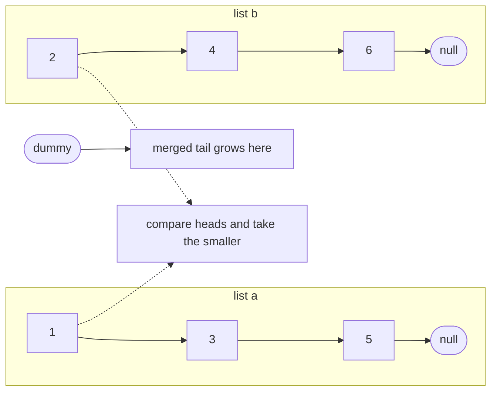
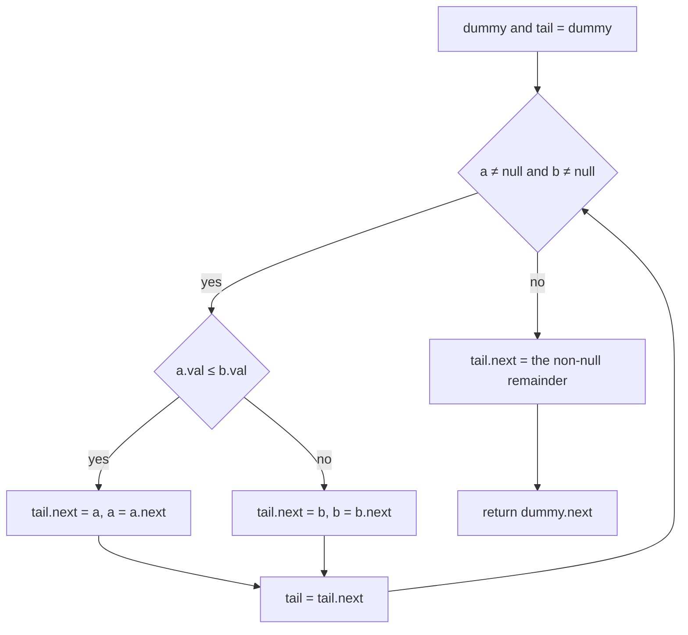
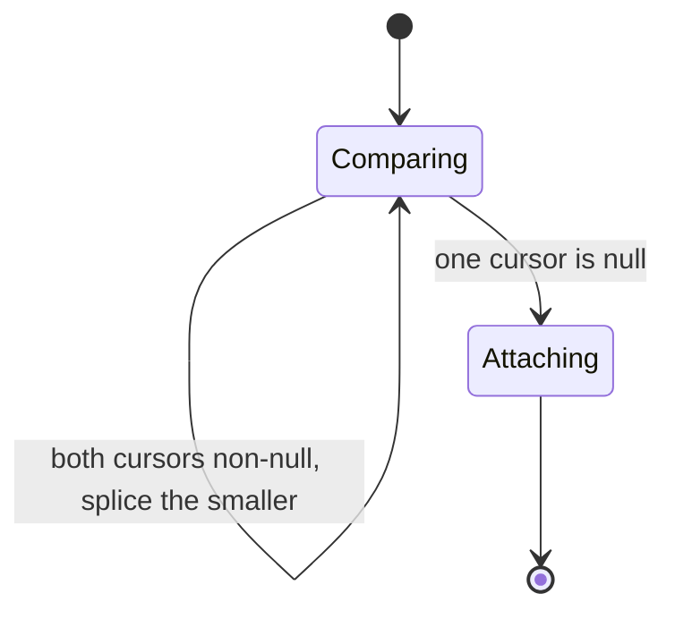
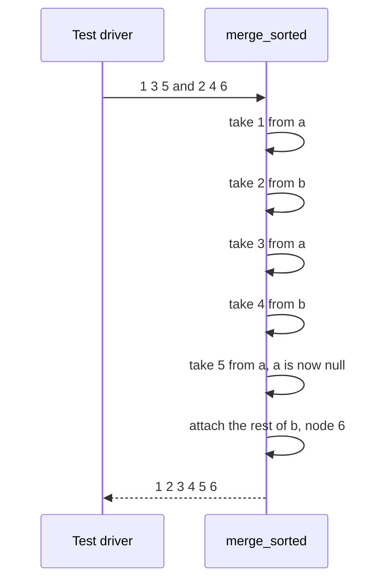

# 059 — Merge two sorted linked lists.

> **Tier:** Beginner · **CTCI chapter:** Ch 10 — Sorting and Searching
> **Task spec:** [059-merge-two-sorted-linked-lists.md](../../../tasks/beginner/059-merge-two-sorted-linked-lists.md)
> **Solutions:** [Python](../../../solutions/python/beginner/059-merge-two-sorted-linked-lists/solution.py) ·
> [Java](../../../solutions/java/beginner/059-merge-two-sorted-linked-lists/Solution.java) ·
> [JavaScript](../../../solutions/javascript/beginner/059-merge-two-sorted-linked-lists/solution.js) ·
> [C#](../../../solutions/csharp/beginner/059-merge-two-sorted-linked-lists/Solution.cs)

## 1. Problem restatement

**Input:** two singly linked lists whose values are already in non-decreasing order. Either list, or
both, may be empty (`null`).

**Output:** one linked list containing all the nodes of both inputs in non-decreasing order. The four
files splice the existing nodes rather than allocating copies, so the result shares every node with
its inputs.

The assertions cover the interleaved case, the degenerate cases and the empty case:

| Call | Result | Why |
| --- | --- | --- |
| `merge_sorted(from_list([1, 3, 5]), from_list([2, 4, 6]))` | `[1, 2, 3, 4, 5, 6]` | the two chains interleave element by element |
| `merge_sorted(None, from_list([1]))` | `[1]` | one empty input: the other is returned as-is |
| `merge_sorted(None, None)` | `[]` | both empty: the result is `null`, not an error |

Python, Java and C# assert all three rows with the labels "interleaved", "one empty" and "both
empty"; JavaScript asserts the first two. The rows matter because a merge can look correct on the
interleaved input while failing on an empty argument — the `tail.next = a or b` step is exactly the
code that handles both degenerate cases.

## 2. Intuition

The naive approach walks both lists into arrays, sorts, and rebuilds a list. It is O((m + n) log(m + n))
time and O(m + n) extra memory, and it throws away the only thing the inputs are giving you: they are
already sorted.

A better-shaped naive approach is recursive: pick the smaller head, then merge the rest. It is correct
and elegant, but it uses one stack frame per node — O(m + n) frames, and a real stack-overflow risk.

The insight comes from noticing what a merge really needs at each moment: **the smallest unconsumed
node of each list**, and a place to hang the chosen one. Both chains are sorted, so their heads are
their minima; comparing two values decides the next output node:

- keep a `tail` pointer that always points at the last node already merged;
- compare `a.val` with `b.val`, splice the winner onto `tail.next`, and advance the winner's cursor;
- when one cursor runs out, every remaining node of the other list is larger than everything already
  merged, so the *entire* remainder attaches in one assignment — no per-node loop needed.

That last step is what keeps the algorithm a single pass: each node is spliced exactly once, and the
tail of the remainder costs one pointer write instead of `k` of them.



The sentinel node from [055-delete-node-by-value-in-singly-linked-list.md](../../../tasks/beginner/055-delete-node-by-value-in-singly-linked-list.md)
reappears here for a different reason. A merge has no idea in advance whether the first output node
comes from `a` or from `b`, so it cannot initialise a real head; a dummy gives the tail something to
point at until the first splice happens, and `dummy.next` is the answer at the end.

## 3. Algorithm

1. Create a dummy node and set `tail = dummy`.
2. While both `a` and `b` are non-null:
   - if `a.val ≤ b.val`, splice node `a` after `tail` and advance `a` by one node;
   - otherwise splice node `b` after `tail` and advance `b` by one node;
   - advance `tail` to the node just spliced.
3. Attach the remainder in one step: `tail.next = a` if `a` is non-null, otherwise `b` (this covers
   the case where both are null, giving `null`).
4. Return `dummy.next`, the first real node.

```text
function merge_sorted(a, b)
    dummy ← new node
    tail ← dummy
    while a ≠ null and b ≠ null do
        if a.val ≤ b.val then
            tail.next ← a
            a ← a.next
        else
            tail.next ← b
            b ← b.next
        end
        tail ← tail.next
    end
    if a ≠ null then
        tail.next ← a
    else
        tail.next ← b
    end
    return dummy.next
end
```

The `≤` in step 2 is a deliberate tie-break: when the two heads hold equal values, the node from `a`
wins, so equal-keyed nodes keep their `a`-before-`b` order — the merge is stable. Step 3 is spelled
with a conditional here; the files write it in their own idiom (`a or b` in Python, `a != null ? a : b`
in Java, `a || b` in JavaScript, `a ?? b` in C#), but all four attach the whole remaining chain.



## 4. Worked example

Trace the interleaved assertion, `merge_sorted([1, 3, 5], [2, 4, 6])`. The dummy is shown as `D`.

| Step | `a` | `b` | comparison | spliced node | merged chain | `tail` |
| --- | --- | --- | --- | --- | --- | --- |
| 0 | `1` | `2` | — | — | `D` | `D` |
| 1 | `3` | `2` | `1 ≤ 2` | `a` = `1` | `D → 1` | node `1` |
| 2 | `3` | `4` | `3 > 2` | `b` = `2` | `D → 1 → 2` | node `2` |
| 3 | `5` | `4` | `3 ≤ 4` | `a` = `3` | `D → 1 → 2 → 3` | node `3` |
| 4 | `5` | `6` | `5 > 4` | `b` = `4` | `D → 1 → 2 → 3 → 4` | node `4` |
| 5 | `null` | `6` | `5 ≤ 6` | `a` = `5` | `D → 1 → 2 → 3 → 4 → 5` | node `5` |
| 6 | `null` | `6` | loop ends (`a` is null) | remainder `b` = `6` | `D → 1 → … → 5 → 6` | — |
| 7 | — | — | return `dummy.next` | — | `1 → 2 → 3 → 4 → 5 → 6` | — |

Step 6 is the shortcut that the naive version replaces with a second loop: because `b` still holds
node `6` and that node's own chain is sorted and entirely larger than `5`, attaching its head is
enough. The two degenerate assertions follow the same table with fewer rows — with `a = null` at
step 0, the loop is skipped and `tail.next = b` returns the second list untouched, and with both null
the result is `null`.





## 5. Complexity

Let `m` and `n` be the lengths of the two input lists.

| Measure | Bound | Why it holds |
| --- | --- | --- |
| Time, best | O(1) | both inputs empty: the loop is skipped and the remainder is null |
| Time, average | O(m + n) | each iteration consumes one node from one list, so there are at most `m + n - 1` iterations |
| Time, worst | O(m + n) | the loop runs until one list is exhausted, and the remainder attaches in O(1) |
| Space, extra | O(1) | one dummy node and three references; the nodes themselves are reused, not copied |
| Copying alternative, space | O(m + n) | allocating a fresh node per output element |
| Array-merge alternative, space | O(m + n) | collecting both inputs into arrays before merging |
| Recursive merge, space | O(m + n) frames | one frame per merged node |

The splice is what makes the O(1) space claim honest: the function never allocates a node for a
value, it only rewires existing `next` pointers, so memory use is independent of the input sizes. The
cost of that choice is that **the inputs are consumed** — after the call, the two argument heads are
embedded in the result and must not be treated as intact lists.

## 6. Pitfalls and edge cases

- **Returning `dummy` instead of `dummy.next`.** The sentinel node `0` is not part of the data, but
  returning the dummy prepends a spurious `0` to every result. The `return dummy.next` line is exactly
  what removes it.
- **Attaching only one node of the remainder.** The loop stops as soon as one cursor is null; copying
  just the current node of the other list drops everything after it. `tail.next = a or b` attaches the
  whole chain because the remainder's links are already correct.
- **Forgetting to advance `tail`.** `tail = tail.next` must run after every splice; without it the
  chain is rewritten at the same position and the result collapses to two nodes.
- **Ties and stability.** `a.val <= b.val` puts `a`'s node first when values are equal, which
  preserves the relative order of equal keys across the two inputs. Changing it to `<` reverses that
  order for ties — a behaviour change that no value-only assertion here would catch, because
  `[1, 3, 5]` and `[2, 4, 6]` share no values.
- **Both inputs empty.** The loop is skipped, the remainder is null, and `dummy.next` is null; the
  assertion reads "both empty". Returning an error would be a contract change.
- **One input empty.** The result is *the other list, unchanged* — the same nodes, not copies. Code
  that expected a fresh list will be surprised when mutating the result also mutates the input.
- **The inputs must actually be sorted.** The merge makes no checks; an unsorted input produces an
  unsorted output that still passes a "count the nodes" test, so the assertions compare full
  sequences.
- **The inputs are destroyed as lists.** After the call, `a` and `b` point somewhere inside the
  result. A caller that needs the originals must clone them first, or rewrite the merge to allocate.
- **Recursion depth.** The recursive formulation is shorter but uses O(m + n) stack frames; the
  iterative version in the four files has a bounded 12-line body and no depth limit.
- **A cycle in either input.** The walk would never exhaust that list; the guard is
  [058-detect-cycle-in-linked-list-floyd.md](../../../tasks/beginner/058-detect-cycle-in-linked-list-floyd.md).

## 7. Variants and follow-ups

- **The array version of the same idea.** [020-merge-two-sorted-arrays-into-a-sorted-array.md](../../../tasks/beginner/020-merge-two-sorted-arrays-into-a-sorted-array.md)
  shows the merge behind a positional interface, where the classic trick is to fill the destination
  from the back so no element is overwritten before it is read.
- **Locating the split.** [057-find-middle-node-of-linked-list-two-pointers.md](../../../tasks/beginner/057-find-middle-node-of-linked-list-two-pointers.md)
  supplies the "divide" half of a linked-list merge sort; this task is the "combine" half, which is
  why the two are usually taught together.
- **Two cursors with a fixed gap.** [060-remove-nth-node-from-end-of-linked-list.md](../../../tasks/beginner/060-remove-nth-node-from-end-of-linked-list.md)
  reuses the `dummy` sentinel in a different role, where it exists so head removal needs no branch.
- **Merging as part of a bigger structure.** [160-implement-lru-cache-using-linked-list-hashmap.md](../../../tasks/beginner/160-implement-lru-cache-using-linked-list-hashmap.md)
  keeps a list ordered by recency, where "merge" becomes "move a node to the front" — the same
  relinking discipline without the comparison.
- **Insertion into sorted order.** [052-implement-simple-linkedlist-insert-at-head.md](../../../tasks/beginner/052-implement-simple-linkedlist-insert-at-head.md)
  and [053-implement-linkedlist-insert-at-tail.md](../../../tasks/beginner/053-implement-linkedlist-insert-at-tail.md)
  are the primitives a "insert one element into a sorted list" variant would build on.
- The chapter walkthrough in [Sorting and Searching](../../ctci/10-sorting-and-searching.md) places
  merging next to the sort implementations whose recursion depends on it.

## 8. Check yourself

1. Why does the algorithm need a dummy node instead of starting directly from the smaller head?

<details><summary>Show answer</summary>

Because which input supplies the first output node is not known until the first comparison, and the
`tail` pointer needs something concrete to write `tail.next` into before that. The dummy provides that
placeholder, so the splice code is identical for the first node and every later one, and `dummy.next`
at the end is the real head.

</details>

2. After the loop exits, why is attaching the remaining chain enough — why not continue comparing?

<details><summary>Show answer</summary>

Because all the nodes already merged are smaller than or equal to both remaining heads, and the
remaining chain is itself sorted. Everything left in the non-empty list therefore comes after
everything already spliced, so the order is already correct; only the connecting link is missing.

</details>

3. On `[1, 3, 5]` and `[2, 4, 6]`, how many iterations does the while loop run, and how many extra
   steps does the remainder take?

<details><summary>Show answer</summary>

Five iterations, one per spliced node, ending when `a` becomes null after node `5` is taken. The
remainder (`b` holding node `6`) costs one assignment: `tail.next = b`. That single step is the
difference between this implementation and one that loops over the rest of the other list.

</details>

4. What does the merge return for two lists that contain equal values, and which one wins?

<details><summary>Show answer</summary>

Both nodes are kept — nothing is deduplicated — and the node from the first list is spliced first,
because the comparison is `a.val <= b.val`. For inputs `[1, 2]` and `[2, 3]` the output is
`[1, 2, 2, 3]` with `a`'s `2` before `b`'s `2`, which is what makes the merge stable.

</details>

5. A caller merges their two lists and then tries to walk the original second list. What happens?

<details><summary>Show answer</summary>

The nodes of the second list are now part of the merged chain, and its head may sit anywhere inside
it, so walking from the old head yields the merged tail rather than the original list. The merge
consumes its inputs; a caller that needs the originals must copy them before merging, or use a
merge variant that allocates new nodes.

</details>
