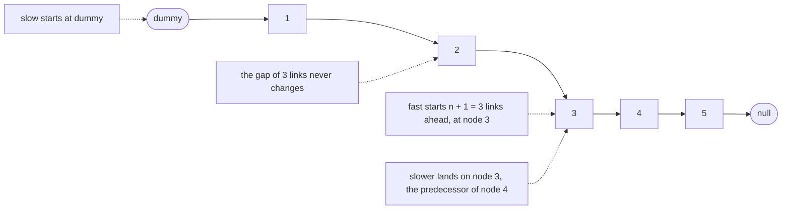
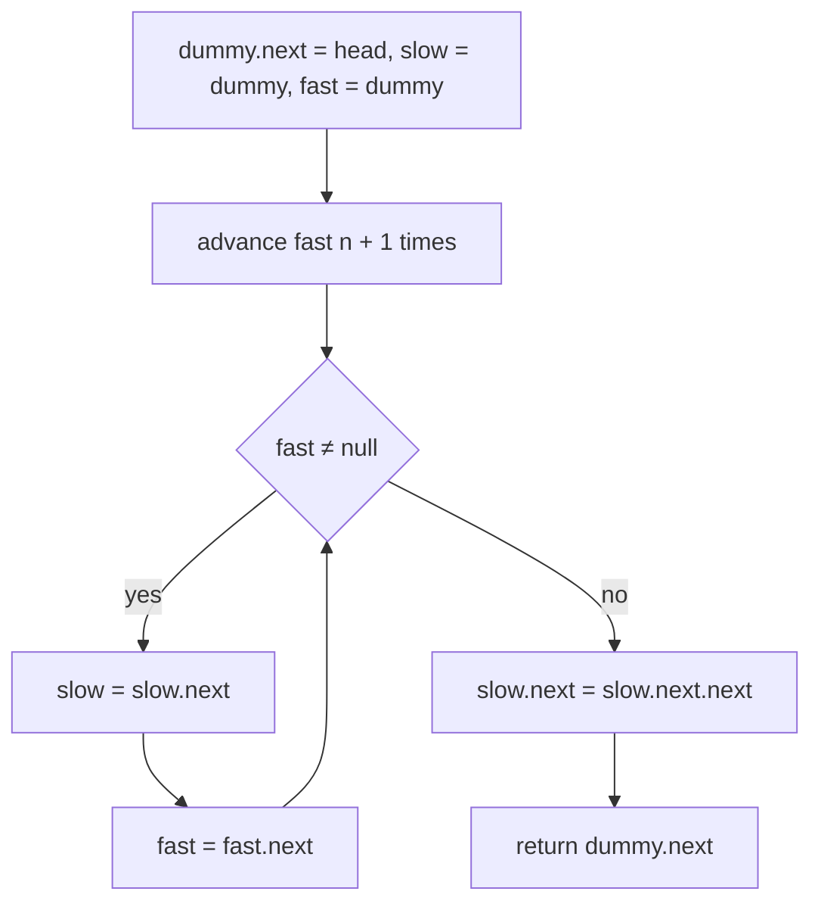
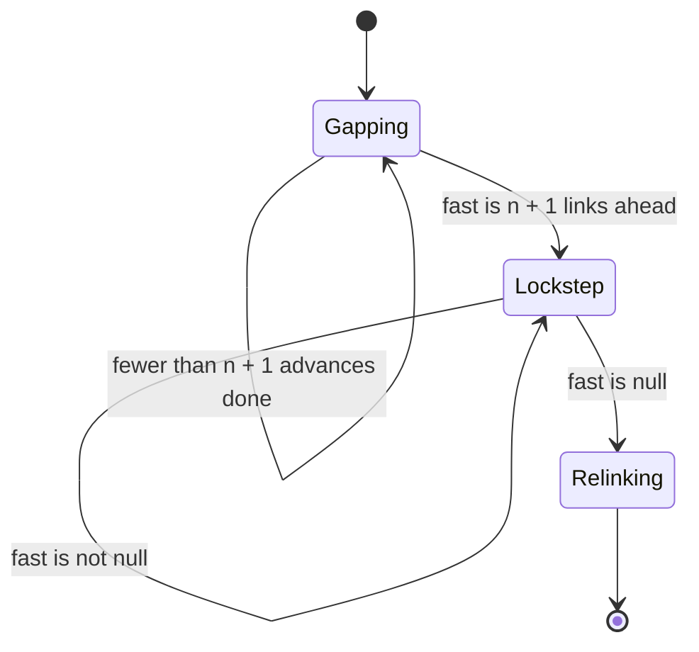
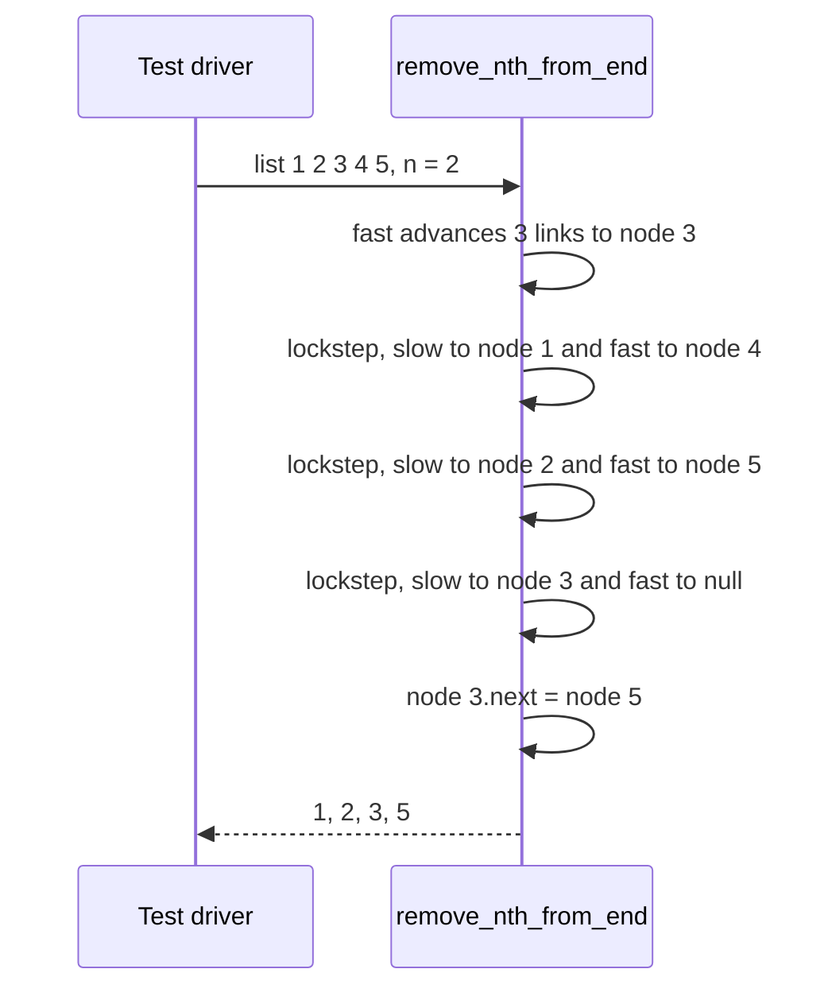

# 060 — Remove nth node from end of linked list.

> **Tier:** Beginner · **CTCI chapter:** Ch 2 — Linked Lists
> **Task spec:** [060-remove-nth-node-from-end-of-linked-list.md](../../../tasks/beginner/060-remove-nth-node-from-end-of-linked-list.md)
> **Solutions:** [Python](../../../solutions/python/beginner/060-remove-nth-node-from-end-of-linked-list/solution.py) ·
> [Java](../../../solutions/java/beginner/060-remove-nth-node-from-end-of-linked-list/Solution.java) ·
> [JavaScript](../../../solutions/javascript/beginner/060-remove-nth-node-from-end-of-linked-list/solution.js) ·
> [C#](../../../solutions/csharp/beginner/060-remove-nth-node-from-end-of-linked-list/Solution.cs)

## 1. Problem restatement

**Input:** the head of a singly linked list and an integer `n` counting from the **end** of the list,
where `n = 1` means the last node.

**Output:** the head of the list with that node unlinked, in a single pass. The Python docstring names
both mechanisms: *"Two pointers with an n+1 gap, plus a dummy to simplify head removal."*

The assertions cover a middle removal, the head, and the smallest possible list:

| Call | Result | Why |
| --- | --- | --- |
| `remove_nth_from_end(from_list([1, 2, 3, 4, 5]), 2)` | `[1, 2, 3, 5]` | removes node `4` — second from the end |
| `remove_nth_from_end(from_list([1, 2, 3, 4, 5]), 5)` | `[2, 3, 4, 5]` | `n` equals the length, so the **head** goes |
| `remove_nth_from_end(from_list([1]), 1)` | `[]` | the only node is both first and last |

All four files assert these three rows, with the labels "middle", "head" and "single" in Java. The
inputs are built by the same `from_list` helper as the rest of the Ch 2 beginner tasks, so the
expected results can be written as value sequences. The contract assumes a valid `n` between `1` and
the list length; nothing in the four files guards against a larger value (see section 6).

## 2. Intuition

The direct reading of the problem is "find the position of the nth node from the end, then unlink it".
Position from the end is only computable if the length is known, which invites a two-pass solution:
walk the list once with the technique from
[056-find-length-of-linked-list.md](../../../tasks/beginner/056-find-length-of-linked-list.md) to get
`L`, then walk `L - n` steps to the predecessor and relink. Correct, and O(L) in time — but it touches
the list twice and needs a counter.

The insight is that "nth from the end" can be expressed without knowing where the end is, by
maintaining a **gap**. Start two cursors together, then move the leading one `n + 1` links ahead. From
that point on, advance both in lockstep:

- the gap between them never changes — it is exactly `n + 1` links;
- when the leading cursor runs off the end (`null`), the trailing cursor is exactly `n + 1` links
  before the end, which is the **predecessor** of the node to remove;
- therefore a single relink, `slow.next = slow.next.next`, unlinks the target.

Why `n + 1` and not `n`? Because the operation needs the *predecessor*, not the target. A gap of `n`
would land the trailing cursor on the node to delete, and a singly linked list offers no way to walk
backwards to its predecessor. The `+ 1` is what makes the dummy node necessary too: when `n` equals the
length of the list, the predecessor of the head is the dummy, and `dummy.next = dummy.next.next`
removes the first node with the same single line of code that removes any other node.



The gap is the whole trick: the pair of cursors is a sliding window of fixed width whose right edge is
pinned to the end of the list, so the left edge is pinned to a fixed distance from the end.

## 3. Algorithm

1. Create a dummy node whose `next` is the real head.
2. Set `slow = dummy` and `fast = dummy`.
3. Advance `fast` exactly `n + 1` times. After this loop, `fast` is `n + 1` links ahead of `slow`.
4. While `fast` is not null: advance both cursors by one link, preserving the gap.
5. Now `slow` is the predecessor of the node to remove: set `slow.next = slow.next.next`.
6. Return `dummy.next`, which is the new head (the original head unless the first node was removed).

```text
function remove_nth_from_end(head, n)
    dummy ← new node with next = head
    slow ← dummy
    fast ← dummy
    for step ← 0 to n do
        fast ← fast.next
    end
    while fast ≠ null do
        slow ← slow.next
        fast ← fast.next
    end
    slow.next ← slow.next.next
    return dummy.next
end
```

The loop in step 3 runs `n + 1` times (Python's `range(n + 1)`, Java's and JavaScript's
`for (i = 0; i <= n; i++)`), which is the off-by-one that decides whether step 5 has a predecessor to
work with. Step 4 does nothing else — no comparisons, no counting — so the whole function makes one
pass over the list.



## 4. Worked example

Trace `remove_nth_from_end([1, 2, 3, 4, 5], 2)`. The dummy is `D`, so the starting chain is
`D → 1 → 2 → 3 → 4 → 5 → null`.

| Phase | Step | `slow` | `fast` | gap in links | note |
| --- | --- | --- | --- | --- | --- |
| setup | 0 | `D` | `D` | 0 | both cursors on the dummy |
| gap | 1 | `D` | `1` | 1 | first of the `n + 1 = 3` advances |
| gap | 2 | `D` | `2` | 2 | |
| gap | 3 | `D` | `3` | 3 | gap established: `fast` is 3 links ahead |
| lockstep | 4 | `1` | `4` | 3 | both advanced, gap unchanged |
| lockstep | 5 | `2` | `5` | 3 | both advanced |
| lockstep | 6 | `3` | `null` | 3 | `fast` left the list; loop exits |
| relink | 7 | `3` | — | — | `3.next = 5` unlinks node `4` |
| return | 8 | — | — | — | `dummy.next` is node `1` → result `1, 2, 3, 5` |

Row 7 is the payoff: the trailing cursor stopped on node `3`, the predecessor of node `4`, because
the gap of three links was preserved all the way to the end of the list. The `n = 5` assertion behaves
differently in an instructive way:

| Phase | `fast` after `n + 1 = 6` advances | `slow` | loop body | result |
| --- | --- | --- | --- | --- |
| head removal | `null` (dummy → 1 → 2 → 3 → 4 → 5 → null) | `D` | never runs | `D.next = 1.next` → `2, 3, 4, 5` |

With `n` equal to the length, the leading cursor is already off the list after the gap phase, so the
loop body never executes and `slow` is still the dummy. The single relink then removes the head — no
special case, which is precisely why the sentinel is there.





## 5. Complexity

Let `L` be the length of the list.

| Measure | Bound | Why it holds |
| --- | --- | --- |
| Time, best | O(n) | the gap phase alone advances `n + 1` links; a head removal still walks that far |
| Time, average | O(L) | `n + 1` steps to open the gap plus `L - n` steps of lockstep — the constant work per node |
| Time, worst | O(L) | the total is exactly `(n + 1) + (L - n) = L + 1` advances, independent of `n` |
| Space, extra | O(1) | two cursors plus one sentinel node |
| Two-pass alternative, time | O(L) | one pass to measure the length, then `L - n` more steps — the same asymptotics, roughly twice the hops |
| Two-pass alternative, space | O(1) | same constant state |
| Array alternative, space | O(L) | storing the nodes to index them from the end |

Worth noting in an interview: the single-pass property is about *passes*, not about asymptotic time —
`L + 1` advances versus roughly `1.5 · L` is a constant-factor difference. What the gap version really
buys is that it never needs the length, so it works on a stream that is being consumed as it arrives.

## 6. Pitfalls and edge cases

- **An `n`-wide gap instead of `n + 1`.** Land the trailing cursor on the target node and there is no
  way to unlink it: the relink needs the predecessor. Every file opens the gap with `n + 1` advances
  for this reason.
- **Removing the head without a sentinel.** With `slow` starting at the real head, `n = L` leaves
  nothing to relink and the function needs a separate branch. The dummy makes head removal the same
  one-line operation as any other removal, and `dummy.next` supplies the new head.
- **Returning `head` instead of `dummy.next`.** For the `n = 5` assertion that returns the node that
  was just unlinked, so the result looks like `1, 2, 3, 4, 5` in the array sense but starts with a
  node no longer in the list.
- **`n` larger than the list.** The gap loop dereferences `fast.next` while `fast` is already null, so
  the call throws a null-pointer error in Java, C#, JavaScript and Python rather than raising a clean
  "out of range" — the four files document no validation, and no assertion covers it.
- **`n = 0`.** The gap phase advances once, making `fast` the head; the lockstep then stops with
  `slow` on the dummy, and the relink removes the first node. The behaviour is defined by the code but
  is outside the intended contract (`n ≥ 1`).
- **Empty list.** `dummy.next` is null, the gap loop dereferences null immediately, and the call fails.
  An early `if head = null` guard would be needed to make it a no-op.
- **`n = 1` removes the tail.** The gap phase puts `fast` on the last node, the lockstep walks until
  `fast` is null with `slow` on the second-to-last node, and the relink detaches the tail.
- **The trailing cursor must stop on the predecessor.** That is a consequence of the gap being `n + 1`
  and the leading cursor ending at `null`; shifting the gap by one silently deletes the wrong node,
  which the "middle" assertion catches.
- **Both cursors always move together in the lockstep phase.** Advancing only one of them changes the
  gap and breaks the invariant that pins the pair to the end of the list.
- **The function consumes the input list.** Nodes are relinked, so the caller's original head is no
  longer a trustworthy entry point when the head is the removed node; the return value is the list.
- **Nothing is freed explicitly.** The unlinked node is unreachable from the list, and the garbage
  collector reclaims it once no other reference remains.

## 7. Variants and follow-ups

- **Delete by value, forget the position.** [055-delete-node-by-value-in-singly-linked-list.md](../../../tasks/beginner/055-delete-node-by-value-in-singly-linked-list.md)
  uses the same dummy sentinel and the same single relink, but searches instead of measuring a gap.
- **The two-cursor family.** [057-find-middle-node-of-linked-list-two-pointers.md](../../../tasks/beginner/057-find-middle-node-of-linked-list-two-pointers.md)
  maintains a *speed* ratio instead of a fixed gap, and
  [058-detect-cycle-in-linked-list-floyd.md](../../../tasks/beginner/058-detect-cycle-in-linked-list-floyd.md)
  uses both cursors to test identity — three tasks, one skeleton.
- **Measuring the list instead.** [056-find-length-of-linked-list.md](../../../tasks/beginner/056-find-length-of-linked-list.md)
  is the first pass of the two-pass alternative, and the comparison is exactly the constant-factor
  difference discussed in section 5.
- **Merging rather than removing.** [059-merge-two-sorted-linked-lists.md](../../../tasks/beginner/059-merge-two-sorted-linked-lists.md)
  splices nodes from two chains with the same dummy plus tail pattern.
- **Reversal rewires instead of unlinking.** [061-reverse-singly-linked-list-iterative.md](../../../tasks/beginner/061-reverse-singly-linked-list-iterative.md)
  and [062-reverse-singly-linked-list-recursive.md](../../../tasks/beginner/062-reverse-singly-linked-list-recursive.md)
  visit the same links and repoint them, which is what makes "remove the nth from the end" trivially
  become "remove the nth".
- **Deletion with a back pointer.** [063-implement-doubly-linked-list-insert-delete.md](../../../tasks/beginner/063-implement-doubly-linked-list-insert-delete.md)
  removes a node in O(1) because the predecessor is stored rather than searched for.
- The chapter walkthrough in [Linked Lists](../../ctci/02-linked-lists.md) pairs the runner technique
  with this gap variant as its two canonical two-pointer drills.

## 8. Check yourself

1. Why is the gap `n + 1` links rather than `n`?

<details><summary>Show answer</summary>

Because the node that must be unlinked is not the target but its predecessor: removing a node in a
singly linked list means rewriting the previous node's `next`. A gap of `n + 1` makes the trailing
cursor stop one node before the target when the leading cursor leaves the list, and a gap of `n` would
leave it standing on the target with no way to reach backwards.

</details>

2. On `[1, 2, 3, 4, 5]` with `n = 2`, where does the trailing cursor end up, and how many advances are
   made in total?

<details><summary>Show answer</summary>

It ends on node `3`, the predecessor of the target node `4`. The total is `L + 1 = 6` advances: three
to open the gap (`dummy → 1 → 2 → 3`) and three in lockstep (`slow` to `1`, `2`, `3` while `fast` goes
to `4`, `5`, `null`).

</details>

3. What makes the `n = 5` case work without a special branch for the head?

<details><summary>Show answer</summary>

The dummy node. When `n` equals the list length, the gap phase puts `fast` at null, the lockstep loop
never runs, and `slow` is still the dummy — whose `next` is the head. The relink
`slow.next = slow.next.next` therefore drops the head, exactly as it drops any other node.

</details>

4. What happens if `remove_nth_from_end` is called with `n = 7` on a five-node list?

<details><summary>Show answer</summary>

The gap loop advances past the end and dereferences a null `next`, so the call throws (a
`NullPointerException` in Java, a null-reference error in C#, a `TypeError` in JavaScript, an
`AttributeError` in Python). There is no validation and no assertion for this case in any of the four
files; a defensive version would check the length or stop early and treat an out-of-range `n` as a
no-op.

</details>

5. Why does this algorithm not need the list length, even though "nth from the end" mentions the end?

<details><summary>Show answer</summary>

Because the distance from the end is encoded in the cursor gap rather than in a number. When the
leading cursor reaches the end of the list, the trailing cursor is by construction exactly `n + 1`
links behind it, so the end of the list is measured by the leading cursor's arrival at null — the
length is never materialised.

</details>
