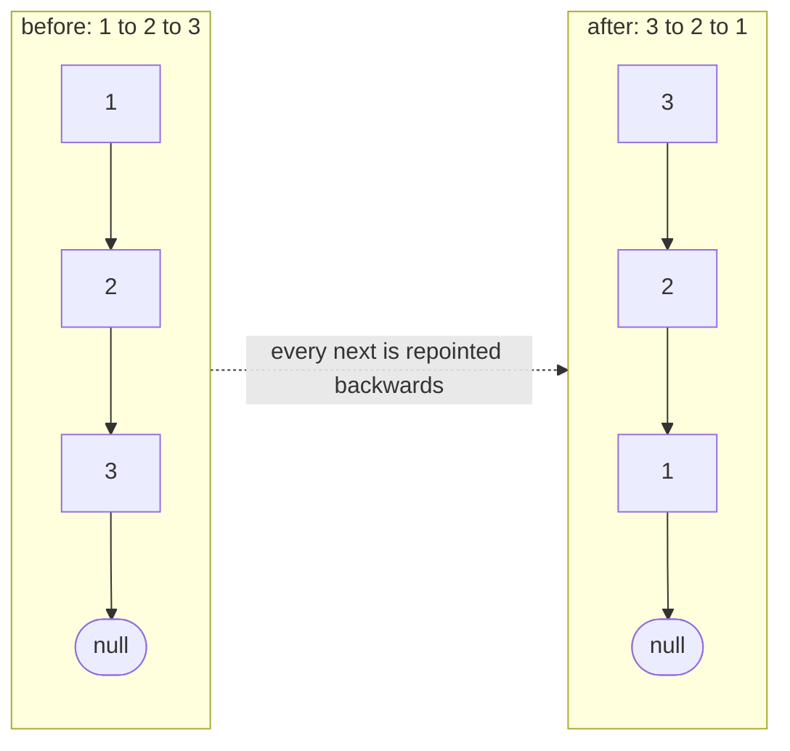
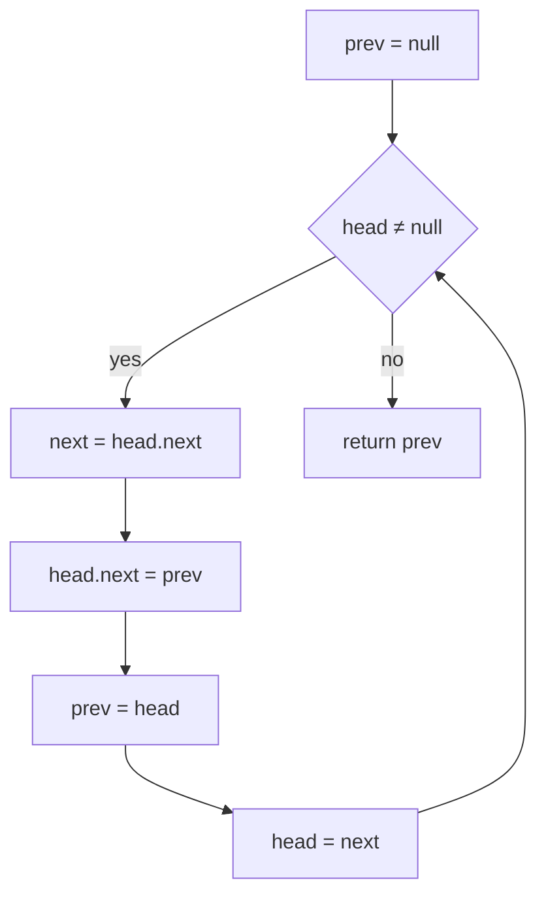
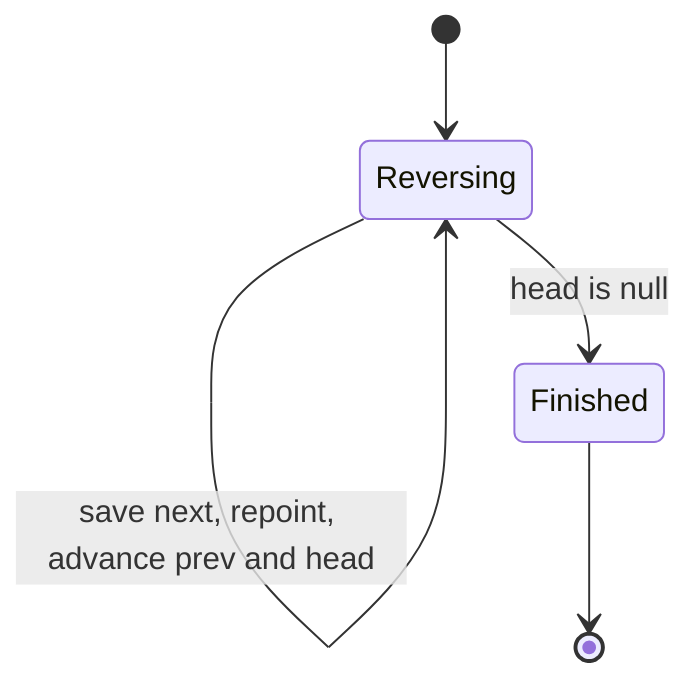
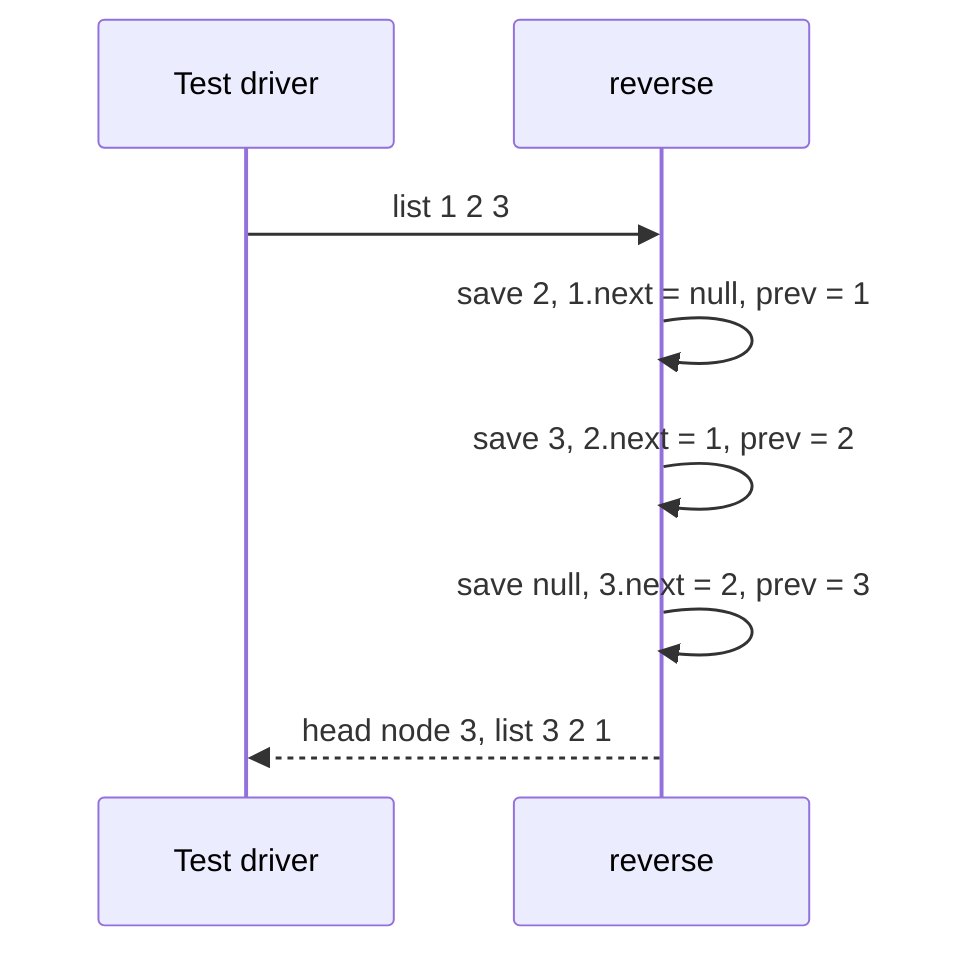

# 061 — Reverse singly linked list (iterative).

> **Tier:** Beginner · **CTCI chapter:** Ch 2 — Linked Lists
> **Task spec:** [061-reverse-singly-linked-list-iterative.md](../../../tasks/beginner/061-reverse-singly-linked-list-iterative.md)
> **Solutions:** [Python](../../../solutions/python/beginner/061-reverse-singly-linked-list-iterative/solution.py) ·
> [Java](../../../solutions/java/beginner/061-reverse-singly-linked-list-iterative/Solution.java) ·
> [JavaScript](../../../solutions/javascript/beginner/061-reverse-singly-linked-list-iterative/solution.js) ·
> [C#](../../../solutions/csharp/beginner/061-reverse-singly-linked-list-iterative/Solution.cs)

## 1. Problem restatement

**Input:** the head of a singly linked list, possibly `null`.

**Output:** the head of the same list with every link pointing the other way, so the node order is
reversed. The original tail becomes the new head. The four files rewire the existing nodes — no node
is allocated and none is copied.

| Call | Result | Why |
| --- | --- | --- |
| `reverse(from_list([1, 2, 3]))` | `[3, 2, 1]` | three nodes, three links repointed |
| `reverse(from_list([1]))` | `[1]` | a single node is already reversed; its `next` stays null |
| `reverse(None)` | `[]` | empty list: the new head is `null`, not an error |

All four files assert these three rows with the labels "three", "single" and "empty". The helper
`from_list` walks the input in reverse and prepends, and `to_list` reads the result back, so the
assertions compare value sequences rather than node identities.

## 2. Intuition

The array analogue of this problem is trivial: swap the ends and walk inward, as
[001-reverse-a-string.md](../../../tasks/beginner/001-reverse-a-string.md) does for characters. A
singly linked list cannot do that, because there is no backward link: from a node you can only reach
its successor. So the "walk inward from both ends" plan is unavailable, and so is "collect the nodes
into an array, reverse, rebuild" — which works but costs O(n) extra memory for a purely structural
rewrite.

The insight is that reversal is not a move operation at all, it is a **repointing** operation. Every
node keeps its value; the only thing that changes is what each `next` points at:

- node `k` used to point at node `k + 1`; after the reversal it must point at node `k - 1`;
- the old head must end up pointing at `null` (it becomes the new tail);
- the old tail must end up as the new head, because nothing should point at it any more.

Since the target of each link is the node you just came from, a single walk with one extra reference
does the whole job. The reference has to be saved **before** the link is overwritten, because the
moment you write `head.next` the rest of the list is unreachable through that cursor:

- `prev` holds the head of the already-reversed prefix;
- `head` is the first node not yet reversed;
- `next` is a temporary that remembers `head.next` across the overwrite.



The reversed prefix grows one node per iteration and the unreversed suffix shrinks by one, so the two
meet after exactly `n` iterations, with `head` having walked off the end. At that moment `prev` is the
new head, which is why the function returns `prev` rather than `head`.

## 3. Algorithm

1. Set `prev = null` (the reversed prefix starts empty) and leave `head` on the first node.
2. While `head` is not null:
   - save `next = head.next`, the rest of the unreversed list;
   - repoint `head.next = prev`, attaching the node to the front of the reversed prefix;
   - move `prev = head`, so the prefix now includes this node;
   - move `head = next`, the saved remainder.
3. When `head` is null, every node has been reversed: return `prev`.

```text
function reverse(head)
    prev ← null
    while head ≠ null do
        next ← head.next
        head.next ← prev
        prev ← head
        head ← next
    end
    return prev
end
```

The four statements inside the loop are one rotation, and the order is essential: saving `next` must
come first, and `prev` must be updated after the repoint but before the cursor moves. Python collapses
the whole rotation into the tuple assignment
`head.next, prev, head = prev, head, head.next`, which is safe because the right-hand side is fully
evaluated — using the *old* `prev`, the *old* `head` and the *old* `head.next` — before any of the
three targets is written. Java, JavaScript and C# spell the four statements out.



## 4. Worked example

Trace `reverse([1, 2, 3])`. The chain starts as `1 → 2 → 3 → null`; the "reversed prefix" column
reads from its new head.

| Iteration | `head` before | `next` saved | repoint | `prev` after | `head` after | reversed prefix |
| --- | --- | --- | --- | --- | --- | --- |
| 0 | node `1` | — | — | `null` | node `1` | empty |
| 1 | node `1` | node `2` | `1.next = null` | node `1` | node `2` | `1 → null` |
| 2 | node `2` | node `3` | `2.next = node 1` | node `2` | node `3` | `2 → 1 → null` |
| 3 | node `3` | `null` | `3.next = node 2` | node `3` | `null` | `3 → 2 → 1 → null` |
| 4 | `null` | — | loop exits | node `3` | `null` | return node `3` |

Iteration 1 is the one that breaks a naive implementation: the moment `1.next` is overwritten, node
`2` and everything behind it are reachable only through the saved `next` reference. The single-node and
empty assertions are the same table with rows 1 and 2 absent — `reverse([1])` performs one iteration
that sets `1.next = null` (it was already null) and returns node `1`, and `reverse(None)` never enters
the loop and returns `null`.





## 5. Complexity

Let `n` be the number of nodes.

| Measure | Bound | Why it holds |
| --- | --- | --- |
| Time, best | O(1) | an empty or single-node list still takes one pass through the loop body, or none at all |
| Time, average | O(n) | one iteration per node, each doing three pointer writes and one read |
| Time, worst | O(n) | every node must be visited; a link that is not repointed leaves the list broken |
| Space, extra | O(1) | two references plus one temporary, regardless of `n` |
| Space, nodes | O(n) | the nodes are reused, so no allocation happens at all |
| Recursive alternative, space | O(n) frames | the version in task 062 keeps one stack frame per node |
| Rebuild-from-array alternative, space | O(n) | collecting the nodes to index them, then relinking |

This is the rare case where the iterative solution beats the recursive one on *both* readability for a
beginner and memory: the loop needs a constant number of references, while
[062-reverse-singly-linked-list-recursive.md](../../../tasks/beginner/062-reverse-singly-linked-list-recursive.md)
needs one frame per node. The two produce the same list.

## 6. Pitfalls and edge cases

- **Save `next` before overwriting.** `head.next = prev` destroys the only forward path; without the
  saved reference the rest of the list is lost and the loop cannot continue.
- **Return `prev`, not `head`.** The loop exits when `head` is null, so returning `head` hands back an
  empty list. The new head is the last node that was reversed, which is exactly what `prev` holds.
- **Empty list.** `prev` stays null and the loop never runs, so the result is `null` — asserted as
  "empty" in all four files. Throwing here would be a contract change.
- **Single node.** The loop body runs once and assigns `1.next = null`, which is already the value;
  the node comes back unchanged, as the "single" assertion requires.
- **Two nodes.** `[1, 2]` becomes `[2, 1]`: iteration 1 makes node `1` the new tail, iteration 2 makes
  node `2` point at it. No assertion covers two nodes explicitly, but nothing in the loop treats it
  specially.
- **The order of the four statements.** Swapping "repoint" and "advance `prev`" reverses the list
  incorrectly — `prev` must move to the current node *after* the node is attached to the prefix.
- **Python's tuple rotation is not magic.** `head.next, prev, head = prev, head, head.next` evaluates
  the right-hand side first, so it behaves exactly like the four statements; writing the same idea as
  three separate assignments in the wrong order is the classic Python bug here.
- **Cyclic input hangs.** The loop terminates only at `null`, so a list that loops back never finishes
  and keeps repointing links forever. Check first with
  [058-detect-cycle-in-linked-list-floyd.md](../../../tasks/beginner/058-detect-cycle-in-linked-list-floyd.md).
- **The original head is consumed.** After the call the caller's old head is the *tail*, so any code
  that kept a reference to it walks a one-node list; only the returned pointer is the reversed list.
- **The reversal is destructive.** Callers that need the original order must copy first; there is no
  non-destructive variant in the four files.
- **No length, no recursion, no extra structure.** The whole algorithm is four lines and reads the
  `next` field of each node exactly once — which is why it is the version to write under time
  pressure.

## 7. Variants and follow-ups

- **The recursive formulation.** [062-reverse-singly-linked-list-recursive.md](../../../tasks/beginner/062-reverse-singly-linked-list-recursive.md)
  reaches the tail first and repoints links while unwinding; the result is identical and the memory
  profile is not.
- **Reversal of a sequence, not a chain.** [001-reverse-a-string.md](../../../tasks/beginner/001-reverse-a-string.md)
  and [030-reverse-digits-of-an-integer.md](../../../tasks/beginner/030-reverse-digits-of-an-integer.md)
  reverse values rather than pointers — the same permutation idea over different storage.
- **Rotation via reversal.** [022-rotate-array-in-place-by-k-positions.md](../../../tasks/beginner/022-rotate-array-in-place-by-k-positions.md)
  is three reversals of an array, which is what the array problem becomes once reversal is understood
  as a permutation.
- **Reversal as a sub-step.** Palindrome checks walk a sequence from both ends; on a linked list the
  equivalent needs either a stack of the first half
  ([057-find-middle-node-of-linked-list-two-pointers.md](../../../tasks/beginner/057-find-middle-node-of-linked-list-two-pointers.md)
  finds the split) or a reversal of the second half.
- **Reverse in groups of `k`.** The natural generalisation keeps the same `prev`/`head`/`next`
  discipline but rotates the loop boundary every `k` nodes.
- **O(1) removal at both ends.** [063-implement-doubly-linked-list-insert-delete.md](../../../tasks/beginner/063-implement-doubly-linked-list-insert-delete.md)
  stores a `prev` link per node; the cost of reversal there drops to a swap of the `head`/`tail`
  references, at the price of an extra pointer everywhere else.
- The chapter walkthrough in [Linked Lists](../../ctci/02-linked-lists.md) presents in-place reversal
  as the canonical pointer-rearrangement drill.

## 8. Check yourself

1. Why does the loop need a third reference when it only rewrites one link per iteration?

<details><summary>Show answer</summary>

Because writing `head.next = prev` erases the only pointer to the unprocessed remainder. The saved
`next` reference keeps that remainder reachable until the cursor moves forward, so the walk can continue.
Two references would be enough only if the link did not have to be overwritten, which is the whole
purpose of the operation.

</details>

2. What is returned for an empty list, and which line decides it?

<details><summary>Show answer</summary>

`null` — the initialisation `prev = null`. The loop condition is false immediately, so no assignment
changes `prev`, and `return prev` hands back the same null the list started as. All four files assert
this as the "empty" case.

</details>

3. In the trace, what does `prev` hold at the start of iteration 3, and what does it hold at the end?

<details><summary>Show answer</summary>

At the start of iteration 3 `prev` is node `2`, the head of the prefix `2 → 1 → null`. At the end it is
node `3`, because node `3` was repointed at node `2` and then became the new head of the prefix. That
final value is the function's return value.

</details>

4. How many link writes does the reversal perform on a five-node list, and how many would a
   copy-then-rebuild version perform?

<details><summary>Show answer</summary>

Five writes — one `next` per node, including the old head, which is set to null. The rebuild version
also writes five links but additionally allocates five nodes (or five array slots) to hold them first,
which is the O(n) extra memory this algorithm avoids.

</details>

5. A caller reverses a list and then walks from their old head variable. What do they see?

<details><summary>Show answer</summary>

They see a single node: the old head is now the tail, and its `next` is null. The list object is
unchanged in identity but every link inside it now points the other way, so only the returned pointer
is a valid entry point. This is why the function's signature returns the new head rather than void.

</details>
