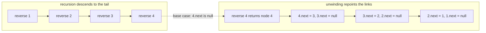
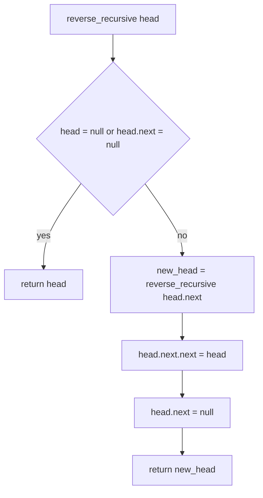
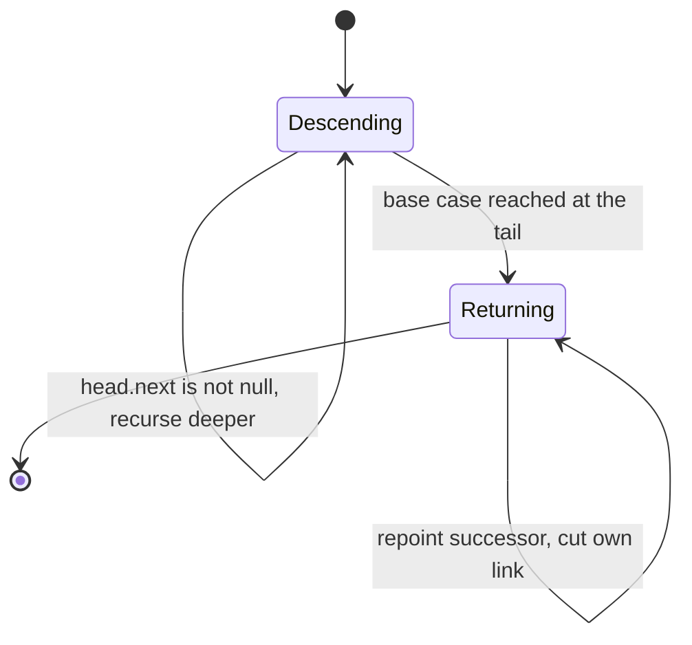
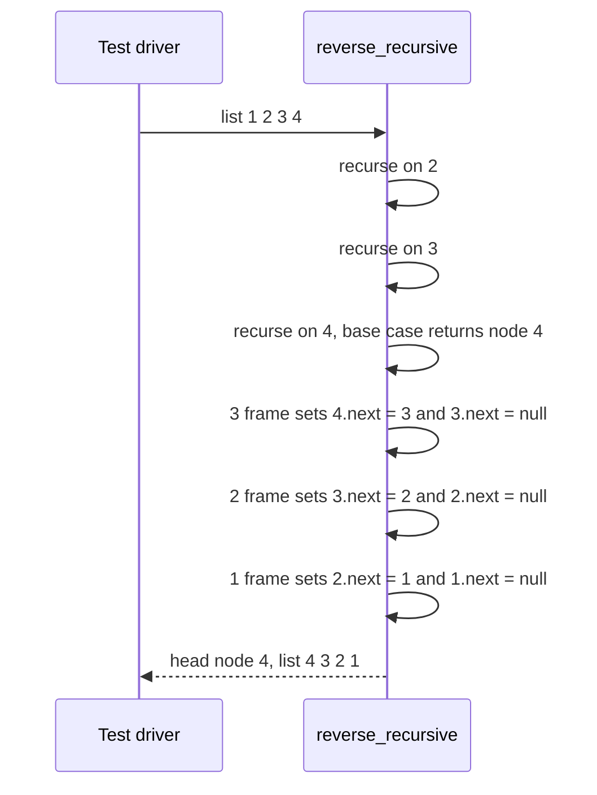

# 062 — Reverse singly linked list (recursive).

> **Tier:** Beginner · **CTCI chapter:** Ch 8 — Recursion and Dynamic Programming
> **Task spec:** [062-reverse-singly-linked-list-recursive.md](../../../tasks/beginner/062-reverse-singly-linked-list-recursive.md)
> **Solutions:** [Python](../../../solutions/python/beginner/062-reverse-singly-linked-list-recursive/solution.py) ·
> [Java](../../../solutions/java/beginner/062-reverse-singly-linked-list-recursive/Solution.java) ·
> [JavaScript](../../../solutions/javascript/beginner/062-reverse-singly-linked-list-recursive/solution.js) ·
> [C#](../../../solutions/csharp/beginner/062-reverse-singly-linked-list-recursive/Solution.cs)

## 1. Problem restatement

**Input:** the head of a singly linked list, possibly `null`.

**Output:** the head of the same list with all links reversed — the same result as
[061-reverse-singly-linked-list-iterative.md](../../../tasks/beginner/061-reverse-singly-linked-list-iterative.md),
produced by recursion instead of a loop. No node is allocated: the existing nodes are relinked.

| Call | Result | Why |
| --- | --- | --- |
| `reverse_recursive(from_list([1, 2, 3, 4]))` | `[4, 3, 2, 1]` | the deepest frame returns the original tail, and the links are flipped on the way back |
| `reverse_recursive(from_list([9]))` | `[9]` | the base case returns immediately; one node is already reversed |
| `reverse_recursive(None)` | `[]` | the base case catches `null` and returns it unchanged |

All four files assert these three rows with the labels "four", "single" and "empty"; the function is
named `reverse_recursive` / `reverseRecursive` / `ReverseRecursive` to distinguish it from the
iterative sibling. The task spec classifies this variant under the recursion chapter rather than
Ch 2, which is a fair hint that the recursion itself — not the pointer surgery — is the subject.

## 2. Intuition

Recursion and iteration differ here in *which end they start from*. The iterative version of this
problem walks from the head, building the reversed list in front of itself; it needs three references
and no call stack. The recursive version walks to the **tail** first, and then repoints links while
returning.

The recursive insight is a two-line description of the reversal:

- "the reversed list starts with the original tail, so somebody has to find the tail and hand it back";
- "each frame, on the way out, makes the node *after* it point back at it, and cuts its own forward
  link."

The second part is the interesting one. Suppose the recursive call has already reversed everything
after `head` and returned the new head. At that moment `head.next` is the node that used to follow
`head` and is now the **tail** of the reversed suffix. Two writes complete the job for `head`:

- `head.next.next = head` — that former successor now points back at `head`;
- `head.next = null` — `head` becomes the last node of the reversed list so far.

The new head returned by the call is passed straight up the stack unchanged, because the original
tail never moves again.



The base case has to catch both `null` and a single node, because the recursive case dereferences
`head.next.next` — on a one-node list that would be a null dereference. Returning `head` in both cases
makes the caller's `new_head` correct without any extra check.

## 3. Algorithm

1. **Base case.** If `head` is null or `head.next` is null, the list has at most one node and is
   already reversed: return `head`.
2. **Recurse.** Compute `new_head = reverse_recursive(head.next)`. This reverses everything after
   `head` and returns the original tail, which is the new head of the whole list.
3. **Repoint.** Set `head.next.next = head`. The node that used to follow `head` is now the tail of
   the reversed suffix, so this makes it point back at `head`.
4. **Terminate the node.** Set `head.next = null`, making `head` the new tail.
5. **Return** `new_head` — unchanged from step 2 — because the head of the reversed list was decided
   at the bottom of the recursion.

```text
function reverse_recursive(head)
    if head = null or head.next = null then
        return head
    end
    new_head ← reverse_recursive(head.next)
    head.next.next ← head
    head.next ← null
    return new_head
end
```

Steps 3 and 4 are order-independent in this exact form (they touch different nodes), but both must
happen before the frame returns: without step 4, `head` keeps pointing forward and the list grows a
cycle at the seam; without step 3, the reversed suffix and `head` are never joined.



## 4. Worked example

Trace `reverse_recursive([1, 2, 3, 4])`. The chain starts as `1 → 2 → 3 → 4 → null`. The descent
column shows the call stack reaching the base case, the unwind column the state after each frame
finishes.

| Phase | Frame | `head` | `head.next` before | work done | returned | list so far |
| --- | --- | --- | --- | --- | --- | --- |
| descend | `reverse(1)` | node `1` | node `2` | calls `reverse(2)` | — | unchanged |
| descend | `reverse(2)` | node `2` | node `3` | calls `reverse(3)` | — | unchanged |
| descend | `reverse(3)` | node `3` | node `4` | calls `reverse(4)` | — | unchanged |
| base | `reverse(4)` | node `4` | `null` | returns immediately | node `4` | `1 → 2 → 3 → 4` |
| unwind | `reverse(3)` | node `3` | node `4` | `4.next = 3`, `3.next = null` | node `4` | `4 → 3 → null` |
| unwind | `reverse(2)` | node `2` | node `3` | `3.next = 2`, `2.next = null` | node `4` | `4 → 3 → 2 → null` |
| unwind | `reverse(1)` | node `1` | node `2` | `2.next = 1`, `1.next = null` | node `4` | `4 → 3 → 2 → 1 → null` |

Two things stand out. First, every frame returns the *same* node — node `4`, the original tail — which
is why the top-level call gets the correct new head without any special handling. Second, the link
surgery happens on the way *out*, so at any moment during the descent the untouched list is still
walkable from `head`; that is the property the base case relies on to detect the end.





## 5. Complexity

Let `n` be the number of nodes.

| Measure | Bound | Why it holds |
| --- | --- | --- |
| Time, best | O(1) | an empty or single-node list hits the base case and returns without recursing |
| Time, average | O(n) | one frame per node, each doing two link writes |
| Time, worst | O(n) | the descent visits every node and every frame is on the unwind path |
| Space, stack | O(n) | one call frame per node — the dominant cost of this variant |
| Space, extra beyond the stack | O(1) | one local `new_head` reference per frame, no allocation of nodes |
| Iterative alternative, space | O(1) | [061](061-reverse-singly-linked-list-iterative.md) needs three references and no frames |
| Rebuild-from-array alternative, space | O(n) | collecting the nodes into an array before relinking |

Both variants are O(n) in time and O(1) in *heap* allocation; the difference is where the linear state
lives. The iterative version keeps it in three variables (constant), the recursive version keeps one
frame per node on the call stack — which for a list of hundreds of thousands of nodes means a
`StackOverflowError` in Java and a `RecursionError` in Python long before memory becomes an issue.

## 6. Pitfalls and edge cases

- **Both base cases are required.** With only `head = null`, a one-node list reaches
  `head.next.next` where `head.next` is null and crashes; the "single" assertion in all four files
  exists to pin this down.
- **Return `new_head`, not `head`.** Returning `head` hands back the node that is now the *tail*, so
  the caller walks a one-node list and loses the rest. The value returned by the deepest frame must
  travel up unchanged.
- **Cut the forward link.** Omitting `head.next = null` leaves each processed node pointing at its old
  successor, producing a cycle at the seam between the reversed prefix and the original order; the
  list then appears to have no end.
- **Repoint before cutting.** `head.next.next = head` uses `head.next` while it still points at the
  old successor, so it has to run before that link is cleared.
- **Empty list returns `null`.** Asserted as "empty" in all four files; the base case handles it with
  the same test that handles the single node.
- **Stack depth is the real limit.** Recursion depth equals the list length; a long list overflows the
  call stack in every one of the four languages. Conversion to a loop with an explicit stack, or the
  iterative version outright, is the standard fix.
- **The function consumes its input.** After the call the argument head is the new tail; only the
  returned pointer addresses the reversed list.
- **Cycles defeat the base case.** A list that never reaches a null `next` recurses until the stack
  overflows, so a cycle check belongs before this call —
  [058-detect-cycle-in-linked-list-floyd.md](../../../tasks/beginner/058-detect-cycle-in-linked-list-floyd.md).
- **Two nodes.** `[1, 2]` gives one recursive call: `reverse(2)` returns node `2`, then the frame for
  node `1` sets `2.next = 1` and `1.next = null`. The result is `2 → 1`, the same as the iterative
  variant.
- **Tail-call optimisation does not save you.** The recursive call is not in tail position (work
  happens after it returns), so no language here can turn it into a loop even if it supported the
  optimisation.
- **Reversal is a good recursion teaching exercise, not a good production choice.** The same result
  with constant stack state is four lines of loop, as the sibling task shows.

## 7. Variants and follow-ups

- **The loop version.** [061-reverse-singly-linked-list-iterative.md](../../../tasks/beginner/061-reverse-singly-linked-list-iterative.md)
  solves the same problem with three references and no stack; comparing the two is the standard way to
  see what recursion costs.
- **Recursion over a list, not a chain of links.** [055-delete-node-by-value-in-singly-linked-list.md](../../../tasks/beginner/055-delete-node-by-value-in-singly-linked-list.md)
  and [060-remove-nth-node-from-end-of-linked-list.md](../../../tasks/beginner/060-remove-nth-node-from-end-of-linked-list.md)
  can also be written recursively, and they make the same stack trade explicit.
- **Where the recursion actually pays.** Nothing in this task *needs* recursion; it is an exercise in
  trusting a recursive call. Problems that do need it are the divide-and-conquer ones in the recursion
  chapter, where the recursive structure mirrors the problem instead of the data.
- **Recursive walks that build results.** The merge in
  [059-merge-two-sorted-linked-lists.md](../../../tasks/beginner/059-merge-two-sorted-linked-lists.md)
  has a recursive formulation whose depth is the number of merged nodes — the same O(n) frame cost.
- **Constant-stack reversal of other structures.** [001-reverse-a-string.md](../../../tasks/beginner/001-reverse-a-string.md)
  reverses a string with a swap loop and no recursion, because index access makes both ends reachable
  at once — the property a singly linked list lacks.
- The recursion chapter walkthrough in
  [Recursion and Dynamic Programming](../../ctci/08-recursion-and-dp.md) uses this task as its first
  "trust the recursive call" example.

## 8. Check yourself

1. Why does the base case test `head.next` as well as `head`?

<details><summary>Show answer</summary>

Because the recursive step evaluates `head.next.next`. On a one-node list `head.next` is null, so that
expression would dereference null. Returning `head` for both the empty list and the single node makes
the shortest lists the terminating cases.

</details>

2. Which node does every frame return, and why is that the right answer for the top-level call?

<details><summary>Show answer</summary>

Every frame returns the original tail — node `4` in the trace — because the deepest call returns it and
each caller passes it straight up unchanged. The original tail never gets a predecessor, so it is the
head of the reversed list, which is exactly what the top-level caller needs.

</details>

3. What goes wrong if `head.next = null` is dropped from the recursion?

<details><summary>Show answer</summary>

After the unwind, `head` still points at its old successor, which now points back at `head` — a
two-node cycle at each seam of the reversed list. `to_list` would loop forever, and the list would no
longer have a tail. The assignment is what makes each processed node the new tail.

</details>

4. For a list of one node, how many frames are created and what is returned?

<details><summary>Show answer</summary>

Exactly one frame. The condition `head.next = null` is true immediately, so the function returns the
node itself without recursing. All four files assert this as the "single" case, and the value is the
same node the caller passed in.

</details>

5. Why can this recursion not be converted to a tail call by a compiler or runtime?

<details><summary>Show answer</summary>

Because the recursive call is not the last operation in the frame: after it returns, the frame still
has to write `head.next.next = head` and `head.next = null`. Work after the call means the frame cannot
be discarded early, so the stack grows to the full list length regardless of language support.

</details>
