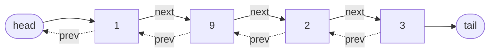
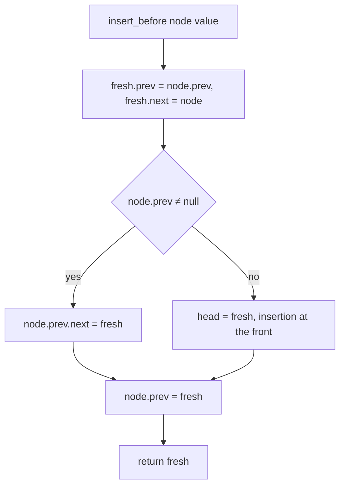
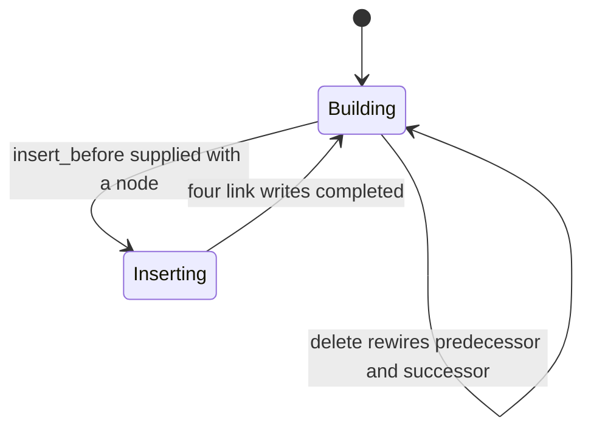
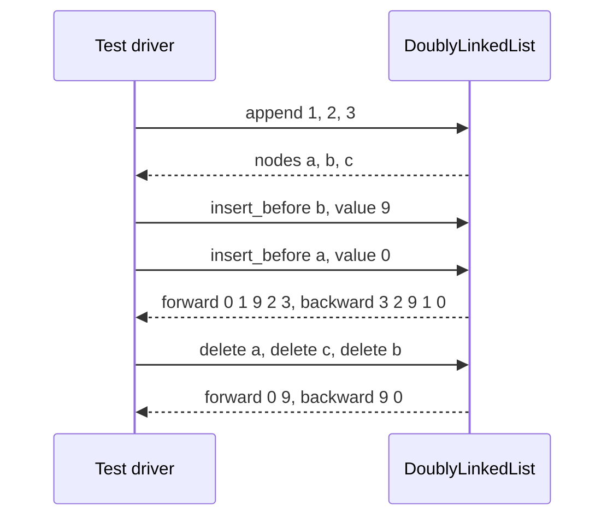

# 063 — Implement doubly linked list insert/delete.

> **Tier:** Beginner · **CTCI chapter:** Ch 2 — Linked Lists
> **Task spec:** [063-implement-doubly-linked-list-insert-delete.md](../../../tasks/beginner/063-implement-doubly-linked-list-insert-delete.md)
> **Solutions:** [Python](../../../solutions/python/beginner/063-implement-doubly-linked-list-insert-delete/solution.py) ·
> [Java](../../../solutions/java/beginner/063-implement-doubly-linked-list-insert-delete/Solution.java) ·
> [JavaScript](../../../solutions/javascript/beginner/063-implement-doubly-linked-list-insert-delete/solution.js) ·
> [C#](../../../solutions/csharp/beginner/063-implement-doubly-linked-list-insert-delete/Solution.cs)

## 1. Problem restatement

**Input:** a doubly linked list built by the operations themselves — `append(value)`,
`insert_before(node, value)`, `delete(node)` — plus two read-only walks, `to_list()` and
`to_list_reversed()`.

**Output:** a list whose nodes each carry both a `prev` and a `next` link, with a `head` and a `tail`
maintained by the container. Insert and delete operate on a **node reference** and must both run in
O(1).

The assertions build a list by appending, insert twice, delete three times, and check the forward *and*
backward walks after each stage:

| Operation | Forward result | Backward result |
| --- | --- | --- |
| `append(1)`, `append(2)`, `append(3)` | `[1, 2, 3]` | `[3, 2, 1]` |
| `insert_before(b, 9)` where `b` holds `2` | `[1, 9, 2, 3]` | — |
| `insert_before(a, 0)` where `a` is the head | `[0, 1, 9, 2, 3]` | `[3, 2, 9, 1, 0]` |
| `delete(a)` (head) | `[0, 9, 2, 3]` | — |
| `delete(c)` (tail) | `[0, 9, 2]` | — |
| `delete(b)` (middle node holding `2`) | `[0, 9]` | `[9, 0]` |

The labels the four files attach are "append", "reversed links", "insert before middle", "insert before
head", "reverse after inserts", "delete middle", "delete tail", "delete node" and "reverse after
deletes". The backward walks are the load-bearing assertions: a half-updated `prev` link passes every
forward check and fails the reversed one immediately.

## 2. Intuition

A singly linked list cannot delete a node given only that node, and cannot walk backwards at all. The
fix is one extra field per node: `prev`. With both links, a node knows its neighbourhood, and every
structural change becomes a constant-time rewiring of at most four links plus the container's
`head`/`tail` pointers.

The trade is stated by the amount of bookkeeping:

- **memory** grows by one reference per node;
- **every mutation touches two links** where the singly linked version touched one — which is why the
  operations here are written as two symmetric halves, one for the forward direction and one for the
  backward direction;
- **the container owns two boundary pointers**, `head` and `tail`, and every delete has to decide
  whether it is removing the first node, the last node, both (a one-node list), or neither.

The last point is the interesting one, and it is why the implementations are full of `if/else` pairs:
a node that is the head has no `prev` to relink, a node that is the tail has no `next`, and a node that
is both is the entire list. Handling those with pointer updates instead of special-cased branches is
what makes the code short.



The two invariants that must hold after every operation are worth writing down explicitly, because
every bug in this task is a violation of one of them:

- `head.prev` is null and `tail.next` is null — the ends of the list are open;
- for every interior node `p`, `p.prev.next` is `p` and `p.next.prev` is `p` — the links agree in both
  directions.

## 3. Algorithm

**Append (O(1) because the tail is stored):**

1. Create a node with null links.
2. If `tail` is null the list is empty: set `head = tail = node`.
3. Otherwise link the node after the current tail (`node.prev = tail`, `tail.next = node`) and move
   `tail` to the new node.
4. Return the new node, so the caller can later pass it to `insert_before` or `delete`.

**Insert before a node (O(1), no search — the caller supplies the node):**

1. Create a node.
2. Point it at the neighbourhood: `fresh.prev = node.prev`, `fresh.next = node`.
3. If `node.prev` exists, make it point forward at the new node; otherwise the insertion is at the
   front, so move `head` to the new node.
4. Make `node` point backward at the new node: `node.prev = fresh`.
5. Return the new node.

**Delete a node (O(1), the mirror image):**

1. If `node.prev` exists, point it at `node.next`; otherwise `node` was the head, so `head = node.next`.
2. If `node.next` exists, point it back at `node.prev`; otherwise `node` was the tail, so
   `tail = node.prev`.
3. Clear the removed node's own links (`node.prev = node.next = null`) so it no longer reaches into the
   list.

```text
procedure append(list, value)
    node ← new node with value, prev = null, next = null
    if list.tail = null then
        list.head ← node
        list.tail ← node
    else
        node.prev ← list.tail
        list.tail.next ← node
        list.tail ← node
    end
    return node
end

procedure insert_before(list, node, value)
    fresh ← new node with value, prev = node.prev, next = node
    if node.prev ≠ null then
        node.prev.next ← fresh
    else
        list.head ← fresh
    end
    node.prev ← fresh
    return fresh
end

procedure delete(list, node)
    if node.prev ≠ null then
        node.prev.next ← node.next
    else
        list.head ← node.next
    end
    if node.next ≠ null then
        node.next.prev ← node.prev
    else
        list.tail ← node.prev
    end
    node.prev ← null
    node.next ← null
end
```

Every one of the three procedures is a fixed number of assignments, which is the O(1) claim: no loop
appears anywhere, because the node reference supplies the position that a singly linked list would
have had to search for.



## 4. Worked example

Trace the assertion sequence. `a`, `b`, `c` hold the nodes created by the three appends, so the tests
can pass them straight to `insert_before` and `delete`.

| Step | Operation | type | links written | forward | backward |
| --- | --- | --- | --- | --- | --- |
| 1 | `append(1)` | empty list | `head = tail = a` | `[1]` | `[1]` |
| 2 | `append(2)` | normal | `a.next = b`, `b.prev = a`, `tail = b` | `[1, 2]` | `[2, 1]` |
| 3 | `append(3)` | normal | `b.next = c`, `c.prev = b`, `tail = c` | `[1, 2, 3]` | `[3, 2, 1]` |
| 4 | `insert_before(b, 9)` | middle | `9.prev = a`, `9.next = b`, `a.next = 9`, `b.prev = 9` | `[1, 9, 2, 3]` | — |
| 5 | `insert_before(a, 0)` | at head | `0.next = a`, `head = 0`, `a.prev = 0` | `[0, 1, 9, 2, 3]` | `[3, 2, 9, 1, 0]` |
| 6 | `delete(a)` | middle now | `0.next = 9`, `9.prev = 0`, `a` links cleared | `[0, 9, 2, 3]` | — |
| 7 | `delete(c)` | at tail | `b.next = null`, `tail = b`, `c` links cleared | `[0, 9, 2]` | — |
| 8 | `delete(b)` | at tail now | `9.next = null`, `tail = 9`, `b` links cleared | `[0, 9]` | `[9, 0]` |

Step 5 is the head case: `a.prev` is null, so the `if` takes its `else` branch and moves `head`
instead of rewiring a predecessor. Step 6 compiles to the same four writes as step 4, because node `a`
still has a `prev` (node `0` was just inserted in front of it). Step 7 shows the tail branch: `c.next`
is null, so `tail` moves instead of a successor being rewired. And step 8 shows a node that *was* the
tail only because the earlier delete removed its successor — `b`'s links were updated by that delete,
so the boundary checks keep working on the live structure rather than on stale state.





## 5. Complexity

Let `n` be the number of nodes. Every operation is given a node reference, so nothing here depends on
position.

| Measure | Bound | Why it holds |
| --- | --- | --- |
| append, best / average / worst | O(1) | four assignments at most; the tail pointer removes the search a singly linked list needs |
| insert_before | O(1) | four assignments; the node reference pins the position |
| delete | O(1) | four assignments plus two clears; no search for a predecessor |
| to_list | O(n) | walks the `next` links from the head |
| to_list_reversed | O(n) | walks the `prev` links from the tail — the assertion that validates the backward links |
| Space per node | O(1) | one extra reference compared with a singly linked list |
| Space, container | O(1) | the `head` and `tail` references |
| Singly linked delete, by value | O(n) | the predecessor must be searched for — see task 055 |

The whole structure is a memory-for-speed trade: one reference per node buys O(1) deletion and O(1)
insertion *given a node*, where the singly linked list pays O(n) for the search. It also makes
`to_list_reversed` possible, which the singly linked structure cannot offer at any cost.

## 6. Pitfalls and edge cases

- **The head and tail cases are not symmetric with the middle case.** A node with no `prev` forces
  `head` to move; a node with no `next` forces `tail` to move. Skipping either `else` branch leaves a
  container pointer aimed at a node that is no longer in the list.
- **A one-node list deletes from both ends at once.** Both boundary conditions fire, so `head` becomes
  `node.next` (null) and `tail` becomes `node.prev` (null) — the empty-list state, reached without any
  special case.
- **`insert_before` must set `node.prev = fresh` last.** The new node's own links are written first, so
  that the neighbours can be rewired using values that are still valid; updating `node.prev` before
  reading it would lose the old predecessor.
- **Clearing the deleted node's links.** `node.prev = node.next = null` detaches the node completely. A
  caller that kept the reference then sees a one-node list instead of a back door into the middle of
  the structure, and a re-insert of the same node cannot resurrect the old neighbourhood.
- **Deleting a node twice.** After the first delete the node's links are null, so the second call
  treats it as a boundary node and corrupts `head`/`tail`. The API assumes each node is deleted once,
  while it is still in the list.
- **Deleting a node that is not in the list.** Nothing validates membership, so the four writes
  silently splice a stranger into the structure. The singly linked delete-by-value version had the same
  exposure; here it is easier to hit because callers keep node references.
- **Append to an empty list is a boundary case too.** If `tail` is null, `node.prev = tail` would leave
  a null `prev` and `tail.next` would dereference null — hence the `head = tail = node` branch.
- **The backward walk is the real test.** Every assertion that includes a reversed read
  ("reversed links", "reverse after inserts", "reverse after deletes") is checking that the `prev`
  links were maintained, not just the `next` links.
- **An incomplete `insert_before` still passes forward reads.** Forgetting `node.prev = fresh` breaks
  only the backward walk, which is exactly why the test file checks both directions after inserts.
- **`node.prev` may be null inside `insert_before`.** The `else` branch must move `head`; if it does not,
  the new node is in the chain but nothing points at it from the outside.
- **Not thread-safe.** All three mutations touch several links without synchronisation; concurrent
  writers can interleave into an inconsistent structure.
- **Recursion is a poor fit here.** Unlike reversal, these operations are already O(1); adding call
  frames would only hurt.

## 7. Variants and follow-ups

- **Why the extra pointer exists.** [055-delete-node-by-value-in-singly-linked-list.md](../../../tasks/beginner/055-delete-node-by-value-in-singly-linked-list.md)
  searches for the predecessor that this structure stores; comparing the two shows what one reference
  per node buys.
- **The singly linked insertions.** [052-implement-simple-linkedlist-insert-at-head.md](../../../tasks/beginner/052-implement-simple-linkedlist-insert-at-head.md)
  and [053-implement-linkedlist-insert-at-tail.md](../../../tasks/beginner/053-implement-linkedlist-insert-at-tail.md)
  are the same insertions without the backward link — one of them O(n) precisely because no tail
  pointer is kept.
- **Reversal becomes trivial, removal becomes possible.** [061-reverse-singly-linked-list-iterative.md](../../../tasks/beginner/061-reverse-singly-linked-list-iterative.md)
  rewires every link; with two links per node a reverse is a swap of `head` and `tail`, which is the
  practical argument for this structure.
- **Where two-way traversal is required.** [160-implement-lru-cache-using-linked-list-hashmap.md](../../../tasks/beginner/160-implement-lru-cache-using-linked-list-hashmap.md)
  unlinks a node from the middle of a list and moves it to the front in O(1) — impossible without a
  `prev` link.
- **Tree-shaped versions.** [149-convert-binary-tree-to-linked-list-flatten.md](../../../tasks/beginner/149-convert-binary-tree-to-linked-list-flatten.md)
  and [242-convert-binary-tree-to-doubly-linked-list-inorder.md](../../../tasks/intermediate/242-convert-binary-tree-to-doubly-linked-list-inorder.md)
  build doubly linked chains out of a structure where each node already has two children.
- **Circular doubly linked lists.** [154-implement-a-basic-circular-linked-list.md](../../../tasks/beginner/154-implement-a-basic-circular-linked-list.md)
  removes the null ends that the boundary branches in this task depend on.
- The chapter walkthrough in [Linked Lists](../../ctci/02-linked-lists.md) introduces the doubly linked
  node as the structure that makes deletion O(1) without a predecessor search.

## 8. Check yourself

1. What does storing `prev` in every node buy, and what does it cost?

<details><summary>Show answer</summary>

It buys O(1) deletion given a node (no predecessor search), O(1) insertion relative to a node, and
traversal in both directions. It costs one extra reference per node, and every mutation must update the
backward links as well as the forward ones — which is why each operation here writes two or four links
instead of one or two.

</details>

2. In the trace, `delete(a)` behaves like a middle deletion, yet `a` was the head at step 3. Why?

<details><summary>Show answer</summary>

Because step 5 inserted node `0` in front of `a`, so by step 6 `a.prev` is node `0` and `a` is no
longer the head. The delete code needs no knowledge of that history: it looks only at the node's
current neighbours, which is the point of storing them.

</details>

3. What does `delete` do when the list contains exactly one node?

<details><summary>Show answer</summary>

Both boundary branches fire: with `node.prev` null, `head = node.next` (null); with `node.next` null,
`tail = node.prev` (null). The list is empty afterwards, the node's own links are cleared, and no
special case was needed beyond the two `if/else` pairs.

</details>

4. Why does the test file call `to_list_reversed` after the inserts and after the deletes?

<details><summary>Show answer</summary>

Because the forward walk only proves the `next` links are right. The reversed walk reads `prev` from the
tail, so it is the only assertion that catches an insert or delete that updated one direction and
forgot the other — the single most common bug in doubly linked code.

</details>

5. Why is `append` O(1) here when the same operation on the singly linked list of task 053 was O(n)?

<details><summary>Show answer</summary>

Because the container keeps a `tail` reference. Task 053 takes only a `head` and has nowhere to store
the last node, so it has to walk to it; here the last node is one field away, and the append is a fixed
number of assignments regardless of list length.

</details>
