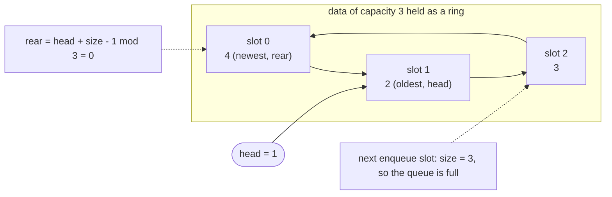
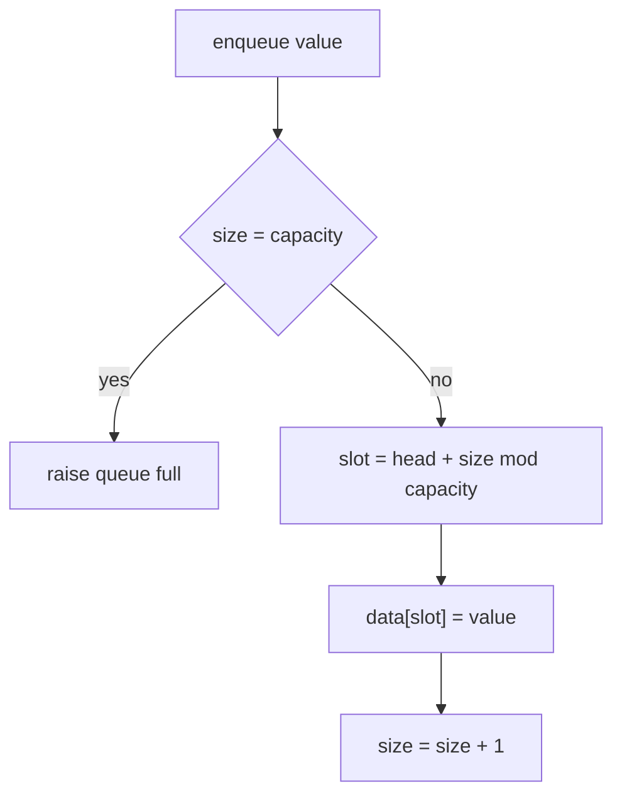
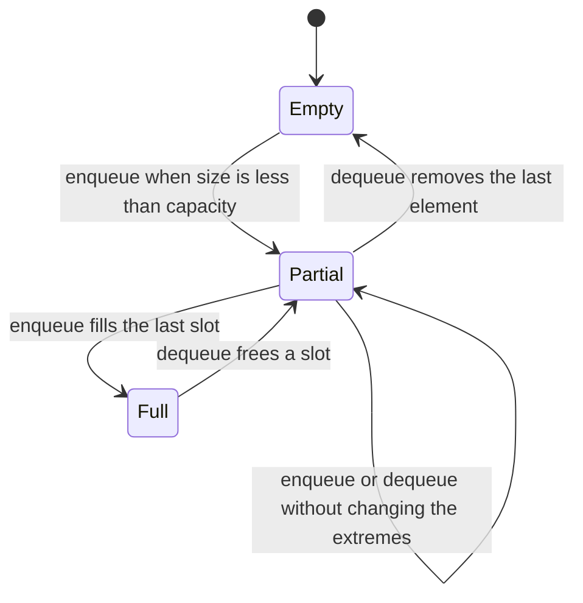
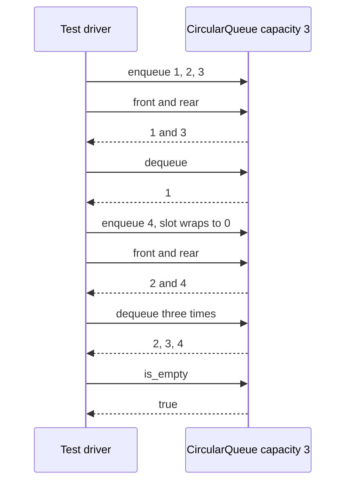

# 064 — Implement circular queue (ring buffer).

> **Tier:** Beginner · **CTCI chapter:** Ch 3 — Stacks and Queues
> **Task spec:** [064-implement-circular-queue-ring-buffer.md](../../../tasks/beginner/064-implement-circular-queue-ring-buffer.md)
> **Solutions:** [Python](../../../solutions/python/beginner/064-implement-circular-queue-ring-buffer/solution.py) ·
> [Java](../../../solutions/java/beginner/064-implement-circular-queue-ring-buffer/Solution.java) ·
> [JavaScript](../../../solutions/javascript/beginner/064-implement-circular-queue-ring-buffer/solution.js) ·
> [C#](../../../solutions/csharp/beginner/064-implement-circular-queue-ring-buffer/Solution.cs)

## 1. Problem restatement

**Input:** an integer `capacity`, then a stream of operations — `enqueue(value)`, `dequeue()`,
`front()`, `rear()`, `is_empty()`, `is_full()`, `size()`.

**Output:** a first-in-first-out container over a fixed ring of `capacity` slots, with all operations
in O(1) and no shifting. This is the production-shaped version of
[050-implement-queue-with-array-enqueue-dequeue.md](../../../tasks/beginner/050-implement-queue-with-array-enqueue-dequeue.md):
it validates the capacity, exposes a full predicate, adds a `rear` view, and clears the slot it
dequeues from.

| Call (capacity 3) | Result | Why |
| --- | --- | --- |
| constructor with `capacity ≤ 0` | error `"capacity must be positive"` | a ring of zero slots cannot hold anything and would divide by zero |
| `is_empty()` and `is_full()` on a fresh queue | `true`, `false` | `size` is 0 out of 3 |
| `enqueue(1)`, `enqueue(2)`, `enqueue(3)` | — | fills slots 0, 1, 2 |
| `is_full()`, `size()` | `true`, `3` | the ring is exactly full |
| `front()`, `rear()` | `1`, `3` | oldest and newest elements |
| `dequeue()` | `1` | FIFO; slot 0 is cleared |
| `enqueue(4)` | — | wraps to slot 0: `(head + size) mod 3` |
| `front()`, `rear()` | `2`, `4` | the wrapped element is the newest |
| three `dequeue()` calls | `2`, `3`, `4` | the queue drains in order |
| `is_empty()` | `true` | `size` is back to 0 |

Two details differ from the earlier queue task. The capacity check happens **in the constructor** with
"capacity must be positive" (a `ValueError` in Python, `IllegalArgumentException` in Java,
`ArgumentException` in C#, plain `Error` in JavaScript), so the modulo can never divide by zero. And
`dequeue` writes `null` into the slot it vacates, so the array does not keep a reference to a value that
has left the queue.

## 2. Intuition

The naive queue removes from the front of an array and shifts everything else down, which costs O(n)
per dequeue for a structure whose whole job is to append at one end and remove from the other. The
intermediate fix — advance a `head` index without shifting — works until the head reaches the end of
the array, at which point the queue appears full while most slots are dead.

The insight is to treat the array as a **ring**: every index is taken modulo the capacity, so position
`capacity` is position `0` again. Two numbers then describe the entire queue:

- `head` is the slot holding the oldest element;
- `size` is how many live elements there are.

Everything else is derived from those two, which is the part worth memorising:

| Quantity | Formula | Note |
| --- | --- | --- |
| front element | `data[head]` | the oldest |
| rear element | `data[(head + size - 1) mod capacity]` | the newest |
| next enqueue slot | `(head + size) mod capacity` | first free slot after the back |
| empty | `size = 0` | a predicate, not a state of `head` |
| full | `size = capacity` | every slot live; no wasted slot |

Deriving the rear as a formula rather than storing a `tail` index is what keeps full and empty
unambiguous: a stored `head`/`tail` pair cannot distinguish "queue empty" from "queue full" without
sacrificing a slot, while a count distinguishes them exactly and uses the whole array.



The picture is the state after `enqueue 1, 2, 3`, `dequeue`, `enqueue 4`: `head = 1`, `size = 3`, and the
elements in logical order are `2, 3, 4` while the physical order is `4, 2, 3`. Logical order is
`(head + i) mod capacity` for `i = 0 .. size - 1` — the single formula behind every method.

## 3. Algorithm

1. **Construct.** Reject `capacity ≤ 0` with an error; allocate `capacity` slots; set `head = 0`,
   `size = 0`.
2. **Enqueue.** If `is_full()` (i.e. `size = capacity`) raise "queue full". Otherwise write at
   `slot = (head + size) mod capacity`, then increment `size`.
3. **Dequeue.** If `is_empty()` raise "queue empty". Otherwise read `data[head]`, clear that slot to
   `null`, advance `head = (head + 1) mod capacity`, decrement `size`, and return the value read.
4. **Front.** If empty, raise; otherwise return `data[head]`.
5. **Rear.** If empty, raise; otherwise return `data[(head + size - 1) mod capacity]`.
6. **Predicates.** `is_empty` is `size = 0`; `is_full` is `size = capacity`; `size` returns `size`.

```text
procedure make_queue(capacity)
    if capacity ≤ 0 then
        raise "capacity must be positive"
    end
    queue.data ← new array of capacity slots filled with null
    queue.head ← 0
    queue.size ← 0
end

procedure enqueue(queue, value)
    if queue.size = length(queue.data) then
        raise "queue full"
    end
    slot ← (queue.head + queue.size) mod length(queue.data)
    queue.data[slot] ← value
    queue.size ← queue.size + 1
end

procedure dequeue(queue)
    if queue.size = 0 then
        raise "queue empty"
    end
    value ← queue.data[queue.head]
    queue.data[queue.head] ← null
    queue.head ← (queue.head + 1) mod length(queue.data)
    queue.size ← queue.size - 1
    return value
end

function front(queue)
    if queue.size = 0 then
        raise "queue empty"
    end
    return queue.data[queue.head]
end

function rear(queue)
    if queue.size = 0 then
        raise "queue empty"
    end
    return queue.data[(queue.head + queue.size - 1) mod length(queue.data)]
end
```

The slots are nullable in all four languages — `[None] * capacity` in Python, `Integer[]` in Java,
`new Array(capacity).fill(null)` in JavaScript, `int?[]` in C# — because `dequeue` stores `null` to
release the payload. The JavaScript and C# fields call the count `count` instead of `size`; Java's
`front`/`rear` read `data[head]` before any boxing issues arise because the guard ran first.



The dequeue path is the mirror image and is worth reading as a checklist: guard on `size = 0`, read
`data[head]`, clear that slot, advance `head` with the modulo, decrement `size`, return the value that
was read. The one step with no counterpart in `enqueue` is the clearing, which is what keeps the array
from retaining payloads that have left the queue.

## 4. Worked example

Trace the full assertion sequence on a capacity-3 ring. The `data` column is physical slot order;
`head` and `size` are shown after the operation.

| Step | Operation | `head` | `size` | `data` after | `front` | `rear` | returned |
| --- | --- | --- | --- | --- | --- | --- | --- |
| 0 | construct | `0` | `0` | `[_, _, _]` | error | error | — |
| 1 | `enqueue(1)` | `0` | `1` | `[1, _, _]` | `1` | `1` | — |
| 2 | `enqueue(2)` | `0` | `2` | `[1, 2, _]` | `1` | `2` | — |
| 3 | `enqueue(3)` | `0` | `3` | `[1, 2, 3]` | `1` | `3` | — |
| 4 | `front()`, `rear()` | `0` | `3` | `[1, 2, 3]` | `1` | `3` | `1`, `3` |
| 5 | `dequeue()` | `1` | `2` | `[_, 2, 3]` | `2` | `3` | `1` |
| 6 | `enqueue(4)` | `1` | `3` | `[4, 2, 3]` | `2` | `4` | — |
| 7 | `dequeue()` | `2` | `2` | `[4, _, 3]` | `3` | `4` | `2` |
| 8 | `dequeue()` | `0` | `1` | `[4, _, _]` | `4` | `4` | `3` |
| 9 | `dequeue()` | `1` | `0` | `[_, _, _]` | error | error | `4` |
| 10 | `is_empty()` | `1` | `0` | `[_, _, _]` | error | error | `true` |

Step 5 and step 6 are the pair that makes the ring work. After the dequeue, `head` moves to slot 1 and
slot 0 becomes a hole in the *middle* of the physical array — and `enqueue(4)` fills precisely that
hole, because `(1 + 2) mod 3 = 0`. Steps 7 to 9 then walk `head` through 2, 0 and 1, draining the queue
while the physical slots stay in place. Step 9 also shows the slot clearing: after the final dequeue the
array holds no references at all, so nothing is retained behind `head = 1`.





## 5. Complexity

Let `n` be the capacity.

| Measure | Bound | Why it holds |
| --- | --- | --- |
| constructor, best / average / worst | O(n) | the slots are allocated and null-filled once; the capacity check is O(1) |
| enqueue, best / average / worst | O(1) | one comparison, one modulo, one write — the full case is rejected in the same comparison |
| dequeue, best / average / worst | O(1) | one read, one clear, one modulo, one decrement |
| front | O(1) | `data[head]` plus an emptiness check |
| rear | O(1) | the index formula `(head + size - 1) mod capacity` |
| is_empty / is_full / size | O(1) | comparisons or a field read on `size` |
| Space | O(capacity) | the ring is allocated up front and never resized |
| Shift-on-dequeue alternative | O(n) per dequeue | moving every remaining element one slot towards the front |
| Task 050's version | O(1) per operation | same ring, without the capacity check, `rear`, or slot clearing |

Nothing in the operations depends on how many elements are live beyond the two predicates, so worst
case equals best case for every method except the constructor. The fixed allocation is the deliberate
trade: an empty queue of capacity 1000 owns 1000 slots, in exchange for never allocating during
enqueue — which is what makes ring buffers the standard structure for producer/consumer streams.

## 6. Pitfalls and edge cases

- **The capacity must be positive and is checked once.** `capacity = 0` would make every modulo a
  division by zero, and a negative capacity cannot allocate; the constructor rejects both before any
  other state exists.
- **Full and empty share the same `head`.** Only `size` tells them apart. Testing `head` against a
  computed tail reintroduces the ambiguity that a count removes.
- **`rear` needs its own guard.** With `size = 0` the formula `(head + size - 1) mod capacity` yields
  `(head - 1) mod capacity`, which in Python wraps to the last slot instead of failing — so `rear`
  must raise "queue empty" before computing anything, exactly as `front` does.
- **Every index goes through the modulo.** `head + size` for the next enqueue and `head + 1` after a
  dequeue both have to be reduced; a raw index reaches `capacity` and writes out of bounds, which is
  what step 6 of the trace exercises.
- **The hole in the middle is intentional.** After a dequeue the physical array is not sorted by age;
  logical order comes from the formulas in section 2, never from scanning the array.
- **Slots are cleared on dequeue.** `data[head] = null` releases the payload, which matters for large
  objects; the Python and Java files therefore use nullable slot types. The sibling task 050 does not
  clear, so its array keeps dead references.
- **JavaScript needs the fill.** `new Array(capacity)` creates holes rather than `null` slots, so the
  file uses `new Array(capacity).fill(null)`; reading an untouched slot otherwise yields `undefined`.
- **Error types are language-specific** — `ValueError`/`OverflowError`/`IndexError` in Python,
  `IllegalArgumentException`/`IllegalStateException` in Java, `ArgumentException`/
  `InvalidOperationException` in C#, plain `Error` in JavaScript — with the message text
  "capacity must be positive", "queue full" and "queue empty".
- **The queue never grows.** A full ring raises instead of resizing; a growable variant has to
  re-linearise the ring when it copies, which is why growth is usually left to the caller.
- **Not thread-safe.** `enqueue` and `dequeue` each write two fields; a concurrent producer and
  consumer can interleave into an inconsistent state. The lock-free design is
  [492-implement-circular-buffer-with-lock-free-design-atomic.md](../../../tasks/advanced/492-implement-circular-buffer-with-lock-free-design-atomic.md).
- **`size` is authoritative.** `is_empty`, `is_full` and the accessor all read it, so there is no way
  for the three to disagree — unlike the sink in task 049, which derives its count from a top index.

## 7. Variants and follow-ups

- **The minimal ring.** [050-implement-queue-with-array-enqueue-dequeue.md](../../../tasks/beginner/050-implement-queue-with-array-enqueue-dequeue.md)
  implements the same structure with the same `head`/`size` pair but without the capacity validation,
  the `rear` view or the slot clearing; diffing the two files shows exactly what the extra robustness
  costs.
- **The other single-ended container.** [049-implement-stack-with-array-push-pop.md](../../../tasks/beginner/049-implement-stack-with-array-push-pop.md)
  needs one index because it only ever touches one end.
- **Deque variants.** [092-max-over-sliding-window-using-deque.md](../../../tasks/beginner/092-max-over-sliding-window-using-deque.md)
  and [208-implement-sliding-window-minimum-using-deque.md](../../../tasks/intermediate/208-implement-sliding-window-minimum-using-deque.md)
  keep the ring but allow removal from both ends, which is what a sliding-window maximum needs.
- **Bounded concurrent streams.** [621-implement-scalable-concurrent-queue-michael-scott-queue.md](../../../tasks/expert/621-implement-scalable-concurrent-queue-michael-scott-queue.md)
  is the linked-node answer to the same interface, and
  [492-implement-circular-buffer-with-lock-free-design-atomic.md](../../../tasks/advanced/492-implement-circular-buffer-with-lock-free-design-atomic.md)
  is the atomic version of this ring.
- **Augmenting the contents.** [173-implement-queue-that-supports-getmin-in-o-1.md](../../../tasks/beginner/173-implement-queue-that-supports-getmin-in-o-1.md)
  keeps the FIFO contract and answers `getMin` in O(1) — the same augmentation idea as the stack in
  [172-implement-stack-that-supports-getmin-in-o-1.md](../../../tasks/beginner/172-implement-stack-that-supports-getmin-in-o-1.md).
- **Priority instead of arrival order.** [065-implement-priority-queue-using-built-in-heap.md](../../../tasks/beginner/065-implement-priority-queue-using-built-in-heap.md)
  replaces the ring with a heap, trading O(1) enqueue for O(log n).
- The chapter walkthrough in [Stacks and Queues](../../ctci/03-stacks-and-queues.md) compares the ring
  buffer with the array stack and the queue-via-two-stacks construction.

## 8. Check yourself

1. Why does this queue store `head` and `size` instead of `head` and `tail`?

<details><summary>Show answer</summary>

Because `head = tail` cannot distinguish a full queue from an empty one; the classic workaround leaves
one slot unused. A count makes the two states explicit (`size = 0`, `size = capacity`) and uses every
slot. The `tail` position is still available whenever it is needed, as the formula
`(head + size - 1) mod capacity` that `rear` uses.

</details>

2. In the trace, after step 5 the array reads `[_, 2, 3]` with `head = 1`. How does `enqueue(4)` know
   to write into slot 0?

<details><summary>Show answer</summary>

It computes `(head + size) mod capacity = (1 + 2) mod 3 = 0`. The head declares where the queue starts
and the size declares how long it is, so the first free slot after the back is derived rather than
stored — which is exactly why the slot 0 hole is usable.

</details>

3. Why does `dequeue` write `null` into the slot before advancing `head`?

<details><summary>Show answer</summary>

To release the payload. Without it the array keeps a reference to every value that has ever passed
through the queue, which for large objects is a memory leak in all four languages. The order matters
only in that the value must be read first, since `data[head]` is overwritten immediately afterwards.

</details>

4. What happens if the constructor is called with `capacity = 0`, and what would break without the
   check?

<details><summary>Show answer</summary>

The constructor raises "capacity must be positive", so no instance exists. Without the check the ring
would have zero slots and every `enqueue`, `dequeue` and `rear` would evaluate a modulo by zero — a
`ZeroDivisionError` in Python, an `ArithmeticException` in Java, `NaN`-indexed access in JavaScript and
a `DivideByZeroException` in C#.

</details>

5. How do you compute the slot of the element at logical position `i` (0-based) for a ring with the
   given `head` and `size`, and which slots are live?

<details><summary>Show answer</summary>

Slot `(head + i) mod capacity` for `i` from `0` to `size - 1`; those are the live slots, and the rest
are holes left by earlier dequeues. `front` is `i = 0`, `rear` is `i = size - 1` — the two special
cases of the same formula.

</details>
