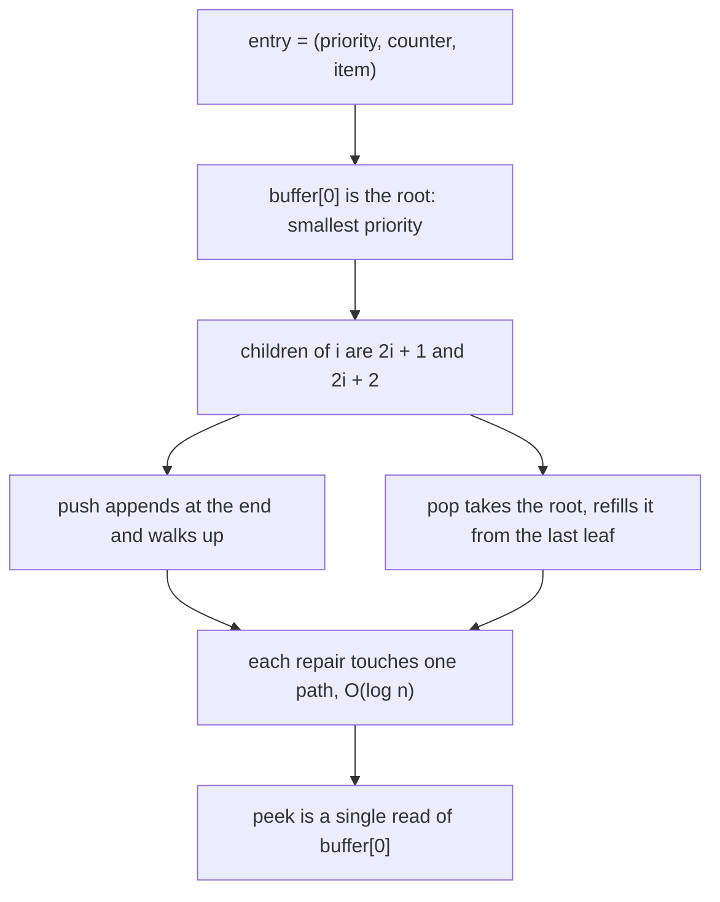
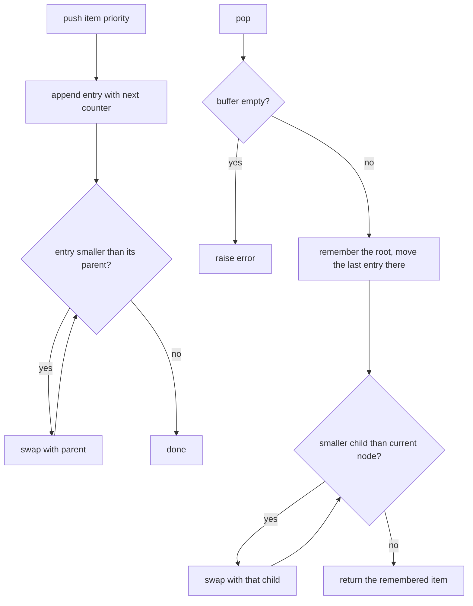
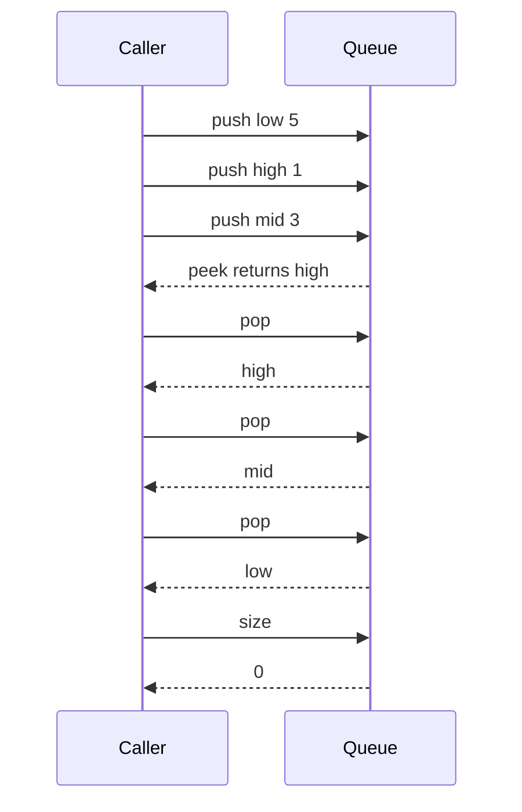

# 065 — Implement priority queue using built-in heap.

> **Tier:** Beginner · **CTCI chapter:** Ch 3 — Stacks and Queues
> **Task spec:** [065-implement-priority-queue-using-built-in-heap.md](../../../tasks/beginner/065-implement-priority-queue-using-built-in-heap.md)
> **Solutions:** [Python](../../../solutions/python/beginner/065-implement-priority-queue-using-built-in-heap/solution.py) ·
> [Java](../../../solutions/java/beginner/065-implement-priority-queue-using-built-in-heap/Solution.java) ·
> [JavaScript](../../../solutions/javascript/beginner/065-implement-priority-queue-using-built-in-heap/solution.js) ·
> [C#](../../../solutions/csharp/beginner/065-implement-priority-queue-using-built-in-heap/Solution.cs)

## 1. Problem restatement

**Input.** A stream of `push(item, priority)` calls, where `item` is any payload and `priority` is
an integer in which **smaller means more urgent**.

**Output.** `pop()` removes and returns the item whose priority is smallest; `peek()` returns that
item without removing it; `len` / `size` reports how many entries are waiting. Pushes and pops may
interleave freely.

The task spec is a single line, so the real contract is fixed by the assertions the four solution
files ship with:

| Call sequence | Result | Why |
| --- | --- | --- |
| `push("low", 5)`, `push("high", 1)`, `push("mid", 3)`, `peek()` | `"high"` | priority `1` is the smallest key |
| then `pop()`, `pop()`, `pop()` | `"high"`, `"mid"`, `"low"` | entries drain in ascending priority |
| `len(pq)` / `size()` after the third pop | `0` | every entry was returned exactly once |
| JavaScript max mode: `new PriorityQueue((a, b) => b - a)`, `push("a", 2)`, `push("b", 9)`, `pop()` | `"b"` | the comparator reverses the order |
| C# max mode: `Enqueue("a", -2)`, `Enqueue("b", -9)`, `Dequeue()` | `"b"` | `-9` is the smallest stored key |
| `pop()` on an empty queue | an error | Python `IndexError`, Java `NoSuchElementException`, JavaScript `Error` |

Two flavours of "built-in heap" appear in the solutions. Python's `heapq`, Java's
`java.util.PriorityQueue` and .NET's `PriorityQueue<TElement, TPriority>` are library heaps;
JavaScript has none, so its file ships the minimal array-backed binary heap that the other three
languages get for free.

## 2. Intuition

Keep the queue as a plain list and the two operations pull in opposite directions:

- **scan for the minimum on pop** — `push` is `O(1)`, but every `pop` costs a full scan, `O(n)`.
- **keep the list sorted** — `peek`/`pop` are `O(1)` at the front, but `push` has to insert into the
  middle and shift the tail, `O(n)`.

A priority queue wants `O(log n)` on *both* sides, and the data structure that buys it is a binary
heap. The key insight is that a total order is more than the problem needs. A heap only maintains a
**partial** order — the root is the smallest entry, and every node is at least as small as its
children — and that weaker invariant is exactly strong enough to name the next item to pop, while
being cheap to repair: one path per operation.

The second half of the insight is that a heap needs no pointers. Lay the tree level by level in an
array and the shape becomes arithmetic: the children of index `i` are `2i + 1` and `2i + 2`, and its
parent is `(i - 1) / 2` rounded down. A complete tree of `n` nodes has height `log n`, so both
repairs touch at most that many nodes, and the array never has holes.



The `counter` in the entry tuple is not decoration. When two priorities are equal, comparing whole
entries would fall through to the items themselves, which may not be comparable at all; the counter
makes every key distinct and simultaneously gives **FIFO order among equal priorities**.

## 3. Algorithm

1. Keep one buffer of entries plus a monotonically increasing `counter`.
2. `push(item, priority)`: append the triple `(priority, counter, item)`, advance the counter, then
   walk up from the last index, swapping with the parent while the new entry is smaller.
3. `pop()`: if the buffer is empty, raise; otherwise remember the root, move the last entry into the
   root slot, shrink the buffer, walk down from index `0` swapping with the smaller child, and
   return the remembered item.
4. `peek()`: raise if empty, otherwise return the root's item — no repair needed, the invariant
   already guarantees the root is the minimum.
5. `size()` / `len`: report the buffer length.

```text
procedure push(item, priority)
    append (priority, counter, item) to buffer
    counter ← counter + 1
    walk_up(buffer, last index)
end

procedure walk_up(buffer, i)
    while i > 0 do
        parent ← (i - 1) / 2
        if buffer[i] is not less than buffer[parent] then
            break
        end
        swap buffer[i] with buffer[parent]
        i ← parent
    end
end

procedure pop
    if buffer is empty then
        raise empty queue error
    end
    root ← buffer[0]
    last ← remove the final entry of buffer
    if buffer is not empty then
        buffer[0] ← last
        walk_down(buffer, 0)
    end
    return item from root
end

procedure walk_down(buffer, i)
    while true do
        smallest ← i
        for each child index c of i do
            if c is inside buffer and buffer[c] is less than buffer[smallest] then
                smallest ← c
            end
        end
        if smallest = i then
            break
        end
        swap buffer[i] with buffer[smallest]
        i ← smallest
    end
end
```

`pop` is careful about the one-element case: after removing the last entry the buffer may be empty,
and writing index `0` then would be out of bounds in a fixed-capacity array (the Java file stores
`data[0] = data[--size]` inside the array, so it stays safe; the other three check the length
first).



The mirror image of that loop is what makes the first diagram's promise true: `push` costs one walk
upward, `pop` one walk downward, and each walk is bounded by the tree height `log n`.

## 4. Worked example

Push `("low", 5)`, `("high", 1)`, `("mid", 3)` in that order, then drain. The counter starts at `0`,
so the entries are `(5, 0, "low")`, `(1, 1, "high")`, `(3, 2, "mid")`.

| Step | Operation | Buffer after the repair | Returned |
| --- | --- | --- | --- |
| start | — | `[]` | — |
| 1 | `push("low", 5)` | `[(5, 0, "low")]` | — |
| 2 | `push("high", 1)` | append → `[(5,0,low), (1,1,high)]`, `1 < 5` so swap → `[(1,1,high), (5,0,low)]` | — |
| 3 | `push("mid", 3)` | `[(1,1,high), (5,0,low), (3,2,mid)]`, parent is `(1,…)`, no swap | — |
| 4 | `peek()` | unchanged | `"high"` |
| 5 | `pop()` | root taken, `(3,2,mid)` moves to index `0`, child `(5,0,low)` is not smaller → `[(3,2,mid), (5,0,low)]` | `"high"` |
| 6 | `pop()` | root taken, `(5,0,low)` moves to index `0`, no children left → `[(5,0,low)]` | `"mid"` |
| 7 | `pop()` | last entry is the root itself, buffer becomes `[]` | `"low"` |
| 8 | `size()` | `0` | `0` |

Note step 5: the *only* candidate to be moved down is inspected and rejected, because the entry that
arrives at the root (`(3,2,mid)`) is already smaller than the sole child. That is the whole point of
the partial order — the heap offers no promise about `(5,0,low)` beyond "not smaller than its
parent", and that is all `pop` needs.

The same sequence as a message trace, which is the order the assertions in the solution files check:



## 5. Complexity

Let `n` be the number of entries currently in the queue.

| Measure | Bound | Why it holds |
| --- | --- | --- |
| `push` | `O(log n)` | the append is `O(1)` amortized; the walk up visits one node per level |
| `pop` | `O(log n)` | the root removal is `O(1)`; the walk down visits one node per level |
| `peek` | `O(1)` | a single array read of the root |
| `size` | `O(1)` | the buffer length is stored |
| Space | `O(n)` | the array *is* the structure; one entry per item, no pointers |
| Compare two entries | `O(1)` | priority first, then the counter; the payload is never compared |
| Alternative: sorted list | `push` `O(n)`, `pop` `O(1)` | inserting into the middle shifts the tail |
| Alternative: min scan | `push` `O(1)`, `pop` `O(n)` | a full scan per removal |

The build cost is worth knowing even though this task never needs it: turning an existing array of
`n` values into a heap bottom-up takes `O(n)`, which is cheaper than `n` separate pushes. Task 068
relies on exactly that — its Python file marks the build phase `# build max-heap: O(n)`. Here the
entries arrive one at a time, so `n` pushes at `O(log n)` each is the honest bound for filling an
empty queue.

## 6. Pitfalls and edge cases

- **Empty `pop`/`peek`.** All four implementations raise rather than returning a sentinel: the
  Python, Java and JavaScript wrappers raise `IndexError`, `NoSuchElementException` and `Error`;
  the C# file delegates to .NET, whose `Dequeue`/`Peek` throw `InvalidOperationException`. Do not
  "fix" this by returning `null` — the item type may legitimately be `null`.
- **Python's `heapq` is min-only.** There is no max-heap module function. The Python file documents
  the standard workaround in its module docstring — negate the priority on the way in and on the way
  out — and the C# file demonstrates it literally with `Enqueue("a", -2)` and `Enqueue("b", -9)`.
- **The negation overflows for the extreme key.** `-Integer.MIN_VALUE` is not representable in
  fixed-width integers, so a max-queue built by negation misbehaves on the most negative priority.
- **Ties.** Equal priorities must produce a *total* order, otherwise the heap comparison reaches the
  payload. The `counter` fixes both problems at once and makes equal priorities drain in push order.
- **JavaScript has no built-in heap.** That file reimplements `push`, `pop`, `peek`, `siftUp` and
  `siftDown` with a pluggable comparator, which is the honest answer in an interview — and it is why
  its assertions exercise the max comparator too.
- **No `decrease-key`, no update.** Inserting a new priority for an item already in the queue leaves
  the old entry in place; the structure only knows how to push and pop.
- **Array capacity.** The Java file grows the storage when full; the other three rely on a growable
  list. Nothing in the contract states a maximum size.

## 7. Variants and follow-ups

- **Write the heap yourself.** [066-implement-min-heap-push-pop.md](../../../tasks/beginner/066-implement-min-heap-push-pop.md)
  and [067-implement-max-heap-push-pop.md](../../../tasks/beginner/067-implement-max-heap-push-pop.md)
  implement the two sifts explicitly; the JavaScript file of this task is essentially the same code.
- **Sort with the same primitives.** [068-heapsort-using-heap-operations.md](../../../tasks/beginner/068-heapsort-using-heap-operations.md)
  reuses sift-down in place and gets `O(1)` extra space.
- **Plain FIFO instead of priority.** [050-implement-queue-with-array-enqueue-dequeue.md](../../../tasks/beginner/050-implement-queue-with-array-enqueue-dequeue.md)
  and the ring-buffer variant
  [064-implement-circular-queue-ring-buffer.md](../../../tasks/beginner/064-implement-circular-queue-ring-buffer.md)
  trade the ordering for `O(1)` on both ends.
- **Other "give me the extreme" structures.** A monotonic deque answers "maximum of a sliding window"
  in `O(1)` amortized — see
  [092-max-over-sliding-window-using-deque.md](../../../tasks/beginner/092-max-over-sliding-window-using-deque.md).
- **Decrease-key.** The usual interview follow-up (Dijkstra, scheduler with priority bumps). With no
  library support the standard answer is lazy deletion: push the updated entry and discard stale
  entries by comparing a version stamp on pop.
- The chapter walkthrough in [Stacks and Queues](../../ctci/03-stacks-and-queues.md) puts this queue
  next to stacks and ring buffers as the three Ch 3 containers.

## 8. Check yourself

1. Why does the buffer never compare the payload items?

<details><summary>Show answer</summary>

Because the comparison is exhausted by `(priority, counter)`. The counter is unique per entry, so two
keys are never equal in both fields and the comparison never falls through to the item. That is also
why a queue can hold items with no ordering at all — strings, objects, mixed types.

</details>

2. What is the difference between `push` on an empty queue and `pop` on an empty queue?

<details><summary>Show answer</summary>

`push` always succeeds: it appends the entry and the walk up stops immediately because index `0` has
no parent. `pop` cannot succeed — there is no minimum to return — so every implementation raises.

</details>

3. The C# file stores `-2` and `-9` to build a max-queue. What does `Dequeue()` return, and why?

<details><summary>Show answer</summary>

`"b"`. The library queue is a min-heap, so it returns the entry with the smallest stored key; `-9`
is smaller than `-2`, and `-9` is the negation of the larger priority `9`. The English priority
ordering survives the sign flip only because the whole queue is negated consistently.

</details>

4. Where exactly does the `log n` come from in `push`?

<details><summary>Show answer</summary>

From the height of the tree, not from the array length. The walk starts at the last leaf and moves to
its parent, grandparent, and so on up to the root; a complete binary tree with `n` nodes has height
`log n`, so at most that many swaps happen. Every level costs one comparison and, at worst, one swap.

</details>

5. Suppose two entries have priority `3` and the second was pushed first. Which one pops first?

<details><summary>Show answer</summary>

The one pushed first. The counter is part of the key, so the earlier entry has the smaller counter and
is therefore the smaller entry. That is the FIFO tie-break; without the counter the order would be
whatever the heap shape happened to produce, and the comparison might not even be defined.

</details>
