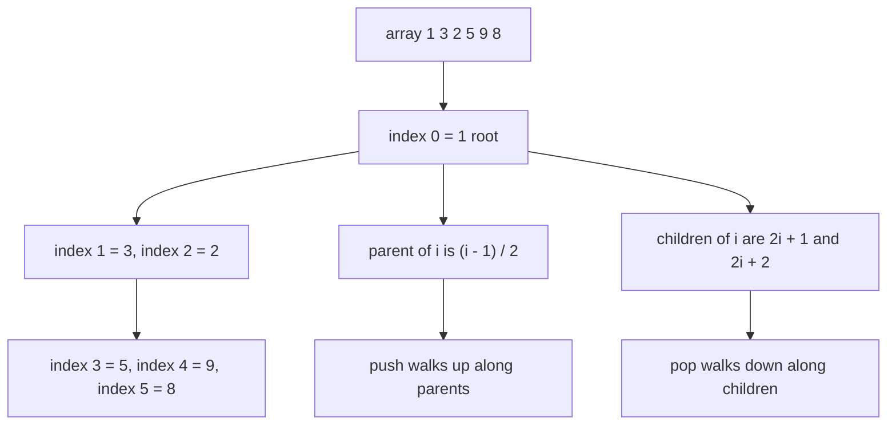
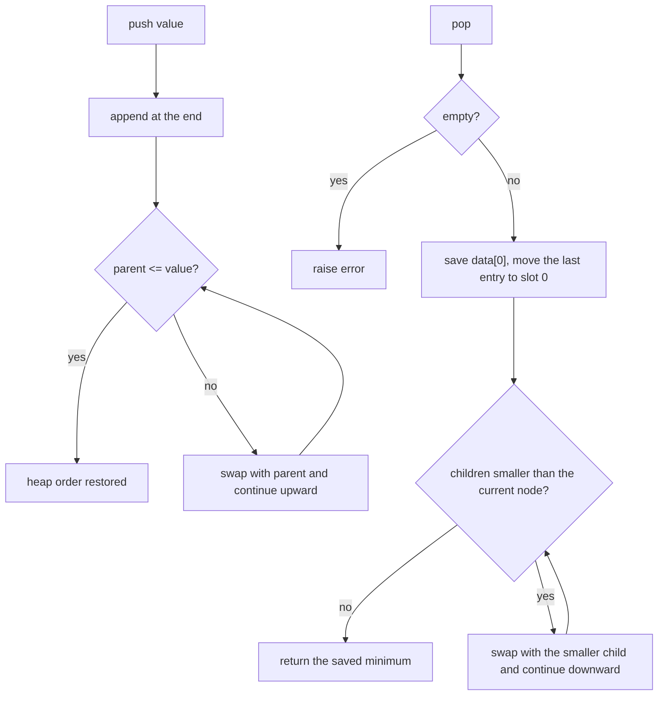
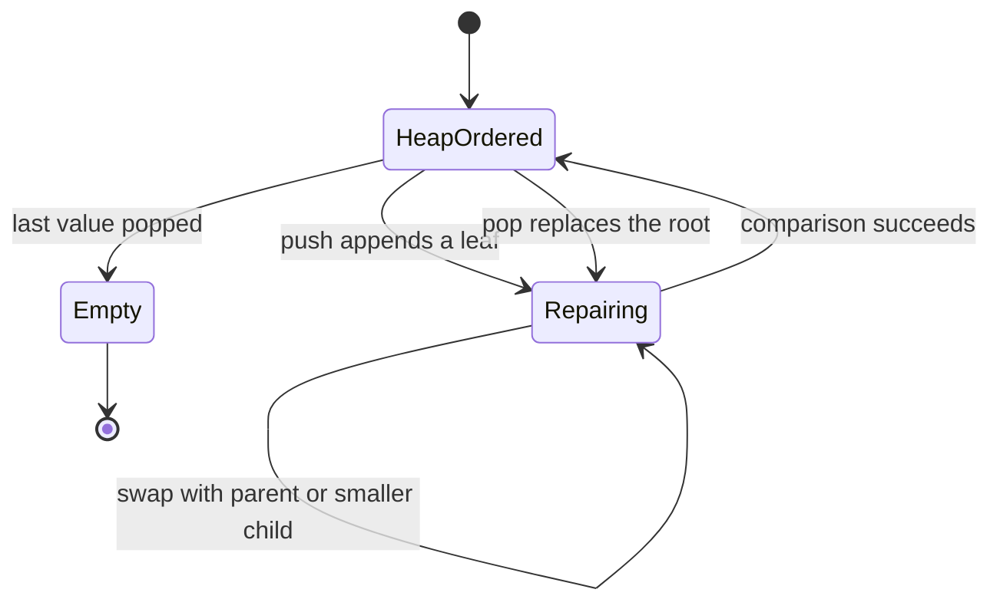

# 066 — Implement min-heap push/pop.

> **Tier:** Beginner · **CTCI chapter:** Ch 4 — Trees and Graphs
> **Task spec:** [066-implement-min-heap-push-pop.md](../../../tasks/beginner/066-implement-min-heap-push-pop.md)
> **Solutions:** [Python](../../../solutions/python/beginner/066-implement-min-heap-push-pop/solution.py) ·
> [Java](../../../solutions/java/beginner/066-implement-min-heap-push-pop/Solution.java) ·
> [JavaScript](../../../solutions/javascript/beginner/066-implement-min-heap-push-pop/solution.js) ·
> [C#](../../../solutions/csharp/beginner/066-implement-min-heap-push-pop/Solution.cs)

## 1. Problem restatement

**Input.** A sequence of integer `push(value)` operations, interleaved with `pop()` and `peek()`
calls.

**Output.** `peek()` returns the smallest value currently stored, without removing it. `pop()`
removes and returns that smallest value. The heap must survive an arbitrary mix of pushes and pops,
so it is not a sort — it is a container that always knows its minimum.

The spec is one line; the shipped assertions define the contract:

| Sequence | Result | Why |
| --- | --- | --- |
| `push 5, 3, 8, 1, 9, 2`, then `peek()` | `1` | the minimum sits at the root |
| then `pop()` six times | `1, 2, 3, 5, 8, 9` | draining a min-heap yields ascending order |
| `size()` after the drain | `0` | every value left exactly once |
| `push 42`, `push 7`, `pop()`, `pop()` | `7`, then `42` | Python asserts this two-element case |
| `pop()` on an empty heap | an error | Python `IndexError`, Java `NoSuchElementException`, JavaScript `Error`, C# `InvalidOperationException` |

The four files build the same structure three different ways: Python, JavaScript and C# keep a
growable list of values, while the Java file owns a fixed `int[]` that doubles from capacity `4`
whenever it fills up.

## 2. Intuition

A sorted array is the obvious container for "always know the minimum": `peek` is `O(1)` and `pop` is
`O(n)` because everything shifts down. A list scanned on demand is the mirror image: `push` is
`O(1)`, `pop` is `O(n)`. Both are too slow for a container that is pushed and popped all day.

The insight is that "the minimum is at the front" is a much weaker promise than "everything is
sorted", and the weaker promise is far cheaper to maintain. Write the values into an array that
represents a **complete binary tree** — index `0` is the root, the children of `i` are `2i + 1` and
`2i + 2`, and the parent of `i` is `(i - 1) / 2` rounded down — and require only this:

> every node is less than or equal to both of its children.

Nothing is said about left versus right, or about cousins. Yet the root must be the global minimum,
because following parents from any node to the root only ever moves to values that are less than or
equal. So `peek` reads `data[0]` and is done.

The rest of the insight is that breaking this invariant is a local accident. Appending a value only
disturbs the path from the new leaf to the root; replacing the root only disturbs a single path
downward. Each repair is a walk along one path, and the tree is complete, so its height is `log n`.
That is where the two sifts come from.



Both walks are bounded by the height of the tree, which is why every operation in this tutorial is
`O(log n)`.

## 3. Algorithm

1. Keep the values in a buffer (`data`), in heap order: `data[i] <= data[2i + 1]` and
   `data[i] <= data[2i + 2]` whenever those children exist.
2. `push(value)`: append the value at the first free slot; then **sift up** — while the current index
   has a parent and the current value is smaller than the parent's value, swap the two and continue
   from the parent's index.
3. `pop()`: if the buffer is empty, raise. Save `data[0]`. Remove the last entry; if values remain,
   write it into slot `0` and **sift down** — repeatedly look at the two children of the current
   index, pick the smaller one, and if it is smaller than the current value, swap and continue from
   that child's index. Return the saved root.
4. `peek()`: raise if empty, otherwise return `data[0]`.
5. `size()` / `len`: return the number of stored values.

```text
procedure push(value)
    append value to data
    sift_up(last index of data)
end

procedure sift_up(i)
    while i > 0 do
        parent ← (i - 1) / 2
        if data[parent] <= data[i] then
            break
        end
        swap data[i] with data[parent]
        i ← parent
    end
end

procedure pop
    if data is empty then
        raise heap empty error
    end
    top ← data[0]
    last ← remove the final entry of data
    if data is not empty then
        data[0] ← last
        sift_down(0)
    end
    return top
end

procedure sift_down(i)
    n ← number of stored values
    while true do
        smallest ← i
        left ← 2 * i + 1
        right ← 2 * i + 2
        if left < n and data[left] < data[smallest] then
            smallest ← left
        end
        if right < n and data[right] < data[smallest] then
            smallest ← right
        end
        if smallest = i then
            break
        end
        swap data[i] with data[smallest]
        i ← smallest
    end
end
```

Two details earn their keep. The tests use `<=` in `sift_up` (not `<`), which stops the walk as soon
as the child is not strictly smaller and therefore avoids pointless swaps. And `pop` checks the
length *after* removing the last entry, because a heap that held exactly one value is now empty and
must not write into slot `0`.



## 4. Worked example

Push `5, 3, 8, 1, 9, 2` in that order. After each push only the path from the new leaf can be out of
order, so the table records that path.

| Step | Push | Buffer before | Sift-up path | Buffer after |
| --- | --- | --- | --- | --- |
| 1 | `5` | `[]` | append at index `0`, nothing to compare | `[5]` |
| 2 | `3` | `[5]` | index `1`, parent index `0` holds `5`, `3 < 5` → swap | `[3, 5]` |
| 3 | `8` | `[3, 5]` | index `2`, parent index `0` holds `3`, `8 > 3` → stop | `[3, 5, 8]` |
| 4 | `1` | `[3, 5, 8]` | index `3`, parent `1` holds `5` → swap; index `1`, parent `0` holds `3` → swap | `[1, 3, 8, 5]` |
| 5 | `9` | `[1, 3, 8, 5]` | index `4`, parent `1` holds `3`, `9 > 3` → stop | `[1, 3, 8, 5, 9]` |
| 6 | `2` | `[1, 3, 8, 5, 9]` | index `5`, parent `2` holds `8` → swap; index `2`, parent `0` holds `1` → stop | `[1, 3, 2, 5, 9, 8]` |

`peek()` now returns `1`. Step 4 is the interesting one: it took two swaps to bubble the new leaf up,
and the array `[1, 3, 8, 5]` is a valid heap even though the values are not in array order — index
`3` holds `5`, which is larger than index `0` and index `1`, and that is allowed because `5` is a
child of `3`.

Now drain. The first `pop()` on `[1, 3, 2, 5, 9, 8]`:

| Step | Action | Buffer |
| --- | --- | --- |
| 1 | save `top = 1`, remove the last entry `8` | `[1, 3, 2, 5, 9]` |
| 2 | write `8` into slot `0` | `[8, 3, 2, 5, 9]` |
| 3 | children of `0` are `3` and `2`; the smaller is `2` at index `2`, `2 < 8` → swap | `[2, 3, 8, 5, 9]` |
| 4 | index `2` has children at `5` and `6`, both beyond the size `5` → stop | `[2, 3, 8, 5, 9]` |
| 5 | return `1` | `[2, 3, 8, 5, 9]` |

The second `pop()` returns `2`: the last entry `9` lands in slot `0`, swaps with `3` at index `1`,
then `9` swaps with `5` at index `3`, and the array becomes `[3, 5, 8, 9]`. Four more pops return
`3, 5, 8, 9` and leave the heap empty, which is exactly the `[1, 2, 3, 5, 8, 9]` drain all four
solution files assert.



## 5. Complexity

Let `n` be the number of stored values and `h = log n` the height of the complete tree.

| Measure | Bound | Why it holds |
| --- | --- | --- |
| Time, `push` | `O(log n)` | the append is `O(1)`; sift-up visits at most `h` nodes, one per level |
| Time, `pop` | `O(log n)` | sift-down visits at most `h` nodes; the rest is `O(1)` |
| Time, `peek` | `O(1)` | the root read, guaranteed by the invariant |
| Time, `push` best case | `O(1)` | when the new value is already at least its parent |
| Space, container | `O(n)` | one slot per value; no pointers, no nulls |
| Space, per operation | `O(1)` | the sifts swap in place and keep one index |
| Java growth | amortized `O(1)` per push | the array doubles, so copies are rare and total `O(n)` |
| Alternative: sorted list | `push` `O(n)`, `pop` `O(n)` | the tail shifts on insert and on removal |
| Alternative: heapify an existing array | `O(n)` total | the bottom-up build used by task 068 |

The Java file's `grow()` is the classic doubling array: it allocates twice the capacity and copies
the used prefix, so the *amortized* cost of pushing into a growing array stays `O(1)` even though one
individual push triggers an `O(n)` copy.

## 6. Pitfalls and edge cases

- **Empty `pop`/`peek`.** Each file raises (`IndexError`, `NoSuchElementException`, `Error`,
  `InvalidOperationException`). Silently returning `0` would be indistinguishable from a real value.
- **Popping the last element.** Naive code writes `data[0] = data[size - 1]` after decrementing and
  can end up with a size of `0` and a stale root. The Python, JavaScript and C# files guard with
  `if data is not empty`; the Java file writes `data[0] = data[--size]` inside the fixed array, which
  is harmless because slot `0` of an allocated array always exists, and `siftDown` then exits
  immediately because `size` is `0`.
- **One element.** `[42]` popped twice is the mistake to avoid: after the first pop the heap is
  empty, so the second must raise. Python asserts the two-element case `push 42, push 7` explicitly.
- **Duplicates.** `[3, 3, 1]` heaps fine; equal values simply never swap because the comparisons use
  `<` in `sift_down` and `<=` in `sift_up`. Heap order permits any arrangement of equal keys, so a
  min-heap is **not** a stable container.
- **`log n` is per operation, not per build.** Pushing `n` values one at a time costs
  `O(n log n)`; only a bottom-up build from a complete array reaches `O(n)`.
- **Integer indices.** `(i - 1) / 2` must round down. In Java and C# that is the default for
  non-negative integers; in Python `//` is explicit; in JavaScript the code uses `>> 1`, which is the
  same as flooring only because indices are non-negative and smaller than `2^31`.
- **`peek` is not `pop`.** The assertions always check the minimum *before* draining precisely
  because a broken `peek` that removes the root is invisible in a drain test that follows it.

## 7. Variants and follow-ups

- **Max-heap.** [067-implement-max-heap-push-pop.md](../../../tasks/beginner/067-implement-max-heap-push-pop.md)
  is the same code with `>=` and `>` in the two sifts.
- **Use a library heap.** [065-implement-priority-queue-using-built-in-heap.md](../../../tasks/beginner/065-implement-priority-queue-using-built-in-heap.md)
  wraps `heapq` / `PriorityQueue` and adds the tie-breaking counter that this container does not need.
- **Sort with the sift.** [068-heapsort-using-heap-operations.md](../../../tasks/beginner/068-heapsort-using-heap-operations.md)
  builds a max-heap in the caller's array and extracts into the tail for `O(1)` extra space.
- **Choose between sorting algorithms.** [069-selection-sort.md](../../../tasks/beginner/069-selection-sort.md)
  and [070-insertion-sort.md](../../../tasks/beginner/070-insertion-sort.md) sort the same values with
  quadratic comparison sorting, which is cheaper than a heap only for very small `n`.
- **Keep the extreme of a window.** A monotonic deque gives the maximum of every sliding window in
  `O(1)` amortized — [092-max-over-sliding-window-using-deque.md](../../../tasks/beginner/092-max-over-sliding-window-using-deque.md).
- The chapter walkthrough in [Trees and Graphs](../../ctci/04-trees-and-graphs.md) places the heap
  next to binary search trees, and
  [Sorting and Searching](../../ctci/10-sorting-and-searching.md) covers its use as a sorting machine.

## 8. Check yourself

1. Why is `data[0]` guaranteed to be the global minimum, even though the heap is not sorted?

<details><summary>Show answer</summary>

Because every node is smaller than or equal to its children, so walking from any node up to the root
never visits a value that decreases. Every value is therefore `>=` the root, which makes the root a
global minimum. The invariant says nothing about the order of a node relative to its cousins, which is
exactly the freedom that makes the structure cheap to maintain.

</details>

2. How many times can `push` on `[1, 3, 2, 5, 9, 8]` swap before it stops, and what is the worst case
for `n` values?

<details><summary>Show answer</summary>

For that heap, appending the smallest possible value swaps at every level along the path: index `6`
to `2` to `0`, two swaps. In general the path has as many nodes as the tree is tall, `log n`, so at
most `log n` swaps — never more, because each swap moves the value one level closer to the root.

</details>

3. `pop()` on a heap holding a single value: what must the code avoid doing?

<details><summary>Show answer</summary>

Writing the removed value into slot `0` as if the heap still had a root. After the last entry is
removed the container is empty, so either skip the refill (Python, JavaScript, C# check the length) or
write into a slot that still exists and let `sift_down` exit on the zero size (the Java file). Then
the *next* `pop` must raise, which the Python file asserts with the `push 42, push 7` case.

</details>

4. Where would a linear scan for the minimum be better than this heap?

<details><summary>Show answer</summary>

When the container is written once and read rarely, or when it is only ever queried once. A scan of
`n` values costs `O(n)` for a *single* query, while a heap pays `O(log n)` per push just to keep the
invariant. A heap wins as soon as several extremes are consumed while the container keeps changing.

</details>

5. Is a min-heap a stable container for equal values?

<details><summary>Show answer</summary>

No. Heap order allows equal values to sit anywhere relative to each other, and the sifts never look at
anything but the values themselves, so equal keys can come out in any order. The priority queue in
task 065 has to add an explicit counter to get FIFO ordering among equal priorities.

</details>
