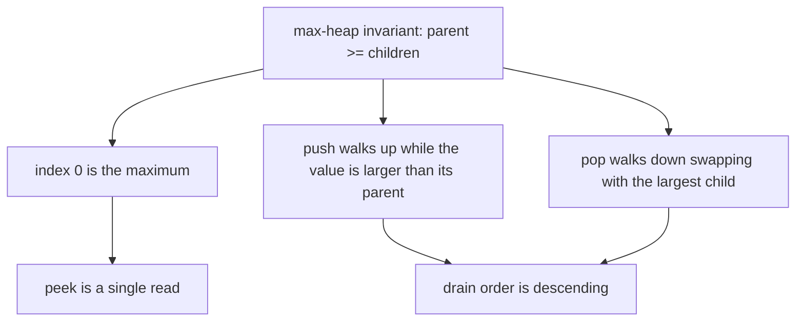
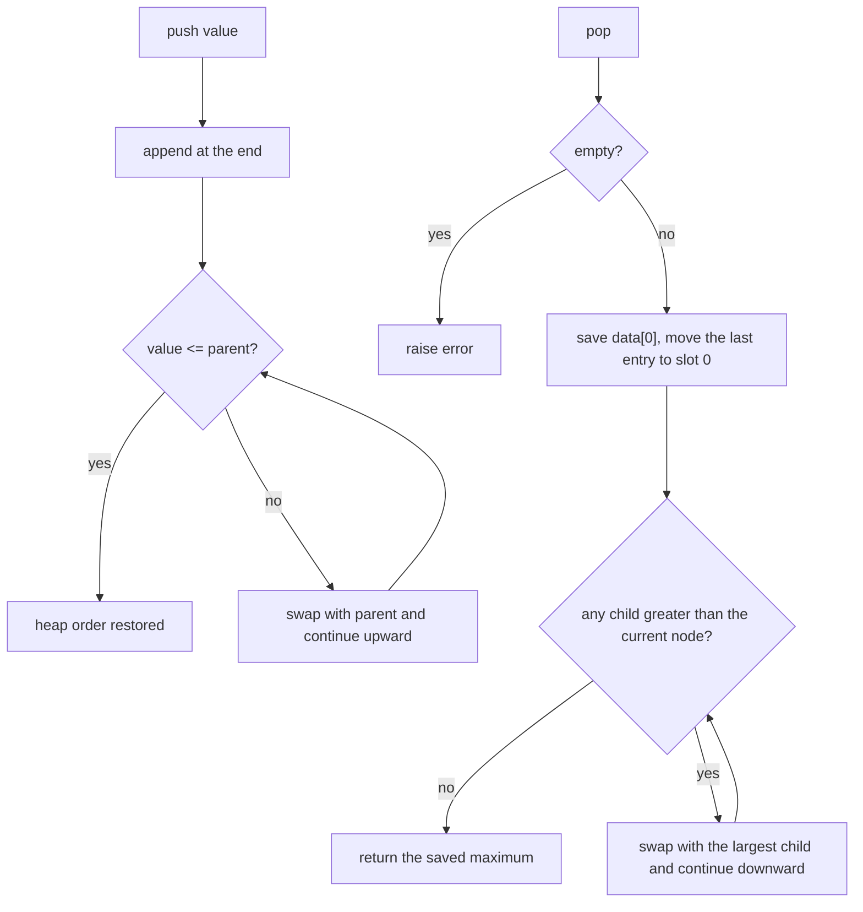
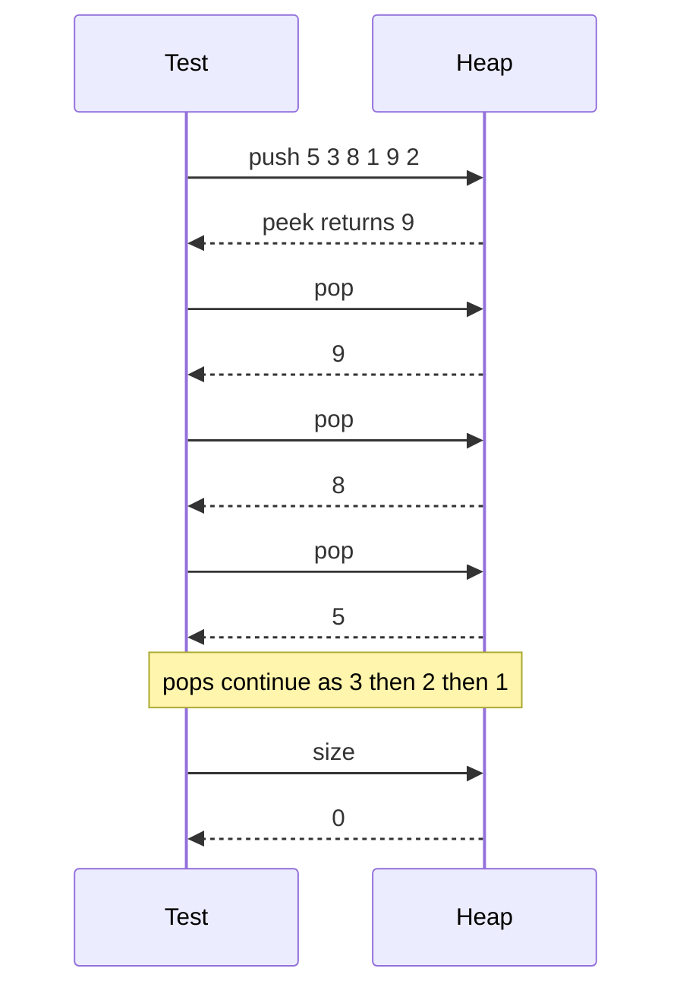

# 067 — Implement max-heap push/pop.

> **Tier:** Beginner · **CTCI chapter:** Ch 4 — Trees and Graphs
> **Task spec:** [067-implement-max-heap-push-pop.md](../../../tasks/beginner/067-implement-max-heap-push-pop.md)
> **Solutions:** [Python](../../../solutions/python/beginner/067-implement-max-heap-push-pop/solution.py) ·
> [Java](../../../solutions/java/beginner/067-implement-max-heap-push-pop/Solution.java) ·
> [JavaScript](../../../solutions/javascript/beginner/067-implement-max-heap-push-pop/solution.js) ·
> [C#](../../../solutions/csharp/beginner/067-implement-max-heap-push-pop/Solution.cs)

## 1. Problem restatement

**Input.** A sequence of integer `push(value)` operations interleaved with `pop()` and `peek()`.

**Output.** `peek()` returns the largest stored value; `pop()` removes and returns it. The container
must keep working across arbitrary interleavings, exactly like the min-heap of task 066 with the
comparison flipped.

| Sequence | Result | Why |
| --- | --- | --- |
| `push 5, 3, 8, 1, 9, 2`, then `peek()` | `9` | the maximum sits at the root |
| then `pop()` six times | `9, 8, 5, 3, 2, 1` | draining a max-heap yields descending order |
| `size()` after the drain | `0` | every value left exactly once |
| `pop()` on an empty heap | an error | Python `IndexError`, Java `NoSuchElementException`, JavaScript `Error`, C# `InvalidOperationException` |

The Java file writes the drain into a `StringBuilder` and compares it against `"985321"`; the Python
file compares the list of popped values against `[9, 8, 5, 3, 2, 1]`; the JavaScript file asserts the
same array with `deepStrictEqual`. All three are checking the same ordering property: a max-heap
drain is the ascending drain of task 066 read backwards.

## 2. Intuition

Everything about the shape stays: the values live in an array that stands for a complete binary
tree, with children of `i` at `2i + 1` and `2i + 2`, and the tree height is `log n` because the tree
is complete. Even the two repairs keep their outline — push appends a leaf and walks up, pop takes
the root and walks down.

The one thing that changes is the **direction of the invariant**:

> every node is greater than or equal to both of its children.

Send a value upward only while it is *larger* than its parent, and downward by swapping with the
*largest* child. The parent-walk argument still proves `data[0]` is a global maximum, because
following parents from any node only ever reaches values that are greater than or equal to the one
you started from.

That makes a max-heap a rename of a min-heap, not a new data structure. The Python file says so in
one line — *"Parent >= children. Same sifts as a min-heap with flipped comparisons."* — and the four
files are otherwise character-for-character the min-heap files with `>=` and `>` in place of `<=` and
`<`. Recognizing that symmetry is worth more than memorizing a second implementation: if you can
write one heap and state the invariant precisely, you can write the other the moment you decide which
way the inequality points.



Descending drain is the reason this container exists at all: it is the engine behind heapsort (task
068) and behind "give me the k largest" questions, where a max-heap of size `k` or a min-heap of size
`k` is the usual answer depending on which end you prune from.

## 3. Algorithm

1. Keep the values in a buffer in max-heap order: `data[i] >= data[2i + 1]` and
   `data[i] >= data[2i + 2]` whenever those children exist.
2. `push(value)`: append the value, then **sift up** — while the index has a parent and the value is
   *greater* than the parent's value, swap and continue from the parent.
3. `pop()`: raise if empty. Save `data[0]`. Remove the last entry; if values remain, write it into
   slot `0` and **sift down** — compare the current value with both children, swap with the
   *largest* child if that child is greater, and continue from there. Return the saved root.
4. `peek()`: raise if empty, otherwise return `data[0]`.
5. `size()` / `len`: return the number of stored values.

```text
procedure push(value)
    append value to data
    sift_up(last index of data)
end

procedure sift_up(i)
    while i > 0 do
        parent ← (i - 1) / 2
        if data[parent] >= data[i] then
            break
        end
        swap data[i] with data[parent]
        i ← parent
    end
end

procedure pop
    if data is empty then
        raise heap empty error
    end
    top ← data[0]
    last ← remove the final entry of data
    if data is not empty then
        data[0] ← last
        sift_down(0)
    end
    return top
end

procedure sift_down(i)
    n ← number of stored values
    while true do
        largest ← i
        left ← 2 * i + 1
        right ← 2 * i + 2
        if left < n and data[left] > data[largest] then
            largest ← left
        end
        if right < n and data[right] > data[largest] then
            largest ← right
        end
        if largest = i then
            break
        end
        swap data[i] with data[largest]
        i ← largest
    end
end
```

The strictness of `>=` in `sift_up` matters in the same way it did for the min-heap: a value equal to
its parent is already in a legal position, so the walk stops instead of shuffling equal keys for no
reason. Both sifts keep a single index, so `pop` and `push` use `O(1)` extra space.



Read the two decision diamonds side by side with the min-heap version and the only difference is the
direction of the comparison; the structure of the flow is identical.

## 4. Worked example

Push `5, 3, 8, 1, 9, 2` in that order, tracking the array after each repair and the path the new leaf
walked.

| Step | Push | Buffer before | Sift-up path | Buffer after |
| --- | --- | --- | --- | --- |
| 1 | `5` | `[]` | append at index `0` | `[5]` |
| 2 | `3` | `[5]` | index `1`, parent `0` holds `5`, `3 > 5` false → stop | `[5, 3]` |
| 3 | `8` | `[5, 3]` | index `2`, parent `0` holds `5`, `8 > 5` → swap | `[8, 3, 5]` |
| 4 | `1` | `[8, 3, 5]` | index `3`, parent `1` holds `3`, `1 > 3` false → stop | `[8, 3, 5, 1]` |
| 5 | `9` | `[8, 3, 5, 1]` | index `4`, parent `1` holds `3` → swap; index `1`, parent `0` holds `8` → swap | `[9, 8, 5, 1, 3]` |
| 6 | `2` | `[9, 8, 5, 1, 3]` | index `5`, parent `2` holds `5`, `2 > 5` false → stop | `[9, 8, 5, 1, 3, 2]` |

Compare step 2 with step 2 of task 066. There the value `3` had to climb; here it stays where it was
appended, because a max-heap wants large values near the root. The same six values therefore produce a
different array: `[9, 8, 5, 1, 3, 2]` instead of `[1, 3, 2, 5, 9, 8]`.

`peek()` returns `9`. Draining, the first `pop()`:

| Step | Action | Buffer |
| --- | --- | --- |
| 1 | save `top = 9`, remove the last entry `2` | `[9, 8, 5, 1, 3]` |
| 2 | write `2` into slot `0` | `[2, 8, 5, 1, 3]` |
| 3 | children of `0` are `8` and `5`; the largest is `8` at index `1`, `8 > 2` → swap | `[8, 2, 5, 1, 3]` |
| 4 | children of `1` are `1` and `3`; the largest is `3` at index `4`, `3 > 2` → swap | `[8, 3, 5, 1, 2]` |
| 5 | index `4` has children at `9` and `10`, both beyond the size `5` → stop | `[8, 3, 5, 1, 2]` |
| 6 | return `9` | `[8, 3, 5, 1, 2]` |

The second pop returns `8`: `2` lands in slot `0`, swaps with the largest child `5` at index `2`, and
the heap becomes `[5, 3, 2, 1]`. The remaining pops return `5`, `3`, `2` and finally `1`, giving the
`9, 8, 5, 3, 2, 1` drain that all four files assert.



## 5. Complexity

Let `n` be the number of stored values.

| Measure | Bound | Why it holds |
| --- | --- | --- |
| Time, `push` | `O(log n)` | `O(1)` append plus a walk up of at most the tree height |
| Time, `pop` | `O(log n)` | `O(1)` root removal plus a walk down of at most the tree height |
| Time, `peek` | `O(1)` | the maximum is at index `0` by the invariant |
| Time, `size` | `O(1)` | the buffer length is stored |
| Space, container | `O(n)` | one slot per value; the array carries the whole shape |
| Space, per operation | `O(1)` | the sifts only hold one index |
| Drain of `n` values | `O(n log n)` | `n` pops at `O(log n)` each, giving descending order |
| Alternative: sort then walk | `O(n log n)` plus a copy | sorting gives the same order but keeps every value around |
| Alternative: scan for the maximum | `pop` `O(n)` | a full pass per removal |

The last row is the honest comparison for this task: if you intend to drain *everything* you would be
better served by a sort, and it costs the same `O(n log n)`. The heap only pays off when pops are
interleaved with pushes and you never need the whole order.

## 6. Pitfalls and edge cases

- **Empty `pop`/`peek`.** Every file raises; the exception types are `IndexError`,
  `NoSuchElementException`, `Error` and `InvalidOperationException` respectively.
- **Popping the only value.** After the last entry is removed the container is empty and must not be
  given a root. Python, JavaScript and C# guard with a length check; the Java file writes
  `data[0] = data[--size]` into the pre-allocated array and lets `siftDown` exit on size `0`.
- **Duplicates.** `[3, 3, 1]` is a valid max-heap after two pushes; the strict `>` in `sift_down`
  means equal values never swap, and no ordering between equal keys is promised.
- **Getting the child order wrong.** Taking the left child whenever it is greater, instead of taking
  the *larger* of the two, breaks the invariant silently. The comparison must be against the current
  best candidate (`largest`), which is exactly why the code tests `data[left] > data[largest]` and
  then `data[right] > data[largest]`.
- **Reusing the min-heap by negation.** Pushing `-value` into a min-heap is a common shortcut, and it
  is fine for priorities, but it breaks on the most negative value in fixed-width arithmetic and it
  obscures the invariant. If the task says max-heap, write the max-heap.
- **Drain tests hide a broken `peek`.** Assert `peek()` *before* popping, as all four files do.
- **One comparison per level is not free.** Sift-down looks at two children per level, so its constant
  is about twice that of sift-up. Both are still `O(log n)`.

## 7. Variants and follow-ups

- **Min-heap.** [066-implement-min-heap-push-pop.md](../../../tasks/beginner/066-implement-min-heap-push-pop.md)
  is this file with `>=` and `>` replaced by `<=` and `<`.
- **In-place sort.** [068-heapsort-using-heap-operations.md](../../../tasks/beginner/068-heapsort-using-heap-operations.md)
  uses this max-heap and extracts into the tail of the caller's array, so it needs no second buffer.
- **Library priority queue.** [065-implement-priority-queue-using-built-in-heap.md](../../../tasks/beginner/065-implement-priority-queue-using-built-in-heap.md)
  shows the .NET trick of negating the priority to get max-first behaviour out of a min-heap library.
- **Sorting alternatives.** [069-selection-sort.md](../../../tasks/beginner/069-selection-sort.md)
  finds the maximum by scanning instead of heapifying, which is `O(n)` per extraction instead of
  `O(log n)`.
- **Selection by value, not by root.** If you only need the `k` largest values, keep a heap of size
  `k` instead of a heap of size `n`; the "most frequent element" task
  [048-find-most-frequent-element-in-array.md](../../../tasks/beginner/048-find-most-frequent-element-in-array.md)
  is the counting cousin of that idea.
- [Trees and Graphs](../../ctci/04-trees-and-graphs.md) covers the array-as-tree mapping, and
  [Sorting and Searching](../../ctci/10-sorting-and-searching.md) lists the heap's role in the sort
  table.

## 8. Check yourself

1. Which single change turns the min-heap of task 066 into this max-heap?

<details><summary>Show answer</summary>

The direction of both comparisons: `>=` in `sift_up` and `>` when picking the child in `sift_down`.
Everything else — the array layout, the parent and child index arithmetic, the pop refill, the empty
checks — is identical, because the *shape* of a heap does not depend on whether you keep the smallest
or the largest value at the root.

</details>

2. After pushing `5, 3, 8` the buffer is `[8, 3, 5]`. Is that sorted? Is it a valid max-heap?

<details><summary>Show answer</summary>

It is not sorted, but it is a valid max-heap: index `0` holds `8`, and its children at index `1` and
`2` hold `3` and `5`, both smaller. Heap order only constrains a node against its own children, so
`5` may sit after `3` in the array.

</details>

3. Why does `sift_up` use `>=` rather than `>` when comparing with the parent?

<details><summary>Show answer</summary>

Because a value equal to its parent is already legal — the invariant is "parent greater than or equal
to child". With `>` the walk would keep swapping equal values up the tree, doing work that changes
nothing observable.

</details>

4. How many comparisons does one `pop` need in the worst case, and why that many?

<details><summary>Show answer</summary>

Two per level, for at most `log n` levels: each step inspects both children of the current node, picks
the larger, and compares it with the node's value. That is a constant factor of about two more than
`sift_up`, which only ever compares against a single parent per level.

</details>

5. Why does a full drain of `n` values cost `O(n log n)`, and what other algorithm would you use
instead if that is all you needed?

<details><summary>Show answer</summary>

Each of the `n` pops performs a sift-down of at most `log n` levels, so the total is `O(n log n)`. If
the entire order is the goal, a sort is the direct answer, and task 068 shows how to get it from the
very same heap operations in place; tasks 069–073 offer the quadratic and linear-time alternatives.

</details>
