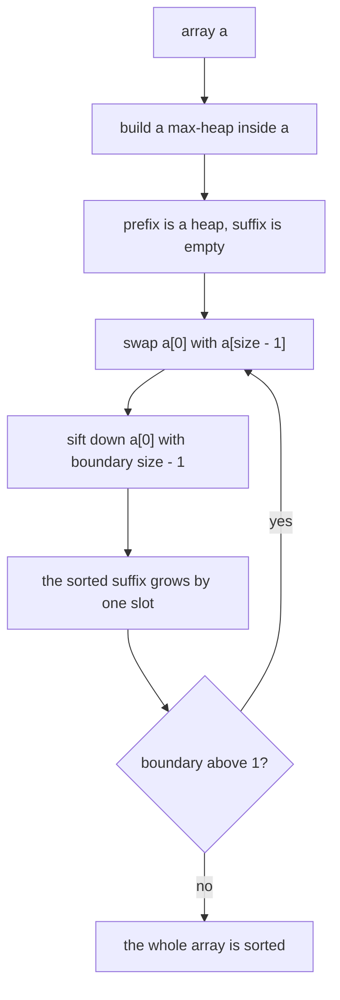
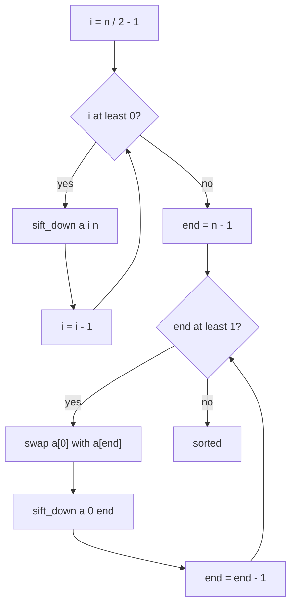
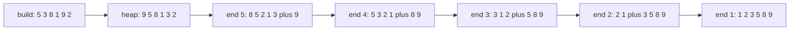
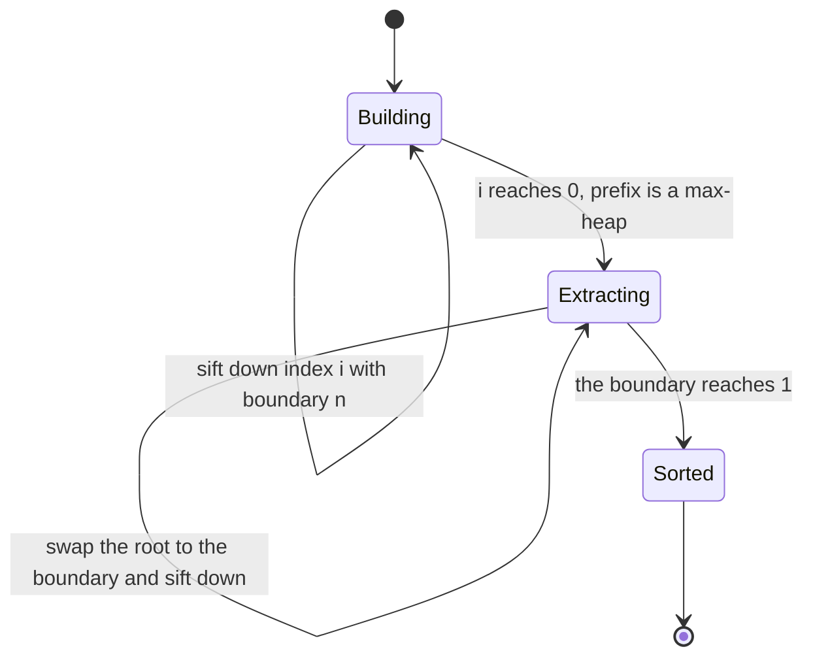

# 068 — Heapsort using heap operations.

> **Tier:** Beginner · **CTCI chapter:** Ch 10 — Sorting and Searching
> **Task spec:** [068-heapsort-using-heap-operations.md](../../../tasks/beginner/068-heapsort-using-heap-operations.md)
> **Solutions:** [Python](../../../solutions/python/beginner/068-heapsort-using-heap-operations/solution.py) ·
> [Java](../../../solutions/java/beginner/068-heapsort-using-heap-operations/Solution.java) ·
> [JavaScript](../../../solutions/javascript/beginner/068-heapsort-using-heap-operations/solution.js) ·
> [C#](../../../solutions/csharp/beginner/068-heapsort-using-heap-operations/Solution.cs)

## 1. Problem restatement

**Input.** An array of integers, which the algorithm may rearrange in place.

**Output.** The same array in non-decreasing order. Nothing of `O(n)` size is allocated: the heap
lives *inside* the caller's array, and the sorted result grows in that same array from the end
backwards.

| Input | Output | What it checks |
| --- | --- | --- |
| `[5, 3, 8, 1, 9, 2]` | `[1, 2, 3, 5, 8, 9]` | the general case |
| `[]` | `[]` | the build loop never starts, the extraction loop never starts |
| `[7]` | `[7]` | a single element is already sorted |
| `[3, 3, 1]` | `[1, 3, 3]` | duplicates survive; their relative order is not promised |

All four files assert the first, third and fourth rows; Java and C# also assert the empty input, and
Python additionally asserts the one-element case. The Python docstring states the two headline
properties: `O(n log n)` time, `O(1)` extra space, **not stable**.

## 2. Intuition

A max-heap already knows where the largest value is — index `0` — so sorting with a heap is tempting:
push every value into a heap, pop all of them, write the results back. That works, but it needs a
second array of `n` slots, which turns a sort into a copy.

The insight that removes the second array splits the *same* array into two regions with opposite
purposes:

- a **prefix** `a[0 .. size - 1]` kept as a valid max-heap, and
- a **suffix** `a[size .. n - 1]` holding the largest values already in final position, largest
  first.

The regions share the array and never overlap. Extraction is then a swap across their boundary: the
root of the heap (the largest value in the prefix) trades places with the last slot of the prefix.
That slot joins the sorted suffix and is never touched again; the value that arrives at the root is
repaired with the very same sift-down as the container heap of task 067, except that its boundary is
the shrinking prefix instead of the whole buffer.

The second insight is that the initial heap need not be built with `n` pushes. Starting from the last
internal node and sifting down every index to `0` builds a correct max-heap in `O(n)` — the Python
file marks that line `# build max-heap: O(n)`. Leaves need no repair at all, so the loop starts at
`n / 2 - 1` and skips half the array; the nodes that do get sifted are near the bottom, where paths
are short.



## 3. Algorithm

1. Let `n` be the length of `a`.
2. **Build.** For `i` from `n / 2 - 1` down to `0`, sift down from `i` with boundary `n`. Indices
   `n / 2 .. n - 1` are leaves and are skipped.
3. **Extract.** For `end` from `n - 1` down to `1`: swap `a[0]` with `a[end]`, so the current maximum
   lands in its final slot, then sift down from `0` with boundary `end` so the repair can never look
   into the sorted suffix.
4. Return the array — Python and JavaScript return it, Java and C# sort in place and the caller
   inspects it.

```text
procedure heap_sort(a)
    n ← length(a)
    for i ← n / 2 - 1 down to 0 do
        sift_down(a, i, n)
    end
    for end ← n - 1 down to 1 do
        swap a[0] with a[end]
        sift_down(a, 0, end)
    end
    return a
end

procedure sift_down(a, i, size)
    while true do
        largest ← i
        left ← 2 * i + 1
        right ← 2 * i + 2
        if left < size and a[left] > a[largest] then
            largest ← left
        end
        if right < size and a[right] > a[largest] then
            largest ← right
        end
        if largest = i then
            return
        end
        swap a[i] with a[largest]
        i ← largest
    end
end
```

The only new ingredient compared with the container heap is the `size` parameter. Everywhere task 067
used "the length of my buffer", heapsort passes a moving boundary; that boundary is precisely what
makes the algorithm in place, because a repair that cannot reach past `size - 1` can never disturb a
value that has already been placed.



## 4. Worked example

Sort `[5, 3, 8, 1, 9, 2]` with `n = 6`. The build starts at index `2` (`n / 2 - 1`) and walks down to
`0`; indices `3`, `4` and `5` are leaves and are skipped.

| Build step | Index | Children examined | Swap | Array after |
| --- | --- | --- | --- | --- |
| 1 | `2` holds `8` | `2` at index `5` | none, `8 > 2` | `[5, 3, 8, 1, 9, 2]` |
| 2 | `1` holds `3` | `1` at index `3`, `9` at index `4` | `3` with `9` | `[5, 9, 8, 1, 3, 2]` |
| 2 cont. | index `4` holds `3` | none, both children are outside `n` | none | `[5, 9, 8, 1, 3, 2]` |
| 3 | `0` holds `5` | `9` at index `1`, `8` at index `2` | `5` with `9` | `[9, 5, 8, 1, 3, 2]` |
| 3 cont. | index `1` holds `5` | `1` at index `3`, `3` at index `4` | none, `5` is larger than both | `[9, 5, 8, 1, 3, 2]` |

Check the invariant on the result: index `0` holds `9` and both children (`5` and `8`) are smaller;
index `1` holds `5` and both children (`1` and `3`) are smaller; index `2` holds `8` and its only
child (`2` at index `5`) is smaller. The prefix `[9, 5, 8, 1, 3, 2]` is a valid max-heap — and it is
plainly not sorted, which is exactly what heap order allows.

Extraction now runs five times, moving the boundary down. Each row shows the array right after the
swap and then right after the repair:

| `end` | After the swap of `a[0]` with `a[end]` | Sift-down with boundary `end` | Array after the sift |
| --- | --- | --- | --- |
| `5` | `[2, 5, 8, 1, 3, 9]` | `2` swaps with `5`, then with `8` | `[8, 5, 2, 1, 3, 9]` |
| `4` | `[3, 5, 2, 1, 8, 9]` | `3` swaps with `5` | `[5, 3, 2, 1, 8, 9]` |
| `3` | `[1, 3, 2, 5, 8, 9]` | `1` swaps with `3` | `[3, 1, 2, 5, 8, 9]` |
| `2` | `[2, 1, 3, 5, 8, 9]` | `2` is larger than its only child `1`, no swap | `[2, 1, 3, 5, 8, 9]` |
| `1` | `[1, 2, 3, 5, 8, 9]` | the boundary `1` leaves no child to look at | `[1, 2, 3, 5, 8, 9]` |

The final array `[1, 2, 3, 5, 8, 9]` is the value all four assertions expect. Two details from the
table are worth pointing out. In the first row the repair walks two levels (`2 → 5 → 8`) because the
value that came back to the root was the smallest one in the prefix — the worst case for a sift. In
the fourth row the repair stops immediately, because after four extractions the prefix is short and
its root is already the maximum. And in every row the boundary does its job: index `5` holds the
final `9` from the first extraction onward, and no later repair ever looks at it.



The two phases as a state machine — note that the second loop is one repeated transition, executed
once per extraction:



## 5. Complexity

Let `n` be the length of the array.

| Measure | Bound | Why it holds |
| --- | --- | --- |
| Time, build | `O(n)` | half of the array is leaves; the sifted nodes sit near the bottom where paths are short, and the sum of the path lengths telescopes |
| Time, extraction | `O(n log n)` | `n - 1` swaps, each followed by a sift-down of at most `log n` levels |
| Time, best / average / worst | `O(n log n)` | the two loops run the same number of times whatever the input order is |
| Space, extra | `O(1)` | the two regions share the caller's array; only loop indices and one temporary are kept |
| `sift_down` comparisons | up to `2 log n` per extraction | both children are inspected at every level |
| Stability | not stable | the root-to-boundary swap jumps over the middle of the array |
| Alternative: mergesort | `O(n log n)`, `O(n)` extra, stable | see the sort table in the chapter |
| Alternative: quicksort | expected `O(n log n)`, worst `O(n²)` | in place, but with a bad-input risk |

Heapsort's selling point is the combination: the worst case is `O(n log n)` *and* the extra space is
`O(1)`, which neither quicksort (bad worst case) nor mergesort (`O(n)` space) offers together. Its
price is locality — sift-down jumps between indices `i`, `2i + 1` and `2i + 2`, the access pattern
caches dislike most.

## 6. Pitfalls and edge cases

- **Empty and one-element arrays.** With `n = 0` the build loop starts at `-1` and both loops are
  skipped. With `n = 1` the build sifts index `0`, which has no children, and the extraction loop does
  not run. Java and C# assert the empty case, Python the single element.
- **Duplicates.** `[3, 3, 1]` sorts to `[1, 3, 3]`. The sift comparisons are strict, so equal values
  never swap inside a sift, but the root-to-boundary swap can still reorder equal keys: heapsort is
  **not stable**.
- **Passing the boundary, not the length.** Using `a.length` instead of `end` inside `sift_down` lets
  the repair reach into the sorted suffix and corrupts the result. Every file passes `size`
  explicitly, and the JavaScript version names that parameter `size` for the same reason.
- **Off-by-one in the build start.** Starting at `n / 2` skips the last internal node and can leave
  the heap invalid; starting at `n - 1` is merely wasteful.
- **Integer division.** `n / 2` must round down: Python writes `n // 2`, and Java, JavaScript and C#
  use integer arithmetic where `n / 2` already floors. A floating-point division here breaks the loop
  bound.
- **`end > 0` is the right stop.** Sifting down once more with a boundary of `0` would compare a slot
  with itself; the loops stop at `end = 1` because a one-element prefix is trivially sorted.
- **In place means the caller's order is gone.** The Java and C# versions return `void` and nothing is
  copied; if the caller still needs the original order, it must copy first.

## 7. Variants and follow-ups

- **The container version of the same sifts.**
  [067-implement-max-heap-push-pop.md](../../../tasks/beginner/067-implement-max-heap-push-pop.md)
  keeps the heap alive between operations instead of sorting once.
- **The library shortcut.** [065-implement-priority-queue-using-built-in-heap.md](../../../tasks/beginner/065-implement-priority-queue-using-built-in-heap.md)
  drains a library heap for the same order at the cost of `O(n)` extra space.
- **Quadratic comparison sorts.** [069-selection-sort.md](../../../tasks/beginner/069-selection-sort.md),
  [070-insertion-sort.md](../../../tasks/beginner/070-insertion-sort.md) and
  [071-bubble-sort-optimized.md](../../../tasks/beginner/071-bubble-sort-optimized.md) are the
  alternatives for tiny or already-sorted inputs.
- **Linear sorts.** [072-count-sort-for-small-integer-range.md](../../../tasks/beginner/072-count-sort-for-small-integer-range.md)
  and [073-radix-sort-for-non-negative-integers.md](../../../tasks/beginner/073-radix-sort-for-non-negative-integers.md)
  beat `O(n log n)` for small integer keys and are stable, which heapsort is not.
- **Partitioning instead of heaping.** [074-implement-simple-stable-partition.md](../../../tasks/beginner/074-implement-simple-stable-partition.md)
  is the other Ch 10 rearrangement primitive, and it *is* stable.
- The four-way comparison of sort families lives in [Sorting and Searching](../../ctci/10-sorting-and-searching.md).

## 8. Check yourself

1. Why does the build start at `n / 2 - 1` rather than `n - 1`?

<details><summary>Show answer</summary>

Because every index from `n / 2` to `n - 1` is a leaf. A leaf has no children, so `sift_down` on it
returns at the first comparison; skipping those indices halves the loop with no change in result. The
index `n / 2 - 1` is the last node that has at least one child.

</details>

2. What goes wrong if `sift_down(a, 0, end)` is called with `n` instead of `end`?

<details><summary>Show answer</summary>

The repair would compare against values already placed in the sorted suffix and could swap a small
value into those slots, destroying the final order. The prefix would still satisfy the heap invariant,
so the bug would only show up in the output array — which is why the boundary is an explicit
parameter.

</details>

3. Heapsort is `O(n log n)` in all cases with `O(1)` extra space. What does it give up?

<details><summary>Show answer</summary>

Locality, and stability. The sift hops between `i`, `2i + 1` and `2i + 2`, so memory access is
scattered and cache-hostile; quicksort scans sequentially. And the root-to-boundary swap reorders
equal keys, whereas mergesort preserves them.

</details>

4. For `[5, 3, 8, 1, 9, 2]`, what is the array after the build phase, and is it sorted?

<details><summary>Show answer</summary>

`[9, 5, 8, 1, 3, 2]`. It is a valid max-heap but not sorted: `5` precedes `8`, and `8` precedes `1`.
The build phase only establishes the heap invariant; the sorted order is produced by the extraction
loop.

</details>

5. How many levels does the first sift-down of the extraction phase walk, and why?

<details><summary>Show answer</summary>

Two levels, for this input. The value moved to the root is the entry that was at the boundary, and in
the first extraction that value is `2`, the smallest in the prefix, so it sinks as far as it can — two
levels from index `0` to `2`. Later extractions sink less, because the prefix is smaller and its root
is already near-correct.

</details>
