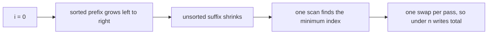
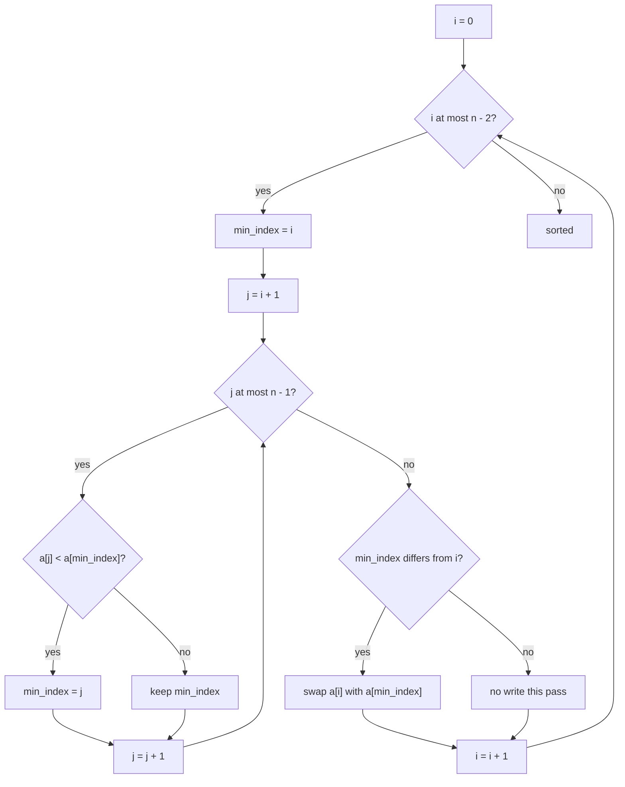
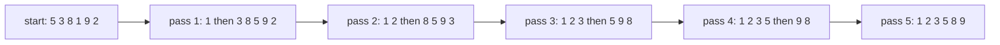
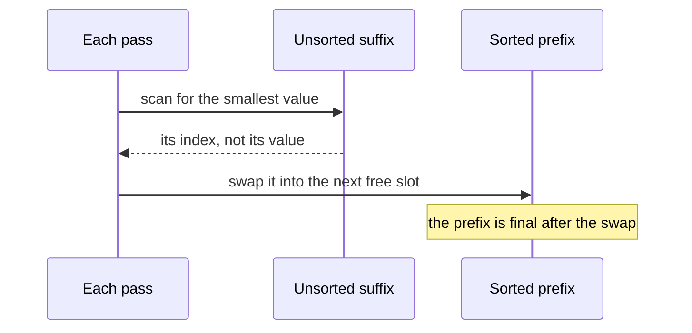

# 069 — Selection sort.

> **Tier:** Beginner · **CTCI chapter:** Ch 10 — Sorting and Searching
> **Task spec:** [069-selection-sort.md](../../../tasks/beginner/069-selection-sort.md)
> **Solutions:** [Python](../../../solutions/python/beginner/069-selection-sort/solution.py) ·
> [Java](../../../solutions/java/beginner/069-selection-sort/Solution.java) ·
> [JavaScript](../../../solutions/javascript/beginner/069-selection-sort/solution.js) ·
> [C#](../../../solutions/csharp/beginner/069-selection-sort/Solution.cs)

## 1. Problem restatement

**Input.** An array of integers, sorted in place.

**Output.** The same array in non-decreasing order, using one "find the minimum of the rest, put it
here" step per position.

| Input | Output | What it checks |
| --- | --- | --- |
| `[5, 3, 8, 1, 9, 2]` | `[1, 2, 3, 5, 8, 9]` | the general case |
| `[]` | `[]` | no pass runs at all |
| `[2, 1]` | `[1, 2]` | a single pass with one swap |
| `[1, 1, 1]` | `[1, 1, 1]` | equal values never trigger a swap (Python asserts this) |

The Python docstring states the cost that makes this algorithm interesting: `O(n²)` comparisons,
`O(n)` swaps, not stable by default.

## 2. Intuition

The naive way to sort an array is to keep moving the smallest remaining value to the front. That is
exactly selection sort, and the question that decides whether it is any good is *how much it writes*.

Compare it with the other two quadratic sorts. Insertion sort moves a value one slot at a time until
it finds its place, which costs `O(n²)` writes in the worst case. Bubble sort swaps neighbours, which
also costs `O(n²)` swaps. Selection sort makes the same number of comparisons — it really is quadratic
in time — but it swaps at most **once per pass**, so the total number of writes is under `n`.

The insight is that finding the minimum never requires moving anything. A pass scans the unsorted
suffix, remembers the *index* of the smallest value, and performs one swap at the end. The array is
therefore divided into two regions that the algorithm treats differently:

- a **sorted prefix** `a[0 .. i - 1]`, which is already final and never written again, and
- an **unsorted suffix** `a[i .. n - 1]`, which is scanned but not rearranged, one swap excepted.

That split is also why selection sort is *not* stable: the swap teleports a value from the far end of
the suffix into position `i`, jumping it over whatever sits in between.



## 3. Algorithm

1. For `i` from `0` to `n - 2` (the last position needs no pass):
2. Set `min_index = i`.
3. For `j` from `i + 1` to `n - 1`: if `a[j] < a[min_index]`, set `min_index = j`. This is the scan of
   the unsorted suffix; it only records an index.
4. If `min_index != i`, swap `a[i]` with `a[min_index]` — the minimum of the suffix is now in its final
   position.
5. Return the array.

```text
procedure selection_sort(a)
    n ← length(a)
    for i ← 0 to n - 2 do
        min_index ← i
        for j ← i + 1 to n - 1 do
            if a[j] < a[min_index] then
                min_index ← j
            end
        end
        if min_index not equal to i then
            swap a[i] with a[min_index]
        end
    end
    return a
end
```

The comparison is strict (`<`), so when several values tie the *first* occurrence wins and the index
never moves. The guard `min_index != i` is not strictly necessary for correctness — swapping a slot
with itself is a no-op — but it is what makes the swap count `O(n)` instead of one per pass, and it is
why the already-sorted assertion `[1, 1, 1]` performs no writes at all.



## 4. Worked example

Sort `[5, 3, 8, 1, 9, 2]`, `n = 6`. The outer loop runs `i = 0 .. 4`.

| Pass | `i` | Suffix scanned | Scan result | Swap | Array after |
| --- | --- | --- | --- | --- | --- |
| 1 | `0` | `3, 8, 1, 9, 2` | minimum `1` at index `3` | `5` and `1` | `[1, 3, 8, 5, 9, 2]` |
| 2 | `1` | `8, 5, 9, 2` | minimum `2` at index `5` | `3` and `2` | `[1, 2, 8, 5, 9, 3]` |
| 3 | `2` | `5, 9, 3` | minimum `3` at index `5` | `8` and `3` | `[1, 2, 3, 5, 9, 8]` |
| 4 | `3` | `9, 8` | minimum `5` at index `3` | none, `min_index` equals `i` | `[1, 2, 3, 5, 9, 8]` |
| 5 | `4` | `8` | minimum `8` at index `5` | `9` and `8` | `[1, 2, 3, 5, 8, 9]` |

The comparison counts per pass make the quadratic cost visible: pass 1 scans `5` elements, pass 2
scans `4`, and so on down to `1` in the last pass, for `5 + 4 + 3 + 2 + 1 = 15` comparisons on six
values. The swap count is much smaller: four swaps, because pass 4 found the minimum already in place.

Pass 4 is worth a second look. After three passes the array is `[1, 2, 3, 5, 9, 8]` and the suffix is
`9, 8`, whose minimum is `5` at the current index. Since `min_index == i`, the guard skips the swap
and the pass writes nothing at all.

The growth of the sorted prefix, one pass at a time:



The rule that produced each row never changes: scan the suffix, then move the minimum to the
boundary of the prefix.



## 5. Complexity

Let `n` be the length of the array.

| Measure | Bound | Why it holds |
| --- | --- | --- |
| Comparisons, all cases | exactly `n(n - 1) / 2` | pass `i` scans `n - 1 - i` elements, for `n - 1 + n - 2 + ... + 1` |
| Time, best | `O(n²)` | the scan happens whether or not the array is already sorted |
| Time, average | `O(n²)` | same count, plus the swaps |
| Time, worst | `O(n²)` | same count again; selection sort is not adaptive |
| Writes, best | `0` | a sorted array never triggers a swap, because `min_index` stays at `i` |
| Writes, worst | `n - 1` | at most one swap per pass |
| Space | `O(1)` | one temporary for the swap, two loop indices |
| Stability | not stable | the swap jumps a value over the middle of the suffix |
| Alternative: insertion sort | `O(n)` best, `O(n²)` worst | adaptive and stable, but `O(n²)` writes |
| Alternative: heapsort | `O(n log n)` always, `O(1)` space | task 068 |

The trade selection sort offers is comparisons for writes. It uses the *most* comparisons of any
`O(n²)` sort — heapsort's `O(n log n)` bound is not available at any price here — but it uses the
fewest writes, which matters when a write is far more expensive than a comparison: flash storage,
remote buffers, hardware registers, or a data structure where "swap" means a copy.

## 6. Pitfalls and edge cases

- **Empty and single-element arrays.** `n = 0` makes the outer loop `for i = 0 to -2`, which does not
  run; `n = 1` makes it `for i = 0 to -1`, which also does not run. All four languages express this
  with a `n - 1` bound, and Python and Java assert the empty case.
- **The last position needs no pass.** Running the outer loop to `n - 1` is harmless but always finds
  `min_index == i`; the loop bound `n - 2` (written `n - 1` in a `range`) records the intent.
- **Ties and strictness.** `a[j] < a[min_index]` keeps the earliest minimum. Replacing `<` with `<=`
  keeps the last one; both produce a sorted array, and both destroy stability in different cases.
- **Instability, concretely.** `[3, 3, 1]` becomes `[1, 3, 3]`, but the two `3`s have swapped their
  relative order: the first pass moves the `1` from index `2` into index `0` and pushes the original
  first `3` to index `2`. If those `3`s carried payloads, their order changed.
- **Already-equal arrays.** `[1, 1, 1]` performs no swaps, because the scan never finds a strictly
  smaller value. The assertion in the Python file pins this behaviour.
- **Not adaptive.** A fully sorted input still performs `n(n - 1) / 2` comparisons, so for
  nearly-sorted data insertion sort is strictly better.
- **The guard is about writes, not correctness.** Removing `if min_index != i` keeps the result
  identical and simply adds one self-swap per pass.

## 7. Variants and follow-ups

- **The other quadratic sorts.** [070-insertion-sort.md](../../../tasks/beginner/070-insertion-sort.md)
  is adaptive and stable, and [071-bubble-sort-optimized.md](../../../tasks/beginner/071-bubble-sort-optimized.md)
  exits early on sorted input.
- **`O(n log n)` in place.** [068-heapsort-using-heap-operations.md](../../../tasks/beginner/068-heapsort-using-heap-operations.md)
  is selection sort's idea done right: instead of a linear scan for the maximum, keep a heap and pay
  `O(log n)` per extraction.
- **Linear-time sorts.** [072-count-sort-for-small-integer-range.md](../../../tasks/beginner/072-count-sort-for-small-integer-range.md)
  and [073-radix-sort-for-non-negative-integers.md](../../../tasks/beginner/073-radix-sort-for-non-negative-integers.md)
  beat both quadratic and comparison bounds when the keys are small integers.
- **Rearranging without sorting.** [074-implement-simple-stable-partition.md](../../../tasks/beginner/074-implement-simple-stable-partition.md)
  keeps the relative order that selection sort throws away.
- **Finding the extreme repeatedly.** [067-implement-max-heap-push-pop.md](../../../tasks/beginner/067-implement-max-heap-push-pop.md)
  and [092-max-over-sliding-window-using-deque.md](../../../tasks/beginner/092-max-over-sliding-window-using-deque.md)
  are the answers when you need the maximum more than once without sorting.
- The sort table in [Sorting and Searching](../../ctci/10-sorting-and-searching.md) places selection
  sort next to its quadratic siblings.

## 8. Check yourself

1. Why does selection sort make `O(n²)` comparisons but only `O(n)` swaps?

<details><summary>Show answer</summary>

Because the pass separates search from movement. The inner loop only reads values and records an index,
which costs a comparison per element; the write happens once, after the scan, so one pass performs at
most one swap. Over `n - 1` passes that is at most `n - 1` swaps, while the comparisons still add up to
`n(n - 1) / 2`.

</details>

2. What is the best-case running time, and why is it not `O(n)` like insertion sort's?

<details><summary>Show answer</summary>

`O(n²)`. The inner loop always scans the whole unsorted suffix — it must, because it has no way to know
the minimum is already in place without looking. Insertion sort can stop early because each element is
compared against the last element of the sorted prefix, and a sorted input makes that comparison
succeed immediately.

</details>

3. Why is selection sort not stable, and where exactly does the order break?

<details><summary>Show answer</summary>

Because the swap moves a value from a distant index into `a[i]`, and the value it displaces travels to
the far end of the suffix. Any equal keys between `i` and `min_index` are jumped over. On `[3a, 3b, 1]`
the first pass puts `1` at index `0` and sends `3a` to index `2`, so the two equal keys end up in the
order `3b, 3a`.

</details>

4. When is selection sort the right choice despite being quadratic?

<details><summary>Show answer</summary>

When writes are much more expensive than reads, and `n` is small. The algorithm uses the fewest writes
of any of the simple sorts — under `n` swaps — and needs `O(1)` extra space. Typical examples are
sorting in flash memory or moving elements between two structures where every move is a copy.

</details>

5. How many comparisons does the pass for `i = 0` perform on an array of six values, and how many
passes run in total?

<details><summary>Show answer</summary>

The first pass compares `a[1] .. a[5]` against the running minimum, so five comparisons. Six values
need five passes, with `5 + 4 + 3 + 2 + 1 = 15` comparisons in total, which is `n(n - 1) / 2` for
`n = 6`.

</details>
