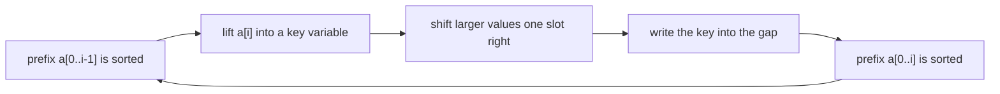
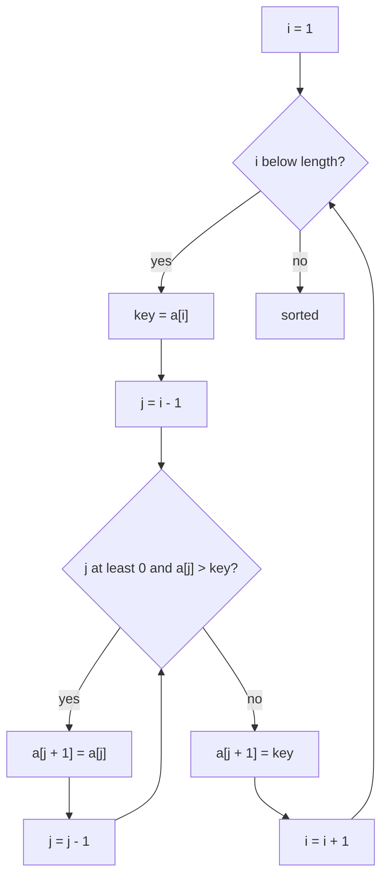
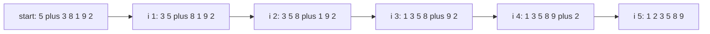
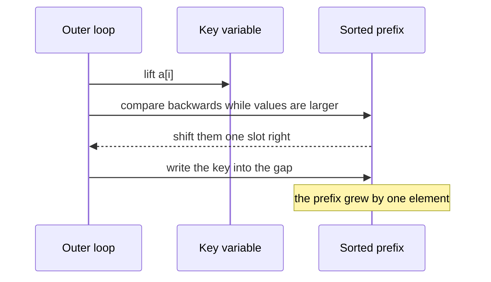

# 070 — Insertion sort.

> **Tier:** Beginner · **CTCI chapter:** Ch 10 — Sorting and Searching
> **Task spec:** [070-insertion-sort.md](../../../tasks/beginner/070-insertion-sort.md)
> **Solutions:** [Python](../../../solutions/python/beginner/070-insertion-sort/solution.py) ·
> [Java](../../../solutions/java/beginner/070-insertion-sort/Solution.java) ·
> [JavaScript](../../../solutions/javascript/beginner/070-insertion-sort/solution.js) ·
> [C#](../../../solutions/csharp/beginner/070-insertion-sort/Solution.cs)

## 1. Problem restatement

**Input.** An array of integers, sorted in place.

**Output.** The same array in non-decreasing order, built by keeping a sorted prefix and inserting
each next value into it.

| Input | Output | What it checks |
| --- | --- | --- |
| `[5, 3, 8, 1, 9, 2]` | `[1, 2, 3, 5, 8, 9]` | the general case |
| `[1, 2, 3]` | `[1, 2, 3]` | one comparison per element, the adaptive path |
| `[]` | `[]` | the loop `i = 1` never starts |
| `[2, 1]` | `[1, 2]` | the smallest non-trivial insertion |

The Python docstring names the three properties this tutorial has to explain: `O(n)` on nearly sorted
data, `O(n²)` in the worst case, **stable**, and fine for `n` below roughly `16`.

## 2. Intuition

Think about sorting a hand of playing cards. Nobody scans the whole hand to find the smallest card
first. You pick up the next card, compare it backwards through the cards you already hold, and slide it
into the gap where it belongs. The cards to its left were already sorted, and inserting one card cannot
unsort them.

That is insertion sort, and it needs one observation to become an algorithm: when `a[i]` is lifted out,
the slot it leaves behind is free. So instead of swapping the value leftwards one position at a time
(two writes per step), the values that are larger simply **shift right by one** until the gap reaches
the correct place, and the lifted value is written once into the gap. That is one write per shifting
element plus one final write, which is why real implementations shift rather than swap.

The prefix invariant is what makes the algorithm *adaptive*. Before handling index `i`, the subarray
`a[0 .. i - 1]` is sorted. If `a[i]` is already at least `a[i - 1]`, the inner loop stops on its very
first comparison and no shifting happens at all — so already-sorted input costs one comparison per
element, `O(n)` in total. The reversed input is the opposite extreme: every element walks all the way
back to index `0`.



The gap, not the swap, is the mental picture to keep: the key travels in a variable while the array
closes in behind it.

## 3. Algorithm

1. For `i` from `1` to `n - 1`:
2. Save `key = a[i]` — this is the lifted card, and the slot at `i` becomes the gap.
3. Set `j = i - 1` and walk backwards while `j >= 0` and `a[j] > key`: copy `a[j]` into `a[j + 1]`,
   which both fills the gap and moves it one slot left, then decrement `j`.
4. Write `key` into `a[j + 1]`, the gap where the walk stopped.
5. Return the array.

```text
procedure insertion_sort(a)
    for i ← 1 to length(a) - 1 do
        key ← a[i]
        j ← i - 1
        while j >= 0 and a[j] > key do
            a[j + 1] ← a[j]
            j ← j - 1
        end
        a[j + 1] ← key
    end
    return a
end
```

Two details decide correctness. The comparison is strict (`a[j] > key`), so a value equal to the key
stops the walk and the key is written *after* it: equal values keep their original relative order, and
that is exactly what stability means. And `key` must be saved before the shifting starts, because the
first shift overwrites `a[i]` and the value would otherwise be lost.



## 4. Worked example

Sort `[5, 3, 8, 1, 9, 2]`, `n = 6`. The prefix starts as the single element `a[0] = 5`, which is
trivially sorted.

| `i` | `key` | Backwards walk | Shifts performed | Array after the insertion |
| --- | --- | --- | --- | --- |
| `1` | `3` | `5 > 3`, then `j` becomes `-1` | one shift | `[3, 5, 8, 1, 9, 2]` |
| `2` | `8` | `5 > 8` is false, the walk stops at once | none | `[3, 5, 8, 1, 9, 2]` |
| `3` | `1` | `8 > 1`, `5 > 1`, `3 > 1`, then `j` becomes `-1` | three shifts | `[1, 3, 5, 8, 9, 2]` |
| `4` | `9` | `8 > 9` is false | none | `[1, 3, 5, 8, 9, 2]` |
| `5` | `2` | `9 > 2`, `8 > 2`, `5 > 2`, `3 > 2`, `1 > 2` is false | four shifts | `[1, 2, 3, 5, 8, 9]` |

The two middle rows are the adaptive case: `8` and `9` each needed a single comparison, because the
largest value in the sorted prefix was already smaller than the key. The last row is the expensive end
of the spectrum, where the key walks from index `5` all the way to index `1`.

Row `i = 3` in detail, since it rewrites three slots:

| Step | `j` | Comparison | Action | Array |
| --- | --- | --- | --- | --- |
| start | `2` | — | `key = a[3] = 1`, gap at index `3` | `[3, 5, 8, 1, 9, 2]` |
| 1 | `2` | `a[2] = 8 > 1` | `a[3] ← 8`, gap moves to `2` | `[3, 5, 8, 8, 9, 2]` |
| 2 | `1` | `a[1] = 5 > 1` | `a[2] ← 5`, gap moves to `1` | `[3, 5, 5, 8, 9, 2]` |
| 3 | `0` | `a[0] = 3 > 1` | `a[1] ← 3`, gap moves to `0` | `[3, 3, 5, 8, 9, 2]` |
| 4 | `-1` | `j` exhausted | `a[0] ← key` | `[1, 3, 5, 8, 9, 2]` |

Note that the array is temporarily holding duplicate values (`8, 8` and then `3, 3`). That is the gap
in action: the value at the gap index is a stale copy that the walk will overwrite, and no value is
ever lost because `key` was saved first.





## 5. Complexity

Let `n` be the length of the array.

| Measure | Bound | Why it holds |
| --- | --- | --- |
| Comparisons, best | `n - 1` | one comparison per element on sorted input; the inner loop never shifts |
| Comparisons, worst | `n(n - 1) / 2` | the reversed input makes element `i` walk back all the way past every earlier one |
| Time, best | `O(n)` | the adaptive case above |
| Time, average | `O(n²)` | a random element travels back about half the prefix on average |
| Time, worst | `O(n²)` | reversed input: `n - 1 + n - 2 + ... + 1` shifts |
| Writes, worst | `O(n²)` | one copy per shift, plus one write of the key per element |
| Space | `O(1)` | a key variable and two indices |
| Stability | stable | the strict `>` stops the walk at an equal value, so the key lands after it |
| Alternative: selection sort | `O(n²)` always, under `n` writes | not adaptive, not stable |
| Alternative: heapsort | `O(n log n)` always | the general-purpose in-place choice |

The `16` in the docstring is the standard hybrid threshold: below it, the constant factors of insertion
sort beat the recursion overhead of quicksort or mergesort, which is why production sorts switch to it
for small ranges.

## 6. Pitfalls and edge cases

- **Forgetting to save the key.** The first shift overwrites `a[i]`. Without `key = a[i]` before the
  loop, the value being inserted is gone.
- **Writing the key in the wrong place.** After the loop `j` points at the element *before* the gap, so
  the write is `a[j + 1] = key`, never `a[j] = key`. This is the single most common off-by-one in the
  algorithm; the `1` in `j + 1` is the gap.
- **`>=` breaks stability.** With `while a[j] >= key` the walk steps over equal values and the key
  lands before them, reversing their relative order. The four files all use the strict comparison.
- **Empty and single-element arrays.** `n = 0` leaves the loop `for i = 1 to -1` unrunnable; `n = 1`
  gives `for i = 1 to 0`, likewise. Python and Java assert the empty array.
- **Sorted input is the best case, not the worst.** `[1, 2, 3]` costs `2` comparisons for `n = 3`. All
  four files assert the already-sorted input, which is exactly the path that a buggy loop with a
  missing `j >= 0` guard or a reversed comparison would corrupt.
- **Reversed input is the worst case.** Every key walks to index `0`, giving `n(n - 1) / 2` shifts —
  for `n = 6` that is `15` shifts, matching the last row of the worked trace.
- **Shift, do not swap.** Swapping `a[j]` and `a[j+1]` inside the inner loop produces the same array
  but twice as many writes; the shift form is what the four files use.
- **Binary insertion is not a different algorithm.** Finding the gap with a binary search reduces the
  comparisons to `O(n log n)` but not the shifts, which stay `O(n²)` — so it does not change the time
  bound.

## 7. Variants and follow-ups

- **The other quadratic sorts.** [069-selection-sort.md](../../../tasks/beginner/069-selection-sort.md)
  is not adaptive but writes less; [071-bubble-sort-optimized.md](../../../tasks/beginner/071-bubble-sort-optimized.md)
  is adaptive through an early-exit flag.
- **`O(n log n)` in place.** [068-heapsort-using-heap-operations.md](../../../tasks/beginner/068-heapsort-using-heap-operations.md)
  is what replaces the quadratic bound when the input gets large.
- **Hybrid sorts.** The threshold mentioned in the docstring is why quicksort and mergesort
  implementations fall back to insertion sort on small ranges; the chapter's sort table lists them
  side by side in [Sorting and Searching](../../ctci/10-sorting-and-searching.md).
- **Sorting is often the first step.** Once the array is sorted,
  [075-binary-search-iterative-on-sorted-array.md](../../../tasks/beginner/075-binary-search-iterative-on-sorted-array.md)
  becomes available, and
  [077-find-first-occurrence-of-target-in-sorted-array-with-duplicates.md](../../../tasks/beginner/077-find-first-occurrence-of-target-in-sorted-array-with-duplicates.md)
  handles duplicates.
- **Stability in practice.** [074-implement-simple-stable-partition.md](../../../tasks/beginner/074-implement-simple-stable-partition.md)
  is the other Ch 10 routine whose whole point is preserving relative order.
- **Merging sorted runs.** [020-merge-two-sorted-arrays-into-a-sorted-array.md](../../../tasks/beginner/020-merge-two-sorted-arrays-into-a-sorted-array.md)
  is what insertion sort does at a coarser grain.

## 8. Check yourself

1. Why does insertion sort run in `O(n)` on already sorted input?

<details><summary>Show answer</summary>

Because the inner loop's first comparison already fails. Before handling `a[i]` the prefix is sorted, so
`a[i - 1]` is the largest value in it; if `a[i] >= a[i - 1]`, the condition `a[j] > key` is false
immediately and no shifting happens. That is one comparison and one write per element, `O(n)` in total.

</details>

2. What is the exact number of comparisons on the reversed input `[6, 5, 4, 3, 2, 1]`?

<details><summary>Show answer</summary>

`15`. Element `i` walks back over every earlier element, so the counts are `1 + 2 + 3 + 4 + 5`, which is
`n(n - 1) / 2` for `n = 6`. The number of shifts equals the number of comparisons here, because every
comparison succeeds.

</details>

3. Why must the key be saved before the shifting begins?

<details><summary>Show answer</summary>

Because the first shift writes `a[i] = a[i - 1]`, destroying the value that is being inserted. The key
lives in a local variable while the array shifts underneath it, and only the final write puts it back
into the gap.

</details>

4. Which line of the algorithm guarantees stability?

<details><summary>Show answer</summary>

The strict comparison in `while j >= 0 and a[j] > key`. When the walk meets a value equal to the key it
stops, so the key is written *after* that equal value, preserving the original relative order. Using
`>=` would step over the equal value and reverse the order.

</details>

5. Where is the gap at the end of the inner loop, and why is the write `a[j + 1]`?

<details><summary>Show answer</summary>

The gap is at index `j + 1` once the loop stops. `j` always points at the last element that was shifted
right (or at `i - 1` if nothing was shifted, or at `-1` if everything was), so the first free slot is
one position to its right.

</details>
