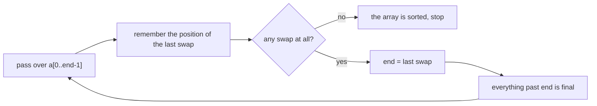
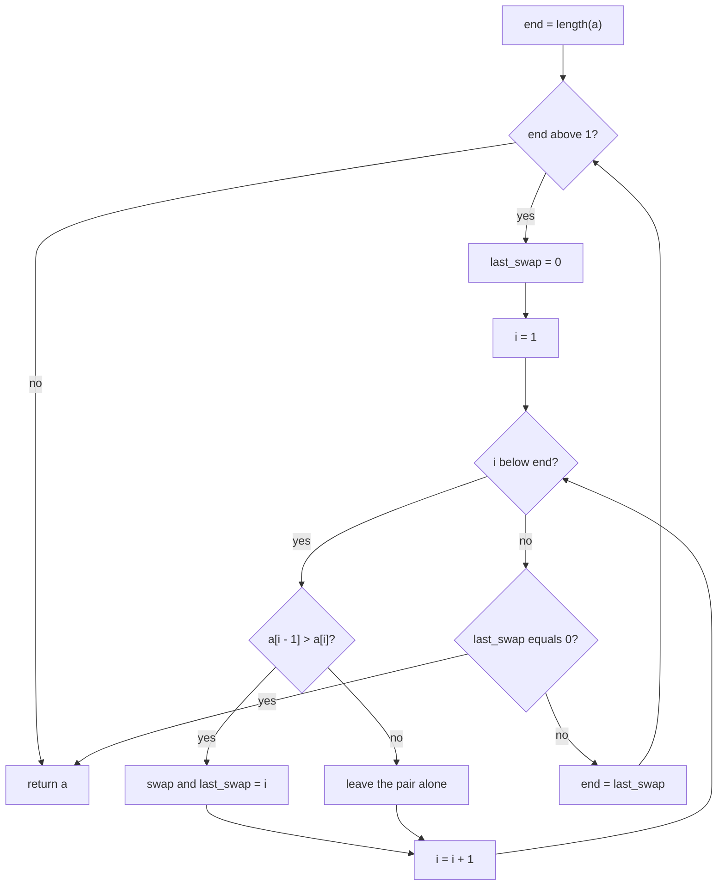
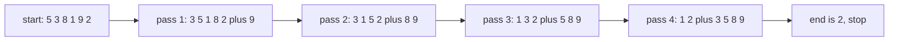
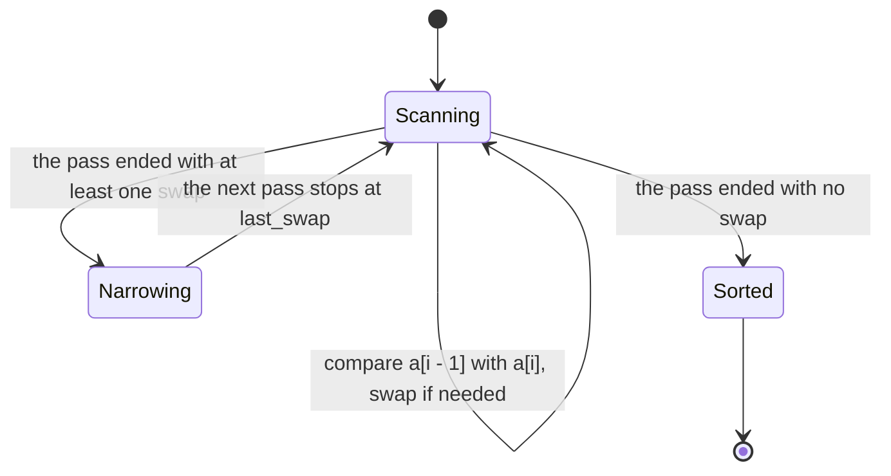

# 071 — Bubble sort (optimized).

> **Tier:** Beginner · **CTCI chapter:** Ch 10 — Sorting and Searching
> **Task spec:** [071-bubble-sort-optimized.md](../../../tasks/beginner/071-bubble-sort-optimized.md)
> **Solutions:** [Python](../../../solutions/python/beginner/071-bubble-sort-optimized/solution.py) ·
> [Java](../../../solutions/java/beginner/071-bubble-sort-optimized/Solution.java) ·
> [JavaScript](../../../solutions/javascript/beginner/071-bubble-sort-optimized/solution.js) ·
> [C#](../../../solutions/csharp/beginner/071-bubble-sort-optimized/Solution.cs)

## 1. Problem restatement

**Input.** An array of integers, sorted in place by repeatedly comparing neighbours and swapping.

**Output.** The same array in non-decreasing order, with the two standard optimizations applied on
top of the textbook version.

| Input | Output | What it checks |
| --- | --- | --- |
| `[5, 3, 8, 1, 9, 2]` | `[1, 2, 3, 5, 8, 9]` | both optimizations change the pass count here |
| `[1, 2, 3]` | `[1, 2, 3]` | the early-exit path: one pass, zero swaps |
| `[]` | `[]` | the loop `end > 1` never starts |
| `[2, 1]` | `[1, 2]` | one swap, then `end` drops to `1` |

The Python docstring lists exactly the two optimizations the four files implement:

1. stop early when a whole pass makes no swaps, and
2. shrink the unsorted suffix to the position of the last swap.

## 2. Intuition

Textbook bubble sort runs `n - 1` passes over the *whole* array, comparing every adjacent pair each
time. Two facts make most of that work pointless, and each fact yields one optimization.

**Fact one: a pass with no swaps means the array is sorted.** If no adjacent pair was out of order,
then `a[i] <= a[i + 1]` held at every index of the pass. The array is sorted, and the remaining passes
can only repeat that observation.

**Fact two: everything after the last swap of a pass is already final.** This is the interesting one.
A bubble pass has an invariant — after the pair `(k - 1, k)` has been compared, `a[k]` holds the largest
value in `a[0 .. k]`. So the last swap at position `last_swap` installs the maximum of the whole scanned
prefix into `a[last_swap]`, and because no later pair needed a swap, the tail

    a[last_swap], a[last_swap + 1], ..., a[end - 1]

came out non-decreasing. Combine the two statements and every value in that tail is at least as large
as every value before it — so those slots are in their final position. The next pass can stop at
`end = last_swap` instead of scanning the whole array again.

Both checks reuse the same variable: `last_swap` starts at `0`, and if no swap happened at all it is
still `0`, which is exactly the sentinel that triggers the early exit. The bound `end` also shrinks
monotonically, so the total comparisons drop well below the textbook `n(n - 1) / 2` on typical input.



## 3. Algorithm

1. Set `end = n`, the length of the array.
2. While `end > 1`:
3. Set `last_swap = 0`.
4. For `i` from `1` to `end - 1`: if `a[i - 1] > a[i]`, swap the pair and set `last_swap = i`.
5. If `last_swap == 0`, no pair was out of order: break out of the loop — the array is sorted.
6. Otherwise set `end = last_swap`, so the next pass skips the finalized tail.
7. Return the array.

```text
procedure bubble_sort(a)
    end ← length(a)
    while end > 1 do
        last_swap ← 0
        for i ← 1 to end - 1 do
            if a[i - 1] > a[i] then
                swap a[i - 1] with a[i]
                last_swap ← i
            end
        end
        if last_swap = 0 then
            break
        end
        end ← last_swap
    end
    return a
end
```

The sentinel deserves a moment. `last_swap` is initialised to `0` and the comparison loop starts at
`i = 1`, so `0` can never be the position of a real swap: an index `0` swap is impossible because the
first pair compares `a[0]` with `a[1]`. `0` therefore means "no swap happened", and any real value is
`>= 1`, which also means the loop terminates the moment a pass ends with `end = 1`.



## 4. Worked example

Sort `[5, 3, 8, 1, 9, 2]`, starting with `end = 6`.

**Pass 1** (`end = 6`), comparing pairs `(0,1)` through `(4,5)`:

| `i` | Comparison | Action | Array | `last_swap` |
| --- | --- | --- | --- | --- |
| `1` | `a[0] = 5 &gt; a[1] = 3` | swap | `[3, 5, 8, 1, 9, 2]` | `1` |
| `2` | `a[1] = 5 &gt; a[2] = 8` | no | `[3, 5, 8, 1, 9, 2]` | `1` |
| `3` | `a[2] = 8 &gt; a[3] = 1` | swap | `[3, 5, 1, 8, 9, 2]` | `3` |
| `4` | `a[3] = 8 &gt; a[4] = 9` | no | `[3, 5, 1, 8, 9, 2]` | `3` |
| `5` | `a[4] = 9 &gt; a[5] = 2` | swap | `[3, 5, 1, 8, 2, 9]` | `5` |

`last_swap = 5`, so `end` becomes `5` — the tail `a[5] = 9` is final and the next pass stops before it.

**Pass 2** (`end = 5`):

| `i` | Comparison | Action | Array | `last_swap` |
| --- | --- | --- | --- | --- |
| `1` | `3 &gt; 5` | no | `[3, 5, 1, 8, 2, 9]` | `0` |
| `2` | `5 &gt; 1` | swap | `[3, 1, 5, 8, 2, 9]` | `2` |
| `3` | `5 &gt; 8` | no | `[3, 1, 5, 8, 2, 9]` | `2` |
| `4` | `8 &gt; 2` | swap | `[3, 1, 5, 2, 8, 9]` | `4` |

`last_swap = 4` puts `end` at `4`; the tail `8, 9` is final.

**Pass 3** (`end = 4`): `3 > 1` swaps into `[1, 3, 5, 2, 8, 9]` with `last_swap = 1`; `3 > 5` is false;
`5 > 2` swaps into `[1, 3, 2, 5, 8, 9]` with `last_swap = 3`. So `end` becomes `3`.

**Pass 4** (`end = 3`): `1 > 3` is false; `3 > 2` swaps into `[1, 2, 3, 5, 8, 9]` with `last_swap = 2`.
`end` becomes `2`, and the condition `end > 1` fails, so the algorithm stops.

| Pass | `end` at the start | Comparisons | Swaps | `end` for the next pass |
| --- | --- | --- | --- | --- |
| 1 | `6` | `5` | `3` | `5` |
| 2 | `5` | `4` | `2` | `4` |
| 3 | `4` | `3` | `2` | `3` |
| 4 | `3` | `2` | `1` | `2` (loop ends) |

Fourteen comparisons instead of the textbook fifteen, and four passes instead of five — and on
`[1, 2, 3]` the early exit fires after a single pass with three comparisons and no swaps at all, which
is the `O(n)` best case.





## 5. Complexity

Let `n` be the length of the array.

| Measure | Bound | Why it holds |
| --- | --- | --- |
| Comparisons, best | `n - 1` | one pass over a sorted array, then the early exit fires |
| Comparisons, worst | `n(n - 1) / 2` | reversed input: every pair swaps, so `last_swap` stays at `end - 1` and `end` shrinks by one per pass |
| Time, best | `O(n)` | the sorted input case: one pass, `n - 1` comparisons, zero swaps |
| Time, average | `O(n²)` | quadratic comparisons dominate; the shrink only removes a constant factor |
| Time, worst | `O(n²)` | reversed input, as above |
| Swaps, worst | `n(n - 1) / 2` | one swap per inverted pair on reversed input |
| Space | `O(1)` | two loop variables and one temporary for the swap |
| Stability | stable | only strictly out-of-order neighbours swap, so equal values never cross |
| Alternative: insertion sort | `O(n)` best, `O(n²)` worst, stable | reaches the same best case with fewer comparisons and writes |
| Alternative: heapsort | `O(n log n)` always, `O(1)` space | task 068 |

The two optimizations change the constant, not the bound: neither can avoid the `n(n - 1) / 2`
comparisons of a reversed input. What they do buy is the `O(n)` best case, which plain bubble sort does
not have, and a much smaller pass count on partially sorted data.

## 6. Pitfalls and edge cases

- **The `0` sentinel is load-bearing.** `last_swap` must start at `0` and the loop must start at `i = 1`
  so that `0` cannot be a real swap position. Starting the inner loop at `i = 0` breaks the check,
  because a swap at index `0` would then be indistinguishable from "no swap".
- **`end = last_swap` must come after the check.** Swapping the two lines makes the loop read
  `end = 0` on the first no-swap pass and then compare `i = 1` with `end - 1 = -1`, skipping the exit.
- **Empty and single-element arrays.** `end = 0` or `end = 1` fails `end > 1` immediately, so both are
  handled without a special case. Python and Java assert the empty array.
- **Shrinking to `last_swap` is exact, not conservative.** The tail from `last_swap` to `end - 1` is
  provably final, as the invariant above shows; shrinking further would skip unfinished work, because
  `a[last_swap - 1]` was involved in the last swap and is *not* settled.
- **Stability comes from strictness.** Only `a[i - 1] > a[i]` swaps, so equal neighbours are left
  alone and equal keys keep their relative order — bubble sort is one of the stable sorts.
- **Choosing it in practice.** Bubble sort is the slowest of the simple sorts even with both
  optimizations; its value here is pedagogical. The Python docstring of task 070 puts the practical
  rule differently: insertion sort is the one to reach for on small inputs.
- **The early exit is not free.** Resetting `last_swap` and testing it costs one write and one branch
  per pass; on a real workload that is negligible compared with the comparisons.

## 7. Variants and follow-ups

- **Cocktail shaker sort.** Alternating the direction of the pass fixes the "turtles" case, where a
  small value at the far end takes one pass per position to travel left.
- **Selection sort.** [069-selection-sort.md](../../../tasks/beginner/069-selection-sort.md) removes
  the repeated comparison work from the write side instead of the pass count.
- **Insertion sort.** [070-insertion-sort.md](../../../tasks/beginner/070-insertion-sort.md) is the
  simple sort that keeps the `O(n)` best case and does better on nearly sorted data.
- **`O(n log n)` in place.** [068-heapsort-using-heap-operations.md](../../../tasks/beginner/068-heapsort-using-heap-operations.md)
  is the answer when the array is too large for a quadratic sort.
- **Counting the inversions instead.** The pair swaps bubble sort performs are exactly what
  [086-count-inversion-pairs-using-naive-o-n-2.md](../../../tasks/beginner/086-count-inversion-pairs-using-naive-o-n-2.md)
  counts, and
  [087-implement-merge-and-count-inversions-using-merge-sort.md](../../../tasks/beginner/087-implement-merge-and-count-inversions-using-merge-sort.md)
  counts them in `O(n log n)`.
- The sort table in [Sorting and Searching](../../ctci/10-sorting-and-searching.md) marks bubble sort
  as "education only".

## 8. Check yourself

1. Why does `last_swap = 0` mean "no swap happened"?

<details><summary>Show answer</summary>

Because the inner loop starts at `i = 1`, so the earliest possible swap position is `1`. A swap at
`i = 1` compares `a[0]` with `a[1]` and records `last_swap = 1`. Value `0` is never written by a real
swap, so it is free to serve as the flag for "this pass changed nothing".

</details>

2. Why is everything from `last_swap` to `end - 1` guaranteed to be in its final position?

<details><summary>Show answer</summary>

A pass maintains the invariant that after comparing the pair `(k - 1, k)`, the value at `a[k]` is the
largest of `a[0 .. k]`. The last swap therefore puts the maximum of the scanned prefix at
`a[last_swap]`, and because no later pair was out of order the tail from there to `end - 1` is
non-decreasing. Every value in the tail is at least as large as everything before it, so no future pass
can move any of them.

</details>

3. What exactly do the optimizations change about the asymptotic cost?

<details><summary>Show answer</summary>

Only the best case. The early exit turns sorted input into a single pass, so the best case becomes
`O(n)` instead of `O(n²)`. The shrink reduces the constant factor on typical input by skipping the
finalized tail, but the worst case — a reversed array, where every pass swaps at the last pair — is
still `n(n - 1) / 2` comparisons.

</details>

4. How many comparisons does the optimized version use on `[1, 2, 3]`, and how many passes run?

<details><summary>Show answer</summary>

Two comparisons and one pass. The first pass compares `1` with `2` and then `2` with `3`, finds no
inversions, leaves `last_swap` at `0` and exits. Plain bubble sort would have used three comparisons
across two passes.

</details>

5. Bubble sort swaps only when `a[i - 1] > a[i]`. What does that buy?

<details><summary>Show answer</summary>

Stability. Equal values are never swapped, so their relative order is preserved. A comparison like
`a[i - 1] >= a[i]` would keep sorting correctly but would exchange equal keys every time they meet, and
records that compare equal on the sort key would silently be reordered.

</details>
