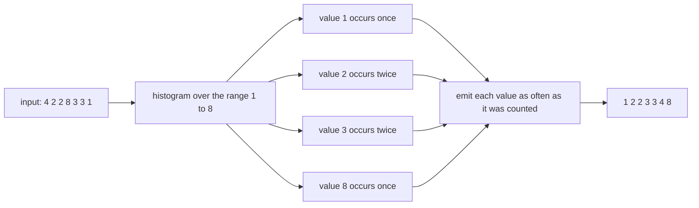
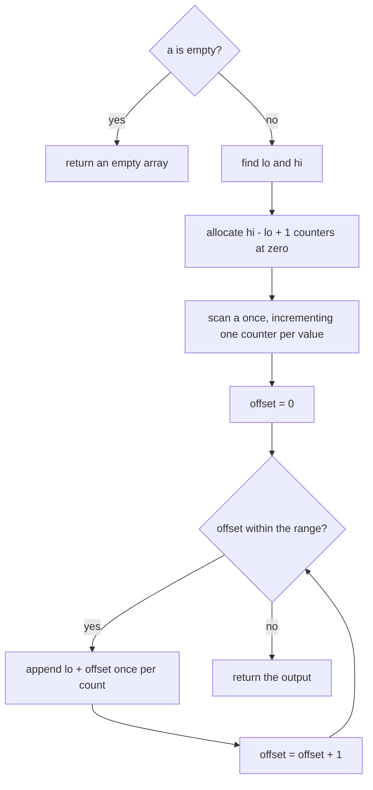
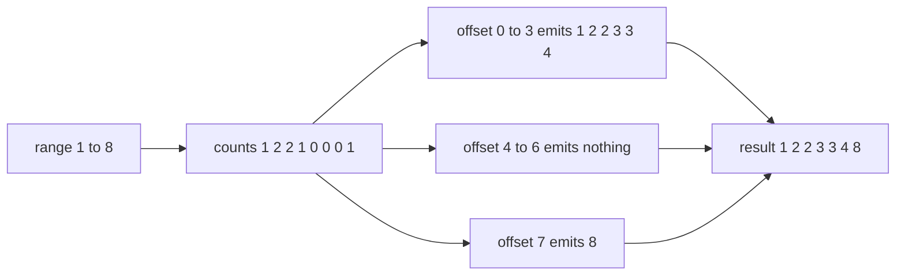
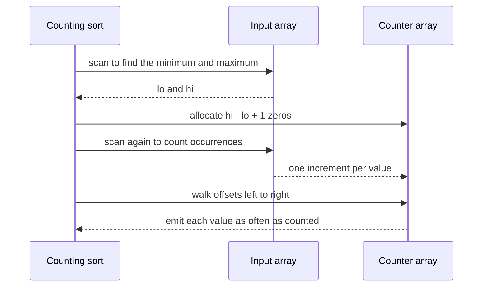

# 072 — Count sort for small integer range.

> **Tier:** Beginner · **CTCI chapter:** Ch 10 — Sorting and Searching
> **Task spec:** [072-count-sort-for-small-integer-range.md](../../../tasks/beginner/072-count-sort-for-small-integer-range.md)
> **Solutions:** [Python](../../../solutions/python/beginner/072-count-sort-for-small-integer-range/solution.py) ·
> [Java](../../../solutions/java/beginner/072-count-sort-for-small-integer-range/Solution.java) ·
> [JavaScript](../../../solutions/javascript/beginner/072-count-sort-for-small-integer-range/solution.js) ·
> [C#](../../../solutions/csharp/beginner/072-count-sort-for-small-integer-range/Solution.cs)

## 1. Problem restatement

**Input.** An array of integers whose values span a small range — the sort is only sensible when the
range is comparable to the number of elements. Negative values are allowed, as long as the *width* of
the range is small.

**Output.** A new array in non-decreasing order. This is the first sort in the tier that is **not** in
place: all four files allocate and return a fresh array.

| Input | Output | What it checks |
| --- | --- | --- |
| `[4, 2, 2, 8, 3, 3, 1]` | `[1, 2, 2, 3, 3, 4, 8]` | duplicates, gaps in the value range |
| `[]` | `[]` | the empty guard before `min`/`max` is computed |
| `[7, 7]` | `[7, 7]` | a range of width `1` and two identical values |
| `[-3, -1, -3]` | `[-3, -3, -1]` | negatives are handled by shifting with the minimum |

The Python docstring gives the bound and the caveat: `O(n + k)` where `k` is the value range, and
"stable when built with prefix sums" — which is a statement about the *other* form of the algorithm,
so section 6 returns to it.

## 2. Intuition

Every sort so far compared values. Counting sort throws comparison away and answers a different
question: **how many times does each value occur?** Once that multiset is known, the sorted order is
forced — the output is the smallest value repeated as many times as it occurs, then the next value,
and so on.

That is why the algorithm can beat the `O(n log n)` comparison bound: it never asks which of two
values is larger. It uses the values themselves as indices into a table, which is only possible when
the values are small non-negative integers (or can be shifted into that shape).

The table is a **frequency histogram** with one slot per value in the range. `counts[v - lo]` holds the
number of times `v` appears, where `lo` is the smallest value seen. Reading the histogram from left to
right and emitting each value as many times as its counter says produces the sorted array directly,
and duplicates come out for free — they simply inflate a counter instead of creating a second entry.



## 3. Algorithm

1. If the array is empty, return an empty array — there is no minimum to compute.
2. Find `lo` and `hi`, the smallest and largest values.
3. Allocate a counter array of length `hi - lo + 1` filled with zeros.
4. For each value `x`, increment `counts[x - lo]`.
5. Walk the counter array from offset `0` to `hi - lo`, and for each offset append `lo + offset`
   `counts[offset]` times to the output.
6. Return the output.

```text
procedure counting_sort(a)
    if a is empty then
        return an empty array
    end
    lo ← smallest value in a
    hi ← largest value in a
    counts ← array of hi - lo + 1 zeros
    for each x in a do
        counts[x - lo] ← counts[x - lo] + 1
    end
    out ← empty array
    for offset ← 0 to hi - lo do
        for c ← 1 to counts[offset] do
            append lo + offset to out
        end
    end
    return out
end
```

Two passes over the input and one pass over the histogram, so no comparison between input values ever
happens; the ordering information lives entirely in the *indices* of `counts`. The `- lo` shift is what
makes negatives work: `-3` with `lo = -3` maps to offset `0`, and `lo + offset` maps back.



## 4. Worked example

Sort `[4, 2, 2, 8, 3, 3, 1]`. The range is `lo = 1` to `hi = 8`, so the histogram has `8` slots.

| Offset | Value `lo + offset` | Increments during the scan | Final count |
| --- | --- | --- | --- |
| `0` | `1` | one, for the `1` at index `6` | `1` |
| `1` | `2` | two, for the `2`s | `2` |
| `2` | `3` | two, for the `3`s | `2` |
| `3` | `4` | one | `1` |
| `4` | `5` | none | `0` |
| `5` | `6` | none | `0` |
| `6` | `7` | none | `0` |
| `7` | `8` | one | `1` |

The counter array is `[1, 2, 2, 1, 0, 0, 0, 1]`. Note that offsets `4`, `5` and `6` are zero: values
`5`, `6` and `7` never occur, and the emission loop skips them without a branch, because "append
`counts[offset]` copies" of zero copies is nothing at all.

Now expand, left to right:

| Offset | Value | Count | Emitted | Output so far |
| --- | --- | --- | --- | --- |
| `0` | `1` | `1` | `1` | `[1]` |
| `1` | `2` | `2` | `2, 2` | `[1, 2, 2]` |
| `2` | `3` | `2` | `3, 3` | `[1, 2, 2, 3, 3]` |
| `3` | `4` | `1` | `4` | `[1, 2, 2, 3, 3, 4]` |
| `4` | `5` | `0` | nothing | `[1, 2, 2, 3, 3, 4]` |
| `5` | `6` | `0` | nothing | `[1, 2, 2, 3, 3, 4]` |
| `6` | `7` | `0` | nothing | `[1, 2, 2, 3, 3, 4]` |
| `7` | `8` | `1` | `8` | `[1, 2, 2, 3, 3, 4, 8]` |

The negative assertion behaves the same way one range lower. For `[-3, -1, -3]` the range is `lo = -3`
to `hi = -1`, so there are three counters: `counts[0]` receives both `-3`s, `counts[1]` receives
nothing, and `counts[2]` receives the single `-1`. Expansion emits `-3, -3, -1`, the asserted output.





## 5. Complexity

Let `n` be the number of values and `k = hi - lo + 1` the width of the value range.

| Measure | Bound | Why it holds |
| --- | --- | --- |
| Time, best | `O(n + k)` | finding the extremes is one pass, counting is another, expansion is a walk over `k` counters |
| Time, average | `O(n + k)` | the work does not depend on the *order* of the input at all |
| Time, worst | `O(n + k)` | the same three passes; there is no adaptive or adversarial case |
| Space, extra | `O(k)` | the counter array, and the returned output of `n` values |
| Space, total | `O(n + k)` | the four files also return a new array rather than sorting in place |
| Stability | not observable here | for plain integers the sorted output is uniquely determined; see section 6 |
| Comparison bound | not applicable | `O(n + k)` beats `Ω(n log n)` because no two values are ever compared |
| Alternative: comparison sort | `O(n log n)` | tasks 068 to 071 |
| Alternative: radix sort | `O(d(n + 10))` | task 073, which uses counting as a subroutine per digit |

The `k` in the bound is the whole story of when this sort is appropriate. When `k` is close to `n` the
sort is effectively linear; when `k` is enormous — say `n = 100` values spread over `-10^9` to `10^9` —
the counter array alone would be billions of slots, and the `O(k)` memory is far worse than simply
sorting the `100` values.

## 6. Pitfalls and edge cases

- **Empty input.** `min`/`max` of an empty array are undefined, so every file returns early. The
  Python version returns `[]`, the Java and C# versions return `new int[0]`, and the JavaScript version
  returns `[]`.
- **The shipped form is not the stable form.** These files expand the counters in value order and never
  look at the payload, so the output is fully determined by the multiset of values. That is all an
  array of plain integers needs, and it is why the docstring's remark about stability is about a
  *variant*: the prefix-sum form (turn counts into start offsets, then place each element in its
  original order) preserves the relative order of equal keys, which is what radix sort requires. Task
  073 shows it in the Java and C# files.
- **Huge ranges.** `k` is `hi - lo + 1`, not `hi`. Values `-3` and `-1` need three counters, not four
  billion, because the shift by `lo` removes the offset — but `[-3, 1000000000]` would allocate a
  billion counters for two values.
- **The minimum is not assumed to be zero.** Assuming non-negative values and indexing `counts[x]`
  directly is the classic bug; the `- lo` shift is what makes the negative assertion pass.
- **Non-integer and non-orderable keys.** The algorithm uses values as array indices, so floats,
  strings and objects cannot be sorted this way without a separate mapping step.
- **Not in place.** Unlike selection, insertion and bubble sort, this sort returns a *new* array. A
  caller that needs the original buffer mutated has to copy the result back.
- **No early exit.** An already sorted input still takes both passes and the full expansion; counting
  sort is never adaptive.
- **JavaScript argument spreading.** The JS file computes the extremes with `Math.min(...a)` and
  `Math.max(...a)`, which passes one argument per element; on a very large array that can exceed the
  engine's argument limit and throw a `RangeError`, even though the algorithm itself is linear.

## 7. Variants and follow-ups

- **Radix sort.** [073-radix-sort-for-non-negative-integers.md](../../../tasks/beginner/073-radix-sort-for-non-negative-integers.md)
  applies counting sort one digit at a time, which turns "small range" into "fixed width" and drops the
  `k` term to `10`.
- **Bucket sort.** Distribute values into buckets by range and sort each bucket with a comparison sort;
  the natural answer when the data is roughly uniform but the exact range is large.
- **Counting as a pre-step.** [089-implement-simple-frequency-histogram-integers.md](../../../tasks/beginner/089-implement-simple-frequency-histogram-integers.md)
  builds the same histogram without sorting, and
  [048-find-most-frequent-element-in-array.md](../../../tasks/beginner/048-find-most-frequent-element-in-array.md)
  reads the maximum out of it.
- **The comparison sorts it replaces.**
  [068-heapsort-using-heap-operations.md](../../../tasks/beginner/068-heapsort-using-heap-operations.md),
  [069-selection-sort.md](../../../tasks/beginner/069-selection-sort.md) and
  [071-bubble-sort-optimized.md](../../../tasks/beginner/071-bubble-sort-optimized.md) all handle
  arbitrary key ranges but never beat `O(n log n)`.
- **Prefix sums without sorting.**
  [081-compute-prefix-sums-for-an-array.md](../../../tasks/beginner/081-compute-prefix-sums-for-an-array.md)
  is the same accumulation idea applied to ranges rather than to order.
- The linear-sort row of the table in [Sorting and Searching](../../ctci/10-sorting-and-searching.md)
  is where this algorithm sits.

## 8. Check yourself

1. Why can counting sort run in `O(n + k)` when comparison sorts are stuck at `O(n log n)`?

<details><summary>Show answer</summary>

Because it never compares two values. The `Ω(n log n)` bound applies to algorithms whose only source of
information is the outcome of comparisons; counting sort instead uses the values as indices into a
table, gathering information about the whole array in a single pass. The price is that it needs a
counter per distinct value in the range, hence the `k` term.

</details>

2. What is the counter array for `[4, 2, 2, 8, 3, 3, 1]`, and which offsets hold zero?

<details><summary>Show answer</summary>

`[1, 2, 2, 1, 0, 0, 0, 1]` for the values `1..8`. Offsets `4`, `5` and `6` (values `5`, `6`, `7`) hold
zero because those values never appear; the emission loop simply appends nothing for them.

</details>

3. How are negative values handled?

<details><summary>Show answer</summary>

By shifting them with the minimum. `lo = -3` means `-3` is stored at offset `0`, and the emission step
writes `lo + offset` instead of `offset`. For `[-3, -1, -3]` the counters are `[2, 0, 1]` and the output
is `-3, -3, -1`.

</details>

4. When is counting sort a bad idea even though it is linear?

<details><summary>Show answer</summary>

Whenever `k`, the width of the value range, is much larger than `n`. The `O(k)` memory for the counters
dominates: sorting 100 values spread across a range of a billion would allocate a billion counters. The
first step of a real implementation should be the sanity check "is `hi - lo` close to `n`?".

</details>

5. Why does the docstring mention stability when the shipped code does not need it?

<details><summary>Show answer</summary>

Because counting sort is usually used as a *subroutine*, most notably inside radix sort. There, equal
keys are common and the relative order of elements with the same digit must be preserved from one digit
pass to the next. The prefix-sum placement form does that; the simple expansion form used here cannot,
since it never looks at the elements' original order.

</details>
