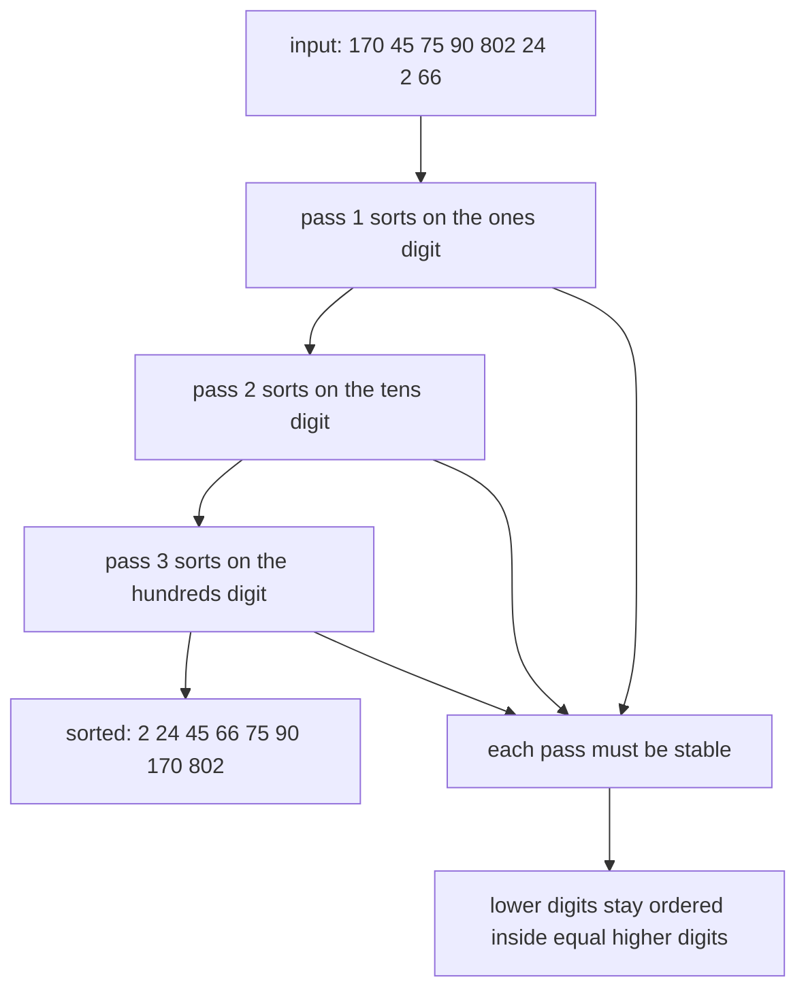
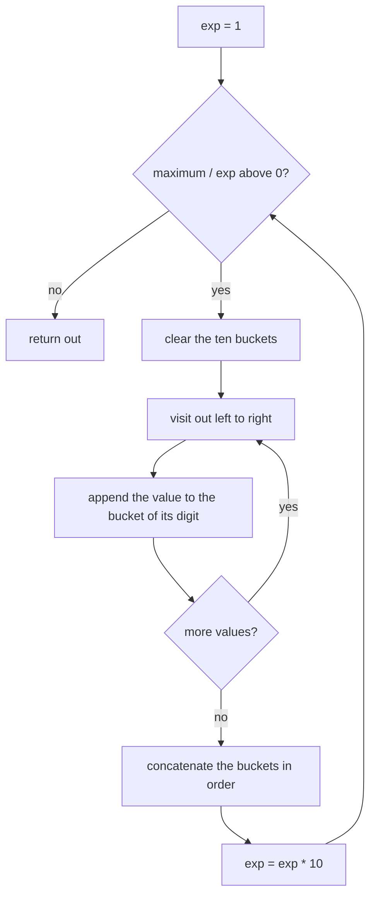
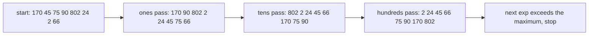
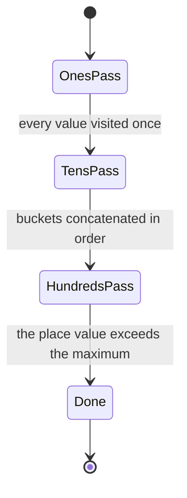

# 073 — Radix sort for non-negative integers.

> **Tier:** Beginner · **CTCI chapter:** Ch 10 — Sorting and Searching
> **Task spec:** [073-radix-sort-for-non-negative-integers.md](../../../tasks/beginner/073-radix-sort-for-non-negative-integers.md)
> **Solutions:** [Python](../../../solutions/python/beginner/073-radix-sort-for-non-negative-integers/solution.py) ·
> [Java](../../../solutions/java/beginner/073-radix-sort-for-non-negative-integers/Solution.java) ·
> [JavaScript](../../../solutions/javascript/beginner/073-radix-sort-for-non-negative-integers/solution.js) ·
> [C#](../../../solutions/csharp/beginner/073-radix-sort-for-non-negative-integers/Solution.cs)

## 1. Problem restatement

**Input.** An array of **non-negative** integers. The restriction is part of the task title and it is
real: the digit extraction used by the algorithm has no way to express a sign.

**Output.** A new array in non-decreasing order, produced by sorting on one decimal digit at a time,
least significant digit first.

| Input | Output | What it checks |
| --- | --- | --- |
| `[170, 45, 75, 90, 802, 24, 2, 66]` | `[2, 24, 45, 66, 75, 90, 170, 802]` | mixed digit widths in one array |
| `[]` | `[]` | the empty guard |
| `[7]` | `[7]` | a single value with one digit (asserted in Python and Java) |
| `[0, 10, 100]` | `[0, 10, 100]` | trailing zeros must not disturb the order |

The Python docstring states the target bound: `O(d * (n + 10))` for `d` digit passes over `n` values
and `10` buckets.

## 2. Intuition

Counting sort is linear but only when the value range is small. For integers up to a billion, the range
is not small — but the *number of decimal digits* is. Radix sort exploits that by never sorting on the
whole value: it sorts on the ones digit, then the tens digit, then the hundreds, and so on.

Sorting on a single digit is exactly counting sort over a range of ten, so each pass is cheap. The
problem is that after the first pass the array is ordered by the ones digit, and the second pass looks
like it would destroy that. It does not, **provided each pass is stable**, and that requirement is the
heart of the algorithm:

> If a pass leaves equal digits in their previous relative order, then the ordering established by the
> earlier (lower) digits survives underneath the new (higher) digit ordering.

So after the tens pass, values are grouped by tens digit, and inside each group the ones-digit order
from the previous pass is still intact. When the highest digit pass finishes, the last sort key that
was applied is the most significant one, and everything below it is already sorted — which is precisely
lexicographic order, and for fixed-width decimal representations that is numeric order.



## 3. Algorithm

1. If the array is empty, return an empty array.
2. Find `max`, the largest value; it fixes the number of passes.
3. Set `exp = 1`, the place value of the digit currently being sorted on.
4. While `max / exp > 0` (that is, while the current place is a digit of some value):
5. Distribute every element into one of ten buckets according to the digit `(x / exp) % 10`,
   preserving the order in which elements arrive in each bucket.
6. Rebuild the array by concatenating the buckets from `0` to `9` in order.
7. Multiply `exp` by `10` and repeat.
8. Return the array.

```text
procedure radix_sort(a)
    if a is empty then
        return an empty array
    end
    maximum ← largest value in a
    out ← copy of a
    exp ← 1
    while maximum / exp > 0 do
        buckets ← ten empty lists numbered 0 to 9
        for each x in out do
            digit ← (x / exp) % 10
            append x to buckets[digit]
        end
        out ← concatenation of buckets 0 to 9 in order
        exp ← exp * 10
    end
    return out
end
```

Two of the four files express step 5 differently. Python and JavaScript use ten real lists, so the
stability is the natural FIFO behaviour of appending to a list. Java and C# instead do a counting pass
over the digit, turn the counts into prefix sums, and then place elements **from the end of the array
backwards** into the computed positions — the classic stable counting-sort placement in a single output
array. Both versions are stable; they differ only in where the temporary storage lives.



## 4. Worked example

Sort `[170, 45, 75, 90, 802, 24, 2, 66]`. The largest value is `802`, so there are three passes:
`exp = 1`, `10`, `100`.

**Pass 1, `exp = 1`** — the digit is `(x / 1) % 10`, the ones digit:

| Value | `170` | `45` | `75` | `90` | `802` | `24` | `2` | `66` |
| --- | --- | --- | --- | --- | --- | --- | --- | --- |
| Ones digit | `0` | `5` | `5` | `0` | `2` | `4` | `2` | `6` |

Buckets: `0` holds `170, 90`; `2` holds `802, 2`; `4` holds `24`; `5` holds `45, 75`; `6` holds `66`.
Concatenating gives `[170, 90, 802, 2, 24, 45, 75, 66]`. Inside bucket `2` the value `802` arrives before
`2`, and that order is preserved — this is where stability matters.

**Pass 2, `exp = 10`** — the tens digit:

| Value | `170` | `90` | `802` | `2` | `24` | `45` | `75` | `66` |
| --- | --- | --- | --- | --- | --- | --- | --- | --- |
| Tens digit | `7` | `9` | `0` | `0` | `2` | `4` | `7` | `6` |

Buckets: `0` holds `802, 2`; `2` holds `24`; `4` holds `45`; `6` holds `66`; `7` holds `170, 75`; `9`
holds `90`. Concatenating gives `[802, 2, 24, 45, 66, 170, 75, 90]`.

Bucket `0` shows the stability argument in action: `802` and `2` have the same tens digit, so the
ones-digit order from pass 1 (`802` before `2`) is what decides their order — and indeed `802` was
first. Bucket `7` shows the same for `170` and `75`, whose ones digits are `0` and `5`.

**Pass 3, `exp = 100`** — the hundreds digit:

| Value | `802` | `2` | `24` | `45` | `66` | `170` | `75` | `90` |
| --- | --- | --- | --- | --- | --- | --- | --- | --- |
| Hundreds digit | `8` | `0` | `0` | `0` | `0` | `1` | `0` | `0` |

Buckets: `0` holds `2, 24, 45, 66, 75, 90`; `1` holds `170`; `8` holds `802`. Concatenating gives
`[2, 24, 45, 66, 75, 90, 170, 802]`, the expected output. Values shorter than three digits have no
hundreds digit at all, and integer division turns that into a leading zero — which is why `2`, `24`,
`45`, `66`, `75` and `90` all land in bucket `0` and `802` alone lands in bucket `8`.

After that pass `exp` becomes `1000` and `802 / 1000` is `0`, so the loop ends.

| Pass | `exp` | Buckets used | Array after the pass |
| --- | --- | --- | --- |
| 1 | `1` | `0, 2, 4, 5, 6` | `[170, 90, 802, 2, 24, 45, 75, 66]` |
| 2 | `10` | `0, 2, 4, 6, 7, 9` | `[802, 2, 24, 45, 66, 170, 75, 90]` |
| 3 | `100` | `0, 1, 8` | `[2, 24, 45, 66, 75, 90, 170, 802]` |





## 5. Complexity

Let `n` be the number of values and `d` the number of digits of the largest value (`d = 3` for
`802`).

| Measure | Bound | Why it holds |
| --- | --- | --- |
| Time, best | `O(d(n + 10))` | `d` passes; each pass visits every value once and walks ten buckets |
| Time, average | `O(d(n + 10))` | digit distribution never changes the work per pass |
| Time, worst | `O(d(n + 10))` | no input-dependent branch exists |
| Time, all values zero | `O(1)` beyond the copy | `max / exp` is `0` on the first test, so the loop body never runs |
| Space, extra | `O(n + 10)` | the ten buckets or the placement array for the current pass |
| Stability | required, and achieved | Python and JavaScript by FIFO bucket appends, Java and C# by reverse-order placement |
| Negative values | unsupported | the task title restricts the input to non-negative integers |
| Alternative: counting sort | `O(n + k)`, `k` is the whole range | task 072, only usable for a small range |
| Alternative: comparison sorts | `O(n log n)` | tasks 068 to 071, no restriction on the keys |

The digit count `d` is what ties the bound to the data: for 32-bit values it is at most `10`, so radix
sort is effectively linear in `n` with a constant of about `10` passes. That is why the algorithm is
described as `O(d(n + 10))` rather than as purely linear — the constant hides a loop over the digits of
the largest value, and it grows if the values get wider.

## 6. Pitfalls and edge cases

- **Negative values.** Not supported, and the task title says so. The usual fixes are to offset all
  values by their minimum or to sort negatives separately by absolute value and reverse them; both
  change the code more than they look.
- **Stability is not optional.** If a pass reorders elements with equal digits, every earlier pass is
  undone. The Python and JavaScript files get stability from list appends; the Java and C# files get it
  from the right-to-left placement that pairs with prefix sums. Replacing that loop with a
  left-to-right one silently produces a wrong order.
- **Empty input.** `max` of an empty array is undefined, so all four files check the length first and
  return an empty array.
- **All values zero.** `max = 0`, and `while max / exp > 0` is already false with `exp = 1`, so the loop
  body never executes and the copy of the input is returned. That is correct — the array is sorted —
  but it is a case worth tracing, because it means the algorithm can perform *zero* digit passes.
- **`exp` overflow in fixed-width languages.** `exp` is multiplied by `10` one time more than necessary
  before the loop test fails, so for a value near `Integer.MAX_VALUE` a 32-bit `exp` overflows and the
  loop can run forever. The Java and C# files declare `exp` as `long` for exactly this reason.
- **Digit extraction.** `(x / exp) % 10` relies on integer division. In Python this is `//`; in Java,
  JavaScript and C# the operands are integers already, but dividing two floating-point numbers would
  break the digit.
- **Wide values mean more passes.** The number of passes is driven by the *largest* value, not by `n`,
  so a single large element adds a pass for every extra digit.

## 7. Variants and follow-ups

- **The per-digit subroutine.** [072-count-sort-for-small-integer-range.md](../../../tasks/beginner/072-count-sort-for-small-integer-range.md)
  is exactly what each pass does, and its prefix-sum form explains the Java and C# placement loops.
- **A linear sort without digits.** Bucket sort distributes values by range instead of by digit and is
  the better choice for floating-point data.
- **The comparison sorts it replaces.**
  [068-heapsort-using-heap-operations.md](../../../tasks/beginner/068-heapsort-using-heap-operations.md)
  and [069-selection-sort.md](../../../tasks/beginner/069-selection-sort.md) have no restriction on the
  key range but cannot beat `O(n log n)`.
- **Stability as a design goal.** [074-implement-simple-stable-partition.md](../../../tasks/beginner/074-implement-simple-stable-partition.md)
  is the tier's other routine whose correctness depends on preserving relative order.
- **Digit arithmetic practice.** [030-reverse-digits-of-an-integer.md](../../../tasks/beginner/030-reverse-digits-of-an-integer.md)
  and [018-convert-integer-to-string.md](../../../tasks/beginner/018-convert-integer-to-string.md)
  work the same `divide and take the remainder` loop in the other direction.
- The linear-sort row of the table in [Sorting and Searching](../../ctci/10-sorting-and-searching.md)
  lists radix sort as `O(d(n + b))` for `b` buckets.

## 8. Check yourself

1. Why must each digit pass be stable?

<details><summary>Show answer</summary>

Because the passes build on each other. A pass sorts on one digit; the order established by all lower
digits must survive underneath it. That only happens if elements with the same current digit keep their
previous relative order, which is exactly stability. A single unstable pass destroys the work of every
pass before it.

</details>

2. How many passes does `[170, 45, 75, 90, 802, 24, 2, 66]` need, and how is that number decided?

<details><summary>Show answer</summary>

Three, one per digit of the largest value `802`. The loop continues while `max / exp > 0` with `exp`
taking the values `1`, `10`, `100`; at `exp = 1000` the test fails. The number of passes depends on the
maximum, never on the length of the array.

</details>

3. What happens if the input is a single `0`?

<details><summary>Show answer</summary>

The array is copied and returned unchanged, with no digit pass at all. `max = 0`, so `0 / 1 > 0` is
false and the loop body never runs. The result is correct because a one-element array is already
sorted.

</details>

4. Why can radix sort handle values up to a billion when counting sort cannot?

<details><summary>Show answer</summary>

Because it never allocates a counter per *value* — it allocates a counter per *digit*, and there are only
ten of them. The "small range" condition that counting sort needs is replaced by "fixed number of
digits", and a billion still has only ten decimal digits.

</details>

5. Where in the Java and C# files does stability come from?

<details><summary>Show answer</summary>

From placing elements into the output array from right to left after turning digit counts into prefix
sums. Because the loop walks the input backwards and each value goes into the last free slot of its
digit group, elements with equal digits end up in their original relative order. Reversing that loop
direction would make the pass unstable.

</details>
