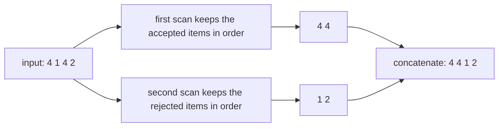
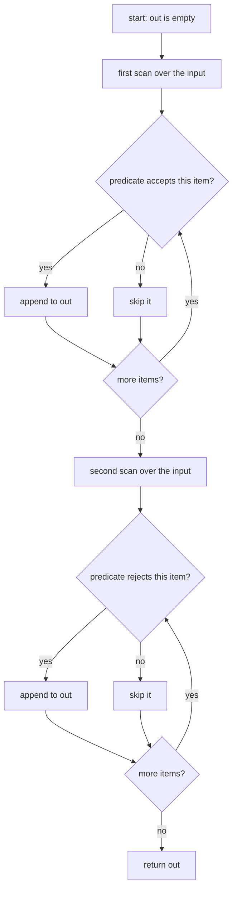
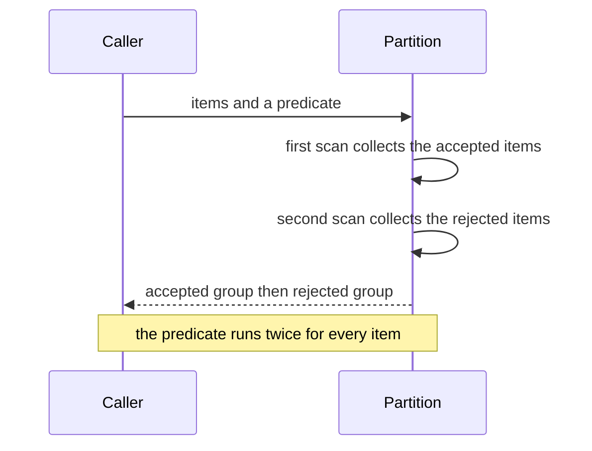

# 074 — Implement simple stable partition.

> **Tier:** Beginner · **CTCI chapter:** Ch 10 — Sorting and Searching
> **Task spec:** [074-implement-simple-stable-partition.md](../../../tasks/beginner/074-implement-simple-stable-partition.md)
> **Solutions:** [Python](../../../solutions/python/beginner/074-implement-simple-stable-partition/solution.py) ·
> [Java](../../../solutions/java/beginner/074-implement-simple-stable-partition/Solution.java) ·
> [JavaScript](../../../solutions/javascript/beginner/074-implement-simple-stable-partition/solution.js) ·
> [C#](../../../solutions/csharp/beginner/074-implement-simple-stable-partition/Solution.cs)

## 1. Problem restatement

**Input.** A sequence of items and a predicate — a function that answers yes or no for one item.

**Output.** A new sequence with every item the predicate accepts first, then every item it rejects. The
word *stable* in the title is the whole problem: items must keep their relative order **inside both
groups**.

| Items | Predicate | Result | What it checks |
| --- | --- | --- | --- |
| `[1, 2, 3, 4, 5, 6]` | even? | `[2, 4, 6, 1, 3, 5]` | ordinary two-group split |
| `[]` | always true | `[]` | empty input, no calls to the predicate matter |
| `[1, 3, 5]` | even? | `[1, 3, 5]` | nothing is accepted, the second group is the whole input |
| `[4, 1, 4, 2]` | equal to `4`? | `[4, 4, 1, 2]` | stability: both `4`s keep their original order |

The docstring states the cost and the alternative: `O(n)` time with `O(n)` extra space, or `O(n²)` in
place using rotations.

## 2. Intuition

The obvious in-place approach mirrors quicksort's partition: walk two pointers towards each other, and
whenever the left pointer finds a rejected item and the right pointer an accepted one, swap them. That
is `O(n)` time and `O(1)` space — and it is **unstable**, because a swap throws the left item to the far
right and the right item to the far left, past every equal item they jumped over.

The insight here is that stability is cheap if you stop insisting on doing it in place. Stability means
"the accepted items appear in their original order, and so do the rejected ones" — which is exactly what
two separate sequential scans produce. Scan the input once and append every accepted item to the first
group; scan it again and append every rejected item to the second group; concatenate. Both scans move
forward in the same direction as the input, so no pair of items can ever be inverted.



The two-pointer alternative is not wrong, only different: it trades stability for `O(1)` space, which
is why every standard library offers both a `partition` (unstable, in place) and a `stable_partition`
(buffer or rotate-based).

## 3. Algorithm

1. Create an empty result with room for every item.
2. **First scan.** For each item in input order, if the predicate accepts it, append it to the result.
3. **Second scan.** For each item in input order, if the predicate rejects it, append it to the result.
4. Return the result.

```text
procedure stable_partition(items, predicate)
    out ← empty sequence
    for each x in items do
        if predicate(x) is true then
            append x to out
        end
    end
    for each x in items do
        if predicate(x) is false then
            append x to out
        end
    end
    return out
end
```

The Python and JavaScript files reach the same result through two filters — `[x for x in items if
predicate(x)]` followed by the complement — and the Java and C# files use two explicit loops with a
single write index. All four are the two-scan shape above, and all four evaluate the predicate **twice
per item**, once in each scan. That is not just a detail: it means the predicate must be a pure
function.

The in-place variant from the docstring replaces the buffer with rotations. When the walk finds a
rejected item at index `i`, it rotates it right past the block of accepted items that follows it, which
moves the item without changing the order of anything else — at the cost of `O(n)` moves per item and
therefore `O(n²)` time overall.



## 4. Worked example

Partition `[4, 1, 4, 2]` with the predicate "is equal to `4`". This is the assertion that separates a
stable partition from an arbitrary one; the two `4`s are distinguishable in the trace even though their
values are equal.

| Step | Item visited | Predicate | Action | First group so far | Second group so far |
| --- | --- | --- | --- | --- | --- |
| scan 1 | `4` (original index `0`) | true | append | `[4a]` | `[]` |
| scan 1 | `1` | false | skip | `[4a]` | `[]` |
| scan 1 | `4` (original index `2`) | true | append | `[4a, 4b]` | `[]` |
| scan 1 | `2` | false | skip | `[4a, 4b]` | `[]` |
| scan 2 | `4` (original index `0`) | true | skip | `[4a, 4b]` | `[]` |
| scan 2 | `1` | false | append | `[4a, 4b]` | `[1]` |
| scan 2 | `4` (original index `2`) | true | skip | `[4a, 4b]` | `[1]` |
| scan 2 | `2` | false | append | `[4a, 4b]` | `[1, 2]` |

The two groups are concatenated to give `[4a, 4b, 1, 2]`, which the assertions compare with `[4, 4, 1,
2]`. The subscripted labels are how you *see* stability: `4a` came before `4b` in the input and still
does in the output. An unstable two-pointer partition on the same input would swap the first `4` with
the `2` and could produce `[2, 1, 4, 4]`-style orderings of the two equal items.

The first assertion in the files is the same shape with different data: `[1, 2, 3, 4, 5, 6]` with "is
even" gives `[2, 4, 6]` followed by `[1, 3, 5]`, and the fourth assertion `[1, 3, 5]` with the same
predicate has an empty first group, so the output equals the input.

| Input | Accepted | Rejected | Output |
| --- | --- | --- | --- |
| `[1, 2, 3, 4, 5, 6]` | `2, 4, 6` | `1, 3, 5` | `[2, 4, 6, 1, 3, 5]` |
| `[4, 1, 4, 2]` | `4a, 4b` | `1, 2` | `[4, 4, 1, 2]` |
| `[1, 3, 5]` | nothing | `1, 3, 5` | `[1, 3, 5]` |
| `[]` | nothing | nothing | `[]` |



## 5. Complexity

Let `n` be the number of items.

| Measure | Bound | Why it holds |
| --- | --- | --- |
| Time, best | `O(n)` | two scans and `n` predicate calls per scan |
| Time, average | `O(n)` | the work per item is one predicate call and, for half the items, one append |
| Time, worst | `O(n)` | no input shape changes the two-pass structure |
| Predicate calls | exactly `2n` | each item is tested once per scan |
| Space, extra | `O(n)` | the output sequence holds every item |
| Stability | guaranteed | both scans walk the input forwards and append in visit order |
| Alternative: in-place rotations | `O(n²)` time, `O(1)` space | moving an item past a block of accepted ones costs `O(n)` shifts each time |
| Alternative: two-pointer partition | `O(n)` time, `O(1)` space, unstable | the quicksort partition described in the chapter |

The interesting column is the last one: stability is not expensive in time — it is expensive in *space*.
Choose the two-pointer version when the payloads are indistinguishable and memory matters, and the
buffer version when the relative order of equal keys carries meaning, as it does in a sort by one field
of a record.

## 6. Pitfalls and edge cases

- **The predicate runs twice per item.** All four implementations evaluate it once in each scan, so the
  predicate must be pure: no counters, no logging that matters, no random answers, and no mutation of
  its argument. A predicate that flips its answer will produce a result whose two groups do not even
  partition the input.
- **Stability is invisible on distinct items.** `[1, 2, 3, 4, 5, 6]` splits the same way for a stable
  and an unstable algorithm, because no two items compare equal. Only the `[4, 1, 4, 2]` assertion can
  detect a regression, which is why it is in the files. When you test a partition, use payloads that
  make equal keys distinguishable.
- **Empty input.** Both scans run zero times and the result is empty. The Python file asserts this with
  a predicate that always returns true.
- **All accepted, all rejected.** `[1, 3, 5]` with "is even" gives the input back unchanged, and the
  same is true of an all-accepted input. Both are naturally handled: one of the two groups is empty, so
  the concatenation is just the other group.
- **Order of the two groups is fixed by the contract.** Accepted first, rejected second. Reversing the
  groups is a different function; if a caller wants the other order they should negate the predicate.
- **A new array, not an in-place rearrangement.** Every file returns a fresh sequence and leaves the
  input alone, so a caller that needs the buffer mutated must copy the result back — the opposite
  convention from the in-place quadratic sorts in this tier.
- **Java and C# need a typed predicate.** The Java file uses `int[]` with an `IntPredicate` and the C#
  file a `Func<int, bool>`; a generic version over objects would need `List<T>` plus a comparison-free
  callback, and it would lose the array's compactness.
- **Stable is not the same as sorted.** The output is a partition of the input, not a sorted sequence.
  The accepted group is in input order, not in predicate-value order.

## 7. Variants and follow-ups

- **The unstable, in-place sibling.** Quicksort's partition swaps from both ends in `O(1)` space; the
  sort table in [Sorting and Searching](../../ctci/10-sorting-and-searching.md) shows it in context.
- **Stability as a requirement.** [070-insertion-sort.md](../../../tasks/beginner/070-insertion-sort.md)
  and [071-bubble-sort-optimized.md](../../../tasks/beginner/071-bubble-sort-optimized.md) are the
  stable sorts in this tier, while
  [068-heapsort-using-heap-operations.md](../../../tasks/beginner/068-heapsort-using-heap-operations.md)
  and [069-selection-sort.md](../../../tasks/beginner/069-selection-sort.md) are not.
- **Radix sort depends on it.** [073-radix-sort-for-non-negative-integers.md](../../../tasks/beginner/073-radix-sort-for-non-negative-integers.md)
  works only because its digit passes are stable, which is the prefix-sum form of
  [072-count-sort-for-small-integer-range.md](../../../tasks/beginner/072-count-sort-for-small-integer-range.md).
- **In-place compaction.** [024-remove-element-at-index-from-array-in-place.md](../../../tasks/beginner/024-remove-element-at-index-from-array-in-place.md)
  keeps two pointers on one scan and `O(1)` space, at the cost of the relative order the partition
  preserves.
- **Rotating into position.** [022-rotate-array-in-place-by-k-positions.md](../../../tasks/beginner/022-rotate-array-in-place-by-k-positions.md)
  is the rotation primitive a stable in-place partition is built on.
- **Partitioning as a stepping stone.** [075-binary-search-iterative-on-sorted-array.md](../../../tasks/beginner/075-binary-search-iterative-on-sorted-array.md)
  needs a *sorted* array, which is what a sort (not a partition) provides.

## 8. Check yourself

1. What does "stable" mean for this task, precisely?

<details><summary>Show answer</summary>

That the items accepted by the predicate appear in the output in the same relative order they had in the
input, and the rejected items likewise. Formally, for any two items `x` before `y` in the input that are
accepted by the predicate, `x` still precedes `y` in the output; the same holds for any two rejected
items.

</details>

2. Why is the two-pointer swap partition not stable, even though it is `O(n)`?

<details><summary>Show answer</summary>

Because a swap is a long-distance move. When the left pointer finds a rejected item and the right
pointer an accepted one, the two exchange positions, so each jumps over everything in between — including
items that compare equal to it. The single pass saves space, not order.

</details>

3. How many times is the predicate called for `n` items, and what restriction does that impose?

<details><summary>Show answer</summary>

`2n` times: once per item in each of the two scans. The predicate therefore has to be a pure function of
its argument. A stateful predicate — one that counts calls or flips a flag — will classify the same item
differently in the two scans, and the two groups will no longer form a partition of the input.

</details>

4. Why does the assertion `[4, 1, 4, 2]` with "is `4`" matter more than the others?

<details><summary>Show answer</summary>

Because it is the only one where two items compare equal. In `[1, 2, 3, 4, 5, 6]` every key is distinct,
so a stable and an unstable implementation produce identical output; only the two `4`s can reveal the
difference. `[4, 4, 1, 2]` is the value a stable algorithm must produce, and it is what all four files
assert.

</details>

5. When would you prefer the in-place rotation variant despite its `O(n²)` time?

<details><summary>Show answer</summary>

When the extra `O(n)` buffer is not available or is expensive to allocate — for example partitioning a
large array in place under a tight memory budget, or partitioning in a language where the items are
unmanaged objects. The price is quadratic moves, so it only makes sense for modest `n` or when the
buffer is really the binding constraint.

</details>
