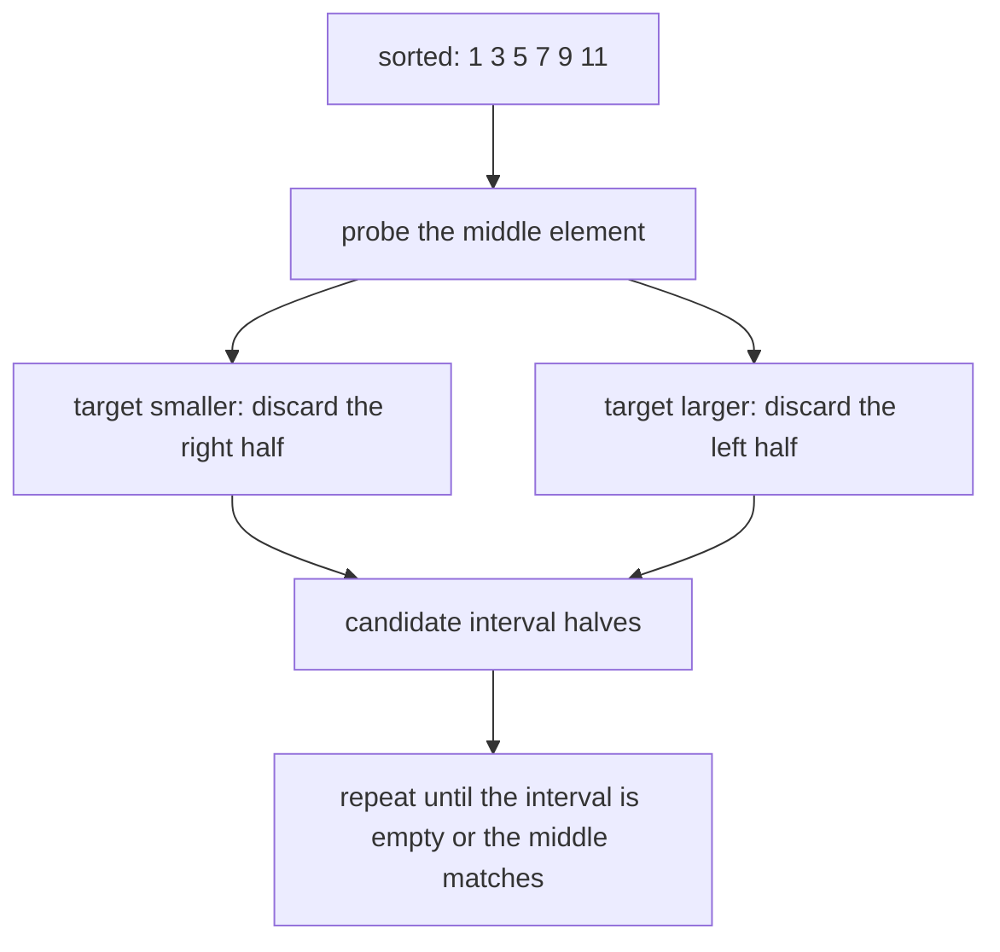
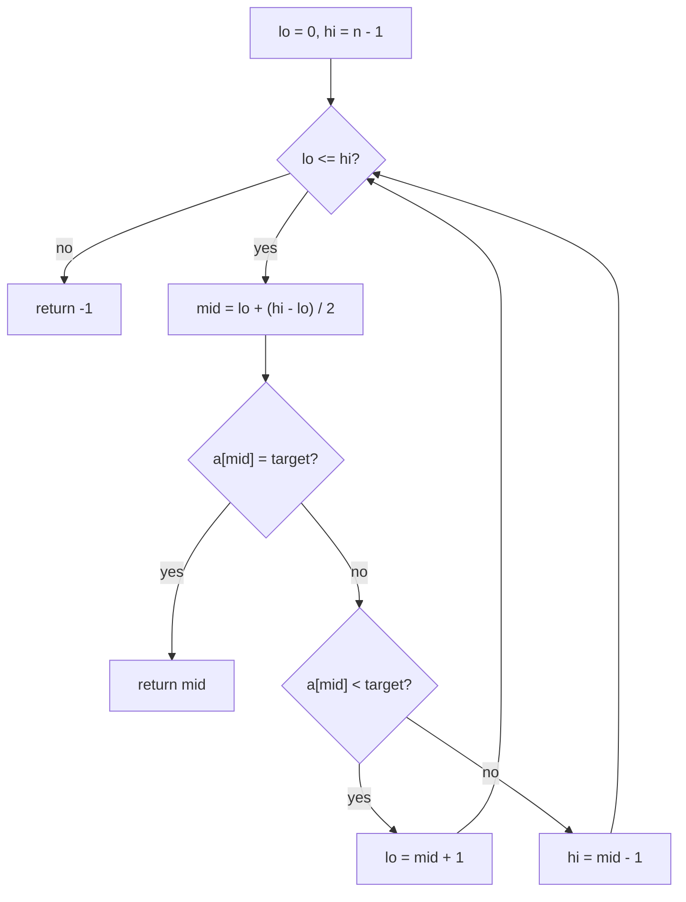
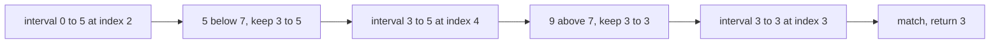
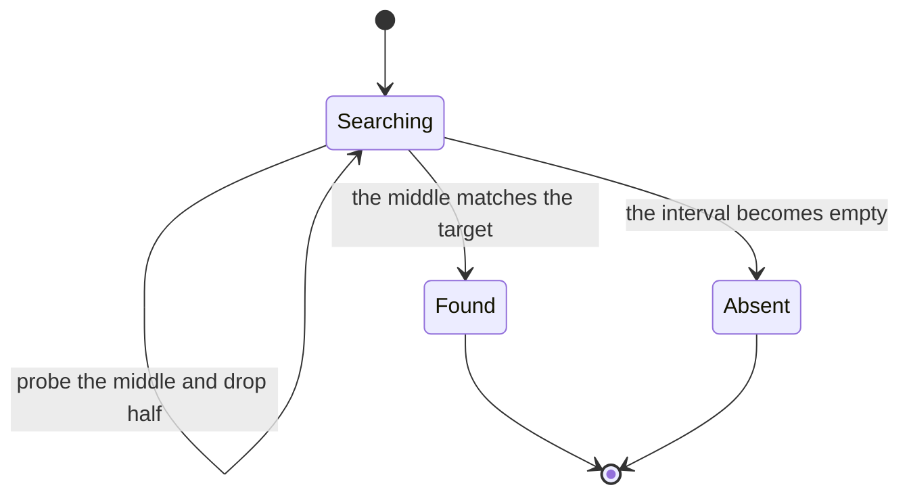

# 075 — Binary search iterative on sorted array.

> **Tier:** Beginner · **CTCI chapter:** Ch 10 — Sorting and Searching
> **Task spec:** [075-binary-search-iterative-on-sorted-array.md](../../../tasks/beginner/075-binary-search-iterative-on-sorted-array.md)
> **Solutions:** [Python](../../../solutions/python/beginner/075-binary-search-iterative-on-sorted-array/solution.py) ·
> [Java](../../../solutions/java/beginner/075-binary-search-iterative-on-sorted-array/Solution.java) ·
> [JavaScript](../../../solutions/javascript/beginner/075-binary-search-iterative-on-sorted-array/solution.js) ·
> [C#](../../../solutions/csharp/beginner/075-binary-search-iterative-on-sorted-array/Solution.cs)

## 1. Problem restatement

**Input.** A sorted array `a` of distinct integers and a `target` value. Sortedness is a promise, not
something the algorithm verifies.

**Output.** The index of the target, or `-1` if it is absent. The loop must handle the empty array and
targets smaller or larger than everything in the array.

| Call | Result | What it checks |
| --- | --- | --- |
| `binary_search([1, 3, 5, 7, 9, 11], 7)` | `3` | a hit in the middle |
| `binary_search([1, 3, 5, 7, 9, 11], 1)` | `0` | the first element |
| `binary_search([1, 3, 5, 7, 9, 11], 11)` | `5` | the last element |
| `binary_search([1, 3, 5, 7, 9, 11], 4)` | `-1` | an absent value between two elements |
| `binary_search([], 5)` | `-1` | the empty array |

All five rows are asserted in the Python file, and all four files assert the first three, the absent
case and the empty array.

## 2. Intuition

A linear scan asks one question per element: "is this the target?" On `n` elements that is up to `n`
questions, and it ignores the single most valuable fact available — the array is sorted.

The insight is that a single comparison against the middle element can eliminate **half** of the whole
array. If `a[mid]` is less than the target, then every element at or before `mid` is also less (the
array is sorted), so the target cannot be in the left half, and the search can continue on the right
half alone. If `a[mid]` is greater, the mirror argument eliminates the right half. So each probe halves
the candidate interval:

    n  →  n/2  →  n/4  →  ...  →  1

The number of halvings needed to get from `n` to `1` is `log n`, which is the whole point of binary
search: a thousand elements need at most ten probes, a million need at most twenty, and a billion need
at most thirty. The cost grows so slowly that the data structure matters more than the constant factor.

The implementation detail that makes it work is the **invariant**: the target, if it exists at all, is
always inside the closed interval `a[lo .. hi]`. Every branch of the loop either returns an index inside
that interval or shrinks it — `lo = mid + 1` or `hi = mid - 1` — so the interval can never contain the
target's old position and the loop must terminate.



## 3. Algorithm

1. Set `lo = 0` and `hi = n - 1`, the closed interval that may still contain the target.
2. While `lo <= hi`:
3. Compute `mid = lo + (hi - lo) / 2`, with integer division.
4. If `a[mid]` equals the target, return `mid`.
5. If `a[mid]` is less than the target, set `lo = mid + 1`.
6. Otherwise set `hi = mid - 1`.
7. If the loop ends, the interval is empty and the target is absent: return `-1`.

```text
function binary_search(a, target)
    lo ← 0
    hi ← length(a) - 1
    while lo <= hi do
        mid ← lo + (hi - lo) / 2
        if a[mid] = target then
            return mid
        end
        if a[mid] < target then
            lo ← mid + 1
        else
            hi ← mid - 1
        end
    end
    return -1
end
```

Two things about step 3 deserve attention. It writes the middle as `lo + (hi - lo) / 2` rather than the
algebraically identical `(lo + hi) / 2`, because the latter can overflow a fixed-width integer when the
array is large — the sum of two indices near the end of a huge array can exceed the type's maximum.
And the division must be integer division: in Python that is `//`, in Java and C# it follows from the
operand types, and the JavaScript file uses `>> 1`.

Termination is worth checking rather than assuming. Since `lo <= hi` inside the loop, `mid` lies in
`[lo, hi]`; the branch that keeps searching sets `lo = mid + 1`, which is strictly greater than the old
`lo`, or `hi = mid - 1`, which is strictly smaller than the old `hi`. Either way the interval shrinks,
so the loop cannot run forever.



## 4. Worked example

Search for `7` in `a = [1, 3, 5, 7, 9, 11]`, so `n = 6` and the interval starts as `[0, 5]`.

| Probe | `lo` | `hi` | `mid` | `a[mid]` | Comparison | Next interval |
| --- | --- | --- | --- | --- | --- | --- |
| 1 | `0` | `5` | `2` | `5` | `5 < 7` | `[3, 5]` |
| 2 | `3` | `5` | `4` | `9` | `9 > 7` | `[3, 3]` |
| 3 | `3` | `3` | `3` | `7` | equal | return `3` |

Three probes for six elements, and the interval went from size `6` to `3` to `1`. Probe 2 is the
interesting one: `mid` is computed as `3 + (5 - 3) / 2 = 3 + 1 = 4`, so the midpoint of an even-length
interval rounds towards the start of the interval, never past it.

Now the absent case, target `4` on the same array:

| Probe | `lo` | `hi` | `mid` | `a[mid]` | Comparison | Next interval |
| --- | --- | --- | --- | --- | --- | --- |
| 1 | `0` | `5` | `2` | `5` | `5 > 4` | `[0, 1]` |
| 2 | `0` | `1` | `0` | `1` | `1 < 4` | `[1, 1]` |
| 3 | `1` | `1` | `1` | `3` | `3 < 4` | `[2, 1]` |
| — | `2` | `1` | — | — | `lo > hi`, loop ends | return `-1` |

The last row is the termination condition doing its job: after probe 3 the interval is `[2, 1]`, which
is empty, so the target is known to be absent. The number of probes is the same as in the successful
case, which is the point of the `O(log n)` bound — an unsuccessful search is not cheaper.





## 5. Complexity

Let `n` be the length of the array.

| Measure | Bound | Why it holds |
| --- | --- | --- |
| Time, best | `O(1)` | the first probe may hit the target, as it does only for the middle element |
| Time, average | `O(log n)` | each probe halves the candidate interval |
| Time, worst | `O(log n)` | at most `floor(log n) + 1` probes before the interval is empty |
| Time, unsuccessful search | `O(log n)` | the interval must still be driven to empty |
| Space | `O(1)` | two indices and a midpoint; nothing is allocated |
| Mutations | none | the array is only read, so the sorted order is preserved |
| Alternative: linear scan | `O(n)` time, `O(1)` space | no sortedness needed, but `n` probes instead of `log n` |
| Alternative: recursive search | `O(log n)` time, `O(log n)` stack | task 076 |

The comparison count is what makes binary search the default for lookups: the halving means the cost
grows by one probe each time the input size doubles, while a linear scan's cost doubles with it.

## 6. Pitfalls and edge cases

- **An unsorted array is not detected.** The algorithm cannot tell that the promise was broken; it
  simply returns an arbitrary wrong answer. `binary_search` is only correct on sorted input, so a caller
  that receives arbitrary data must sort it first — tasks 068 to 073 are the options.
- **Overflow in `(lo + hi) / 2`.** For arrays whose length approaches a type's maximum, the sum
  overflows and `mid` becomes negative. All four files write `lo + (hi - lo) / 2`, which cannot
  overflow because the interval's width is at most the array length. The Python file calls this out in
  its docstring.
- **Mixing the two interval conventions.** This file uses the closed interval `[lo, hi]` with `lo <= hi`
  as the loop condition and `hi = mid - 1`. Task 077 uses the half-open interval `[lo, hi)` with
  `lo < hi` and `hi = mid`. Both work; a mixture of the two is the classic infinite loop, because the
  update no longer strictly shrinks the interval.
- **Duplicates.** With more than one copy of the target present, this search returns *whichever* index
  its probes happen to hit, which is not specified by the contract. When the exact position matters,
  use the lower-bound and upper-bound searches of
  [077-find-first-occurrence-of-target-in-sorted-array-with-duplicates.md](../../../tasks/beginner/077-find-first-occurrence-of-target-in-sorted-array-with-duplicates.md)
  and [078-find-last-occurrence-of-target-in-sorted-array-with-duplicates.md](../../../tasks/beginner/078-find-last-occurrence-of-target-in-sorted-array-with-duplicates.md).
- **Empty array.** `hi` starts at `-1`, so `lo <= hi` is false immediately and the function returns
  `-1` without any special case. Java and C# assert this; Python and JavaScript assert it too.
- **Off-by-one on the boundaries.** The first and last elements are the two easiest rows to get wrong,
  which is exactly why all four files assert both. `hi = n` instead of `n - 1` with a closed interval
  reads one element past the end.
- **Membership versus position.** If the caller only needs "is it there", the same loop works but the
  early return in the middle branch is all that matters; the index is free information here.

## 7. Variants and follow-ups

- **Recursive form.** [076-binary-search-recursive.md](../../../tasks/beginner/076-binary-search-recursive.md)
  expresses the same halving as a recursion, with `O(log n)` stack space instead of `O(1)`.
- **First and last occurrence.** [077-find-first-occurrence-of-target-in-sorted-array-with-duplicates.md](../../../tasks/beginner/077-find-first-occurrence-of-target-in-sorted-array-with-duplicates.md)
  and [078-find-last-occurrence-of-target-in-sorted-array-with-duplicates.md](../../../tasks/beginner/078-find-last-occurrence-of-target-in-sorted-array-with-duplicates.md)
  replace the three-way comparison with a two-way one, which pins down the boundary of a run of equal
  values.
- **Insertion position.** [079-find-insert-position-for-target-in-sorted-array.md](../../../tasks/beginner/079-find-insert-position-for-target-in-sorted-array.md)
  drops the equality check entirely and returns the insertion point of a missing key.
- **Producing the sorted order.** [068-heapsort-using-heap-operations.md](../../../tasks/beginner/068-heapsort-using-heap-operations.md)
  and the quadratic sorts of this tier are what make binary search applicable in the first place.
- **Search on a different shape.** A balanced binary search tree offers the same `O(log n)` lookup
  while allowing insertions; the comparison binary search of a linear structure cannot.
- [Sorting and Searching](../../ctci/10-sorting-and-searching.md) covers the search half of the chapter.

## 8. Check yourself

1. Why is `lo + (hi - lo) / 2` preferred over `(lo + hi) / 2`?

<details><summary>Show answer</summary>

They are algebraically equal, but the sum can overflow in fixed-width integer types when both indices
are large — for an array near the maximum length, `lo + hi` may exceed the type's range and produce a
negative `mid`. Computing the width first and adding half of it to `lo` keeps every intermediate value
within the array's index range.

</details>

2. How many probes does an unsuccessful search of a million-element array need at most?

<details><summary>Show answer</summary>

About twenty. Each probe halves the interval, and `2^20` is a little over a million, so around twenty
halvings drive the interval to empty. The successful case costs the same order, which is why binary
search is described as `O(log n)` for both outcomes.

</details>

3. What invariant does the loop maintain, and which lines keep it true?

<details><summary>Show answer</summary>

That the target, if present, lies inside `a[lo .. hi]`. The two updates keep it: `lo = mid + 1` is safe
because `a[mid] < target` and the array is sorted, so every index up to `mid` can be discarded; `hi =
mid - 1` is the mirror argument for `a[mid] > target`.

</details>

4. What happens if the array is not sorted?

<details><summary>Show answer</summary>

The halving argument collapses, because "everything to the left of `mid` is smaller" is no longer true.
The loop still terminates and still returns an index or `-1`, so the failure is silent — it may report
a missing target as found at some index, or report a present target as missing.

</details>

5. With duplicates present, which index does this search return?

<details><summary>Show answer</summary>

Whichever copy its sequence of probes lands on first, which depends on the array length and the
positions of the copies. The contract says only "an index of a matching element". To get a defined
answer — the first or the last copy — you need the lower-bound and upper-bound variants of tasks 077
and 078.

</details>
