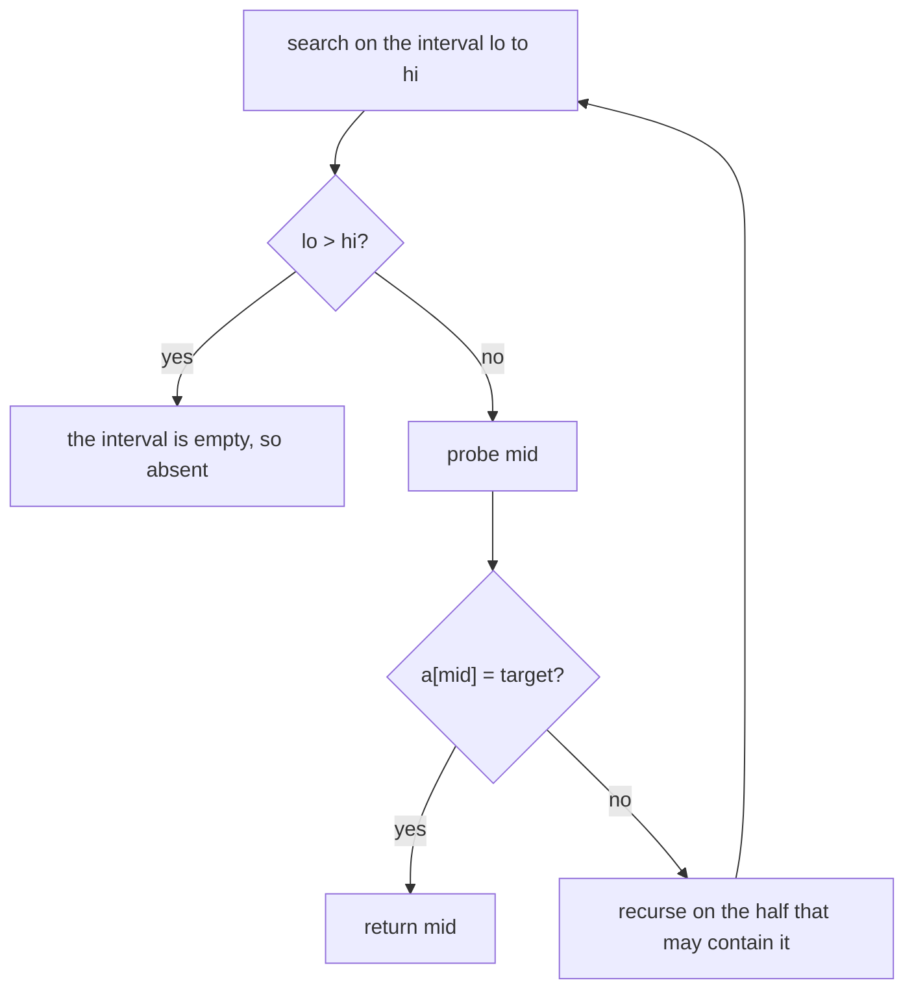
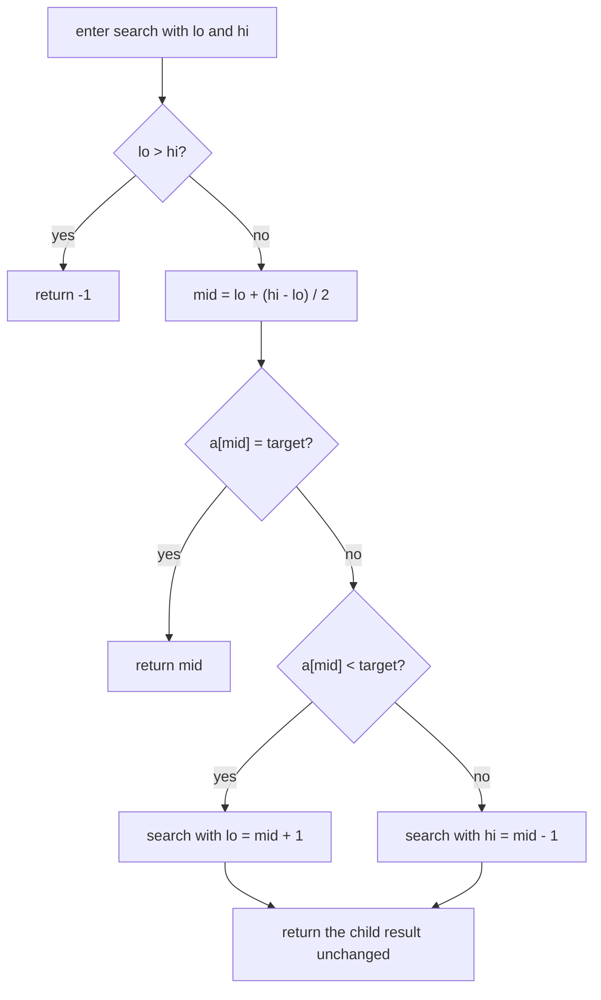
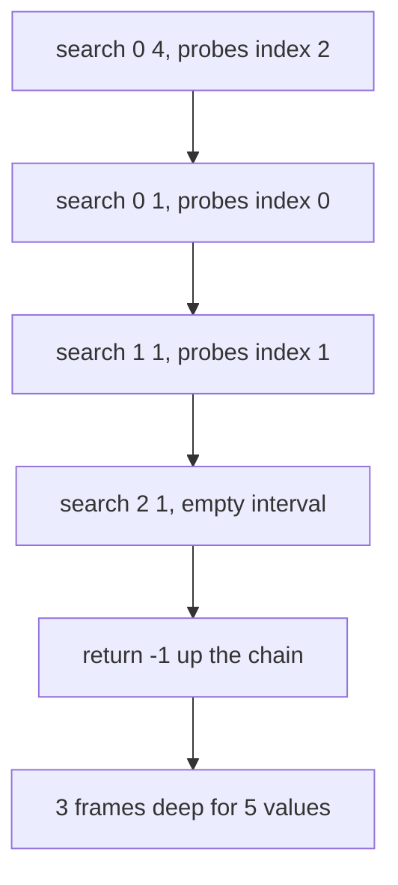
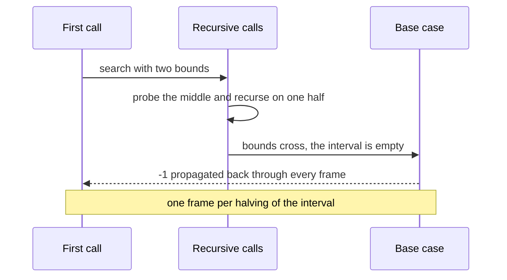

# 076 — Binary search recursive.

> **Tier:** Beginner · **CTCI chapter:** Ch 8 — Recursion and Dynamic Programming
> **Task spec:** [076-binary-search-recursive.md](../../../tasks/beginner/076-binary-search-recursive.md)
> **Solutions:** [Python](../../../solutions/python/beginner/076-binary-search-recursive/solution.py) ·
> [Java](../../../solutions/java/beginner/076-binary-search-recursive/Solution.java) ·
> [JavaScript](../../../solutions/javascript/beginner/076-binary-search-recursive/solution.js) ·
> [C#](../../../solutions/csharp/beginner/076-binary-search-recursive/Solution.cs)

## 1. Problem restatement

**Input.** A sorted array and a target value. The array is guaranteed sorted; nothing validates it.

**Output.** The index of the target, or `-1` if it is absent — the same contract as the iterative
search of task 075, expressed as a recursion whose only state is the pair of bounds.

| Call | Result | What it checks |
| --- | --- | --- |
| `binary_search_recursive([2, 4, 6, 8, 10], 8)` | `3` | a hit after one descent |
| `binary_search_recursive([2, 4, 6, 8, 10], 2)` | `0` | the first element, reached by the leftmost path |
| `binary_search_recursive([2, 4, 6, 8, 10], 10)` | `4` | the last element (asserted in Python) |
| `binary_search_recursive([2, 4, 6, 8, 10], 5)` | `-1` | absent, the interval must empty out |
| `binary_search_recursive([], 1)` | `-1` | the initial interval is already empty |

Java and C# assert the first, second, fourth and fifth rows; JavaScript asserts the first, an absent
value `1`, and the empty array; Python asserts all five.

The four files differ in how the bounds are passed. Python uses `lo=None` as a sentinel so that `hi` can
be derived from the array length, JavaScript uses default parameters, and C# pairs an expression-bodied
public wrapper with a private `Search` helper. Java has no default arguments at all, so its public
method is a one-line call into the recursive helper.

## 2. Intuition

Binary search is one comparison that eliminates half the input. The recursive form makes that elimination
explicit: the function's *state* is nothing but the interval `[lo, hi]` that may still contain the
target, and each call hands a strictly smaller interval to the next one.

The base case is what stops the descent, and it is not "found" — it is "the interval is empty". If
`lo > hi`, the candidate interval contains no indices at all, so the target cannot be present. A search
that only checks for a match would recurse forever on an absent target, because "smaller interval" is
not on its own enough: the interval shrinks until it is empty and then has to be recognised as such.

The whole algorithm is therefore four lines of structure:

- **base case:** `lo > hi` means absent;
- **probe:** compute `mid` and compare;
- **recurse:** on `[mid + 1, hi]` or `[lo, mid - 1]`, depending on the comparison;
- **return:** the value the recursive call produced, unchanged.

That last point is worth stating because it is where people go wrong: the recursion returns an *index*,
not a boolean, and the caller must propagate it without modifying it.



## 3. Algorithm

1. On the first call, set `lo = 0` and `hi = n - 1` if the caller did not supply bounds.
2. If `lo > hi`, return `-1` — the search has run out of candidates.
3. Compute `mid = lo + (hi - lo) / 2`.
4. If `a[mid]` equals the target, return `mid`.
5. If `a[mid]` is less than the target, recurse with `lo = mid + 1` and the same `hi`.
6. Otherwise recurse with the same `lo` and `hi = mid - 1`.
7. Return whatever the recursive call returned.

```text
function search(a, target, lo, hi)
    if lo > hi then
        return -1
    end
    mid ← lo + (hi - lo) / 2
    if a[mid] = target then
        return mid
    end
    if a[mid] < target then
        return search(a, target, mid + 1, hi)
    end
    return search(a, target, lo, mid - 1)
end

function binary_search_recursive(a, target)
    return search(a, target, 0, length(a) - 1)
end
```

The recursion is a pure tail-style descent: the returned value is either the current `mid` or whatever
the recursive call reports, and no work happens after the recursive call returns. That makes the
transformation to a loop mechanical — replace the recursive call with an assignment to `lo` or `hi` and
loop — which is exactly the iterative version of task 075.

One consequence of recursion is that the bounds must be threaded through every call. Java has no default
parameter values, so its file splits the API into a public one-argument method and a private helper that
carries `lo` and `hi`; Python works around the missing "default to the array length" with `lo=None` and
an explicit guard at the top.



## 4. Worked example

Search for `5` in `a = [2, 4, 6, 8, 10]`. The value is absent, so the trace has to reach the empty
interval — the base case that a match-only implementation would miss.

| Call | `lo` | `hi` | `mid` | `a[mid]` | Comparison | Next call |
| --- | --- | --- | --- | --- | --- | --- |
| `search(0, 4)` | `0` | `4` | `2` | `6` | `6 > 5` | `search(0, 1)` |
| `search(0, 1)` | `0` | `1` | `0` | `2` | `2 < 5` | `search(1, 1)` |
| `search(1, 1)` | `1` | `1` | `1` | `4` | `4 < 5` | `search(2, 1)` |
| `search(2, 1)` | `2` | `1` | — | — | `lo > hi`, base case | return `-1` |

The fourth call never computes a midpoint: its very first action is the base-case test. That is the
detail the table is here to show, and it is why the recursion cannot run away even though `5` never
appears in the array.

Now search for `8`, which is present, to see the successful path:

| Call | `lo` | `hi` | `mid` | `a[mid]` | Comparison | Result |
| --- | --- | --- | --- | --- | --- | --- |
| `search(0, 4)` | `0` | `4` | `2` | `6` | `6 < 8` | recurse right |
| `search(3, 4)` | `3` | `4` | `3` | `8` | equal | return `3` |

Two frames, and the value `3` travels straight back up the call chain — the single frame that found it
returns `3`, and the frame above it returns that same value, which is the "return the child result
unchanged" line of the pseudocode.

The recursion tree for the absent case shows why the depth is logarithmic: each level halves the
interval, and the branches are not explored in parallel — only one side of each split is visited.





## 5. Complexity

Let `n` be the length of the array.

| Measure | Bound | Why it holds |
| --- | --- | --- |
| Time, best | `O(1)` | if the target is at the middle, the first probe returns |
| Time, average | `O(log n)` | one probe per frame and one frame per halving |
| Time, worst | `O(log n)` | at most `floor(log n) + 1` frames before `lo > hi` |
| Space, call stack | `O(log n)` | each frame keeps its own `lo`, `hi` and `mid` |
| Space, heap | `O(1)` | nothing is allocated |
| Frames, worst | about `log2(n) + 1` | a million elements gives roughly twenty frames |
| Alternative: iterative | `O(log n)` time, `O(1)` space | task 075, the same algorithm with the bounds in variables |

The important comparison with the iterative version is not time — both are `O(log n)` — but space. The
recursive form's memory grows with the input, slowly, but it grows; and because Python, the JVM and
.NET do not eliminate tail recursion reliably, that stack usage is real rather than theoretical.

## 6. Pitfalls and edge cases

- **The base case must be the empty interval.** Testing only for equality recurses forever on an absent
  target, since nothing else stops the descent. `lo > hi` is the condition to check, and it must come
  before `mid` is computed, because when the interval is empty there is no valid `mid`.
- **No default arguments in Java.** The Java file therefore hides the recursion behind a private helper.
  Python gets there differently: `lo=None` is checked at the top, because a default of `0` cannot express
  `hi = len(a) - 1` for an arbitrary array.
- **Bounds must be threaded, not recomputed.** Recursing with the same `lo` and `hi` — or with fresh
  ones from the array length — turns the search into an infinite recursion, or into a linear scan of the
  first half.
- **Return the child's result unchanged.** Writing `return search(...) == target` or dropping the
  `return` keyword changes the contract from an index to a boolean or to `None`. All four files return
  the index the frame produced.
- **Stack depth is logarithmic, not linear.** The recursion descends one frame per halving, so a million
  elements need about twenty frames. A recursive *linear* scan of the same array would need a million,
  which is the difference between a fine recursion and a stack overflow.
- **Empty array.** The first call computes `hi = -1`, and `lo > hi` is true immediately, so `-1` is
  returned without touching the array. All four files assert this.
- **Unsorted input is silent.** Like the iterative version, the recursion trusts sortedness and returns a
  wrong index rather than an error when the promise is broken.
- **Duplicates.** The frame that happens to probe one of several equal values returns its index; the
  ordering among copies is unspecified. Tasks 077 and 078 define first and last occurrence.
- **Overflow.** The midpoint is computed as `lo + (hi - lo) / 2` here for the same reason as in the
  iterative version, even though the recursion itself is not the risk.

## 7. Variants and follow-ups

- **The iterative twin.** [075-binary-search-iterative-on-sorted-array.md](../../../tasks/beginner/075-binary-search-iterative-on-sorted-array.md)
  is the same halving with `O(1)` space and no base case to remember.
- **Recursion discipline.** [012-compute-nth-fibonacci-using-recursion.md](../../../tasks/beginner/012-compute-nth-fibonacci-using-recursion.md)
  is the other recursion in this tier, and its exponential version shows what happens when the base case
  and the subproblem overlap are not both handled carefully.
- **First and last occurrence.** [077-find-first-occurrence-of-target-in-sorted-array-with-duplicates.md](../../../tasks/beginner/077-find-first-occurrence-of-target-in-sorted-array-with-duplicates.md)
  and [078-find-last-occurrence-of-target-in-sorted-array-with-duplicates.md](../../../tasks/beginner/078-find-last-occurrence-of-target-in-sorted-array-with-duplicates.md)
  are recursive searches whose answer depends on not stopping at the first match.
- **Insertion position.** [079-find-insert-position-for-target-in-sorted-array.md](../../../tasks/beginner/079-find-insert-position-for-target-in-sorted-array.md)
  returns `lo` when the interval empties, which is the recursive base case turned into a value.
- **The sorted input it needs.** [068-heapsort-using-heap-operations.md](../../../tasks/beginner/068-heapsort-using-heap-operations.md)
  or the simpler sorts in this tier produce the order binary search assumes.
- Chapter pointers: [Recursion and Dynamic Programming](../../ctci/08-recursion-and-dp.md) for the
  recursion, and [Sorting and Searching](../../ctci/10-sorting-and-searching.md) for the search itself.

## 8. Check yourself

1. What is the base case, and why is it not "the target was found"?

<details><summary>Show answer</summary>

The base case is `lo > hi`, an empty candidate interval. "Found" is a successful exit, not a stopping
condition: a target that is absent never triggers it, so the recursion needs a separate condition that
fires when there is nothing left to probe. When the interval is empty, the target provably cannot be in
the array.

</details>

2. How many frames are on the stack when the search of a million-element array fails?

<details><summary>Show answer</summary>

Roughly twenty, one per halving of the interval. Each frame stores its own `lo`, `hi` and `mid`, so the
memory grows logarithmically. That is why this recursion is safe where a recursive linear scan is not.

</details>

3. Why does the Java file need two methods while the Python file needs only one?

<details><summary>Show answer</summary>

Because Java has no default parameter values, so the recursive helper cannot default `lo` and `hi` from
the array length. The public one-argument method performs that initialisation and delegates. Python can
either follow the same pattern or — as its file does — accept `lo=None` and derive the bounds inside the
function.

</details>

4. What happens if the recursive call's return value is not propagated?

<details><summary>Show answer</summary>

The outer frame returns `None` (or its language's equivalent) even though an inner frame found the index.
Since the recursion returns an index rather than a boolean, every frame has to pass the child's answer
through unchanged.

</details>

5. Which line of the recursive version corresponds to the loop condition of the iterative version?

<details><summary>Show answer</summary>

`if lo > hi: return -1` corresponds to the iterative loop's `while lo <= hi` exit. When the interval is
empty the loop falls through to `return -1`; in the recursion the same condition is checked at the start
of each call and returns immediately.

</details>
