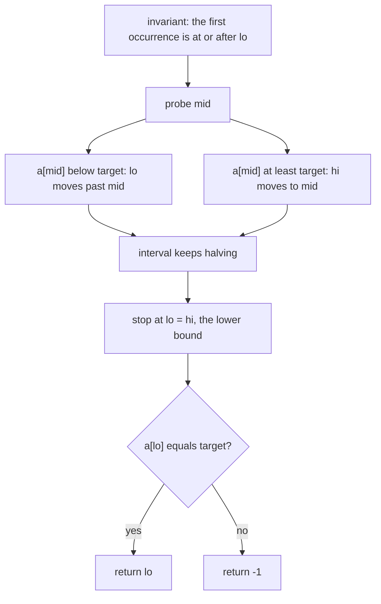
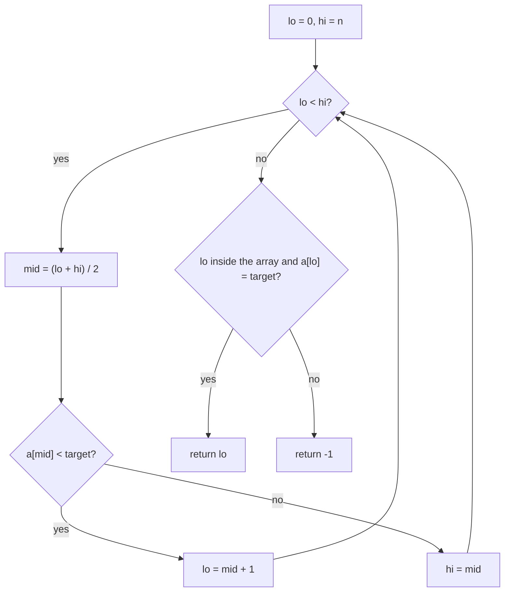
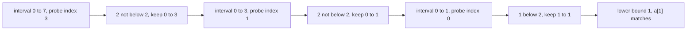
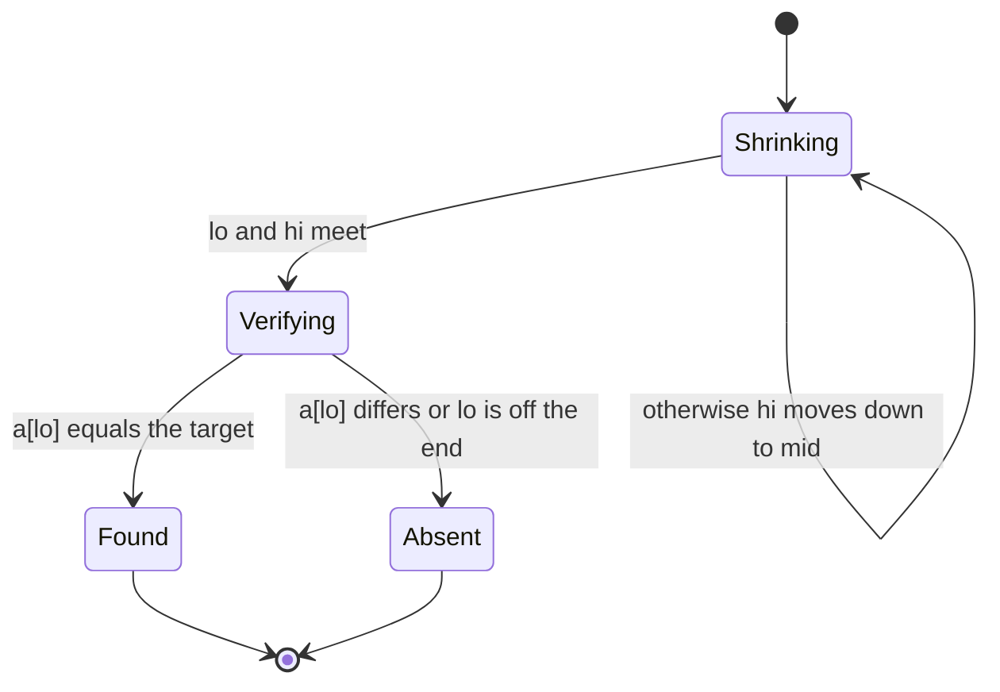

# 077 — Find first occurrence of target in sorted array with duplicates.

> **Tier:** Beginner · **CTCI chapter:** Ch 10 — Sorting and Searching
> **Task spec:** [077-find-first-occurrence-of-target-in-sorted-array-with-duplicates.md](../../../tasks/beginner/077-find-first-occurrence-of-target-in-sorted-array-with-duplicates.md)
> **Solutions:** [Python](../../../solutions/python/beginner/077-find-first-occurrence-of-target-in-sorted-array-with-duplicates/solution.py) ·
> [Java](../../../solutions/java/beginner/077-find-first-occurrence-of-target-in-sorted-array-with-duplicates/Solution.java) ·
> [JavaScript](../../../solutions/javascript/beginner/077-find-first-occurrence-of-target-in-sorted-array-with-duplicates/solution.js) ·
> [C#](../../../solutions/csharp/beginner/077-find-first-occurrence-of-target-in-sorted-array-with-duplicates/Solution.cs)

## 1. Problem restatement

**Input.** A sorted array that may contain the target value many times, and the target itself.

**Output.** The index of the **first** copy of the target, or `-1` if the value does not occur at all.
The plain binary search of task 075 is not enough: it returns whichever copy its probes happen to hit.

| Call on `a = [1, 2, 2, 2, 3, 4, 4]` | Result | What it checks |
| --- | --- | --- |
| `first_occurrence(a, 2)` | `1` | a run of three equal values in the middle |
| `first_occurrence(a, 4)` | `5` | a run of two equal values at the end |
| `first_occurrence(a, 1)` | `0` | a single copy at the very start |
| `first_occurrence(a, 9)` | `-1` | a value larger than everything in the array |
| `first_occurrence([], 1)` | `-1` | the empty array |

The first four rows are asserted in all four files, the last one in Python.

## 2. Intuition

The obvious fix for duplicates is to find *any* match with task 075's search and then walk left while the
previous element is equal. That works, but it destroys the `O(log n)` guarantee: an array of `n` copies
of the target makes the walk take `n - 1` steps, and the total collapses to `O(n)`. Worse, the worst case
is not an exotic input — "all values equal" is exactly the shape a benchmark produces.

The insight is that the early `return mid` is what throws the information away. Binary search does not
have to stop at the first match; it can **keep the match inside the interval and keep halving**, using
the equality case to shrink from the right instead of returning:

- if `a[mid] < target`, everything up to and including `mid` is too small — move `lo` past it;
- otherwise (`a[mid] >= target`), the first occurrence is at `mid` or *before* it — set `hi = mid`.

That two-way comparison collapses the interval to a single index `lo == hi`, and the invariant says that
index is the **lower bound**: the smallest position whose value is greater than or equal to the target.
For a target that occurs, that position *is* the first copy; for a target that does not occur, it is
where the target would have to be inserted. So one final check on `a[lo]` separates "found" from
"absent", and `-1` covers the second case.



The convention that makes this clean is the **half-open interval** `[lo, hi)`: `lo` starts at `0` and
`hi` at `n`, the loop runs while `lo < hi`, and `hi = mid` is a legal update even when `mid == lo`. A
closed interval would need care at the boundary, because `hi = mid - 1` could skip the very index being
searched for.

## 3. Algorithm

1. Set `lo = 0` and `hi = n`, an interval of candidate indices that always contains the lower bound.
2. While `lo < hi`:
3. Compute `mid = (lo + hi) / 2` with integer division.
4. If `a[mid] < target`, set `lo = mid + 1`.
5. Otherwise set `hi = mid`.
6. When the loop ends, `lo == hi` is the lower bound. Return `lo` if `lo` is a valid index and
   `a[lo] == target`, otherwise `-1`.

```text
function first_occurrence(a, target)
    lo ← 0
    hi ← length(a)
    while lo < hi do
        mid ← (lo + hi) / 2
        if a[mid] < target then
            lo ← mid + 1
        else
            hi ← mid
        end
    end
    if lo < length(a) and a[lo] = target then
        return lo
    end
    return -1
end
```

The loop terminates because `lo` strictly increases in one branch and `hi` strictly decreases in the
other, so the interval's width shrinks every iteration and reaches zero. And the check after the loop is
not defensive padding: without it the function would return an *insertion point* rather than `-1` for an
absent value, which is a different function — task 079 is exactly that function.



## 4. Worked example

Search for `2` in `a = [1, 2, 2, 2, 3, 4, 4]`, so `n = 7` and the interval starts as `[0, 7)`.

| Probe | `lo` | `hi` | `mid` | `a[mid]` | Comparison | Next interval |
| --- | --- | --- | --- | --- | --- | --- |
| 1 | `0` | `7` | `3` | `2` | not below `2` | `[0, 3)` |
| 2 | `0` | `3` | `1` | `2` | not below `2` | `[0, 1)` |
| 3 | `0` | `1` | `0` | `1` | below `2` | `[1, 1)` |
| — | `1` | `1` | — | — | loop ends, `lo == hi == 1` | `a[1] = 2` matches, return `1` |

Probe 1 lands on the *third* copy of `2`, and the algorithm does not return it: `hi` moves down to `3`,
keeping the first copy inside the interval. Probe 2 lands on the second copy and again shrinks from the
right. Only at probe 3 does the comparison come out "below", pushing `lo` past index `0` — and the
interval has collapsed to a single index, the first copy.

The absent cases show why the final verification is needed. Searching for `9` in the same array:

| Probe | `lo` | `hi` | `mid` | `a[mid]` | Next interval |
| --- | --- | --- | --- | --- | --- |
| 1 | `0` | `7` | `3` | `2` below `9` | `[4, 7)` |
| 2 | `4` | `7` | `5` | `4` below `9` | `[6, 7)` |
| 3 | `6` | `7` | `6` | `4` below `9` | `[7, 7)` |
| — | `7` | `7` | — | `lo` equals the array length | return `-1` |

The lower bound came out as `7`, one past the last index, and the guard `lo < n` catches it. The mirror
case is a target smaller than everything, such as `0`: every comparison "not below" pushes `hi` down until
`lo == hi == 0`, and then `a[0] = 1` fails the equality test, so the answer is `-1` rather than the
insertion point `0`.





## 5. Complexity

Let `n` be the length of the array.

| Measure | Bound | Why it holds |
| --- | --- | --- |
| Time, best | `O(log n)` | the interval halves even when the first probe is a match, because equality shrinks instead of returning |
| Time, average | `O(log n)` | one comparison and one bound update per probe |
| Time, worst | `O(log n)` | `floor(log2 n) + 1` probes at most, then the interval is empty |
| Space | `O(1)` | two bounds, a midpoint and one final comparison |
| Probes on the three-copy example | `3` for `n = 7` | the interval went `7 → 3 → 1 → 0` |
| Alternative: search then walk left | `O(n)` worst | task 075 plus a loop; degenerates to `n` steps on equal elements |
| Alternative: linear scan | `O(n)` | no sortedness needed |
| Related bounds | first and last together give the count | `last - first + 1` copies (task 078) |

The reason the best case is still `O(log n)` is worth repeating, because it is the difference between
this search and task 075's: finding the value is not the goal, pinning down its *leftmost* position is,
and that position can only be confirmed once the interval has no room left.

## 6. Pitfalls and edge cases

- **Dropping the final check.** Without `a[lo] == target`, the function returns the lower bound for every
  input, so `first_occurrence(a, 9)` would report `7`. The verification is the only thing separating
  "first index of the target" from "insert position" (task 079).
- **Using `hi = mid - 1` in the else branch.** In a half-open interval with `lo < hi`, the equality-safe
  update is `hi = mid`. Setting `hi = mid - 1` can skip the index that holds the first occurrence. The
  closed-interval version of the same idea has to be written differently, which is why the two
  conventions should not be mixed.
- **The guard needs both halves.** `lo < n` protects the array access when the lower bound fell off the
  end, and the equality test handles a lower bound that landed on a larger value. Both are needed — the
  absent example above exercises the first, a target smaller than everything exercises the second.
- **Empty array.** `hi = 0`, so the loop never runs, `lo = 0` is not `< 0 = n`, and the answer is `-1`.
  The Python file asserts this.
- **Duplicates are the whole point.** On an array of `n` copies of the target, this search still takes
  `log n` probes: the interval always keeps the leftmost copy, so each probe halves the run.
- **Midpoint arithmetic.** The four files write `(lo + hi) / 2`. That form is safe while `lo + hi` fits
  the integer type — with `hi <= n` this holds for any realistic array — but the overflow-proof
  `lo + (hi - lo) / 2` used by task 075 removes the question entirely and is the better habit.
- **The interval convention is not visible in the signature.** `hi` starting at `n` and not `n - 1` is
  the tell-tale of a half-open interval. Mixing it with `a[hi]` accesses is an out-of-bounds bug.
- **First and last are different functions.** This one moves `hi` on equality; task 078 moves `lo` and
  subtracts one at the end. Using the same code for both is the usual way to get one of them wrong.

## 7. Variants and follow-ups

- **Last occurrence.** [078-find-last-occurrence-of-target-in-sorted-array-with-duplicates.md](../../../tasks/beginner/078-find-last-occurrence-of-target-in-sorted-array-with-duplicates.md)
  is the upper-bound mirror image; together they give the number of copies as `last - first + 1`.
- **Insertion position.** [079-find-insert-position-for-target-in-sorted-array.md](../../../tasks/beginner/079-find-insert-position-for-target-in-sorted-array.md)
  is this loop **without** the verification step, and the task spec says so explicitly.
- **The plain search.** [075-binary-search-iterative-on-sorted-array.md](../../../tasks/beginner/075-binary-search-iterative-on-sorted-array.md)
  returns any copy and is cheaper in the best case, because it can stop early.
- **The recursive form.** [076-binary-search-recursive.md](../../../tasks/beginner/076-binary-search-recursive.md)
  shows how to express the same shrinking interval as a recursion.
- **A sorted array to search.** [068-heapsort-using-heap-operations.md](../../../tasks/beginner/068-heapsort-using-heap-operations.md)
  and the quadratic sorts of this tier produce the order this search assumes.
- **Bounding a value.** The same lower-bound trick answers "how many elements are below `x`" — which is
  the query behind prefix sums for sorted data,
  [081-compute-prefix-sums-for-an-array.md](../../../tasks/beginner/081-compute-prefix-sums-for-an-array.md).
- [Sorting and Searching](../../ctci/10-sorting-and-searching.md) frames repeated queries on sorted data.

## 8. Check yourself

1. Why does this search not return as soon as it sees the target?

<details><summary>Show answer</summary>

Because seeing the target proves only that *a* copy is at that index, not that it is the first one. The
equality case therefore has to shrink the interval towards the left and keep going. Returning early
would leave the caller with an arbitrary copy, and adding a leftward walk afterwards would degrade the
worst case to `O(n)` on an array of equal values.

</details>

2. What exactly does `lo` mean when the loop ends?

<details><summary>Show answer</summary>

It is the lower bound: the smallest index whose value is greater than or equal to the target. If the
target occurs, `a[lo]` is the first copy. If it does not, `lo` is where the target would be inserted to
keep the array sorted — which is why the function has to check `a[lo]` before it answers.

</details>

3. Why is the interval written as `[lo, hi)` instead of `[lo, hi]`?

<details><summary>Show answer</summary>

Because the update `hi = mid` must be legal even when `mid == lo`, which is the case for an interval of
width one. With a half-open interval that update is always a strict shrink and the loop terminates
cleanly. In a closed interval the equivalent logic needs `hi = mid - 1` plus an extra stored candidate,
and mixing the two conventions is a common source of skipped elements.

</details>

4. How many probes does `first_occurrence` need on an array where every element equals the target?

<details><summary>Show answer</summary>

About `log n`. The interval keeps shrinking from the right — every probe says "not below the target" and
moves `hi` down — until it collapses onto index `0`. The run of equal values is never walked linearly, so
the cost stays logarithmic.

</details>

5. What is the number of copies of a value, given both this search and the last-occurrence search?

<details><summary>Show answer</summary>

`last - first + 1` when the value occurs. On `[1, 2, 2, 2, 3, 4, 4]` the first occurrence of `2` is `1`
and the last is `3`, so there are three copies. If either search returns `-1`, the count is zero.

</details>
