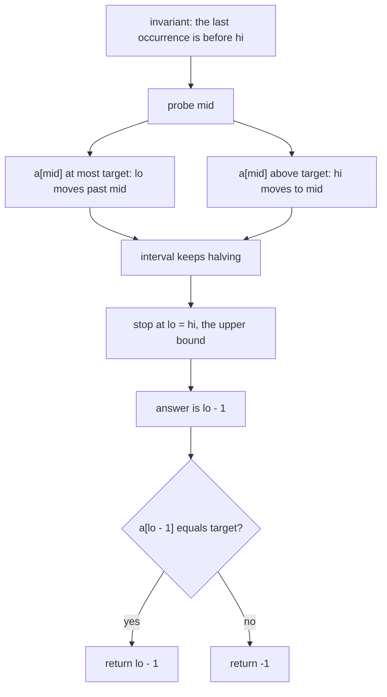
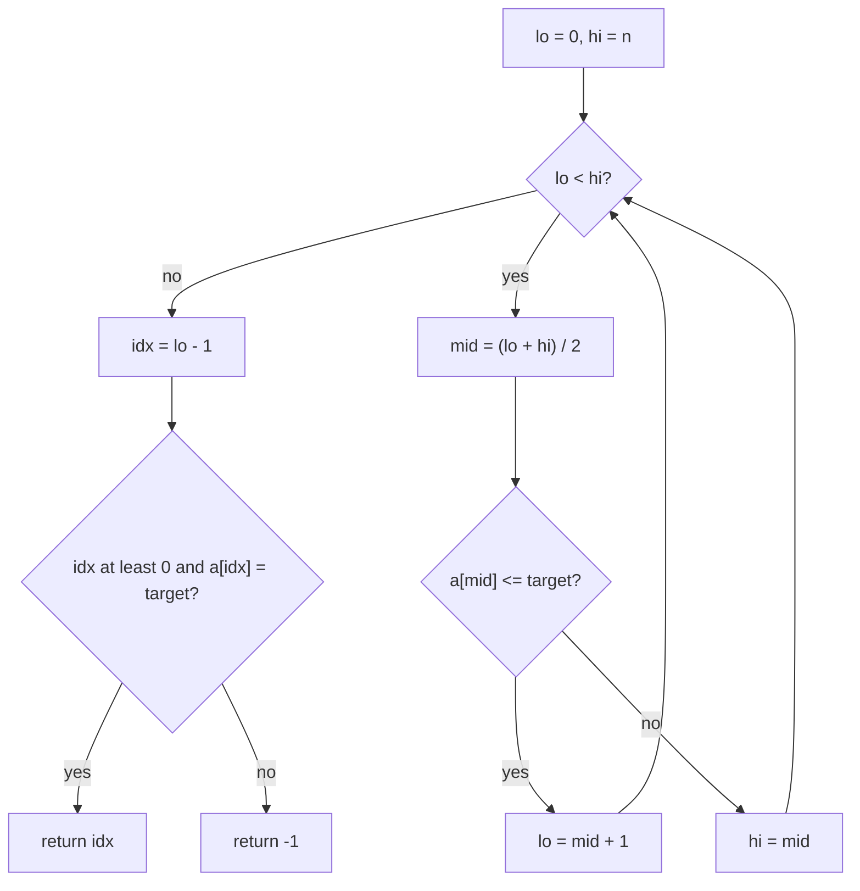
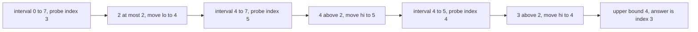
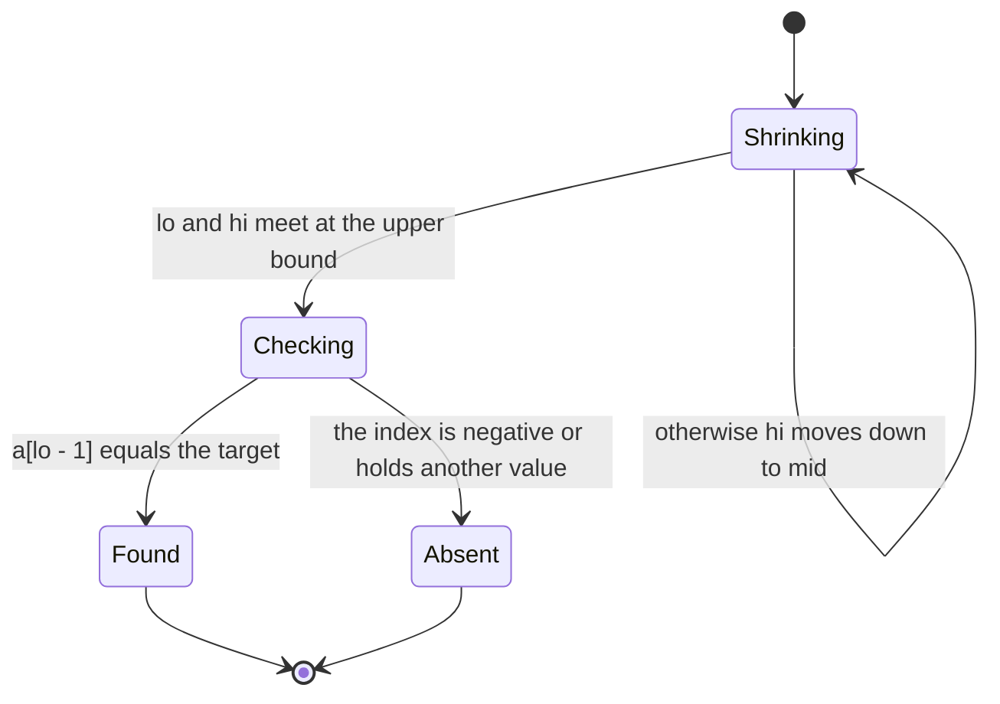

# 078 — Find last occurrence of target in sorted array with duplicates.

> **Tier:** Beginner · **CTCI chapter:** Ch 10 — Sorting and Searching
> **Task spec:** [078-find-last-occurrence-of-target-in-sorted-array-with-duplicates.md](../../../tasks/beginner/078-find-last-occurrence-of-target-in-sorted-array-with-duplicates.md)
> **Solutions:** [Python](../../../solutions/python/beginner/078-find-last-occurrence-of-target-in-sorted-array-with-duplicates/solution.py) ·
> [Java](../../../solutions/java/beginner/078-find-last-occurrence-of-target-in-sorted-array-with-duplicates/Solution.java) ·
> [JavaScript](../../../solutions/javascript/beginner/078-find-last-occurrence-of-target-in-sorted-array-with-duplicates/solution.js) ·
> [C#](../../../solutions/csharp/beginner/078-find-last-occurrence-of-target-in-sorted-array-with-duplicates/Solution.cs)

## 1. Problem restatement

**Input.** A sorted array that may contain the target several times, and the target itself.

**Output.** The index of the **last** copy of the target, or `-1` if the value does not occur.

| Call on `a = [1, 2, 2, 2, 3, 4, 4]` | Result | What it checks |
| --- | --- | --- |
| `last_occurrence(a, 2)` | `3` | the right end of a run of three equal values |
| `last_occurrence(a, 4)` | `6` | the last index of the array |
| `last_occurrence(a, 1)` | `0` | a single copy at the start, where the answer touches index `0` |
| `last_occurrence(a, 9)` | `-1` | a value larger than everything stored |

All four rows are asserted in all four files, and the Python file adds the empty-array case implicitly
through its guard (`idx >= 0` and the equality test both fail when the array is empty).

## 2. Intuition

Task 077 finds the *first* copy by shrinking from the right: on equality it moves `hi` down and keeps the
found position inside the interval. The mirror idea finds the last copy: on equality move `lo` **up**,
past the copy, and let the interval collapse on the position *after* the run.

The natural way to write that is the comparison `a[mid] <= target`:

- if `a[mid] <= target`, the last occurrence is at `mid` or *after* it — set `lo = mid + 1`;
- otherwise (`a[mid] > target`), the last occurrence must be before `mid` — set `hi = mid`.

This converges to the **upper bound**: the smallest index whose value is strictly greater than the
target. That index is one past the last copy, so the answer is `lo - 1`, checked against the array for
the case where the run does not exist.

The symmetry with task 077 is worth memorizing as a pair, because it is the same loop with two characters
changed:

| | first occurrence (task 077) | last occurrence (this task) |
| --- | --- | --- |
| comparison | `a[mid] < target` | `a[mid] <= target` |
| update when true | `lo = mid + 1` | `lo = mid + 1` |
| update when false | `hi = mid` | `hi = mid` |
| meaning of the result | lower bound | upper bound |
| final answer | `lo`, verified | `lo - 1`, verified |



## 3. Algorithm

1. Set `lo = 0` and `hi = n`, the half-open interval of candidate indices.
2. While `lo < hi`:
3. Compute `mid = (lo + hi) / 2` with integer division.
4. If `a[mid] <= target`, set `lo = mid + 1` — the run may continue to the right.
5. Otherwise set `hi = mid`.
6. When the loop ends, `lo` is the upper bound and the candidate answer is `idx = lo - 1`.
7. Return `idx` if `idx >= 0` and `a[idx] == target`, otherwise `-1`.

```text
function last_occurrence(a, target)
    lo ← 0
    hi ← length(a)
    while lo < hi do
        mid ← (lo + hi) / 2
        if a[mid] <= target then
            lo ← mid + 1
        else
            hi ← mid
        end
    end
    idx ← lo - 1
    if idx >= 0 and a[idx] = target then
        return idx
    end
    return -1
end
```

`idx` can be `-1` in exactly one situation — when the target is smaller than every element, so the upper
bound is `0` — and that is why the guard tests `idx >= 0` before touching the array. The equality test
means the algorithm never returns an index for a value that is not there.



## 4. Worked example

Search for `2` in `a = [1, 2, 2, 2, 3, 4, 4]`, so `n = 7` and the interval starts as `[0, 7)`.

| Probe | `lo` | `hi` | `mid` | `a[mid]` | Comparison with `2` | Next interval |
| --- | --- | --- | --- | --- | --- | --- |
| 1 | `0` | `7` | `3` | `2` | at most | `[4, 7)` |
| 2 | `4` | `7` | `5` | `4` | above | `[4, 5)` |
| 3 | `4` | `5` | `4` | `3` | above | `[4, 4)` |
| — | `4` | `4` | — | — | loop ends, upper bound `4` | `idx = 3`, `a[3] = 2` matches |

The first probe lands on the *third* copy of `2`; because the comparison is "at most", `lo` jumps past the
entire left portion to index `4`, and the interval then narrows onto the boundary just after the run. The
answer is one before it.

Searching for `4` in the same array exercises the other end:

| Probe | `lo` | `hi` | `mid` | `a[mid]` | Comparison with `4` | Next interval |
| --- | --- | --- | --- | --- | --- | --- |
| 1 | `0` | `7` | `3` | `2` | at most | `[4, 7)` |
| 2 | `4` | `7` | `5` | `4` | at most | `[6, 7)` |
| 3 | `6` | `7` | `6` | `4` | at most | `[7, 7)` |
| — | `7` | `7` | — | — | loop ends, upper bound `7` | `idx = 6`, `a[6] = 4` matches |

The upper bound came out as `7`, one past the last index, which is exactly what "there may be more copies
to the right" means at the end of the array.

Now the absent case, target `1`, which is present once and could produce `idx = -1`:

| Probe | `lo` | `hi` | `mid` | `a[mid]` | Comparison with `1` | Next interval |
| --- | --- | --- | --- | --- | --- | --- |
| 1 | `0` | `7` | `3` | `2` | above | `[0, 3)` |
| 2 | `0` | `3` | `1` | `2` | above | `[0, 1)` |
| 3 | `0` | `1` | `0` | `1` | at most | `[1, 1)` |
| — | `1` | `1` | — | — | loop ends, upper bound `1` | `idx = 0`, `a[0] = 1` matches, return `0` |

And the true absence, target `9`: every probe reports "at most", so `lo` climbs to `7` and `idx = 6`
holds `4`, which fails the equality test and yields `-1`. A target below everything, such as `0`, gives
the upper bound `0`, so `idx = -1` and the `idx >= 0` guard is what keeps the function from reading
`a[-1]`.





## 5. Complexity

Let `n` be the length of the array.

| Measure | Bound | Why it holds |
| --- | --- | --- |
| Time, best | `O(log n)` | the interval halves even when the first probe is a match, because the comparison still moves a bound |
| Time, average | `O(log n)` | one comparison and one bound update per probe |
| Time, worst | `O(log n)` | `floor(log2 n) + 1` probes, then the interval is empty |
| Space | `O(1)` | two bounds, a midpoint and one subtraction |
| Probes on the three-copy example | `3` for `n = 7` | the interval went `7 → 3 → 1 → 0` |
| Alternative: search then walk right | `O(n)` worst | the mirrored version of task 077's naive fix; `n` steps on equal elements |
| Alternative: both bounds | `2` searches of `O(log n)` | this search plus task 077 gives both ends, and the count is `last - first + 1` |

Both bounds cost the same, which is why the pair is usually implemented together: two `O(log n)` searches
answer "does the value occur", "where does it start", "where does it end" and "how many copies are there"
without ever scanning the run of duplicates.

## 6. Pitfalls and edge cases

- **`idx - 1` can be `-1`.** A target smaller than everything yields an upper bound of `0`, so the
  candidate index is negative. Every file checks `idx >= 0` before reading the array; with a negative
  index, Python would silently read from the end of the array and Java, JavaScript and C# would throw.
- **`<=` versus `<`.** This is the only line that differs from task 077. Using `<` computes the *lower*
  bound, and the answer becomes the index of the first copy — the wrong end of the run. Using `<=` and
  then forgetting the `- 1` gives the index just past the run, which is why the two changes ship together.
- **Equality must move `lo`.** Returning early on a match, or moving `hi` on equality, computes the first
  occurrence instead of the last. The direction of the move is the whole difference between the two
  searches.
- **The empty array.** `hi = 0`, so the loop never runs, `lo - 1` is `-1`, and the guard returns `-1`.
  No special case is required.
- **Duplicate runs stay logarithmic.** On an array of `n` copies of the target, every probe reports "at
  most" and `hi` is never touched; `lo` climbs to `n` in `log n` steps, and the answer is `n - 1`.
- **A run touching the end.** `idx` can equal `n - 1`, as the `4` example shows, so the verification must
  allow the last index — the guard is `idx >= 0`, not `idx < n - 1`.
- **Midpoint arithmetic.** The files write `(lo + hi) / 2`. With `hi <= n` the sum stays inside a 32-bit
  integer for any array that fits in memory, but `lo + (hi - lo) / 2` — the form used by task 075 — is
  the habit that never needs the argument.
- **First and last are not interchangeable.** Task 077's loop with this task's `- 1` appended returns an
  index one before the first copy, which is invalid or wrong. Keep the pair in mind as a unit: the same
  skeleton, a different comparison, and a different final adjustment.
- **The array must be sorted.** As with every binary search, an unsorted input produces a silently wrong
  index; nothing in the code detects it.

## 7. Variants and follow-ups

- **First occurrence.** [077-find-first-occurrence-of-target-in-sorted-array-with-duplicates.md](../../../tasks/beginner/077-find-first-occurrence-of-target-in-sorted-array-with-duplicates.md)
  is the lower-bound half of the pair; together they give the run's extent and its count.
- **Insertion position.** [079-find-insert-position-for-target-in-sorted-array.md](../../../tasks/beginner/079-find-insert-position-for-target-in-sorted-array.md)
  is the same lower bound without verification, and it is also the index at which a value larger than
  every existing target would be appended.
- **Plain binary search.** [075-binary-search-iterative-on-sorted-array.md](../../../tasks/beginner/075-binary-search-iterative-on-sorted-array.md)
  finds some copy and is the right tool when the position within the run does not matter.
- **Recursive formulation.** [076-binary-search-recursive.md](../../../tasks/beginner/076-binary-search-recursive.md)
  expresses the same shrinking interval as a recursion; the bound adjustments carry over unchanged.
- **Counting occurrences.** With both bounds in hand the count is arithmetic; the hash-based alternative
  for unsorted data is the counting idea behind
  [084-two-sum-using-hashmap.md](../../../tasks/beginner/084-two-sum-using-hashmap.md) and
  [089-implement-simple-frequency-histogram-integers.md](../../../tasks/beginner/089-implement-simple-frequency-histogram-integers.md).
- **Sorting first.** [072-count-sort-for-small-integer-range.md](../../../tasks/beginner/072-count-sort-for-small-integer-range.md)
  and [073-radix-sort-for-non-negative-integers.md](../../../tasks/beginner/073-radix-sort-for-non-negative-integers.md)
  produce ordered data in linear time, which is what makes these bounds cheap to apply.
- [Sorting and Searching](../../ctci/10-sorting-and-searching.md) covers the family of binary-search
  variants.

## 8. Check yourself

1. What does the search compute, and how is the final answer obtained from it?

<details><summary>Show answer</summary>

It computes the upper bound: the smallest index whose value is strictly greater than the target. The last
copy of the target is immediately before that index, so the answer is `lo - 1`, verified against `a` so
that an absent target still returns `-1`.

</details>

2. Which single character separates this search from the first-occurrence search?

<details><summary>Show answer</summary>

The equality case in the comparison. This search tests `a[mid] <= target`, task 077 tests `a[mid] <
target`. Because of that, equality here moves `lo` upward (looking for later copies) while there it moves
`hi` downward (looking for earlier ones). The bound updates themselves are identical.

</details>

3. Why is `idx >= 0` necessary, and when is it triggered?

<details><summary>Show answer</summary>

Because the upper bound is `0` when the target is smaller than every element of the array, making `lo - 1`
equal `-1`. Without the guard the code would index `-1`, which reads the last element in Python and throws
in Java, JavaScript and C#. A target that is simply absent but larger than the first element produces a
non-negative index that fails the equality test instead.

</details>

4. With both bounds available, how do you count the copies of a value?

<details><summary>Show answer</summary>

`last - first + 1`. On `[1, 2, 2, 2, 3, 4, 4]` the first and last occurrences of `2` are `1` and `3`, so
there are three copies. If either search returns `-1`, the count is zero — there is nothing to subtract.

</details>

5. Is this search faster than the first-occurrence search on an array of equal values?

<details><summary>Show answer</summary>

No, both are `O(log n)` and take about the same number of probes. The direction differs — this one only
ever moves `lo`, task 077 only ever moves `hi` — but each probe still halves the interval, so an array of
`n` equal values costs about `log n` steps in both cases.

</details>
